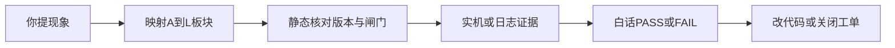

# 交付与检测 SOP（白话版）

> **基线扩展：4.1.45** · 修订 2026-09-13 · 板块 **L**  
> 关联：[`工作指导.md`](工作指导.md) · [`REQUIREMENTS.md`](REQUIREMENTS.md) §6 · [`obs/实机验收记录.md`](../unified-scheduler/obs/实机验收记录.md) · [`obs/4.1.45-上线验收单.md`](../unified-scheduler/obs/4.1.45-上线验收单.md)

---

## 0. 分工

| 角色 | 做什么 |
|------|--------|
| **你（需求方）** | 用大白话说现象/需求；按清单点几下、看面板；必要时贴截图或控制台结果 |
| **我（检测方）** | 定标准、跑检测、读日志/遥测、映射工作指导板块、给出结论与是否改代码 |

不要求你懂代码。结论一律用下方统一用语。

**判定用语：**

| 用语 | 含义 |
|------|------|
| **PASS** | 合格 |
| **FAIL** | 产品行为不合格，需按板块修代码 |
| **BLOCKED** | 环境挡路（未重载扩展、号池空、SCRM 闸门、OPS 挂了等），不算产品 FAIL |
| **NEED_YOU** | 缺你这边一手观察/账号操作，我无法单独判完 |

---

## 1. 矩阵闸门（调度交付）

必须达到短测门槛；长泡为加签。

| 闸门 | 白话合格标准 | 最短证据 |
|------|--------------|----------|
| **S1 不假死** | 自动跑时，不是「面板显示在跑其实已死」；调度还会继续轮转 | 短测 ≥30min 无幽灵 running；加签 ≥4h 浸泡 |
| **S2 不互抢** | 同一时刻不会关注和私信互相抢着跳页 | ≥30min；最多一个引擎真活 |
| **S3 能接上** | F5 / 切 tab 后该跑的能恢复；你点了暂停，刷新后仍暂停 | 刷新后 1–2 分钟内恢复或保持暂停 |
| **S4 后台生效** | OPS 改限额/间隔后，约 1 分钟内插件行为跟着变 | 改一项阈值 + 看间隔/日限变化 |

来源：`REQUIREMENTS.md` §6 · `ROADMAP.md` 现场手测。

---

## 2. 业务必测包（4.0.x 全面体检）

| 场景 ID | 白话该怎样 | 主要板块 | 验收记录对应 |
|---------|------------|----------|--------------|
| **B-Follow** | 能领号、点关注；一博主点完才换号 | B | A' / 关注主轴 |
| **B-SoftFill** | 约 15 次后进 **15–17 分**填窗；节奏 **私信→养号→私信→回关注**（粉丝页两检，禁收件箱） | B4 / A4 / C2 | B + C |
| **B-EarlyEnd** | ~~未满配额私信完立刻回关注~~ **已废**；chat2 完成后清窗回关注 | A4 | J |
| **B-HoldDebt** | ~~债 hold 扫箱~~ **已废**；债留给 chat2 / 下窗 promote | A4 / A5 | K |
| **C-IceOnly** | 新粉只发破冰，不首轮乱发 LINE 广告 | C2 | L |
| **C-Inbox** | 未读蓝点能被扫到，不轻易漏跳 | C3 | M |
| **C-PIN** | Passcode 能解；粉丝页不误判卡死破冰 | C6 | E |
| **C-AdAfterReply** | 有对方回复证据后才发广告 | C5 | D |
| **A-Defer** | 关注真轮进行中，私信让路（填窗除外） | A3 | A |

填写与证据采集见 [`unified-scheduler/obs/实机验收记录.md`](../unified-scheduler/obs/实机验收记录.md)。

### 2.2 检测类别对照（须一一对应，4.0.13+）

| 检测类别 | 对应场景 | 合格提示/信号 | 常见误判（已修） |
|----------|----------|---------------|------------------|
| 破冰气泡确认 | round0 发送后 | toast「破冰…」；`ice_sent` / `task_item_done` | 笼统「未确认」 |
| 广告气泡确认 | round1 / 补发 | toast「广告/补发广告…」；`ad_sent` | 已上屏仍 no_bubble |
| 催加气泡确认 | round2 | toast「催加…」；`kick_sent` | 含 emoji 短句漏检 → 跳粉丝页 |
| 婉拒气泡确认 | 低龄 | toast「婉拒…」 | 与催加提示串类 |
| OPS 记账 | 发送成功后 | 「已发出但后台记账失败」≠ 气泡未确认 | 两类混为一谈 |
| 会话页识别 | `/i/chat/<id>` 或 `peer-me` | step4 只退收件箱 | 单 ID URL 误跳粉丝列表 |
| 身份交叉校验 | 开会话（S4） | 正向证明才 step2；pending 静默等；仅真冲突 toast「不一致」 | 空身份放空通过 / 导航未就绪误报 |
| 黑名单/婉拒跳过 | 守箱不点进 | `skipped:reject` | 与面板 blacklist 混淆 |

### 2.3 破冰→守箱交接状态机（须逐步成立，4.0.16+）

| 阶段 | URL / 相位 | 必须为真 | 必须为空/假 |
|------|------------|----------|-------------|
| **S0** 破冰段 | `/{me}/followers`；`dan_chat_phase=outbound`；`!softRiskOutboundDone` | 软风控窗有效 | `current_target` 仅执行中短暂占用；无守箱脉冲键 |
| **S1** 破冰执行 | 资料/会话发破冰 | 队首 `doing` → 核对 done/skipped | — |
| **S2** 交接清场 | **列表根** `/i/chat`（无 peer）；`phase=inbox`；`softRiskOutboundDone=true` | 会话帽已 begin；`resetChatHandoffState` + 退尽 DM | **`current_target` / `dan_auto_step` / `dan_inbox_opening` / 探测队列 / 旧 ice DM 视图** |
| **S3** 守箱开人 | 列表可见；点行或直开 | `current_target === dan_inbox_opening` | **身份未确认前禁止 `dan_auto_step=2`** |
| **S4** 身份门 | `/i/chat/<peer>` 或带 composer 的会话 | **正向证明**：页头 handle=目标，或 urlPeerId=dbPeerId（均非空） | 空身份不得当 PASS；pending 只静默等待 |
| **S5** 业务 | 扫回复 / 发广告催加 | 仅 S4 通过后 | mismatch 只标 skipped，不污染 peerId |

**硬禁令（4.0.17+）：** 扫箱脉冲未结束（队列未封口/仍有 open/正在开人）时，**禁止**因「页面无响应」「无债」「step4」跳到 `/{me}/followers`；健康超时与 step4 只能回 **`/i/chat` 列表根**。整段守箱只允许在触底/帽满/`softRiskChatDone` 后由调度交回关注。

红/黄「会话与目标不一致」只允许出现在 **S4 真冲突**（header/peer 对不上）；**禁止**在导航未就绪时出现。

---

## 3. 你怎么提需求 / 报障

尽量带这 5 项（不会写也没关系，我会追问）：

1. **账号**（哪个 @）
2. **现象**（一句话 + 大概时间）
3. **期望**（你认为应该怎样）
4. **面板大概状态**（在关注 / 私信 / 养号 / 停着 / 不知道）
5. **能否重现**（每次都有 / 偶发）

**示例：**

> 账号 @foo；今天下午大概 3 点；软风控进了私信但一直空转不回关注；期望有债就继续聊、没债就回关注；面板好像停在养号；每次软风控后都这样。

---

## 4. 我怎么检测（固定顺序，不跳步）



1. 对照 [`工作指导.md`](工作指导.md) 定 **一级 + 二级板块**（禁止跨板块乱改）
2. 核对扩展版本 = **当前 manifest**、SCRM / 号池 / OPS 是否挡路
3. 取证据：面板、`__sgDiag`、测试监控导出、OPS `chat.inbox_scan_verdict` / telemetry（回扫读错见 [`私信回扫读错SOP.md`](私信回扫读错SOP.md)）
4. 用下方模板回复你

### 4.1 回复模板（固定结构）

```text
【结论】PASS / FAIL / BLOCKED / NEED_YOU
【白话原因】……
【板块】例如 A4 / C3（若需改码）
【证据】面板 / telemetry / 日志要点……
【要不要改码】是 / 否 / 先排环境
【你下一步】只需……（一句话动作）
```

### 4.2 改代码纪律

- 只动工作指导白名单板块
- 改完在 `工作指导.md` **§13** 记一笔
- 行为变更 bump `unified-scheduler/manifest.json`
- 不继续拆巨石文件（模块化已冻结）

---

## 5. 全面体检顺序

| 阶段 | 内容 | 谁做 |
|------|------|------|
| 0 | 本文 + 实机验收表与版本对齐 | 检测方 |
| 1 | 静态冒烟：manifest、模块挂载、关键路径抽查 | 检测方可独立 |
| 2 | 实机必测包（上表） | 需你账号配合 |
| 3 | 仅对 **FAIL** 按板块修并复测 | 需你确认后再动业务码 |

**第一轮不做：** ≥4h 的 S1 长泡（第二轮调度交付加签）。  
**不做：** 借体检名义跨板块顺手优化、继续拆文件。

### 5.1 你配合实机时的最小动作

1. Chrome 重载扩展，确认版本与 `manifest.json` 一致  
2. 开自动模式 + 测试监控 ON；SCRM 测试可临时放行（**测完改回**）  
3. 跑关注直到出现软风控填窗，观察破冰 → 扫箱  
4. 按提示贴面板截图，或控制台执行 `await __sgDiag()` / 导出测试监控 JSON  

---

## 6. 基线体检报告（附录位）

每次全面体检在本节或验收记录「最终结论」写清：

| 项 | 结果 |
|----|------|
| 扩展版本 | |
| 静态冒烟 | PASS / FAIL |
| 业务必测包 | __ / 9 PASS（其余 FAIL/BLOCKED/NEED_YOU） |
| S1–S4 短测 | 各闸门结果 |
| 是否进入修复 | 是 / 否 |
| 日期 | |

### 4.0.10 基线报告（2026-09-03）

| 项 | 结果 |
|----|------|
| 扩展版本 | **4.0.11** |
| 静态冒烟 | 见前次；本版新增任务队列（需重载后实机验） |
| 业务必测包 | 破冰/守箱改为「登记 N → 完成 M → 跳过 K」见 §2.1 |
| S1–S4 短测 | **NEED_YOU** |
| 是否进入修复 | 本版已合入队列制度（C2/C3） |

详情填写见 [`obs/实机验收记录.md`](../unified-scheduler/obs/实机验收记录.md)「最终结论」。

**你下一步（实机）：**

1. `chrome://extensions` 重载，确认 **4.0.10**  
2. 开自动模式 + 测试监控 ON；SCRM 测试可临时放行  
3. 跑到软风控填窗，观察破冰→扫箱  
4. 把面板截图或 `await __sgDiag()` / 监控导出贴回来 → 我按回复模板给每场景 PASS/FAIL  
