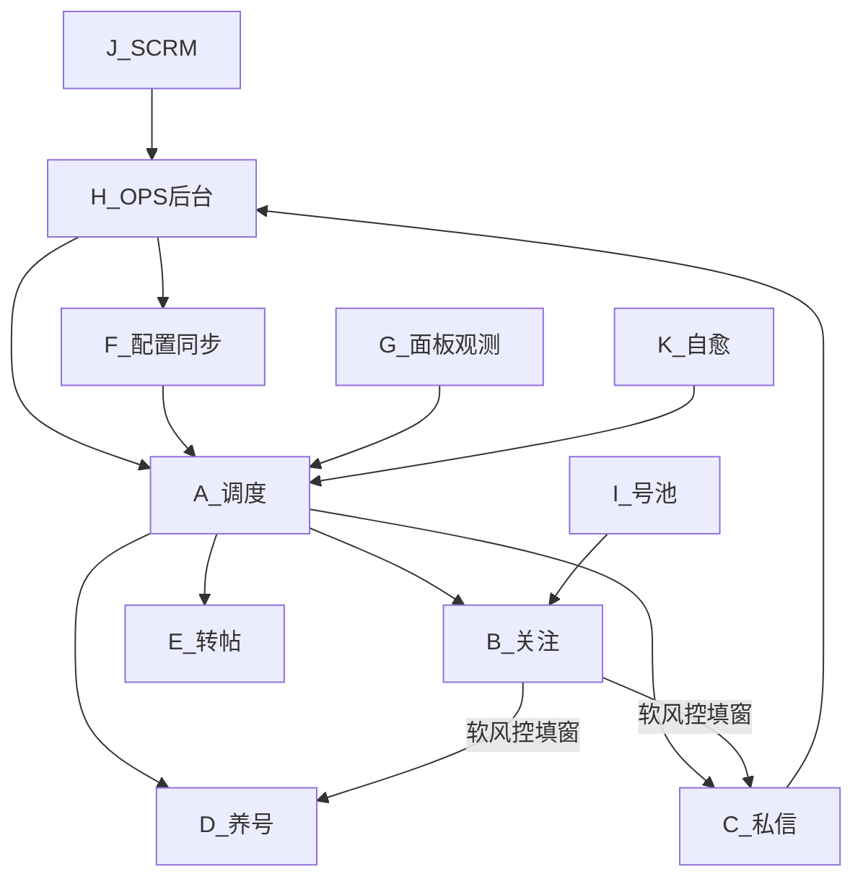

# 智能调度 · 工作指导（改码地图）

> **修订：2026-10-01 · 基线扩展 4.3.24**  
> **强制入口：** 先读 [`智能调度插件技术指导.md`](智能调度插件技术指导.md) **对应链 ID**（目的/链条/少跳页）→ 再读 [`调度工作手册.md`](调度工作手册.md) **子 ID** → 再读本文白名单。  
> **本文 = Where（改哪个文件）；手册 = 子板块细则；技术指导 = 宪法（必须遵守）。**  
> 相关：[`智能调度插件技术指导.md`](智能调度插件技术指导.md) · [`调度工作手册.md`](调度工作手册.md) · [`ARCHITECTURE.md`](ARCHITECTURE.md)

---

## 0. 怎么用这份指导

**以后每次开工（人或 Agent）都必须按下面顺序**，再动手。不要跳过。

1. 定需求 → 打开 [`智能调度插件技术指导.md`](智能调度插件技术指导.md) 找到 **唯一链 ID**（§4）；涉及导航先读 **§3 少跳页**。  
2. 打开 [`调度工作手册.md`](调度工作手册.md) **对应子 ID 全节**；跨板块先查手册 **§X 契约**。  
3. 回本文定 **一级 + 二级**，**只打开**列出的文件/锚点。  
4. 看清 **禁止顺手改**。  
5. 按技术指导该链「终态」+ 手册「验收」做完。  
6. 在本文件 **§13** 补一行（写清 **链 ID**、板块、做了什么）。

```
开工 → 技术指导链ID → 手册子ID → 本文白名单 → 只改一处 → 验收 → §13
```

**说不清链 ID → 禁止开工。**

**模块化冻结（2026-08-30）：** 现有独立文件已足够（见 §11）。**暂停继续物理拆分**巨石文件。

插件文件地图：[`unified-scheduler/README.md`](../unified-scheduler/README.md)。

---

## 1. 一级板块总览

| ID | 一级板块 | 职责一句话 | 主目录 |
|----|----------|------------|--------|
| A | 调度控制面 | 谁先跑、何时启停三引擎 | `unified-scheduler/scheduler-core.js` + `scheduler/` |
| B | 关注引擎 | 领号、点关注、软风控填窗 | `unified-scheduler/follow/` |
| C | 私信引擎 | 破冰/守箱/广告/PIN/年龄 | `unified-scheduler/chat/` |
| D | 养号引擎 | 刷首页点赞评论预算 | `unified-scheduler/nurture/` |
| E | 转帖引擎 | S0 定时转帖专场 | `unified-scheduler/repost/` |
| F | 配置同步 | OPS→插件阈值/阶段/开关 | `shared/config-sync.js` 等 |
| G | 面板与观测 | 面板、日志、测试监控、诊断 | `ui/` · `obs/` · `shared/telemetry.js` |
| H | 后台 OPS | 配置、账号、闸门、战报、分析 | `test-env/x-ops-console/` |
| I | 号池 | 博主任务队列 | `test-env/x-pool-service/` |
| J | SCRM 监控 | 客服在线爬取与 cookie | `test-env/scrm-monitor/` |
| K | 自愈与风控页 | CF验证、白屏 heal | `challenge-guard` · background heal |
| L | 文档与验收 | 路线图、SOP、验收记录 | `docs/` · `obs/*.md` |

**硬边界（全项目）：**

- 不做 worker lease / 心跳锁停引擎  
- 调度未稳不扩机  
- 自动模式下引擎禁止私自 `location.reload`（走 heal）  
- 改私信 DOM 识别 ≠ 改调度优先级；两处分开提

---

## 2. 板块依赖（改前先看箭头）



---

## 3. A · 调度控制面（细板块）

| 子 ID | 子板块 | 文件 / 锚点 | 可改内容 | 禁止顺手改 |
|-------|--------|-------------|----------|------------|
| A1 | 阶段与时段 | `scheduler/stage-detector.js` | S0–S4、work/chatHours；**Day≤2 养号优先排序（软），可直接关注**；**Day≥3 才私信** | 引擎内部发送逻辑 |
| A2 | 主循环启停 | `scheduler-core.js` `coTick` / `coStart*` | priority、软风控覆盖、赶工 | follow/chat 业务细节 |
| A3 | 关注优先/让路 | `applyFollowFirstInS3` · `shouldDeferChatForFollowCo` | S3 关注优先规则 | `content_chat` 守箱 DOM |
| A4 | 软风控优先级 | `applySoftRiskPriority` · `markSoftRiskChatPass*` | 窗内 **Day≥3：chat1→nurture→chat2→follow**；**Day1–2：只 nurture→follow**；预留 chat2；禁 hold/early_end 抢回 | `enterSoftRiskDiversion` 窗长（在 B4） |
| A5 | 私信策略闸 | `scheduler/chat-strategy.js` | SCRM/债/赶工策略对象 | SCRM 服务端闸门（在 H/J） |
| A6 | 时间预算 | `scheduler/time-budget.js` | 小时帽 | 日帽冷却阈值（在 F/H） |
| A7 | 门禁 | `shared/scheduler-gate.js` | 自动模式禁自启 | 引擎命令处理 |
| A8 | 诊断 whyIdle | `computeWhyIdle` · `__sgDiag` | 空闲文案 | 面板 DOM（在 G） |

**调度逻辑（必读）：** [`调度工作手册.md`](调度工作手册.md) **§A（A1–A8）** + **§X 契约**。实现审查附录：[`调度模块逻辑审查.md`](调度模块逻辑审查.md)（冲突以手册为准）。

**调度验收信号：** 见手册 §A 各节；面板引擎行切换合理；`scheduler.chat_blocked`；无双引擎抢导航；`round_start`/`round_complete`/`chat_zombie_reclaim`；`soft_chat_pass` / `soft_risk_round_end`。

---

## 4. B · 关注引擎（细板块）

主文件：`follow/content_follow_v1522.js`（巨石，按锚点改）

| 子 ID | 子板块 | 锚点 / 文件 | 可改内容 | 禁止顺手改 |
|-------|--------|-------------|---------|------------|
| B1 | 配额与阶梯 | 【配额与风控系统】 | 日限、间隔 | OPS 阈值键名（先改 H/F） |
| B2 | 号池领号 | **`follow/pool-api.js`**（`SgPoolApi` pop/fail/release/进度）；follow 薄封装 | pop/done/dead | 调度 coTick |
| B3 | 点击关注 | 【关注逻辑】【扫描页面】 | 按钮识别、已关注多语言 | 私信破冰 |
| B4 | 软风控填窗 | **`follow/soft-risk.js`** + **`shared/soft-fill-mode.js`** | 窗长 15–17；进场读 SoftFillMode；`chat_fill`→chat1，否则只养号 | 差集识别细节（C3） |
| B5 | 死号填窗 | `tryDeadSkipFillWindow` | 阈值、计数 | 调度超时路径以外逻辑 |
| B6 | 任务锁恢复 | keepTask / 回粉丝列表 | 休息后回原博主 | 释放锁时机误改 |
| B7 | 回关检测 | `follow/follow-back-detect.js` | 回关上报 | 效率分析页（H） |
| B8 | 推博主 | `follow/push_blogger.js` | 推送辅助 | 主循环 |

**关注业务逻辑（改 B 必读）：** [`调度工作手册.md`](调度工作手册.md) **§B（B1–B8）**；日龄/软窗相位见手册 **A1/A4** 与契约 **A4↔B4**。摘要：软风控唯一入口=平台风控条→15–17 分填窗；Day1–2 只养号；Day≥3 才 chat1→nurture→chat2；禁止超时/死号冒充软风控。

**验收：** 见手册 §B4 / §A4。

---

## 5. C · 私信引擎（细板块）

主文件：`chat/content_chat.js`（巨石，按锚点改）

| 子 ID | 子板块 | 锚点 | 可改内容 | 禁止顺手改 |
|-------|--------|------|---------|------------|
| C1 | 目标库 | **`chat/target-db.js`**（`SgTargetDb`） | 入库字段、round | 调度 priority |
| C2 | 破冰 outbound | 主巡航粉丝页分支 | 扫粉、发破冰 | 收件箱 DOM；**push 条属 B8** |
| C3 | 回复扫描 | **`chat/inbox-watch.js`**（差集硬门 + 列表 pick/预览打分已迁入；`runInboxWatchTick` 编排仍 register） | 预览差集、未读、会话检测（最高优先级）；软风控内一次脉冲 | 关注点击 |
| C4 | 年龄分流 | **`chat/age-parse.js`**（`SgAgeParse`） | 仅年龄数据解析（数字歳 + `24です`/`だよ`口语 + 明示未成年自称→低龄） | 模糊关键词婉拒（若い等，已废除勿加回） |
| C5 | 广告/婉拒发送 | **`chat/chat-gates.js`**（`canSendAdNow`/`canSendKickNow`）；发送确认仍在 content_chat；**job round1 只认愿不愿意** | 等回复证据；兼职意向闸（年龄不挡） | PIN 填框逻辑以外 |
| C6 | **DM Passcode** | **`chat/dm-pin.js`**（`SgDmPin`）；`content_chat` `bind` 宿主依赖 | 填码、重试、检测门 | 守箱排序、调度 |
| C7 | 话术与链接 | **链接：`chat/promo-links.js`**（`SgPromoLinks`）；话术池/DNA 仍在 content_chat；**兼职粉池** `chat_scripts_job.json` / `dan_scripts_job`（`chat_script_pool=dating\|job`） | 模板、{LINK}、池切换 | OPS 交友话术池结构（先 H）；job 池暂本地 |
| C8 | 冷却与日轮 | **`chat/chat-gates.js`**（`getChatIntervalCfg`/日帽） | 读配置 | 直接写死与 OPS 冲突 |
| C9 | 主巡航引擎 | 【主巡航引擎】 | 步进状态机 | 改完必须回归 C3/C6 |
| C10 | 诊断桥 | `debugTraceReplyChain` / `__sg*` | 排障工具 | 生产发送路径行为 |

**私信业务逻辑（改 C 必读）：** [`调度工作手册.md`](调度工作手册.md) **§C（C1–C10）** — 按子 ID 切开，禁止一次读整章后跨改。

| 改什么 | 手册节 |
|--------|--------|
| 名单封口/一人一条/跳过门闩/浅扫 | **C2** |
| 破冰后差集 / 禁历史灰泡 | **C3** |
| 年龄解析 | **C4** |
| AD/婉拒/拒绝记死/盾牌催加 | **C5** |
| PIN | **C6** |
| 话术池 dating/job | **C7** |
| 冷却日轮 | **C8** |
| 步进/回退/`/i/chat` | **C9** |
| 诊断 | **C10** |
| 时段/日龄/软窗时间片 | **A1 / A4**（契约，勿在 C 重写） |

实现审查附录：[`私信模块逻辑审查.md`](私信模块逻辑审查.md)（冲突以手册为准）。短扫/回扫 SOP 仍外链。

**验收：** 见手册 §C2/C3/C5；一窗一遍；拒绝永久 skipped；无回复不 AD；回 `/followers`。

---

## 6. D · 养号 · E · 转帖

| 子 ID | 板块 | 文件 | 说明 |
|-------|------|------|------|
| D1 | 养号引擎 | `nurture/nurture-engine.js` | 动作执行 |
| D2 | 养号预算 | `nurture-tracker.js` · `nurture-config.js` | 日/时预算 |
| D3 | 评论库 | `nurture-comments.js` | 文案 |
| E1 | 转帖执行 | `repost/repost-engine.js` | 发帖路径 |
| E2 | 转帖日程 | `repost-tracker.js` | 默认 06:00 开跑（不跟随下班）；Day1–4 每天 2 条、Day≥5 每天 1 条；成功间隔 **≥30 分钟**；已发 ID 不重复 |
| E3 | 资料克隆 | `repost/profile-clone.js` | Day≤2 养号前置；源页图进 BG+storage；apply 硬进设置页+纠偏；选横幅/头像 file input；未完成调度让路 |
| E4 | 转帖浮层 | `repost/repost-panel.js` | 粉色球面板（拉取 OPS 来源 / 手动转帖 / 克隆）；**勿再装独立 X Repost Engine** |

白天 priority **不含** repost；只走 S0 定时专场（到开跑时刻后跑，达 `dailyQuota` 或超时收工）。**默认凌晨 06:00**（`repost_follow_work_end=false`）：开跑点 &lt; 上班点时，仅 `[开跑, 上班)` 算已到点，避免晚间误触发。跟随下班时仍按 end 开跑；跨午夜仅适用于晚间开跑（start≥12）。**例外**：OPS `test24h` 或 **工作窗 end≥24** 永不进 S0，到期后仍独占拉起转帖。改 E 勿动 A2 白天逻辑（**例外**：E3 仅挂 `startNurture` 前置闸；test24h/全天工作专场闸见 A2）。

---

## 7. F · 配置同步

| 子 ID | 文件 | 职责 |
|-------|------|------|
| F1 | `shared/config-sync.js` | 拉 `/api/config/all` 写入 LS |
| F2 | `shared/remote-settings.js` | 统一读阈值 |
| F3 | `shared/storage-keys.js` | 键名唯一来源 |
| F4 | `shared/config.js` | 本地默认 |

改阈值键名必须：**H 阈值表 → F 映射 → 引擎读取** 三处同 PR，禁止只改一处。

常用键：`chat_dm_pin` · `chat_script_pool` · `chat_cooldown_*` · `chat_rounds_per_day` · `scrm_gate_*` · `follow_*` · `sg_stage_policy`。

---

## 8. G · 面板与观测

| 子 ID | 文件 | 职责 |
|-------|------|------|
| G1 | `ui/panel.js` | 调度面板主控 |
| G2 | `shared/ui_console.js` | 中控台（悬浮球已停用） |
| G3 | `shared/telemetry.js` | 事件上报 |
| G4 | `obs/test-monitor.js` | 测试监控 |
| G5 | `obs/event-catalog.json` | 事件中文目录 |
| G6 | `page-diag-bridge.js` | 主世界诊断桥 |
| G7 | `obs/*.md` | 运维说明 / SOP / 验收 |

改文案/按钮 ≠ 改业务状态机。观测事件 ID 变更要同步 G5 + H 告警。

---

## 9. H · OPS 后台（细板块）

| 子 ID | 路径 | 职责 |
|-------|------|------|
| H1 | `routes/api/config.js` | 阈值/阶段/模块 API |
| H2 | `routes/api/plugin.js` | 插件心跳、DM、telemetry |
| H3 | `routes/api/scrm.js` + `repositories/scrm-status-repo.js` | **私信闸门** |
| H4 | `routes/api/links.js` + `services/scrm-links-sync.js` | 推广链 ↔ 客服号 |
| H5 | `routes/api/monitor*.js` | 任务监控 / 运行日志 |
| H6 | `routes/pages/analytics*` | 效率分析 |
| H7 | `views/*.njk` | 页面展示 |
| H8 | `db/migrations*` | 表结构 |

闸门模式：`soft` / `strict` / `off`。  
**现行默认 `strict`**：无监控号 / 未找到 / 快照过期 / 客服离线 → **不放行私信**（含破冰）。`soft` 仅抗墙测试用；`off` 全放行仅临时。  
容器：`x-ops-console-*-test-1`，数据 `/vol2/1000/test/x-ops-console/data/`。

**远程指令白名单**（插件约 10s claim，禁止下发任意 JS）：`start` · `pause` · `reset_profile_media` · `reset_follow_daily_limit` · `reset_chat_local` · `clear_dead_handles`。新命令 = OPS 白名单三处 + A2 `claimRemote` 分支 + 账号页按钮。  
**重置私信（H · 交付清场）：** 账号页「重置私信」→ 服务端删该号 `dm_records` + leads 私信阶段回退 `followed_back`；可选勾选「同时清插件本地」下发 `reset_chat_local`。

---

## 10. I · 号池 · J · SCRM · K · 自愈

| ID | 说明 | 主路径 |
|----|------|--------|
| I1 | pool_pop/done/dead | `test-env/x-pool-service` · `:15678` |
| J1 | 爬虫与 cookie | `test-env/scrm-monitor` · `:3211` |
| J2 | cookie 扩展 | `scrm-monitor/cookie-sync-extension` |
| K1 | CF ChallengeGuard | `shared/challenge-guard.js` |
| K2 | 缓存自愈 + 多开错峰 + 媒体闸 | `background.js` purge/heal/DNR；见 [`多开网络SOP.md`](多开网络SOP.md) |

**K2 多开要点（4.3.14）**：每档 `installationId` 哈希错峰 purge；`loading_shell` 首愈不 purge；**默认 `media_load_mode=on` 放行媒体**（`auto` 亦按 on；仅显式 `off` 才 DNR 禁重媒体）；**Aw Snap 撞页**由 SW 扫 title/`chrome-error`（含日文エラー）并在熔断内 recreate；**已取消**冷启动 4 分钟 idle（开跑即启）；S0 转帖 +0–15min 抖动。

SCRM `agentIds` 与 OPS `promo_links` 必须同客服号（如 `@140rrusv`），禁止残留 `@test`。

---

## 11. 巨石文件改动纪律（防连锁错误）

当前最易改崩的两处：

| 文件 | 建议 |
|------|------|
| `chat/content_chat.js` | 一次只动一个 C 子板块；改 C3 不改 C6；改 C6 不改 C9 步进 |
| `follow/content_follow_v1522.js` | 一次只动 B4 或 B3；填窗概率在 B4，不要在 A 重复实现 |
| `scheduler-core.js` | 一次只动 A2–A4 之一；让路规则与 chat 侧同名函数保持语义对齐 |

**已拆独立文件（冻结清单，够用即止，不再继续拆）：**

| 模块 | 文件 | 入口 |
|------|------|------|
| C1 目标库 | `chat/target-db.js` | `SgTargetDb` |
| C3 守箱/差集/pick | `chat/inbox-watch.js` | `SgInboxWatch` |
| C4 年龄 | `chat/age-parse.js` | `SgAgeParse` |
| C5/C8 闸门冷却 | `chat/chat-gates.js` | `SgChatGates` |
| C6 PIN | `chat/dm-pin.js` | `SgDmPin` |
| C7 推广链接 | `chat/promo-links.js` | `SgPromoLinks` |
| B2 号池 | `follow/pool-api.js` | `SgPoolApi` |
| B4 软风控 | `follow/soft-risk.js` | `SgSoftRisk` |

**仍在巨石、按子板块锚点改即可：** C2 破冰 · C7 话术/DNA · C9 主巡航 · B1 配额 UI · B3 点击扫描 · A2 `coTick` · C3 的 `runInboxWatchTick` 编排  

**工作方式（冻结后）：**

1. 改功能 = 定板块 → 只改该板块文件/锚点 → §13 记一笔  
2. **不要**为了「更模块化」再主动拆文件，除非用户明确要求  
3. 若新功能放不进现有子板块：先在本文新增子 ID + 白名单文件，再写代码  

---

## 12. 修改检查清单（每次提交前）

- [ ] **已读** [`调度工作手册.md`](调度工作手册.md) 对应子 ID 全节  
- [ ] **已读**本文同 ID 白名单；未改「禁止顺手改」  
- [ ] 跨板块：已先改手册 §X + 本文 §13 记一笔  
- [ ] 若改阈值键：H + F + 引擎读取已对齐  
- [ ] 版本号：行为变更则 bump `manifest.json`  
- [ ] 验收信号已知（手册该节 / telemetry / OPS）  
- [ ] **已在 §13 变更记录补一行**  
- [ ] 未做未经要求的额外拆分或跨板块顺手改  

---

## 13. 变更记录

| 日期 | 板块 | 说明 |
|------|------|------|
| 2026-10-02 | C2→G3→L | **4.3.28 粉丝台账+关注者对账+屏蔽多语言**：`buildFanLedgerSnapshot`（账号/名字/轮次/状态/拉黑）；封口 `ops_dm_roster`→`POST /api/plugin/dm/roster`；本号关注者数对账（缺口再滚一趟）；step1「已屏蔽你」`they_blocked_us`；CHAT_I18N 简繁英日；`__sgFanLedgerSnapshot` |
| 2026-10-02 | H2→A2→I1 | **4.3.27**：远程指令 `clear_dead_handles`（账号页批量「清本地死号名单」→ 插件清空 `matrix_dead_handles`）；号池 dead≈1685 已整批 `pool/revive` 回 pending |
| 2026-10-02 | B5 | **4.3.26 慢网勿误 dead**：粉丝页「出错了」软愈重试×5 再 fail（禁立刻 dead）；粉丝入口等待 10–14s；无入口/踢回主页→`skipBloggerSoftFail`；本地死名单命中只释放不二次 `pool_dead`；PROFILE 进页 settle 4s |
| 2026-10-02 | B7 | **4.3.25**：回关主动扫 `canStart` 增加 nurture 在跑则禁跳通知；非通知页行程/hold 残留 8s 内清掉（boot+5s 哨兵），修养号被 `sg_fb_scan_hold` 锁死空转 |
| 2026-10-01 | A2→L | **4.3.24**：早间刷新改盯 `isWorkTime` 假→真；转帖 whyIdle 去「S0静默」；manifest 描述写清「关注养号全天+转帖非私信独占+软窗回关注+进工作窗刷新」；README/手册/技术指导基线对齐 4.3.24 |
| 2026-10-01 | A1→A2→E | **4.3.23 权利模型**：关注+养号全天（下班不再空 S0）；转帖仅非私信时段可跑且独占压过关注/养号；私信时段硬停转帖；软窗内仍名单做完回关注；工作/私信内关注优先不变；QA 补：软窗内 `followGo` 禁把 soft_fill 治愈成 true；阶段 fallback 去掉 repost |
| 2026-10-01 | B4→B6→A2 | **4.3.22 软窗空坐修**：`content_follow` 曾被清空已从 zip 恢复；`stopBot(keepTask)` 不再盖掉 `soft_fill`；进窗先 stop 再钉旗；软窗内清关注占坑 hasRun；`sg-soft-risk-entered` 立刻启养号回 `/home`（修软窗 idle 停粉丝页） |
| 2026-10-01 | H2→H7→A2 | **4.3.21 OPS 重置私信**：账号页批量「重置私信」清 `dm_records`+leads 阶段回退 followed_back；可选 `wipe_plugin`→`reset_chat_local`；白名单三处+A2 清本地目标库/队列；API `POST /api/accounts/:id/reset-dm` · `/batch-reset-dm` |
| 2026-10-01 | I1 | **号池运维**：dead 1693 + completed 185 均改回 pending（备份 `bak-revive*` / `bak-revive-completed*`）；现网 pending≈1877 assigned=1 completed=0 dead=0 |
| 2026-10-01 | L | **技术指导宪法：** 新建 [`智能调度插件技术指导.md`](智能调度插件技术指导.md)（目的+全链ID+少跳页+占用/鉴权/收口+自洽）；开工强制链ID；手册/架构入口已挂 |
| 2026-10-01 | L | **文档工程：调度工作手册 SSOT**：新建 [`调度工作手册.md`](调度工作手册.md) 按 A–K 子 ID 写全逻辑（含 4.3.20）；本文降为改码地图；铁律改索引；审查/架构以手册为准 |
| 2026-10-01 | C2→C3→C5 | **4.3.20 名单一人一条做稳**：封口前 kick→ad→ice 定序（含 `prepareAndSeal`/`chat1_reuse`/`chat2`）；拒绝/拉黑/job_intent_no/age_reject 永不可 promote；job+dating 婉拒未确认也记死 skipped；collectPeer 有 ice 只返 afterIce；doing 占坑 toast |
| 2026-10-01 | C3 | **4.3.19 禁历史灰泡假回复**：有我方破冰后 peer 只认 afterIce，禁止宽扫回落；切轮不再把同轮「own 之前的 peer」算破冰后（修 はなそーん→误发 AD） |
| 2026-10-01 | C3→A1 | **4.3.18 破冰后正文流+job到19点**：`collectPeerTextsAfterIceTurn` 按最后我方行之后取 peer（修同轮无切界漏「やる」）；job 池 `readChatHours` end 至少 19:00 |
| 2026-10-01 | C3 | **4.3.17 只取破冰后对方回复**：peer 检测窗口收成 iceTurn（最近我方话术轮）之后各轮；破冰前不取 |
| 2026-10-01 | C3→C5 | **4.3.16 时间戳=切轮**：明确时间戳只分隔几轮气泡，不认说话人；`collectDmTurnsByTimestamp` 按时刻切轮，轮内仍话术池差集；确认/peer 优先看最近一轮 |
| 2026-10-01 | C3→C5 | **4.3.15 正文差集取代气泡几何**：peer/确认/真空/`hasOwn` 以话术池命中为准（∈池=我方，非壳其余=对方）；时间戳仅作壳噪声；确认不依赖气泡左右 |
| 2026-10-01 | K2→F→H→C5 | **4.3.14 停禁图+确认改我方气泡**：默认/OPS `media_load_mode=on`（auto 亦按 on）；DNR 静态规则默认 enabled=false；migration 055；发送确认主路径改「我方气泡签名增量+话术命中」，减轻扫根依赖、修已上屏仍 no_bubble |
| 2026-10-01 | C5→K2 | **4.3.13 日文撞页+确认减负**：Aw Snap 正则补 `エラー`/`エラー コード`/`表示中に問題`；确认扫针禁 cloneNode、短缓存扫根、禁全量 div 找根（降错误码39渲染崩溃） |
| 2026-10-01 | C5 | **4.3.12 气泡确认同源寻根**：`__getDmMessageListRoot` 走 Fallback/ListRoot；波浪号归一；绝对兜底只认气泡区命中（不卡 composerEmpty）；修蓝泡已上屏仍 `no_bubble_retry` |
| 2026-10-01 | C2 | **4.3.11 禁同窗重复扫**：同 `softRiskUntil` 浅扫封口后复用队列（不清 `dan_session_scanned`/不回顶）；未完成债灌队取消 ∩ 已见（避免「清空已见→灌不进债→再扫」死循环）；封口后跳过 30s syncFanScan |
| 2026-10-01 | C2 | **4.3.10 顶部浅扫**：有台账后回顶只收当前可见屏即 `shallow_*` 封口，不再 passes≥3/idle≥3 连滚（最多约 12×200px）；首趟无台账仍全量触底建账；库债仍 `seedUnfinishedFanDebtToQueue` |
| 2026-10-01 | A2 | **4.3.9 取消冷启动错峰**：`BOOT_IDLE_MS=0`，`coBootIdleActive` 恒 false，开跑不再写/等待 `sg_boot_at`（多开最多同时启几个号，4 分钟齐等无意义） |
| 2026-10-01 | C5 | **4.3.8 寻口补洞**：整页无 textarea/ce 时认 `input[type=text]`、底部「私信」占位壳点击唤醒、open shadowRoot 深扫；miss 日志带 url/conv/inputText（根因=认框失败非 PIN） |
| 2026-10-01 | G→A2 | **4.3.7 build 自动对齐**：`__SG_SCHED_BUILD__`/`sg_ext_build` 改读 `getManifest().version`（config.js 最早注入 + scheduler-core 写 localStorage），消除硬编码版本与 manifest 不一致的假「请刷新」 |
| 2026-10-01 | C5→A2 | **4.3.6 私信寻口**：优先 `textarea`/`dm-composer-textarea`；会话壳先 click 再认口；miss 时点壳唤醒；`__SG_SCHED_BUILD__` 对齐 4.3.6（消「请刷新」假警报） |
| 2026-10-01 | K2 | **4.3.5 Aw Snap 撞页自愈**：SW `tabs.onUpdated`+1min 扫描 title「喔唷/Aw Snap」/`chrome-error`→`sg_request_heal(aw_snap/recreate)`（共用 10min/2次硬熔断）；MAIN 禁图默认只同步闸门，auto 靠 DNR+CSS，仅 `off` 装 DOM 补丁；现网 `media_load_mode` 改回 auto |
| 2026-10-01 | C5 | **4.3.4 会话结构寻口**：`findBottomAwakeningTarget` 钻到真正 contenteditable/textarea；会话页按主栏底部结构找口；禁靠「私信」文案选择器；发送钮优先输入口附近；排除 PIN 密码框 |
| 2026-10-01 | C5 | **4.3.3 中文「私信」寻框**：不靠 dm-container testid；会话 URL 主栏底部 textbox / 占位「私信」即 can_send（修有框仍 toast 输入框未就绪；非 PIN 误判） |
| 2026-10-01 | K2 | **4.3.2 禁图不拦 fetch/XHR**：MAIN 不再 reject twimg 网络请求（DM 加密依赖 fetch）；省流仍靠 DNR image/media + DOM img/video；现网紧急把 `media_load_mode` 改回 on 止损「输入框未就绪」 |
| 2026-10-01 | K2→H7 | **4.3.1 禁图收窄+话术池 UI**：DNR/MAIN 不再拦 `abs.twimg`/头像，只拦 pbs·video·ton 重媒体（护 DM，避免进箱才开闸）；OPS `/config` 增加 `chat_script_pool` 交友\|兼职粉下拉 |
| 2026-10-01 | L | **4.3.0 大版本**：基线升至 4.3.0（承接 4.2.65–70：兼职粉池/软放行/10点起/强钩破冰；OPS `media_load_mode`+`chat_script_pool` 已现网） |
| 2026-10-01 | H | **OPS 现网部署**：docker cp `config.njk`+053/054 进 `x-ops-console-*-test-1` 并 restart；阈值已有 `media_load_mode=auto`、`chat_script_pool=dating`；/config 媒体下拉可见 |
| 2026-10-01 | H7→H8 | **OPS 媒体加载开关**：系统配置→调度参数增加 `media_load_mode`（auto/on/off）；migration 054；保存走 `/api/config/thresholds` |
| 2026-09-30 | C7 | **4.2.70 兼职粉破冰强钩**：破冰点明日给/看视频；仍保持やる／やらない；job 池 v1.3 |
| 2026-09-30 | C5 | **4.2.69 兼职粉软放行**：有对方回复且非明显拒绝即发完整话术（不再等明确「やる」）；仅明确拒绝婉拒 |
| 2026-09-30 | A1→F→C7 | **4.2.68 兼职粉10点起**：`chat_script_pool=job` 时 `TimeUtil.readChatHours` 私信 start 不早于北京 10:00；StageDetector/调度同读；面板显示「兼职粉·10点起」 |
| 2026-09-30 | C7→C5 | **4.2.67 兼职粉指定性破冰**：破冰强制「やる／やらない」二选一；解析认单独「やる」；job 池 v1.2 |
| 2026-09-30 | C7→C5 | **4.2.66 兼职粉简化**：话术缩短、破冰只问做不做；愿意即发完整话术；年龄不挡（人工扣粉）；job 池升 v1.1 |
| 2026-09-30 | C7→C5→F→H | **4.2.65 兼职粉话术池**：OPS `chat_script_pool=dating\|job` 全局切换；job 池 `chat_scripts_job.json`/`dan_scripts_job` 独立；破冰问意向+年龄，愿意且≥22 才发完整话术，否则婉拒/deferred；保留盾牌/催加 |
| 2026-09-30 | D1→C6→C9 | **4.2.64 QA**：软窗养号段若停在 `/i/chat`/`messages` 也拉回 `/home`（不止粉丝页）；加密模块失败时 `isDmPinBlockedForSend`+主循环显式 reclaim，避免卡创建密码页 |
| 2026-09-30 | D1→C6 | **4.2.63 软窗养号回首页**：修 4.2.61 误把 `/followers` 当已到目标、软风控启养号不跳 `/home`；软窗 nurture 段仍在粉丝页则跳首页；识别「无法加载加密模块」→ PIN give_up → 假活回收推进 chat1→养号 |
| 2026-09-30 | D2→F→H1→D1→B4 | **4.2.62 养号评论降频**：日评 10→2、时评 1；新增 `nurture_comment_cooldown_min=45`；评论权重 0.04→0.015；动作间隔默认 45–90s；软窗默认 commentTarget=0、点评论 roll 0.40→0.08；OPS migration 052 |
| 2026-09-30 | B3→B2→C2→C9→D1→K2 | **4.2.61 软导航减握手**：粉丝页灌水三态（shell/空列表/已灌水），白壳禁假触底换号；软窗只愈不释放；PROFILE 点粉丝 Tab；对齐禁同 URL Force×3；看门狗去 `?_t=`；破冰 seek 遇壳软愈；同 URL chatGo→共用 soft_reload；养号错页先 back、壳不盲跳 /home；`sg_shared_soft_heal_at` 三引擎共用愈冷却 |
| 2026-09-30 | J1→J2 | **SCRM Cookie API 恢复**：NAS scrm-nas 热更新 web_server/cookie_store（/api/cookies/status 已 200）；补齐 cookie-sync-extension 安装说明 |
| 2026-09-30 | C6 | **4.2.60 DM 自动创建密码**：欢迎页点「创建密码」→ 填 chat_dm_pin(默认2546)→确认/二次确认；限流或8次失败才交手动 |
| 2026-09-30 | C6 | **4.2.59 DM 创建密码**：识别「欢迎使用新的 X 聊天/创建密码」引导，停私信不空填 2546；识别 Rate limit 停填；无输入格不计 attempt |
| 2026-09-30 | D1→B4→C2→C9→C1 | **4.2.58 评论打回+破冰清脏**：养号/填窗评论 Lexical 写入读回校验；粉红条「再试一次」不计配额并离开；换号对账清 ice 队列/台账；本号粉丝页闸；开人滚屏点击优先；发完双层回退本号 /followers |
| 2026-09-20 | H1 | **养号降频（仅 OPS）**：现网阈值日赞 30→12、评论 10→4、进帖 10→5；动作间隔 10–20s→45–90s；赞冷却 3→8min；时赞 5→2；**不改插件**（4.2.57 拉远程即生效） |
| 2026-09-20 | K2 | **4.2.57 禁图**：接入静态 DNR `rules/twimg-block.json`（ImageBlocker/uBlock 同思路 `\|\|twimg` image/media）；开闸 `updateEnabledRulesets` 卸规则；CSS 隐藏 tweetPhoto；动态规则仅备份 |
| 2026-09-20 | K2 | **4.2.56 禁媒防卡死**：去掉 2s 全页 killVideo+load 与重 Mutation 连环；改防抖轻量 scrub；fetch 只拦 twimg 域（修「后面帖子不加载 / 页面无响应」） |
| 2026-09-20 | E3→K2 | **4.2.55 QA 开闸**：`resolveMediaBlob` 仅 open 成功才 gateHeld；等 `__sgWaitMediaAllow` 再拉图（防并发 ref 被 finally 误减） |
| 2026-09-20 | K2 | **4.2.54 禁视频**：MAIN 掐 `video`/`srcObject`/m3u8/mp4(twimg)；videoPlayer 巡检 pause+清源；开闸前时间线不播视频 |
| 2026-09-20 | K2 | **4.2.53 禁图**：补 `background-image`/style/XHR；面板须显示 4.2.53（4.2.50 无主世界拦图） |
| 2026-09-20 | K2→E3→E1 | **4.2.52 QA 禁图**：开闸等 MAIN `__sg_media_gate_state`；隔离世界 fetch 认闸；BG 代拉认闸；SW 唤醒恢复 `sg_media_gate_ref`；sync 独立 document_start；status 不再写回 ref=0 |
| 2026-09-20 | K2 | **4.2.51 禁图真生效**：IX 常无 DNR → 主世界 `media-block-main` 拦 img/srcset/fetch；隔离世界 sync 开闸；DNR 补 `WithHostAccess`+requestDomains；gate ref 持久化到 storage |
| 2026-09-20 | K2→E2→E1 | **4.2.50 QA**：`writeHealSuccess` 传入真实 mode（修 soft_reload 仍烧硬窗）；开闸 DNR 失败回滚 ref；S0 抖动缓存按晨窗 maxJ 夹紧 |
| 2026-09-20 | K2→A2→E2→E1→F | **4.2.49 QA**：loading_shell soft_reload 不烧硬 heal 窗 + 90s 可升档 + 第3档 recreate 可破窗；heal reload 不重置 `sg_boot_at`；S0 抖动用 installationId、留足晨窗；S0 已到点跳过冷启动 idle；开闸失败不硬拉图 |
| 2026-09-20 | K2→A2→E2→E3→E1→F | **4.2.48 多开网络**：purge 哈希错峰+installationId；冷启动 idle；S0 转帖 +0–15min 抖动；loading_shell 宽限+首愈不 purge；DNR 默禁 twimg + 克隆/转帖引用计数开闸；auto/off 定期 purge 跳过 twimg；`nav_min_interval_ms` 默认 13s；`media_load_mode` |
| 2026-09-20 | D1→B4 | **4.2.47 QA 只要日语**：养号/填窗先「显示原文」再判假名；填窗互动硬闸不跟 onlyJapanese；评论复检 fail-closed |
| 2026-09-20 | D1→B4→E1 | **4.2.46 只要日语（严）**：须平/片假名才互动；外国文脚本一律拒；纯中文/英文/纯图/假 lang=ja 不放行；养号+填窗+转帖同规则 |
| 2026-09-20 | B5→D1 | **4.2.45 QA**：保护号锁标限主栏空态（禁粉丝列表误 dead）；无粉丝链接触发前 2.5s 宽限；评论 sheet 路径也复检日语 |
| 2026-09-20 | D1→B4→E1 | **4.2.44 只互动日语帖收口**：填窗 `runHomeWarmup` 原先不过滤语言会评印地帖；外国文脚本优先否决；打开评论后二次校验主帖；转帖同规则 |
| 2026-09-19 | B5 | **4.2.43 保护号粉丝页不再空跳**：SCAN/0-cell 补 `pageLooksProtected`；文案扩「帖子受到保护」；main 不全时读 body；无 task_id 也 `pool_dead_by_handle`；遇保护号立刻 dead 换号 |
| 2026-09-19 | H | **OPS 部署**：同步账号页/白名单 `reset_follow_daily_limit` 到 NAS，`docker compose --force-recreate`；账号页出现「重锁今日关注配额」 |
| 2026-09-19 | F | **4.2.42 OPS 区间外自动重锁**：`applyRemoteDayCount` 用 `RemoteSettings.followDayRange` 校验；旧 `daily_limit` 落在区间外（如锁49而 Day2=60–70）则立刻重抽并清 follow 冷却；修「改 OPS 阶梯面板仍旧锁」 |
| 2026-09-19 | A2 | **4.2.41 QA**：远程 `reset_follow_daily_limit` 成功且新锁有余量时清 `followNextDelayUntil`（防配额满后 8h/延迟挡续关） |
| 2026-09-19 | H2→H7→A2 | **4.2.40 远程重锁关注日限**：白名单命令 `reset_follow_daily_limit`；OPS 账号页批量「重锁今日关注配额」；插件清 `daily_limit` 按 DayN 重抽（保留 follows_today）；远程指令表补文档约定 |
| 2026-09-19 | A2 | **4.2.39 养号帽让台**：白天养号跑满约15分超帽后写 `nurtureYieldUntil`（约20分），关注未满时跳过立刻重启养号、priority 置顶 follow（修 Day1–2「停养号→秒启养号」打断关注轮） |
| 2026-09-19 | B6 | **4.2.38 页锁对齐**：换博主/漂移纠偏用 `force` 跳转+失败重试；扫描拒绝「页≠锁」；tryAutoStart/sg-start 禁止用当前 path 覆盖任务锁；巡检在引擎假活时也纠偏（修 berkayt0 页锁 nana 空转） |
| 2026-09-18 | D1→A2 | **4.2.37 养号来回调转**：tick 见 `sg_nurture_nav_busy` 或进帖 busy 不强制 `/home`；允许 `/status`、单段主页、`followers/following` 短暂停留；仅非业务页（settings 等）仍拉回；`__SG_SCHED_BUILD__` 对齐 |
| 2026-09-18 | L | **仓库清理**：根目录临时抓包/脚本已删；`DAN/`、`号池/` 去缓存后移入 `_archive/`；插件目录说明见 `unified-scheduler/README.md`；补回缺失图标。未改引擎行为 |
| 2026-09-18 | E2→D1→F | **4.2.36**：转帖成功间隔硬地板 ≥30 分钟（`sg_repost_last_ok_at` + cooldownMin）；已发 tweet ID 仍去重；养号权重/动作不再转帖 |
| 2026-09-18 | H/A1 | **现网工作窗临时 06:00–23:59**：旧扩展不认跨夜 06–02 会永 S0；日窗右开到 23:59（勿用 end=24，会触发全天专场） |
| 2026-09-18 | A2 | **4.2.35**：启动时写 `localStorage.sg_ext_version/build`，比特浏览器页面控制台可直接验是否加载到新包 |
| 2026-09-18 | A2→G | **4.2.34**：产品窗 06–02 内强制退出假 S0/转帖专场（关注未满）；`__SG_SCHED_BUILD__` 与 manifest 不一致时面板提示「请刷新」（扩展重载后页脚本仍旧） |
| 2026-09-18 | A1→A2 | **4.2.33**：本地脏工作窗（如残留 08–18）在默认跨夜 06–02 仍应在班时误进 S0→转帖专场停关注；detect 自愈写回默认窗并重拉 ConfigSync；S0 空闲原因优先暴露 now/work |
| 2026-09-18 | A2→B | **4.2.32**：nurture-only 软窗养号帽误用 `softLeft` 与 age 比较 → ~半窗 `nurture_cap` 清窗；改为 `until−startedAt` 吃满窗；`handOffFollowRoundNoSoft` 补清 `softFillMode` |
| 2026-09-18 | A4→B4→L | **4.2.31 SoftFillMode**：`shared/soft-fill-mode.js` 统一 `off`/`nurture_only`/`chat_fill`；B4 进场与 A4 priority/`beginSoftRiskChat2`/`chat.canRun` 只认 mode；审查文档 §2 对齐五段软窗；SCRM 仍只挡启动 |
| 2026-09-18 | A2→A4→B6 | **4.2.30 残留收口**：领号 `popping`+单飞锁/`starting` 存活宽限防假关注轮与双 pool_pop；`beginSoftRiskChat2` 对齐关私信/时段；软窗关私信 coerce+停 chat；`coRehydrate` 尊重 modules.chat；延迟 followGo 先 canNavigate |
| 2026-09-18 | B6→A7→A2→B4 | **4.2.29 关注轮空转**：软窗 `stopFollow` 残留 `stopped_by_user` + start 跳转失败误写停用 → Gate「follow 未授权」→幽灵旗标；清窗/幽灵清标治愈 tab；跳转失败保留授权并重试；延迟 followGo 先 canNavigate；**关私信模块时软窗只养号** |
| 2026-09-18 | J1→H2→G5 | **PushPlus 收敛**：SCRM 无变化不推；观测告警全舰队按事件去重（不再每账号一条）且 catalog 不再绕过计数门槛；关 `system.logger_error`/`inbox.cruise_revive` push |
| 2026-09-18 | H2/H3 | **无客服期停私信**：澄清 `scrm_gate_mode=off`≠禁私信（=闸门旁路 `allow_chat=true`）；OPS `modules.chat=false`，闸门现为 `strict`/`allow_chat=false`，调度不再启私信 |
| 2026-09-18 | B2→B3→号池 | **4.2.27 毒号轮领**：粉丝列表「出错了」→`pool_dead`；`pool_fail`/过期回流改 `created_at` 排队尾；attempts≥3 直接 dead；pop 带 pending CAS |
| 2026-09-18 | A1→A2 | **4.2.26 取消须先养号硬闸**：Day≤2 不再因无养号进度 dropFollow/`coStart` 拒关注；保留养号优先排序；Day≤2 仍不私信。根因=系统性闸门+养号常空转写不出进度 |
| 2026-09-18 | A8→H3 | **4.2.25 whyIdle**：Day1 空闲不再被「SCRM客服号未找到」盖住；先显示须先养号/养号应启动；OPS `scrm_gate_mode=off`（无客服号期） |
| 2026-09-18 | A1→A8→A2→A4→OPS | **4.2.24 24h取时纠偏**：消灭 en-US 正则把下午当凌晨→误S0；TimeUtil/OPS shanghai h23；S0 whyIdle 带 now/work；关关注清场直养号；软风控回退决策单测 |
| 2026-09-18 | A4→A2 | **4.2.23 软风控回退三修**：chat2 清窗后 `sg=coLoadSg` 防 stale 误养号；`scrm_pending` 不烧相位只临时养号；软窗日帽改走启动环 fallback；chat1 走 `markSoftRiskChatPass1Done` |
| 2026-09-18 | A4→A2 | **4.2.22 软风控空转**：chat1/chat2 被 SCRM/预算等挡时回退 nurture 或清窗回关注；telemetry `soft_risk_chat_blocked_fallback` |
| 2026-09-18 | B3→A2→A7→F/H | **4.2.21 冻结漏检+跳转风暴**：首页 mask/只读层补检；coTick 冻结心跳；Gate/coStart `nav_min_interval_ms`（默认10s）；migration 053 |
| 2026-09-18 | A1 | **4.2.20 跨夜早间误判**：`isMorningNurtureOnly` 改为仅 `[上班点, morningUntil)`；午夜后 now&lt;截止不再只养号挡关注 |
| 2026-09-17 | H1→H7→H8→A1 | **4.2.19 关注工作窗 06:00–02:00**：私信仍 08–18；OPS/UI 允许工作窗跨夜；转帖改 05:00 留 S0；migration 052 |
| 2026-09-17 | A4→A2→B4 | **4.2.18 软风控后调度卡死**：`softRiskActive` 禁止 until=0+相位永久挡关注；snapshot 对齐；chatDone+chat2 清场；handOff 清相位残留 |
| 2026-09-17 | E2→F→H→A2 | **4.2.17 转帖改 06:00**：取消跟随下班；凌晨门禁仅 `[06,上班)`；running 过上班点不续窗；migration 051；调度文案兜底 6:00 |
| 2026-09-17 | H→F | **OPS 工作窗 7–23**：migration 050 写入默认；去掉「工作全天」开关；保存/API 钳制 end≥24→23（防永不进 S0） |
| 2026-09-17 | A2→E2 | **4.2.16 工作窗 end=24 无转帖**：全天工作永不进 S0，与 test24h 一样到期独占拉起；跨午夜 `00:xx>=21:00` 假阴性修好（armanischi93382 类） |
| 2026-09-16 | A2→E2→E3 | **4.2.15 23点无转帖**：夜场专场不再被资料克隆幽灵挡死；启动转帖清软风控；本日 timeout/done 且 0 条视为假收工可重试 |
| 2026-09-16 | B4→B3→B5→A2 | **4.2.14 软风控唯一入口**：仅平台下方风控条（soft_*）→休息15–17m；超时/死号/列表卡/配额满只交回调度，禁止冒充软风控（纠正误把轮转当风控） |
| 2026-09-16 | B4→A4→A2 | **4.2.13 关注跑不满加速**：未满配额缩短软窗（5–7/8–10m）、&lt;40%跳过软窗私信；关注轮拉长 35–45m；冰延/加班帽随配额收紧（修全天点不满百粉） |
| 2026-09-16 | A4→B4 | **4.2.12 关注点不满**：chat1/chat2 超窗曾无限 +5m；加班累计封顶 15m 后推进相位回关注；私信假活回收不再依赖已废的 pulse_ran，软窗 chat 段必推进 |
| 2026-09-16 | B3→B5 | **4.2.11 中文保护号跳过**：补「这些帖子受到保护」等文案；粉丝入口改为本博专用可点链接；SCAN 被打回主页则 pool_dead（修 @itsu0y_ 类主页↔粉丝页空转） |
| 2026-09-16 | B5→B4 | **4.2.10 列表刷不出→强制养号**：粉丝页滚动卡死/假触底空转不再死等关注；`list_refresh_stuck` 进软风控且强制 `nurture`（防 GermanLitt 类卡关注轮风控） |
| 2026-09-16 | E3→D1→A2 | **4.2.9 调度被克隆幽灵卡住**：4.2.8 纠偏每 2.5s 刷 updatedAt 使 apply job 永不过期，`isRunning` 永久 true→coTick 让路；改为限次纠偏、不刷 TTL、启动自清幽灵 running/过期 job |
| 2026-09-15 | E3→D1 | **4.2.8 apply 卡 /home**：根因养号 tick 把 `/settings/profile` 拽回首页；养号拒启/勿拽回；克隆硬跳 settings + 2.5s 纠偏看门狗；暂停不挡 apply 续跑；TTL 用 updatedAt |
| 2026-09-15 | E3 | **4.2.7 恢复选图主路径**：设置页直接找横幅/头像 `input[type=file]` 注入（对齐独立版）；原生 files setter；有裁剪窗必 Apply；相机编辑按钮仅兜底 |
| 2026-09-15 | E3→BG | **4.2.6 头像/横幅丢图**：临时仓从 SW 内存改 base64+`chrome.storage.local`（跳设置页 SW 回收不再 miss）；内容拉图失败走 BG 代拉；裁剪窗偶发缺失时已注入文件仍继续 |
| 2026-09-15 | E3→E4 | **4.2.5 克隆死循环**：mediaPartial 禁止 nurtureAfter 跳首页（根因：源号↔主页来回）；手动「克隆资料」`nurtureAfter:false`+`force`、不要求先点自动；开跑前停其它引擎防抢页 |
| 2026-09-15 | E3→A2→Gate→BG→E4 | **4.2.4 资料克隆 Harden**：源页 `fetch` 条幅/头像进 BG 临时仓；设置页先条幅后头像用 Blob；mediaPartial 复用缓存直进 apply；abort 世代号禁续跑养号；`schedulerPause` coStop+`sg_user_paused`+广播全 tab；粉球克隆/转帖尊重暂停与克隆中 |
| 2026-09-15 | F1→H7 | **4.2.3 转帖来源同步**：OPS 已填仍本机空——bot_id 错配时用全局空数组误清空；改为仅「账号已绑定」才允许空覆盖；加强 getBotId；账号列表绑源 `data-handle` 改强制 `x_handle` |
| 2026-09-15 | E4 | **4.2.2 转帖粉色球并入智能调度**：`repost-panel.js`（右键面板、⬇拉取来源、手动转帖、克隆资料）；标题显示 4.2.2；请禁用独立「X Repost Engine」避免双球 |
| 2026-09-15 | E2/外挂 | **Repost v3 3.0.2**：博主区整行蓝钮「⬇ 拉取来源」；标题显示版本号便于确认已重载独立扩展（非智能调度） |
| 2026-09-15 | E2/外挂 | **Repost v3 拉博主**：独立扩展 `repost-standalone` 3.0.1 从页面 `sg_repost_targets`（智能调度 OPS 同步）拉入「博主」列表；面板「拉取来源」；空列表打开自动吃调度侧 |
| 2026-09-15 | G1 | **4.2.1 转帖来源面板**：展开「转帖来源」列出 OPS 目标号；「拉取来源」同步；@号可开主页手抄；「手动只转帖」常驻（自动失败时用） |
| 2026-09-15 | L | **4.2.0 大版本**：基线升至 4.2.0（承接 4.1.x：转帖日语/日龄配额、新号先养后关、suspended 识别、资料克隆 Harden 等） |
| 2026-09-15 | E2→E1→F/H | **4.1.73 转帖日限额按日龄**：Day1–4 每天 2 条、Day≥5 每天 1 条；自动场按剩余取帖；已发/跳过 ID 去重；OPS 默认配额改 2（展示兜底） |
| 2026-09-15 | E1 | **4.1.72 转帖仅日语**：假名/汉字或 lang=ja 才转，非日语 skip；源页 `?lang=ja`+显示原文；compose 写入改 paste/InputEvent；配图上传等待缩略图 |
| 2026-09-15 | A1→A2→D2 | **4.1.71 新号先养后关**：S1 默认 `nurture→follow`；Day≤2 无养号进度硬挡 follow；`coStart(follow)` 同闸；养号 didOne 写当日 ok 旗 |
| 2026-09-15 | B3 | **4.1.70 本号 suspended**：补认 `Your account is suspended…not permitted to follow` 及停用/日文变体→FROZEN 停全模块（旧逻辑只认 frozen/冻结会漏） |
| 2026-09-15 | E3→A2→H7 | **4.1.69 资料克隆日文原文**：刮前 `?lang=ja`+点「显示原文」+优先日文；简介二次写入；远程「重置资料克隆」=整份重跑（`forceRerun`，Day>2 也可） |
| 2026-09-15 | H2→H7→A2 | **4.1.68 远程重置资料图**：账号页「重置资料图」批量下发 `reset_profile_media`；扩展 claim 后 `ProfileClone.resetMedia()`，下次养号补头像/横幅 |
| 2026-09-15 | E3 | **4.1.67 资料克隆头像**：裁剪 Apply 失败不算成功；刮到源头像位却无 URL 标 expectMedia 禁止假完成；菜单「上传」兜底；拉图对齐转帖 fetch；og:image 补刮 |
| 2026-09-15 | H3 | **闸门改 strict**：无 SCRM/未找到/过期/离线一律 `allow_chat=false`（停破冰）；LAN+公网已同步。新 share 链接到位后再修爬虫 |
| 2026-09-15 | J1→H3 | **SCRM 修复推进**：NAS `scrm-nas` 部署新代码（cookie API）；清 8/10 假 cookie；PushPlus 催同步；缺 `cf_clearance` 不再假装已登录。**待人工**：扩展同步 Cookie 后闸门才能新鲜命中 `@140rrusv` |
| 2026-09-15 | H3 | **SCRM 闸门回归 soft**：测试期 `off` 改回上线默认软放行；关 force_allow；LAN+公网已同步 |
| 2026-09-14 | A1→H7 | **4.1.66 工作全天≠实测**：`TimeUtil.inRange`/stage-detector 支持跨夜与 end=24；OPS 增「工作全天」开关并防 6:00~5:00 倒置；下发 work **0–24**、chat **08–18**、`test24h=false`、`follow_daily_limit=299` |
| 2026-09-14 | F | **4.1.65 ConfigSync**：OPS `test24h=false` 时清本地 `sg_test_24h`，避免面板 24h 盖住调度时段；同步日志打出 chat/workHours |
| 2026-09-14 | A1→A2→A5→C2→F→H | **4.1.64 恢复私信时段**：关 OPS `test24h`；私信 **08:00–18:00**；工作时段 **07:00–23:00**（过 18 点仍可关注/养号）；过私信点不开私信/不加债/不赶债 |
| 2026-09-14 | C2→C5 | **4.1.63 脏债+硬封闭**：库债必须 ∩ 本窗关注者列表；页头 Unencrypted 不得误判可发；Use X Number/closed inbox **硬门优先**→拉黑跳过（修 h_hideshi/conarregli 类只 deferred） |
| 2026-09-14 | C4→C7→C3→H | **4.1.62 话术+回复补全**：OPS `chat_kick_min_hours=0` 已落地；话术池 v2.3（15套余裕口吻+全套 reject）；年龄认「24です/だよ」；灰泡几何漏判时有我方蓝泡仍认 peer |
| 2026-09-14 | C5/C8→F→H | **4.1.61 按轮次跟进**：废盾牌/催加 2h 等待；下一软窗即可；OPS `chat_kick_min_hours=0`；未成年仍走婉拒 |
| 2026-09-14 | C4 | **4.1.60 明示未成年**：对方「未成年です」等解析为 17 岁 → 走婉拒；非模糊关键词 |
| 2026-09-14 | C5 | **4.1.59 可发正向三态**：can_send/hard_closed/pending；废「无框即死」；`__sgDmSendability` 校准；hard_closed 才永久跳过 |
| 2026-09-14 | C2→C5 | **4.1.58 私信硬门收口**：无框即拉黑；DOM/会话补 iceSentAt；禁 setUserRound(0) 清态；UI 确认必本地计数；真空才破冰——一次盖住连环破冰/未计数/无框漏判 |
| 2026-09-14 | C5 | **4.1.57 无框即无法私信**：会话内只认面板 composer；无框不必等 Use X Number；no_bubble 后无框立即拉黑，禁「下窗再试」 |
| 2026-09-14 | C2 | **4.1.56 发出即本地计数**：UI 确认成功必 advanceRound；OPS 记账失败不再「未计数」连环同人破冰 |
| 2026-09-14 | C2→C5 | **4.1.55 禁二次破冰**：真空=无我方且无对方真气泡；有蓝泡/iceSentAt 绝不 blank_force 再发；修 0:06+3:25 双破冰 |
| 2026-09-14 | C2→C5 | **4.1.54 真空强制破冰**：空白判空仅认真气泡；真空+可发框打断错误 need_probe；toast「跟进」替「查回复」；资料页 DM 按钮 aria 兜底防误杀未开启私信 |
| 2026-09-14 | C2→C5→C6→C8 | **4.1.53 私信逻辑补全**：真空会话强制破冰；AD后盾牌+催加共2步(KICK_MAX=2)；PIN检出填2546；轮次≠chat时间片写入铁律 |
| 2026-09-14 | C2→A2 | **4.1.52 去齐步话术**：开人 toast 改「破冰/查回复/发广告/催加」；废「广告检测/第一检/第二检」；chat1/chat2 只称时间片混发 |
| 2026-09-14 | C9 | **4.1.51 空会话身份放行**：粉丝队列资料进 DM 无页头@但有 Unencrypted 框时，短等后按 current_target+目标库 round 发，禁止 identity_pending 空等到跳回 |
| 2026-09-13 | C2→C5 | **4.1.50 三连收口**：浅扫先回顶再封口(passes≥3)；no_bubble 首次 deferred、连败≥2 才拉黑；差集壳扩 Use X Number/软横幅 |
| 2026-09-13 | C9→C2 | **4.1.49 队列终态语义**：`finishTargetVisit` 显式 skipped/deferred 不被 blockedAt 盖成 done；拉黑记 skipped；wait_reply 只用 softRiskStartedAt |
| 2026-09-13 | C5 | **4.1.48 无法私信=拉黑跳过**：硬门（无框+Use X Number 等）统一 `finalizeUnsendablePeer`；toast「无法私信已拉黑 → 跳过」；队列 skipped 永不再点进 |
| 2026-09-13 | C5 | **4.1.47 硬封闭识别**：无框+Use X Number / must be verified 文案立即 ui_unavailable；与有 Unencrypted 软提示区分 |
| 2026-09-13 | G10/C2 | **4.1.46 主世界清误杀**：page-diag-bridge 暴露 `await __sgClearFalseDmBlocks()`（隔离世界 window 直调无效） |
| 2026-09-13 | H2→H3→C8→L | **4.1.45 上线收口**：OPS 部署废 dm_limit + 重启；`scrm_gate_mode=soft`；`chat_kick_min_hours=2`；扩展清误杀 `__sgClearFalseDmBlocks`；验收单/浅扫观察单；OBS 去掉 daily_dm_limit 依赖 |
| 2026-09-13 | C2→B4→A4 | **4.1.44 按人轮次**：废 chat1 全员 wait_reply；仅本软窗刚破冰的人 deferred；他人已破冰任意相位可 need_probe；写 softRiskStartedAt |
| 2026-09-13 | C5/C6 | **4.1.43 可发=有文本框**：强化 dmComposer/Unencrypted 寻框；有框绝不 ui_unavailable；toast 区分对方拒绝 vs 无框 |
| 2026-09-13 | C5 | **4.1.42 修 X Number 误杀**：If you know their X Number 软提示不再当不可发；有 composer 且无 closed inbox/只读硬文案则放行；真封闭仍要 Not Now+Use X Number 且无输入框 |
| 2026-09-13 | H2→C5 | **4.1.41 废 OPS 日私信条数上限**：`dm/check` 不再因 daily_dm_limit 返回 dm_limit_reached；插件侧亦忽略该 reason；节流=关注+填窗；账号页字段仅展示 |
| 2026-09-13 | C2 | **4.1.40 首扫全量/其后浅扫**：`sg_fan_roster_baseline`；无台账必须触底建账；有台账才 `shallow_new_fans`；Force 清台账重全量；已有库痕迹≥8 可 infer 免再首扫 |
| 2026-09-13 | C2→C9 | **4.1.39 浅扫+库债**：新粉列表浅扫封口；未完成 AD/kick/deferred 从目标库灌队；完结/拉黑跳过；不滚完全表；chat2 prepare 同步灌债；开人失败仍拉黑跳过 |
| 2026-09-13 | A2→C9→C8 | **4.1.38 废长冷却**：去掉 chatLastEndAt+55m 兜底；completeChatRound 不再写 25–35 分；满配额有 round1/kick 债可忽略残留 nextAt 清债；followNextDelay 滞留清改为 >3h；日志去「扫箱脉冲」 |
| 2026-09-13 | C2 | **4.1.37 第二检重开**：废 lastInboundAt 死锁；chat1 仍 wait_reply；chat2/窗外 round1→need_probe；prepareSoftRiskChat2Queue 强制 revive 破冰 done 为 chat2_probe |
| 2026-09-13 | C2→A2→C9 | **4.1.36 登记=当前关注者**：禁 seed 整库灌队（修共82/实26）；toast 列表已见；封口 OPS 2s；触底×1；巡航 3–4.5s；守箱关禁用 soft drain 5开/4分帽 |
| 2026-09-13 | C5 | **4.1.35 closed inbox 拉黑**：detectDmSendUnavailable 认 has a closed inbox / X Number 对话框（Not Now+Use X Number 且无 composer）→ markPeerBlocked |
| 2026-09-13 | B3 | **4.1.34 关注蓝条进填窗**：「暂时不能关注更多用户」改扫 status/banner/整页精确句→SOFT；自动模式走软风控跳转，不再 HARD 熔断后被 follow_idle_recover 拉回空转 |
| 2026-09-13 | G3→A2→C9 | **4.1.33 诊断改上报**：关闭诊断冻结（enterFreeze 只 emit OPS，启动清旧冻）；mustStayOnInboxSurface 守箱关不因 phase=inbox 锁箱；健康超时/step4 误 /i/chat 改粉丝页；day_lt_3 上报限频 |
| 2026-09-13 | K2→C9→A2 | **4.1.30 媒体缓存清扫**：定时 45min；origins 含 video/ton.twimg；purge 15min 防抖；堆≥300MB/DOM≥6000 仅 `sg_purge_cache`；>400MB 仍 recreate heal；不清 cookies/LS |
| 2026-09-13 | K2→C9 | **4.1.28 方案 C**：内存/卡顿 `sg_request_heal` 可关 tab 同 URL 重建；白屏若本小时已 reload 仍复发则升级 recreate；熔断同 B（10min / 1h×2）；自动模式靠 `sg_state.running` 恢复 |
| 2026-09-13 | A5→A2 | **4.1.32 修调度空转**：`chat-strategy` 跨 IIFE 读不到 `getMyHandle` 致日龄恒=1、`day_lt_3` 误挡 S3；改读 `matrix_my_handle`/`__sgGetMyHandle`；策略误报时以调度日龄为准；Day&lt;3 软风控只排 chat 时压成养号 |
| 2026-09-13 | A2→C6→C9→C10→G1 | **4.1.31 漏洞收口**：`startChat`/Force 日龄闸；PIN max_attempts 停 chat 不整号冻；outbound 进度假活；假活文案按相位（禁写死守箱）；离会话/ensureInbox 兜底 `/followers`；面板 Day&lt;3 禁用只私信 |
| 2026-09-13 | B4→A4→A2→A5→G1 | **4.1.29 私信日龄闸**：Day1–2 绝对不私信（软风控只养号、`coStart`/策略/启动跳过硬拒）；仅 Day≥3 填窗 chat1→nurture→chat2；接回原 `canEnterSoftRiskChat` 死闸 |
| 2026-09-13 | E2→A2 | **4.1.27 转帖**：OPS `test24h` 永不进 S0 导致自动转帖为零；到期独占拉起；`workHours.end=24` 回退 `repost_start_*`；已开跑跨午夜不被掐窗 |
| 2026-09-13 | K2→A2→C9 | **4.1.26 白屏 heal**：健康 DOM 不再认裸 AppTabBar/空 primaryColumn；需主栏真内容；私信心跳白屏≥45s 也 `sg_request_heal`；主循环软恢复不再重置 `dan_last_healthy_time`（旧逻辑导致永远到不了 heal）；SW 仍 10min/1h×2 熔断 |
| 2026-09-13 | E3 | **4.1.25**：刮图限定 primaryColumn+源号 UserAvatar/header_photo（禁侧栏本号）；file input 按按钮邻近+横幅在前；URL 类型硬校验；补跑强制重刮 |
| 2026-09-13 | E3 | **4.1.24 资料补图**：头像/横幅先点 `editProfileAvatar/Header`→file→裁剪 Apply；拉图 omit credentials；图失败不永久 done，下次养号补跑；`ProfileClone.resetMedia()` |
| 2026-09-13 | C5 | **4.1.23**：发送 `no_bubble`（已点发送但会话气泡未确认）立即 `markPeerBlocked` + 队列 skipped，下轮不进入；不再等连败 |
| 2026-09-13 | E3→A2→F3→G1 | **4.1.22 资料克隆**：养号启动前置；源=转帖来源第一号；name/bio/avatar/banner；session job 跨页续跑；成功/无来源跳过只跑一次；失败最多 3 次后放行；面板「资料」行 |
| 2026-09-12 | C2→C9 | **4.1.21 轮次防掉**：目标库 round 为长期记忆；chat1 清队后 `seedIceQueueFromTargetDb`；无回复 AD 改 deferred(wait_reply)，有回复再 pending；不靠冷却记班次 |
| 2026-09-12 | A4→B4→C9 | **4.1.21 轮次口径**：整轮以 chat2 做完结束并清干净重开；闹钟只催养号让台，不砍私信；进软风控不看私信冷却（去掉 55 分/短冷却依赖） |
| 2026-09-12 | A4→C9→B4 | **4.1.21 逻辑补丁**：修 chat1 后 `completeChatRound` 误写 softRiskChatDone 清窗；`pass>=1` 误判 chat2；skip-nurture 走 beginSoftRiskChat2；软风控进窗取消 55 分冷却兜底；五段收尾短/零冷却 |
| 2026-09-12 | A2→A4→A5→B4→B1→C→F→H | **4.1.21 上线收口**：守箱硬废除（chatGo/ RemoteSettings 恒禁 CHAT）；填窗节奏 **关注→私信→养号→私信→关注**（`softRiskPhase` chat1/nurture/chat2）；取消 underQuota early_end；窗长 **15–17** 分；关注间隔 **2–4s**（migration 046）；chat2 复活队列吃回复→AD |
| 2026-09-12 | C5→C9 | **4.1.20 QA**：DM ready-wait 在 composer disabled/只读时立即 `markPeerBlocked`（修 4.1.19 漏检）；超时改 deferred 不清 doing |
| 2026-09-12 | C5→C9 | **4.1.19**：read-only 横条纳入不可发检测（扫 main/会话壳）；点进只读会话立即 markPeerBlocked 跳过，禁空转 |
| 2026-09-12 | A4→C3 | **4.1.18**：守箱关+粉丝队列完结禁止 actionable_debt hold_chat（修停 followers 假完成）；差集加 `Use X Number`/`M月D日… at` 等页面壳 |
| 2026-09-12 | C3 | **4.1.17 回复差集收紧**：扩页面壳（`星期六 13:58`/句柄前缀/显示名）；发送路径禁用 fallback 宽扫；修空会话误 peer_first 发链 |
| 2026-09-05 | C2→C5 | **4.1.16**：粉丝队列 round1 有对方灰泡时忽略 `target_mismatch` 继续年龄/AD；无对方文本才 deferred；修「29です」已回仍跳过不发 AD |
| 2026-09-05 | C9→C2 | **4.1.15 剔除守箱残留**：守箱关相位不因 URL 默认 inbox；禁 Messages 武装 step2；粉丝队列错会话 deferred 回粉丝页（无「不一致」toast/inbox skipped）；开人前先离旧 DM |
| 2026-09-05 | C2→C9 | **4.1.14 不要进入 CHAT**：`chatGo` 拦截一切 `/i/chat|/messages`（含列表根）；粉丝队列误落列表根/空壳立刻回 `/followers`；仅真会话(composer)可发；进 CHAT 失败则改完结不硬跳 |
| 2026-09-05 | C2→C9 | **4.1.13 全量硬化**：`chatGo` 拦截粉丝队列 `/i/chat|messages/<id>` 深链（仅 inbox+守箱放行）；`openDmConversationDirect` 同闸；开人仅资料路径；空壳主循环拉回+真会话清计数；合并 4.1.7–4.1.12（peer_first/composer deferred/粉丝页守卫） |
| 2026-09-05 | C9→C2 | **4.1.12**：空壳回收提到主循环（不依赖 step=2）；去掉 hasConvPanel 挡回退；禁空壳武装 step2；`openDmConversationDirect` 在 outbound/fan_roster/守箱关时硬拒绝；同人空壳×3→deferred |
| 2026-09-05 | C9→C2 | **4.1.11**：空壳回退判定收紧（去掉 New chat 单靠命中；须空壳文案+无 composer+无会话面板），防真会话加载中误拉回粉丝页 |
| 2026-09-05 | C2→C9 | **4.1.10**：粉丝队列开人**废除** `/i/chat` 直链（ad/kick 与 ice 同走资料→点 DM）；误落 Start Conversation 空壳则拉回 `/followers` 重开；纠正 4.1.9 误加直开 |
| 2026-09-05 | C2→C9 | **4.1.9**：修广告/催加开人把 peerId 当 handle 调 `openDmConversationDirect`（导航失败仍 step=2）→ 粉丝页空转弹「广告检测」；改为 `chatGo(/i/chat/…)`；重开节流 2.8s |
| 2026-09-05 | C9→C2 | **4.1.8**：修 step2 粉丝页重开命中「已在飞」早退不点人；deferred/skipped 不写 `dan_sent_`；peer 读失败/DB 异常不强制破冰 |
| 2026-09-05 | C9→C2 | **4.1.7**：粉丝列表禁假「输入框未就绪」（step2 回 step1 重开）；composer 满次 deferred；`needIceOnly` 前先 `collectExtraPeerTexts`，有对方文本走 peer_first→AD 不发问年龄 |
| 2026-09-05 | C9→C2 | **4.1.6 隐私/无DM立刻跳过**：资料页「这些帖子受到保护」或无 `sendDMFromProfile` → reject+`iceQueueMark(skipped)`+block；修旧逻辑只 step4 不标队列导致 doing 占坑反复进同一人 |
| 2026-09-05 | C2→C9→A2 | **4.1.5 一窗一遍·分类单发**：一律 outbound；取消整段 ice-only；每人每趟一条；无回复/催加未到点 deferred；废赶工同人连发与 followup 测试跳收箱 |
| 2026-09-05 | C2→G | **4.1.4 修 diag 冻结**：`followup_redirect_fan_queue` 改 `queue_followup_redirect`（对齐破冰 `queue_*` 白名单）；照搬进度命名约定，非照搬 DB 跟进开人 |
| 2026-09-05 | C9→C2 | **4.1.3 粉丝队列原路回退**：`outbound`/`followup` 结束禁止 `leaveDmConversationToListOnce`（点返回落收件箱）；一律 `chatGo(/followers)`；收紧 `mustStayOnInboxSurface` |
| 2026-09-05 | L→G7 | **4.1.2 三小时实机观察单**：[`obs/4.1.2-三小时实机观察单.md`](../unified-scheduler/obs/4.1.2-三小时实机观察单.md)；本地 boot/hourly 口令 + OPS `fan_roster_*`/`session_verdict` |
| 2026-09-05 | C2→C9→G6 | **4.1.2 粉丝登记防漏**：Force 清 `dan_session_scanned`；seal 前 OPS+重分类；deferred 软风控 promote；`chat.fan_roster_seal`/`fan_roster_gap` 对账 |
| 2026-09-05 | C2→C3→C9→G6 | **4.1.1 粉丝全员轮次登记+OPS核对**：列表全员入队按 max(local,OPS) 分 ice/ad/kick/skipped；完结绝不点进；开人/发送前复核+opsDmCheck；废 DB 跟进主路径；Force/解卡改粉丝页登记；守箱默认仍关 |
| 2026-09-05 | C3→C2→C5→C9→B4→G6 | **4.1.0 停用蓝点守箱**：默认 `chat_inbox_watch_enabled=false`；破冰后改 DB 跟进队列（登记→逐条会话检测）；`kickCount`≤4 后完结；废除未读 final_kick；无回复 deferred；&lt;25 婉拒拉黑不进入 |
| 2026-09-05 | C2 | **4.0.37 破冰一人做完再下一人**：`doing` 优先且拒开第二人；PIN/composer 软暂离不标 skipped；取消 batch_max 提前 seal（必须触底/超时才封口逐条）；对齐「先登记→逐条完成」 |
| 2026-09-05 | C10→G6→C9 | **4.0.36 诊断冻结解卡**：`__sgUnstickInbox`/`forceInboxPulse` 自动清 `sg_diag_freeze`；页面 `__sgDiagUnfreeze`；ExtVer 带 `diagFrozen`；修「冻结后 Force 被 tick 立刻停死」 |
| 2026-09-04 | C9→C3→C10 | **4.0.35 解卡包**：列表根路径立即清陈旧 opening；`__sgUnstickInbox` 一键清半截态+Force；视觉蓝点放宽（窄列/数字角标）；修「多蓝点仍卡 opening」 |
| 2026-09-04 | C10 | **4.0.34 `__sgExtVer`**：页面可读 manifest 版本 + 是否含 stale-opening/cruise/finalKick，避免「改了但指纹浏览器未重载」误判 |
| 2026-09-04 | C9 | **4.0.33 陈旧 opening 清理**：停在 `/i/chat` 列表却占着 `dan_inbox_opening` 超 10s → 清除并续扫；修「认出未读却卡在旧 opening / step=null」 |
| 2026-09-04 | C5→C7→C9→C3 | **4.0.32 最终催加+终端完结**：普通催加后记 `kickSentAt`；再未读则发 `final_kick_message` 一次并写 `chatClosedAt`/`finalKickSentAt`；orphan 跳过已完结；不复活终态 |
| 2026-09-04 | C9 | **4.0.31 opening 回填武装**：会话页有 `current_target` 但 `dan_inbox_opening` 空时回填并 `tryArmInboxStep2`；禁止误退列表；修实机 autoRun=true / opening=null / step=null |
| 2026-09-04 | C9→C3 | **4.0.30 开人保活步进**：`ensureInboxCruiseAlive`/`ensureChatMainEngine`；开人后重试 `tryArmInboxStep2`；主循环 opening 守卫复活 autoRun；stop 清 opening；补 peerId；修「ok_header 却 step=null / autoRun=false」 |
| 2026-09-04 | C9 | **4.0.29 私信启页定位**：`sg-chat-command` start 按目标面跳转（inbox↔粉丝页必跳）；修完工停在收箱再启破冰/扫箱却免跳导致卡住 |
| 2026-09-04 | A2→G3→C3→G1 | **4.0.28 诊断冻结契约**：`SgDiagContract` 阶段动作表；异常/`zombie`/follow 假活 → 上报+冻结拒 coStart；面板解冻；养号时长帽不冻 |
| 2026-09-04 | G3→A2→C3 | **4.0.27 round_start 去重**：`SgTelemetry.emitRoundStart` 同 pulseId 只上报一次；清租约时清去重键 |
| 2026-09-04 | A2→C3→H2 | **4.0.26 闭环 pulse 对齐**：A2 写入 `dan_inbox_queue_pulse`；clear 不清指挥 pulse；beginChatLease 优先租约 id；zombie 带 pulseId；outbound 不要求 plan；OPS 按 intent 判环 |
| 2026-09-04 | C3→G3→H2 | **4.0.25 闭环观测闭环**：force 补 `round_start`；telemetry 优先 flush `round_*`；OPS `/api/monitor/logs/command-loop` + 监控页预设；zombie_reclaim Push |
| 2026-09-04 | A2→C3→G | **4.0.24 指挥租约**：进度心跳(仅守箱)、假活 reclaim、相位 sealed→executing、密封/deferred keep、未读 hold、OPS round_*；清理双发 round_start / force 误清 |
| 2026-09-04 | L | **指挥租约制度**：[`调度模块逻辑审查.md`](调度模块逻辑审查.md) §0 |
| 2026-09-04 | C3→C9 | **4.0.23 登记后空转**：重复 inbox `start` 不再 clear 已登记队列/opening；「脉冲未完成续扫」补 setTimeout 自调度（实机 queue=null+auto=true） |
| 2026-09-04 | C2→A4→C3→G6 | **4.0.22 守箱全面修复包**：verified出站面；空破冰只看round0；early_end未读未开可同窗再脉冲；hold踢假kick；空扫不chatDone；orphan索引含done；row_miss回顶；forceInboxPulse等列表就绪 |
| 2026-09-04 | L | **守箱全面审查成文**：[`私信守箱全面审查.md`](私信守箱全面审查.md)；P0=verified假活/空破冰出口吃假债/force同步tick/空扫chatDone/假kick烧帽；停零碎热修，下步一次包 4.0.22 |
| 2026-09-04 | C3→G6 | **4.0.21 `__sgForceInboxPulse`**：页面 console 的 dispatchEvent 进不了隔离世界致强制扫箱空跑；经 postMessage 桥在 content 同世界启私信+跑守箱 tick |
| 2026-09-04 | C3→C1 | **4.0.20 未读复活墓碑**：orphan/队列不再因 done 跳过可视未读；收养清 tombstone；修「清假债后强制扫箱仍空转」 |
| 2026-09-04 | C1→C3→C2 | **4.0.19 OPS 不灌假债**：`applyOpsMaxRound` 禁止凭空新建本地目标（历史 pending_leads 曾把已清 ad/kick 灌回）；ice 跳过仍用 `ops_target_rounds`；配墓碑清债+强制 outboundDone |
| 2026-09-04 | C3→C2→C1 | **4.0.18 守箱漏回+清假债**：orphan 不再因 round2 kick_not_ready 漏未读；守箱队列先 orphan 后 kick；软风控收养帽 2→5；hold 末次再试开；无待破冰立刻转扫箱；实机配清 round1/2 假债脚本 |
| 2026-09-04 | L→C3 | **实机 FAIL 守箱漏回**：`@MaltzTeres75998` 截图多蓝点未回；OPS `list_signal` unread_dom=5 无 open；`no_unread`/`saw_unread_no_open` + 早间空 ice 队列/`soft_risk_early_end`；今日 ad_sent=0 |
| 2026-09-04 | L | **实机验收启动**：账号 `@MaltzTeres75998`；验收表升基线 **4.0.17**；03:43 diag PASS（auto/S3/chatAlive）；黄信号=粉丝页 chat idle + outboundTodayMin=0；场景包仍 NEED_YOU，暂不改业务码 |
| 2026-09-04 | C9→C3 | **4.0.17 扫箱禁跳粉丝页**：健康超时/step4/`mustStayOnInboxSurface` 只回 `/i/chat`；队列未封口禁止 `inbox_no_actionable_debt` 提前收工；身份 pending 刷新健康计时；非 DM 环境强制拉回列表 |
| 2026-09-04 | C9→C3→B4 | **4.0.16 破冰→守箱交接严逻辑**：`resetChatHandoffState`/`ensureInboxListRootView`；身份正向证明（pending 只等、真冲突才 toast）；开人与 `dan_auto_step=2` 解耦；`inbox-watch` 去 sessionTarget 双轨；软风控进窗 `resetChatIdentityState`；交付SOP §2.3 |
| 2026-09-04 | E1 | **4.0.15 转帖禁置顶**：`isPinnedTweet` 认 socialContext/aria/文案头（Pinned/置顶/固定/ピン留め）；选帖与发帖双闸，避免广告置顶被转 |
| 2026-09-04 | E2→E1→A2→F→H | **4.0.14 转帖固定开跑+每日条数**：去掉晚/早双窗门禁；`dailyQuota`（默认3）收工；S0 仍专场；OPS/config-sync 同步；立刻验通用面板「只转帖」 |
| 2026-09-04 | C5/C9/C3/C10 | **4.0.13 检测类别对齐**：发送失败 toast/verdict 按破冰/广告/催加/婉拒/补发分型；`/i/chat/<id>` 读写 peerId；合成句柄不做页头硬比；直开会话可无 myId；交付SOP §2.2 对照表 |
| 2026-09-04 | C5→C9 | **4.0.12 催加已发仍「未确认」**：气泡多针+去 emoji 归一+绝对兜底；`/i/chat/<id>` 认会话页；step4 在 DM 内禁止误跳粉丝列表 |
| 2026-09-04 | C2→A2→C3 | **4.0.11 破冰/守箱任务队列**：先登记 `dan_ice_task_queue`/`dan_inbox_task_queue`（telemetry `task_queue_*`）再逐条完成核对；软风控破冰段忽略 outbound 小时帽直跳扫箱；0 破冰勿伪「破冰完成」；`kick_not_ready` 改 skipInboxDone；会话帽触顶剩余 deferred |
| 2026-09-04 | I1 | **号池恢复+72h**：从 `followed_bloggers_ALL_20260830` 回灌缺失博主（inserted≈5128）；`INACTIVE_HOURS` 48→**72**（compose/UI/夜间检测）；NAS 容器已重建生效 |
| 2026-09-03 | L | **交付与检测 SOP**：新增 [`交付与检测SOP.md`](交付与检测SOP.md)（白话 S1–S4 + 业务必测包 + 提需求/回复模板）；[`obs/实机验收记录.md`](../unified-scheduler/obs/实机验收记录.md) 升基线 **4.0.10**；静态冒烟 **PASS**（manifest/挂载/语法/4.0.x 关键路径）；实机必测包待账号 → NEED_YOU，暂不改业务码 |
| 2026-09-03 | A5→A2 | **4.0.10 软风控空闲**：脉冲后 A4 `hold_chat` 与 A5 `soft_risk_nurture` 禁 chat 冲突致空转；有可行动债改放行 `soft_risk_hold_debt`（养号仍仅满配额余窗，未满 early_end 回关注） |
| 2026-09-03 | C3 | **4.0.9 未读漏跳**：加固视觉蓝点（SVG/品牌蓝/右侧区）；缺 @handle 用显示名合成收养；无债也下滑找未读；扫完仍见未读则短 hold 再开（防ケンサン类直接跳走） |
| 2026-09-03 | C2 | **4.0.8 依次破冰**：列表点进强制 `outbound`；发送闸用相位+软风控破冰段双判，保证新粉只发破冰文案 |
| 2026-09-03 | C2 | **4.0.7 触底结束**：软风控破冰物理触底×2 即转扫箱；取消「全库 pending>0 清零触底计数」死循环（4.0.4 防漏扫过严） |
| 2026-09-03 | C6 | **4.0.6 PIN 误判**：粉丝列表禁用 body 全文匹配；去掉裸 `PIN`；异常不再 fail-closed（修粉丝页卡「等待 Passcode」破冰全停） |
| 2026-09-03 | C2/C9 | **4.0.5 outbound 仅破冰**：粉丝页相位禁止 peer_first→寒暄 AD；已破冰则跳过不发广告（修首轮乱发 LINE 广告） |
| 2026-09-03 | C2/A4 | **4.0.4 破冰防漏扫**：pending>0 禁止转扫箱；scroll_timeout 续滚；破冰段不删 UserCell；破冰未完成顺延软窗（+5m/次，上限+30m） |
| 2026-09-03 | C2/A4/B4 | **4.0.3 破冰不掐时**：去掉 2min/3 人预算；破冰扫完新粉/触底再转扫箱；会话帽延后到扫箱段 |
| 2026-09-03 | A4/B4/A5/C2 | **4.0.2 软风控先破冰**：填窗两段 `softRiskOutboundDone`→粉丝页破冰再扫箱；early_end/nurture 不变 |
| 2026-09-03 | C2 | **4.0.1 粉丝页不进资料**：破冰选人不再要求 `getLiveLink`（无链曾静默跳过全员）；定格/仅清债时 toast+telemetry；广告仍发信闸检查链接 |
| 2026-09-03 | L→C2 | **破冰步骤审计**：[`私信模块逻辑审查.md`](私信模块逻辑审查.md) §9；4.0.0 破冰链路完整未缺步；push≠破冰；像没破冰先查入口/闸门（本期不改业务码） |
| 2026-09-03 | L | **4.0.0 大版本**：manifest 版本/描述升格为「关注主轴 · 私信闭环调度 · 养号/转帖」；制度基线对齐 4.0.0（行为同 3.7.67–68 闭环） |
| 2026-09-03 | A2/C5 | **3.7.68 QA**：短打断会话帽仅套收箱 URL（禁掐 outbound 破冰）；`isActionableAdEntry` 对齐 replySeenAt/inbound（与调度 actionableReply 一致） |
| 2026-09-03 | A2/A4→B4/C9 | **3.7.67 调度闭环**：进箱仅脉冲/actionableReply/kick；裸 waiting 不进箱；SOFT 有界 drain（5开/4分）；hold 只认可行动债；满配额有债优先 chat；窗外短打断（2开/2分）；制度文档升基线 |
| 2026-09-03 | L→A/B4 | **调度工作制度成文**：[`调度模块逻辑审查.md`](调度模块逻辑审查.md) As-Is 基线 **3.7.66**（角色/节奏/进箱三条件/互斥/旗标/纪律）；附录 To-Be 未生效；无业务码变更 |
| 2026-09-02 | A4/C5/C9/C3 | **3.7.66 同行+黄条+来回跳**：对方 LINE 引流/色诱识别完结；blocked/reject 不进债与收养；read-only 认不可发；发送确认多针+加长等待降 no_bubble 误报；软风控脉冲后有 reply/kick 债同窗续 chat 再回关注 |
| 2026-09-02 | L | **私信问题归纳回写**：[`私信模块逻辑审查.md`](私信模块逻辑审查.md) 基线升 **3.7.65**；补 3.7.57–65 已关表；开放项 S-Sync/S-Stop + §8 会话事实校对只读方案（未改业务码） |
| 2026-09-01 | C5/C9 | **3.7.65 轮次误杀回滚**：不可发只扫会话面板（禁整页 Blocked）；composer 未就绪不再永久 markBlocked；停聊/婉拒词收紧；no_bubble 需连败+证据才完结（恢复 1/2/3 正常调用） |
| 2026-09-01 | C5/C9 | **3.7.64 拉黑/无框仍发**：无 composer 连续 miss 或 UI 不可发 → `markPeerBlocked`；对方「ブロック」等停聊文案禁 AD/催加；`no_bubble` 连败完结；催加前再扫停聊（修无窗仍踢/多轮错发） |
| 2026-09-01 | A2/A3 | **3.7.63 软风控假活卡粉丝页**：chat 需 inbox 却停在非私信 URL>45s 判死；软风控强制重拉 `/i/chat`；清幽灵 chat 旗标（修 maltz 类只见 push 条、脉冲不进箱） |
| 2026-09-01 | C5/C9/C3 | **3.7.62 婉拒后再发 AD**：婉拒写入 reject 名单+done；OPS 补 round3 占位防次日 check=2；round2 见婉拒/低龄禁止「缺广告补发」；orphan 跳过已完结（修 @f2jgmw） |
| 2026-09-01 | C5/C9 | **3.7.61 禁连环 AD**：已有 adSentAt/adBubbleOk/会话 LINE 推广痕迹则不再寒暄发广告；round2 补发前短等 DOM，防对方复读 `line.me` 触发反复补发 |
| 2026-08-31 | C3 | **3.7.60 收箱二次下滑**：同脉冲触底后记 `list_pass_done`，回列表不再从顶重扫；结束软风控脉冲时立刻写 `softRiskChatDone` 防二次拉起 |
| 2026-08-31 | C10 | **3.7.59 验判定点**：`reportChatMetric` 不再经 `reportDmHealthEvent` 二次 `SgTelemetry.emit`（修 OPS `inbox_scan_verdict` 成对重复；非真扫两遍） |
| 2026-08-31 | A2/A4→A3/C9 | **3.7.58 空转+占空比**：未满配额非软风控清幽灵 followPhase/旗标并拉回关注（`follow_idle_recover`）；脉冲完成未满配额提前结束填窗回关注（`soft_risk_early_end`），满配额才余窗养号；defer 认引擎未活 |
| 2026-08-31 | H→F→B1/B4 | **3.7.57 加速关注**：间隔 5–8s→**3–5s**（去客户端 5s 硬底，底限 2s）；软风控填窗 15–18→**10–12**分；OPS 已刷阈值；migration 044 |
| 2026-08-31 | L→C9/C3/A2 | **3.7.56 私信审查闭环**：[`私信模块逻辑审查.md`](私信模块逻辑审查.md)；peer_first 先 OPS 占位 round1；会话身份交叉校验；补发后续 kick；kick 债含 needsAdRepair；婉拒 OPS 成功再 done；PIN early skipInboxDone |
| 2026-08-31 | C9→C3 | **3.7.55 假广告确认**：发送确认只认气泡区（禁作曲框/清空假阳性）；round2 会话无广告则补发；`adBubbleOk`；target_mismatch 硬停；缺广告可再打开补发 |
| 2026-08-31 | C3 | **3.7.54 kick 空转**：round2 未到催加窗不再因蓝点/预览回复打开；orphan 收养同跳过；债务队列不排未就绪 kick（修 m5lilu 类 kick_not_ready 死循环） |
| 2026-08-31 | C9 | **3.7.53 对方先开口**：未读收养 round0 若会话已有对方文本 → 跳过问年龄破冰，占位 ice 后走寒暄 AD（修 マック/IncHr 类误发破冰） |
| 2026-08-31 | B2→B6 | **3.7.52 触底不换号**：回流博主本趟&lt;5 关注可耗尽换号；soft_back 不杀引擎；0 关注近底也走 done |
| 2026-08-31 | B6→B3 | **3.7.51 页面偏移**：SCAN 误进粉丝主页时 `history.back`（勿整页重开列表）；关注点击防冒泡+点前 mark；修 jgccjhdtwj 类 recover 死循环 |
| 2026-08-31 | H→F | **实测全天**：OPS `test24h`+0–24 窗；插件 `TimeUtil` 认 stagePolicy/全天窗→不定格不硬停；migration 043；配置页「全天实测」开关（测完改回） |
| 2026-08-31 | C9→C3 | **3.7.49**：进会话后只退一层回列表（`leaveDmConversationToListOnce`）；禁止整页重进 `/i/chat`；早退路径记 `inbox_done` 防同人连环重开 |
| 2026-08-31 | C9 | **3.7.48**：17 点定格仍拦主动破冰新粉；**未读收养/对方已来信**放行当晚破冰或寒暄 AD（修 tgg0to 类 freeze_block） |
| 2026-08-31 | A2→B4 | **3.7.47 关注幽灵旗标**：软风控结束清 soft_cooldown→idle；养号结束不写回 follow 旗标；coStart 软风控后不强写 running；ghost 清旗+45s 冷却；填窗用 soft_fill 非 stopped_by_user |
| 2026-08-31 | C3→C9/L | **3.7.46 扫描+寒暄AD**：短扫未读优先禁探测压未读；废除 need_age 追问；无年龄发 AD；peerHash 去重；[`私信短扫优先级.md`](私信短扫优先级.md) |
| 2026-08-31 | C3→C9/G/L | **3.7.45 反馈读错**：`chat.inbox_scan_verdict` / `chat.session_verdict`；事件目录；[`私信回扫读错SOP.md`](私信回扫读错SOP.md)；排障先拉 verdict |
| 2026-08-31 | C3 | **3.7.44**：round2 未读/回复可行动；orphan 按 urgent 集排除（对齐 peerId 交叉验证）；`inbox.unread_adopt_miss` 打点 |
| 2026-10-02 | A2 | **4.3.29 修复远程重锁关注配额**：`reset_follow_daily_limit` 改为清除本地 `daily_limit` 和 `followNextDelayUntil`，由引擎稍后自动按新配置重抽，解决 OPS 重锁后前端仍满配额的问题 |
| 2026-08-30 | C3→C9 | **3.7.43 宇宙外未读沉底**：全库匹配+round0 已破冰提升；orphan 未读收养优先打开（≤2/脉冲）；无破冰先 ice；`inbox.unread_adopt`/`match_repair` |
| 2026-08-30 | C3/C9 | **3.7.42**：视觉蓝点 unread；`inbox.list_signal`/`unread_outside_debt`；yield 清 processing；进箱 scrollTop=0；`need_age_reask_skipped` 打点 |
| 2026-08-30 | C3→C9/C7 | **3.7.41 私信回扫**：inbox start 清 probe/processing/scan；探测前让位未读/强回复；`未読` 识别；composerReady=有框即可；`need_age` 25min 限频追问年龄（不发广告） |
| 2026-08-30 | H/C/J | **OPS 实机抽检**：LAN/WAN `/api/config/all` 正常；话术 v1–v10 含问年龄+{LINK}；推广链 `@140rrusv`；`scrm_gate_mode=off`+force_allow 至今日；SCRM 快照过期且客服未找到；矩阵 34 号仅约 2 在线 |
| 2026-08-30 | L | **全量检查 3.7.40**：manifest 40 脚本齐全、加载顺序正确；8 模块语法/API/宿主封装/bind OK；跨模块冒烟 PASS；无孤儿语法。待实机 S1–S3/守箱/PIN/链接。ARCHITECTURE 模块列表已对齐 |
| 2026-08-30 | L | **模块化冻结**：现有独立文件够用；日常按 A–L 板块改；开工必读本文；改完写 §13；暂停继续物理拆分 |
| 2026-08-30 | C1/C5/C7/C8/B2 | **3.7.40**：`target-db`/`chat-gates`/`promo-links`/`pool-api` 物理拆分；话术池与 C9/B3 仍巨石 |
| 2026-08-30 | C3 | **3.7.39**：列表 `pick`/预览打分迁入 `inbox-watch.js`；`runInboxWatchTick` 仍为 content_chat 编排 |
| 2026-08-30 | C3 | **3.7.38**：差集硬门迁入 `inbox-watch.js`（bind 宿主）；列表守箱仍 register |
| 2026-08-30 | C4/C6/B4/C3/L | **3.7.37**：模块化首批落地 — `age-parse.js`/`dm-pin.js`/`soft-risk.js` 行为抽出；`inbox-watch.js` 契约+register；manifest 按依赖注入 |
| 2026-08-29 | C8/A2 | 3.7.36：等回复短回查不加 fleet 抖动；chat 幽灵/心跳走脉冲异常重试 |
| 2026-08-29 | C3/C5/C7/C8 | 3.7.32：本方话术差集硬门；删等满强写旁路；无年龄 need_age；催加仅 6h |
| 2026-08-29 | H 话术 | OPS 话术库误成短招呼；已恢复为问年龄破冰方案（v1–v10） |
| 2026-08-29 | C6 | DM Passcode 加固（3.7.31）：原生写值+键盘、失败 90s 重试 |
| 2026-08-29 | B4 / F / H | 填窗私信概率 0.85；冷却 15–25；闸门测试可 off |
| 2026-08-29 | L / 全文 | 首版工作指导：按板块细分，强制改前阅读 |

---

## 14. 常见需求 → 板块速查

> 先打开 [`智能调度插件技术指导.md`](智能调度插件技术指导.md) **链 ID**，再手册子 ID，再改白名单。

| 你想改的 | 链 ID → 手册 |
|----------|-------------|
| 插件目的 / 整天怎么转 / 少跳页 | 技术指导 §1–§3 |
| 全面体检 / 交付 | [`交付与检测SOP.md`](交付与检测SOP.md) · **L** |
| 为什么不跑私信 | **L-GATE** → A2/A5/B4/H3 |
| 软窗进出 / 清窗 | **L-SOFT** → A4/B4 |
| 一人一条 / 封口 / 拒绝还进 | **L-ROSTER / L-REJECT** → C2/C5 |
| 误发 AD / 歴史灰泡 | **L-PROBE** → C3 |
| 破冰 | **L-ICE** → C2 |
| AD/盾牌/催加 | **L-AD-KICK** → C5 |
| 关注点粉 | **L-FOLLOW** → B2/B3 |
| 养号 | **L-NURTURE** → D |
| 转帖 | **L-REPOST** → E |
| 假活 / 租约 | **L-LEASE** → A2 |
| 占用/鉴权/收口标准 | 技术指导 **§5** |
| Passcode | C6（手册） |
| SCRM | **L-GATE** → H3/J |
| 面板 | G1 |
| 新功能模板 | 技术指导 **§6** |

---

**一句话：先定链 ID（技术指导）→ 子 ID（手册）→ 白名单（本文）；改完记 §13；够用的模块不要再拆。**
