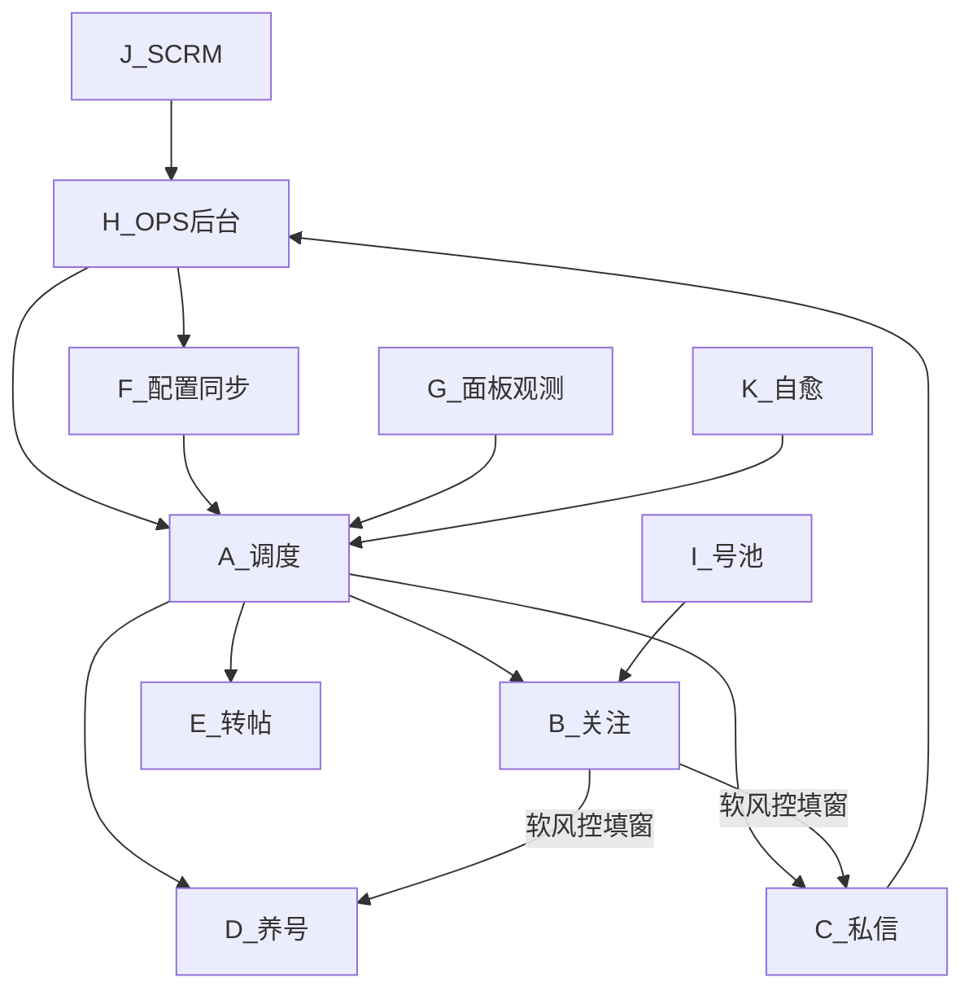

# 智能调度 · 工作指导（改码地图）

> **修订：2026-10-03 · 基线扩展 4.4.1**  
> **强制入口：** 先读 [`智能调度插件技术指导.md`](智能调度插件技术指导.md) **对应链 ID**（目的/链条/少跳页）→ 再读 [`调度工作手册.md`](调度工作手册.md) **子 ID** → 再读本文白名单。  
> **本文 = Where（改哪个文件）；手册 = 子板块细则；技术指导 = 宪法（必须遵守）。**  
> 相关：[`智能调度插件技术指导.md`](智能调度插件技术指导.md) · [`调度工作手册.md`](调度工作手册.md) · [`ARCHITECTURE.md`](ARCHITECTURE.md)

---

## 0. 怎么用这份指导

**以后每次开工（人或 Agent）都必须按下面顺序**，再动手。不要跳过。

1. 定需求 → 打开 [`智能调度插件技术指导.md`](智能调度插件技术指导.md) 找到 **唯一链 ID**（§4）；涉及导航先读 **§3 少跳页**。  
2. 打开 [`调度工作手册.md`](调度工作手册.md) **对应子 ID 全节**；跨板块先查手册 **§X 契约**。  
3. 回本文定 **一级 + 二级**，**只打开**列出的文件/锚点。  
4. 看清 **禁止顺手改**。  
5. 按技术指导该链「终态」+ 手册「验收」做完。  
6. 在本文件 **§13** 补一行（写清 **链 ID**、板块、做了什么）。

```
开工 → 技术指导链ID → 手册子ID → 本文白名单 → 只改一处 → 验收 → §13
```

**说不清链 ID → 禁止开工。**

### 铁律：先找问题确认，再改代码（2026-10-05）

**禁止：** 用户报症状后直接改业务码 / 扩文案 / bump 版本碰运气。  
**必须：**

1. **先复现/取证**（页面 URL、面板浮条/`sg_follow_last_msg`、诊断一行、控制台探针结果、当前 `manifest` 版本）。  
2. **写清根因一句**（哪条热路径、哪次判定返回了什么、为何与预期不符）。  
3. **根因经用户或实机证据确认后**，才允许改白名单内代码。  
4. 改完写 **可证伪验收**（例如：出现「这些帖子受到保护」→ 必须 `🔒` + `pool_dead` + 换号，禁止继续点粉丝 Tab）。

盲改一律视为违规；同一问题连续盲改 ≥2 次仍无验收 → 停手，只做诊断。

**模块化冻结（2026-08-30）：** 现有独立文件已足够（见 §11）。**暂停继续物理拆分**巨石文件。

插件文件地图：[`unified-scheduler/README.md`](../unified-scheduler/README.md)。

---

## 1. 一级板块总览

| ID | 一级板块 | 职责一句话 | 主目录 |
|----|----------|------------|--------|
| A | 调度控制面 | 谁先跑、何时启停三引擎 | `unified-scheduler/scheduler-core.js` + `scheduler/` |
| B | 关注引擎 | 领号、点关注、软风控填窗 | `unified-scheduler/follow/` |
| C | 私信引擎 | 破冰/守箱/广告/PIN/年龄 | `unified-scheduler/chat/` |
| D | 养号引擎 | 刷首页点赞评论预算 | `unified-scheduler/nurture/` |
| E | 转帖引擎 | S0 定时转帖专场 | `unified-scheduler/repost/` |
| F | 配置同步 | OPS→插件阈值/阶段/开关 | `shared/config-sync.js` 等 |
| G | 面板与观测 | 面板、日志、测试监控、诊断 | `ui/` · `obs/` · `shared/telemetry.js` |
| H | 后台 OPS | 配置、账号、闸门、战报、分析 | `test-env/x-ops-console/` |
| I | 号池 | 博主任务队列 | `test-env/x-pool-service/` |
| J | SCRM 监控 | 客服在线爬取与 cookie | `test-env/scrm-monitor/` |
| K | 自愈与风控页 | CF验证、白屏 heal | `challenge-guard` · background heal |
| L | 文档与验收 | 路线图、SOP、验收记录 | `docs/` · `obs/*.md` |

**硬边界（全项目）：**

- 不做 worker lease / 心跳锁停引擎  
- 调度未稳不扩机  
- 自动模式下引擎禁止私自 `location.reload`（走 heal）  
- 改私信 DOM 识别 ≠ 改调度优先级；两处分开提

---

## 2. 板块依赖（改前先看箭头）



---

## 3. A · 调度控制面（细板块）

| 子 ID | 子板块 | 文件 / 锚点 | 可改内容 | 禁止顺手改 |
|-------|--------|-------------|----------|------------|
| A1 | 阶段与时段 | `scheduler/stage-detector.js` | S0–S4、work/chatHours；**Day≤2 养号优先排序（软），可直接关注**；**4.6.31 起私信时段即进 S3，无日龄门** | 引擎内部发送逻辑 |
| A2 | 主循环启停 | `scheduler-core.js` `coTick` / `coStart*` | priority、软风控覆盖、赶工 | follow/chat 业务细节 |
| A3 | 关注优先/让路 | `applyFollowFirstInS3` · `shouldDeferChatForFollowCo` | **私信主轴**：有债且未 yield → chat 置顶；一轮后 yield → follow；**18:30 后末次名额**（与 soft 共用）已用 → 不再新开私信 | `content_chat` 守箱 DOM |
| A4 | 软风控优先级 | `applySoftRiskPriority` · `markSoftRiskChatPass*` | 窗内 **chat_fill：单段 chat 一轮→follow**；**下班前30分只许末次进**；已进窗私信可**延伸至下班+30**（兼职 18:30末次/19:30硬停）；SCRM 等临时闸 **挂起真养号**（切 nurture，闸开回 chat；挂起禁冰延/加班）；队未空可冰延/超窗（封顶 60m 且不过延伸硬停，仅非挂起）；**否则只 nurture→follow** | `enterSoftRiskDiversion` 窗长（在 B4） |
| A5 | 私信策略闸 | `scheduler/chat-strategy.js` | SCRM/债/赶工策略对象 | SCRM 服务端闸门（在 H/J） |
| A6 | 时间预算 | `scheduler/time-budget.js` | 小时帽 | 日帽冷却阈值（在 F/H） |
| A7 | 门禁 | `shared/scheduler-gate.js` | 自动模式禁自启 | 引擎命令处理 |
| A8 | 诊断 whyIdle | `computeWhyIdle` · `__sgDiag` | 空闲文案 | 面板 DOM（在 G） |

**调度逻辑（必读）：** [`调度工作手册.md`](调度工作手册.md) **§A（A1–A8）** + **§X 契约**。实现审查附录：[`调度模块逻辑审查.md`](调度模块逻辑审查.md)（冲突以手册为准）。

**调度验收信号：** 见手册 §A 各节；面板引擎行切换合理；`scheduler.chat_blocked`；无双引擎抢导航；`round_start`/`round_complete`/`chat_zombie_reclaim`；`soft_chat_pass` / `soft_risk_round_end`。

---

## 4. B · 关注引擎（细板块）

主文件：`follow/content_follow_v1522.js`（巨石，按锚点改）

| 子 ID | 子板块 | 锚点 / 文件 | 可改内容 | 禁止顺手改 |
|-------|--------|-------------|---------|------------|
| B1 | 配额与阶梯 | 【配额与风控系统】 | 日限、间隔 | OPS 阈值键名（先改 H/F） |
| B2 | 号池领号 | **`follow/pool-api.js`**（`SgPoolApi` pop/fail/release/进度）；follow 薄封装 | pop/done/dead | 调度 coTick |
| B3 | 点击关注 | 【关注逻辑】【扫描页面】 | 按钮识别、已关注多语言 | 私信破冰 |
| B4 | 软风控填窗 | **`follow/soft-risk.js`** + **`shared/soft-fill-mode.js`** | 窗长 **30–35**；进场读 SoftFillMode；`chat_fill`→单段私信一轮；**18:30 后末次私信名额与白天主轴共用**；until 封顶下班+30 | 差集识别细节（C3） |
| B5 | 死号填窗 | `tryDeadSkipFillWindow` | 阈值、计数 | 调度超时路径以外逻辑 |
| B6 | 任务锁恢复 | keepTask / 回粉丝列表 | 休息后回原博主 | 释放锁时机误改 |
| B7 | 回关检测 | `follow/follow-back-detect.js` | 回关上报 | 效率分析页（H） |
| B8 | 推博主 | `follow/push_blogger.js` | 推送辅助 | 主循环 |

**关注业务逻辑（改 B 必读）：** [`调度工作手册.md`](调度工作手册.md) **§B（B1–B8）**；日龄/软窗相位见手册 **A1/A4** 与契约 **A4↔B4**。摘要：软风控唯一入口=平台风控条→**30–35 分**填窗；`chat_fill`→单段私信一轮（台账全员处置完再交回）；无中间养号/chat2；禁止超时/死号冒充软风控。

**验收：** 见手册 §B4 / §A4。

---

## 5. C · 私信引擎（细板块）

主文件：`chat/content_chat.js`（巨石，按锚点改）

| 子 ID | 子板块 | 锚点 | 可改内容 | 禁止顺手改 |
|-------|--------|------|---------|------------|
| C1 | 目标库 | **`chat/target-db.js`**（`SgTargetDb`） | 入库字段、round | 调度 priority |
| C2 | 破冰 outbound | 主巡航粉丝页分支 | 扫粉、发破冰 | 收件箱 DOM；**push 条属 B8** |
| C3 | 回复扫描 | **`chat/inbox-watch.js`**（差集硬门 + 列表 pick/预览打分已迁入；`runInboxWatchTick` 编排仍 register） | 预览差集、未读、会话检测（最高优先级）；软风控内一次脉冲 | 关注点击 |
| C4 | 年龄分流 | **`chat/age-parse.js`**（`SgAgeParse`） | 仅年龄数据解析（数字歳 + `24です`/`だよ`口语 + 明示未成年自称→低龄） | 模糊关键词婉拒（若い等，已废除勿加回） |
| C5 | 广告/婉拒发送 | **`chat/chat-gates.js`**（`canSendAdNow`/`canSendKickNow`）；发送确认仍在 content_chat；**job round1 只认愿不愿意** | 等回复证据；兼职意向闸（年龄不挡） | PIN 填框逻辑以外 |
| C6 | **DM Passcode** | **`chat/dm-pin.js`**（`SgDmPin`）；`content_chat` `bind` 宿主依赖 | 填码、重试、检测门 | 守箱排序、调度 |
| C7 | 话术与链接 | **链接：`chat/promo-links.js`**（`SgPromoLinks`）；话术池/DNA 仍在 content_chat；**兼职粉池** `chat_scripts_job.json` / `dan_scripts_job`（`chat_script_pool=dating\|job`） | 模板、{LINK}、池切换 | OPS 交友话术池结构（先 H）；job 池暂本地 |
| C8 | 冷却与日轮 | **`chat/chat-gates.js`**（`getChatIntervalCfg`/日帽） | 读配置 | 直接写死与 OPS 冲突 |
| C9 | 主巡航引擎 | 【主巡航引擎】 | 步进状态机 | 改完必须回归 C3/C6 |
| C10 | 诊断桥 | `debugTraceReplyChain` / `__sg*` | 排障工具 | 生产发送路径行为 |

**私信业务逻辑（改 C 必读）：** [`调度工作手册.md`](调度工作手册.md) **§C（C1–C10）** — 按子 ID 切开，禁止一次读整章后跨改。

| 改什么 | 手册节 |
|--------|--------|
| 名单封口/一人一条/跳过门闩/浅扫 | **C2** |
| 破冰后差集 / 禁历史灰泡 | **C3** |
| 年龄解析 | **C4** |
| AD/婉拒/拒绝记死/盾牌催加 | **C5** |
| PIN | **C6** |
| 话术池 dating/job | **C7** |
| 冷却日轮 | **C8** |
| 步进/回退/`/i/chat` | **C9** |
| 诊断 | **C10** |
| 时段/日龄/软窗时间片 | **A1 / A4**（契约，勿在 C 重写） |

实现审查附录：[`私信模块逻辑审查.md`](私信模块逻辑审查.md)（冲突以手册为准）。短扫/回扫 SOP 仍外链。

**验收：** 见手册 §C2/C3/C5；一窗一轮（每人每软窗一次动作；刚破冰→done，复检下窗）；拒绝永久 skipped；硬禁 Messages 会话栏；回 `/followers`。

---

## 6. D · 养号 · E · 转帖

| 子 ID | 板块 | 文件 | 说明 |
|-------|------|------|------|
| D1 | 养号引擎 | `nurture/nurture-engine.js` | 动作执行 |
| D2 | 养号预算 | `nurture-tracker.js` · `nurture-config.js` | 日/时预算 |
| D3 | 评论库 | `nurture-comments.js` | 文案 |
| E1 | 转帖执行 | `repost/repost-engine.js` | **两阶段**：来源抓取文案+图 → 首页 modal 原创发；正文零 `@` |
| E2 | 转帖日程 | `repost-tracker.js` | 默认 **20:00** 开跑（不跟随下班）；开跑后 **0–240 分钟**按号哈希错峰；Day1–4 每天 2 条、Day≥5 每天 1 条；成功间隔 **≥30 分钟**；已发 ID 不重复 |
| E3 | 资料克隆 | `repost/profile-clone.js` | Day≤2 养号前置；源页图进 BG+storage；apply 硬进设置页+纠偏；选横幅/头像 file input；未完成调度让路 |
| E4 | 转帖浮层 | `repost/repost-panel.js` | 粉色球面板（拉取 OPS 来源 / 手动转帖 / 克隆）；**勿再装独立 X Repost Engine** |

白天 priority **不含** repost；只走定时专场（到开跑时刻+本号错峰后跑，达日限或超时收工）。**默认 20:00**（`repost_follow_work_end=false`）+ **`repost_start_jitter_max_min=240`**。开跑点 &lt; 上班点时，仅 `[开跑+jitter, 上班)` 算已到点。跟随下班时仍按 end 开跑；跨午夜仅适用于晚间开跑（start≥12）。**例外**：OPS `test24h` 或 **工作窗 end≥24** 到期后仍独占拉起转帖。日限满额时协调器必须停转帖交回（不可僵尸独占）。改 E 勿动 A2 白天逻辑（**例外**：E3 仅挂 `startNurture` 前置闸；满额收口/test24h 专场闸见 A2）。

---

## 7. F · 配置同步

| 子 ID | 文件 | 职责 |
|-------|------|------|
| F1 | `shared/config-sync.js` | 拉 `/api/config/all` 写入 LS |
| F2 | `shared/remote-settings.js` | 统一读阈值 |
| F3 | `shared/storage-keys.js` | 键名唯一来源 |
| F4 | `shared/config.js` | 本地默认 |

改阈值键名必须：**H 阈值表 → F 映射 → 引擎读取** 三处同 PR，禁止只改一处。

常用键：`chat_dm_pin` · `chat_script_pool` · `chat_cooldown_*` · `chat_rounds_per_day` · `scrm_gate_*` · `follow_*` · `sg_stage_policy`。

---

## 8. G · 面板与观测

| 子 ID | 文件 | 职责 |
|-------|------|------|
| G1 | `ui/panel.js` | 调度面板主控 |
| G2 | `shared/ui_console.js` | 中控台（悬浮球已停用） |
| G3 | `shared/telemetry.js` | 事件上报 |
| G4 | `obs/test-monitor.js` | 测试监控 |
| G5 | `obs/event-catalog.json` | 事件中文目录 |
| G6 | `page-diag-bridge.js` | 主世界诊断桥 |
| G7 | `obs/*.md` | 运维说明 / SOP / 验收 |

改文案/按钮 ≠ 改业务状态机。观测事件 ID 变更要同步 G5 + H 告警。

---

## 9. H · OPS 后台（细板块）

| 子 ID | 路径 | 职责 |
|-------|------|------|
| H1 | `routes/api/config.js` | 阈值/阶段/模块 API |
| H2 | `routes/api/plugin.js` | 插件心跳、DM、telemetry |
| H3 | `routes/api/scrm.js` + `repositories/scrm-status-repo.js` | **私信闸门** |
| H4 | `routes/api/links.js` + `services/scrm-links-sync.js` | 推广链 ↔ 客服号 |
| H5 | `routes/api/monitor*.js` | 任务监控 / 运行日志 |
| H6 | `routes/pages/analytics*` | 效率分析 |
| H7 | `views/*.njk` | 页面展示 |
| H8 | `db/migrations*` | 表结构 |
| H9 | `db/migrations/*repost_sources.sql` · `repositories/sources-repo.js` · `routes/pages/sources.js` · `views/sources.njk` · `routes/api/plugin.js`（status 上报点） · `accounts-repo.js`/`routes/pages/accounts.js`/`views/account-detail.njk`（勾选引用） · `routes/pages/config.js`/`views/config.njk`（全局勾选） · `services/config-assembler*`（banned 过滤） | **转帖来源号池**：登记/状态/勾选引用/下发剔除 banned |

闸门模式：`soft` / `strict` / `off`。  
**现行默认 `strict`**：无监控号 / 未找到 / 快照过期 / 客服离线 → **不放行私信**（含破冰）。`soft` 仅抗墙测试用；`off` 全放行仅临时。  
容器：`x-ops-console-*-test-1`，数据 `/vol2/1000/test/x-ops-console/data/`。

**远程指令白名单**（插件约 10s claim，禁止下发任意 JS）：`start` · `pause` · `reset_profile_media` · `reset_follow_daily_limit` · `reset_chat_local` · `clear_dead_handles`。新命令 = OPS 白名单三处 + A2 `claimRemote` 分支 + 账号页按钮。  
**重锁今日关注配额（≥4.3.30 / 4.6.51+）：** ① 下发插件清零 `follows_today` + 按 DayN 重抽上限；② **同步删除 OPS `activity_logs` 今日 follow/success**，并把 `account_runtime_status.followed_today` 置 0。轻总控 `activity/check` **优先读插件心跳 `followed_today`**（无 runtime 行才回退 logs 计数）；重锁不清 runtime 则仍可能 `follow_limit_reached`。  
**账号中心：** 约 20s 自动刷新运行态列（调度/模块/今日关注），远程指令后仍立即 bust `accounts:` 缓存。  
**重置私信（H · 交付清场）：** 账号页「重置私信」→ 服务端删该号 `dm_records` + leads 私信阶段回退 `followed_back`；可选勾选「同时清插件本地」下发 `reset_chat_local`。  
**台账落库：** 插件已 POST roster；OPS 补接口见 [`OPS-DM-ROSTER.md`](OPS-DM-ROSTER.md)。

---

## 10. I · 号池 · J · SCRM · K · 自愈

| ID | 说明 | 主路径 |
|----|------|--------|
| I1 | pool_pop/done/dead | `test-env/x-pool-service` · `:15678` |
| J1 | 爬虫与 cookie | `test-env/scrm-monitor` · `:3211` |
| J2 | cookie 扩展 | `scrm-monitor/cookie-sync-extension` |
| K1 | CF ChallengeGuard | `shared/challenge-guard.js` |
| K2 | 缓存自愈 + 多开错峰 + 媒体闸 | `background.js` purge/heal/DNR；见 [`多开网络SOP.md`](多开网络SOP.md) |

**K2 多开要点（4.3.14）**：每档 `installationId` 哈希错峰 purge；`loading_shell` 首愈不 purge；**默认 `media_load_mode=on` 放行媒体**（`auto` 亦按 on；仅显式 `off` 才 DNR 禁重媒体）；**Aw Snap 撞页**由 SW 扫 title/`chrome-error`（含日文エラー）并在熔断内 recreate；**已取消**冷启动 4 分钟 idle（开跑即启）；转帖开跑 **+0–240min** 抖动（`repost_start_jitter_max_min`）。

SCRM `agentIds` 与 OPS `promo_links` 必须同客服号（如 `@140rrusv`），禁止残留 `@test`。

---

## 11. 巨石文件改动纪律（防连锁错误）

当前最易改崩的两处：

| 文件 | 建议 |
|------|------|
| `chat/content_chat.js` | 一次只动一个 C 子板块；改 C3 不改 C6；改 C6 不改 C9 步进 |
| `follow/content_follow_v1522.js` | 一次只动 B4 或 B3；填窗概率在 B4，不要在 A 重复实现 |
| `scheduler-core.js` | 一次只动 A2–A4 之一；让路规则与 chat 侧同名函数保持语义对齐 |

**已拆独立文件（冻结清单，够用即止，不再继续拆）：**

| 模块 | 文件 | 入口 |
|------|------|------|
| C1 目标库 | `chat/target-db.js` | `SgTargetDb` |
| C3 守箱/差集/pick | `chat/inbox-watch.js` | `SgInboxWatch` |
| C4 年龄 | `chat/age-parse.js` | `SgAgeParse` |
| C5/C8 闸门冷却 | `chat/chat-gates.js` | `SgChatGates` |
| C6 PIN | `chat/dm-pin.js` | `SgDmPin` |
| C7 推广链接 | `chat/promo-links.js` | `SgPromoLinks` |
| B2 号池 | `follow/pool-api.js` | `SgPoolApi` |
| B4 软风控 | `follow/soft-risk.js` | `SgSoftRisk` |

**仍在巨石、按子板块锚点改即可：** C2 破冰 · C7 话术/DNA · C9 主巡航 · B1 配额 UI · B3 点击扫描 · A2 `coTick` · C3 的 `runInboxWatchTick` 编排  

**工作方式（冻结后）：**

1. 改功能 = 定板块 → 只改该板块文件/锚点 → §13 记一笔  
2. **不要**为了「更模块化」再主动拆文件，除非用户明确要求  
3. 若新功能放不进现有子板块：先在本文新增子 ID + 白名单文件，再写代码  

---

## 12. 修改检查清单（每次提交前）

- [ ] **已读** [`调度工作手册.md`](调度工作手册.md) 对应子 ID 全节  
- [ ] **已读**本文同 ID 白名单；未改「禁止顺手改」  
- [ ] 跨板块：已先改手册 §X + 本文 §13 记一笔  
- [ ] 若改阈值键：H + F + 引擎读取已对齐  
- [ ] 版本号：行为变更则 bump `manifest.json`  
- [ ] 验收信号已知（手册该节 / telemetry / OPS）  
- [ ] **已在 §13 变更记录补一行**  
- [ ] 未做未经要求的额外拆分或跨板块顺手改  

---

## 13. 变更记录

| 日期 | 板块 | 说明 |
|------|------|------|
| 2026-10-14 | E5+H11+F1 | **4.6.137 E5/H11 原创内容池上线（repost_content_pool=1 的账号 claim 已审核日文原创帖直发）**：日本兼职矩阵进入原创内容生产阶段，转帖模块新增内容池模式——账号 `repost_content_pool=1` 时不再从来源号池抓取，改为从 OPS 内容池 claim（原子领取）已审核（approved）且到期的日文原创帖+配图直发，发布结果经 posted/retry/failed 回报 OPS 闭环。①**OPS 侧（H11）**：`/api/content/ingest|claim|report` 三接口 + `/content` 审核页（pending→approved 流转、图预览），媒体落盘 `CONTENT_MEDIA_DIR=/data/content-media`；**已部署 NAS 验证**。②**插件侧（E5）**：SW 新增三个内容池代理 + `opsFetchRaw`（直读 NAS 图）；新增 `repost/content-pool-client.js`（manifest 注入）；`repost-engine.js` 内容池分支——claim→存待发→/compose/post 拟人发帖；**空池/无到期内容 `scheduleNext(5min)` 再查，不导航、不发空帖**；发布成功/失败回报 posted/retry/failed。③**F1**：`config-sync.js` 新增 `contentPoolMode` 透传（`repost_content_pool` 账号 override → `cfg.contentPoolMode`，随 `sg_repost_config` 下发，默认 false 维持来源号模式）。④**时间窗结论**：`repost_start_hour` 消费方均为**北京时间（Asia/Shanghai）**，`repost_eve_end_hour` 已废弃不再消费；等效 JST 11–23 = 北京 10–22，账号 override 数据行**待账号建好后配置**。校验：`node --check unified-scheduler/shared/config-sync.js` 通过；插件全量测试 79/79 全绿。manifest 4.6.136 → 4.6.137（version/description/default_title 三处）。**OPS 侧已部署 NAS；插件需 chrome://extensions 重载扩展**。 |
| 2026-10-14 | C7 | **4.6.136 job话术回归核心文案（扣粉规则不前置）**：用户指出 4.6.135 把「日本在住」「初めての方」写在广告里像查户口、删掉「1日3万〜10万円」核心卖点，话术更差了。纠正：扣粉规则是加LINE后人工审核用的，不该前置到广告里劝退。6 套话术全部回归「アルバイト募集中 + TikTok動画再生 + 1日3万〜10万円 + 22歳以上 + LINE:」核心结构，v1 用用户原文，v2-v6 轻微变体。dna_core 补「3万」「10万」。话术版本 1.8→1.9。manifest 4.6.135 → 4.6.136。 |
| 2026-10-14 | C7 | **4.6.135 job话术围绕扣粉规则重写**：6 套话术广告加「22歳以上」「日本在住」「初めての方」门槛，补 foreigner_reject。话术版本 1.7→1.8。manifest 4.6.134 → 4.6.135。（后被 4.6.136 回退：扣粉规则不前置到广告） |
| 2026-10-14 | C7+C5 | **4.6.134 job池年龄婉拒（21歳以下扣）+ 广告加回22歳以上门槛**：用户给出扣粉规则——21歳以下（含21）扣、异国扣、重粉扣、色粉扣。改两处：①年龄婉拒——`getAgeRejectBelow()` job池由 0 改为 22（age<22 婉拒）；②广告话术——6 套全部加回「22歳以上の方」门槛。话术版本 1.6→1.7。manifest 4.6.133 → 4.6.134。 |
| 2026-10-14 | C7 | **4.6.133 job话术池扩到6套做A/B测试 + 广告降可信度门槛**：话术池 3→6 套（v1-v6），随机轮播跑数据淘汰差的：破冰全部改为自然提问，去掉「やる？やらない？」直球；广告去掉「1日3万〜10万円」夸张金额，改个人分享口吻，v3/v6 保留「アルバイト募集中」作对照。话术版本 1.5→1.6。manifest 4.6.132 → 4.6.133。 |
| 2026-10-14 | C7 | **4.6.132 job广告话术还原核心文案**：用户给出原始核心话术「アルバイト募集中。TikTokブロガーの動画再生回数を増やすお手伝い…1日3万〜10万円…22歳以上の場合はLINEで」。v1 用原文，v2/v3 轻微变体；破冰保持软性提问。话术版本 1.4→1.5。manifest 4.6.131 → 4.6.132。 |
| 2026-10-14 | C7 | **4.6.131 job话术池软性化（破冰改自然聊天）**：运营分析发现转化率0根因=话术太硬广（job破冰回复率仅1%，dating破冰50%+）。改 SCRIPT_DEFAULTS_JOB（v1.3→v1.4 触发自动覆盖所有账号 localStorage）：破冰去掉「日給数万」「バイトやる？やらない？」直球，改自然提问「今何か副業とかしてる？」。校验：`node --check` + npm test 61/61。manifest 4.6.130 → 4.6.131。**纯插件侧改动，需 chrome://extensions 重载**。 |
| 2026-10-14 | C7 | **4.6.130 推广链接过期校验 + 催加轮兜底补链接（修转化率0根因）**：用户报「最后转化0」，排查发现两个插件侧 bug：①**链接漂移**——今天 OPS `promo_links` 只配 `@486avvfc`，但 DM 记录中 `cassinrash87735`/`mosciski95529` 发出了历史号 `@823ygrhz`/`@569trtfn`/`@659iuydz`（本地缓存残留 + 服务端同步未覆盖）；②**催加轮无链接**——R3 `kick_message` 默认不含 `{LINK}`，8 个进催加轮的热目标手里没链接。修（插件侧两处）：①`promo-links.js`——`loadMyLinks`/`startLinkSync` 记录链接来源（`dan_links_source=server|local`），`getLiveLink` 对 `local` 来源做 24h 过期校验（`LOCAL_LINK_MAX_AGE_MS`），过期返回 null 不上报旧链接（每天换号，旧链接归属昨天客服号）；②`content_chat.js getRoundMessage`——R2 广告、R3 催加文案不含 `{LINK}` 且未硬编码 `line.me` 时，末尾自动追加当前推广链。文档：手册 §C7 补「链接来源与过期」「话术与链接绑定」两行。校验：`node --check` 两文件通过。manifest 4.6.129 → 4.6.130（三处）。**纯插件侧改动，无 OPS 变更、无需 NAS 部署**；需 chrome://extensions 重载扩展。 |
| 2026-10-14 | obs+B4 | **4.6.129 仪表行号级归因 + diag_bad_action 风暴根治（数据驱动两连修）**：仪表 4.6.128 上线 35 分钟即出首批归因（386 桶，OPS log_events 可查）——content_chat.js 720s/8439 次（85ms/次）、scheduler-core.js 525s/5738 次（91ms/次）为两大热点，push_blogger/follow 已证治好（0.35ms/1.1ms 每次）。同批确认 diag 风暴数据：当日 162,419 条遥测中 `scheduler.diag_anomaly`+`diag_freeze` 各 34,369 条（合计 42%），其中 99% 为同一 code=`diag_bad_action`（chat_outbound/running + hint「不允许动作 has_target」，波及 19 号）。修两处：①**B4 契约**（diag-contract.js CONTRACTS.chat_outbound.running.actions）补精确名 `has_target`/`progress`——content_chat.js:9705 心跳 `noteChatProgress('has_target')` 不在允许表，每次撞契约即经 `enterFreeze` 吐 anomaly+freeze 两条 + buildSnapshot（多次 sessionStorage 读 + JSON.parse）+ emit 双写（pushLocal 全量 parse/stringify sessionStorage）+ console.warn 大对象 + 指挥闭环优先级 flush，自反馈风暴；`noteChatProgress` 其余 8 调用点（ice_/queue_/step_/identity_ 前缀）均已被前缀放行，仅 has_target 与空参 fallback 'progress' 漏网。②**obs 仪表**（cpu-profiler.js tagFromStack）tag 由文件名升级为 `文件:行号`（正则补 `:(\d+)` 捕获注册点行号）——文件级粒度下不了刀，行号级可直接锁定 85ms/次的具体定时器注册处。校验：`node --check` 两文件 + manifest JSON 校验 + 11 单测全过。manifest 4.6.128 → 4.6.129（三处）。**纯插件侧改动，无 OPS 变更、无需 NAS 部署**；需 chrome://extensions 重载。观察点：重载后 diag_anomaly 日量应从 34k 掉到百级（剩 diag_zombie 等真实异常）；仪表次日按行号聚合出新榜单，指导 C 档（scheduler-core coTick 拆解）。 |
| 2026-10-14 | obs | **4.6.128 CPU 仪表默认开启（去掉「需手动置 1 才出数据」的门槛）**：用户要求「现在可以诊断 CPU」，先核实数据链路——遥测已从老表 `plugin_telemetry`（库 `x-ops-console-test.sqlite`，**8/24 起停更**）迁到独立日志库 `/data/x-ops-log.sqlite` 的 `log_events` 表，插件 SW 走 `/api/plugin/log/batch`（`background.js:959`）。查 `cpu.profile_minute` = **0 条（全时段）**，而当日其他事件 123 万条正常流入 → **链路无损，根因=仪表从未激活**（4.6.121 设计为需显式 `sg_cpu_profile=1`）。修（`cpu-profiler.js` 仅 `isEnabled` 一处）：判据由 `=== '1'`（未置＝关）改为 `!== '0'`（未置＝开），catch 兜底 `true` → **默认常驻上报**，置 `sg_cpu_profile=0` 可关；仪表头注释同步。校验：`node --check` + 11 单测全过。manifest 4.6.127 → 4.6.128（version/description/default_title 三处）。**纯插件侧改动，无 OPS 变更、无需 NAS 部署**；需 chrome://extensions 重载。注：仪表对 `setTimeout/setInterval/MutationObserver` 的包裹属**诊断期临时装置**（仅作用于隔离世界，不影响 X 主世界），拿到归因后应摘除。 |
| 2026-10-14 | C2 | **4.6.127 粉丝列表加载守卫修白壳误判（手册 C2-15 · 扫描漏登记 Phase 4 补丁）**：4.6.124 后用户报账号 HaagRoyce26150「依然未扫到粉丝格」。根因=加载守卫 `if ((cells===0||loading) && !pageLooksChatFollowersShell())` 中 `pageLooksChatFollowersShell()` 在「无 UserCell 且无 emptyState 文案」时返回 true——**该状态既可能是真白壳也可能是页面仍在加载**。一旦返回 true 即跳过等待 → harvest 0 格 → `prepareAndSeal` 命中 `cells0_hard`（F>0 && cells===0）→ 调 `forceRescanForRosterGap('cells0_hard')`，而该函数在 followers 相位下**只清计数器、不导航不刷新** → 每拍重复 defer 永远扫不到粉。修（`content_chat.js` 加载守卫，仅此一处）：旁路条件由 `!pageLooksChatFollowersShell()` 改为「**只有真实空态**（0 粉丝 emptyState 含「关注者/followers/フォロワー」文案）**才跳过等待**」，其余 `UserCell=0` 一律等加载（空列表 10 tick≈20s / 加载态 15 tick≈30s，超窗软愈）。文档：宪法 §L-ROSTER 判定行、手册 §C2-15 同步。校验：`node --check` + `npm test` 61/61。manifest 4.6.126 → 4.6.127（三处，保留 4.6.126 DM shadow DOM 说明）。**纯插件侧改动，无 OPS 变更、无需 NAS 部署**；需 chrome://extensions 重载扩展。 |
| 2026-10-14 | C5 | **4.6.126 三态判定穿透 shadow DOM（修「收件箱已关闭」永不拉黑）**：用户报「DM 页扫描到 @norikazu_0130 的收件箱已关闭/X 安全码提示却没拉黑」。实机取证（`__sgDmSendability` 返回 hasPanel=false/pending + 穿透 TreeWalker 定位文案于 shadow 内）实锤根因=**X 已把 DM 会话面板（`dm-container` 全链）整体移入 open shadowRoot**，`document.querySelector`/`innerText`/普通 TreeWalker 均不透 shadow → `getDmConversationPanelRoot` 恒 null、文案 blob 永远无「收件箱已关闭」→ verdict 恒 pending → 只 composer_miss 空转 deferred 永不 hard_closed。修（content_chat.js，仅 C5 三态判定板块）：①新增 `__dmCollectTextDeep`（TreeWalker + 递归 open shadowRoot 文本收集，深限 6/长限可截）；②`getDmConversationPanelRoot` 改 `__dmQueryAllDeep` 穿透；③blob 提取——innerText 未命中硬文案时补 `__dmCollectTextDeep(scanRoot)`（命中不跑，省 CPU）；④composer 三 testid 查找穿透（保原优先级）；⑤`Use X Number` 按钮查找穿透且**补中文「使用 X 安全码」/「X 安全码」/日文「Xナンバー」文案**（原只认英文，中文 UI 必漏）；⑥`pageLooksDmReadOnly` 未命中时 DM 路径下补 body 穿透收集（只读会话同治）。发送链路 composer 查找此前已走 `__dmQueryAllDeep` 穿透不受影响。文档：宪法 L-PROBE 禁止栏、手册 C5-6 同步。校验：`node --check` + `npm test`。manifest 4.6.125 → 4.6.126（version/description/default_title 三处）。**纯插件侧改动，无 OPS 变更、无需 NAS 部署**；需 chrome://extensions 重载扩展。 |
| 2026-10-14 | C2 | **4.6.125 粉丝台账扫描补登加固（手册 C2-2 · 扫描漏登记修复 Phase 1 保守版 + Phase 3）**：接 4.6.124 续做。根因=①有台账的号浅扫只回顶一屏、首扫被 `failCount>20` 硬截断后**首见触底即封口**→ 漏登；②`prepareAndSeal` 缺口（`cells+2<F`）分支只置 `dan_roster_profile_gap_retry` 后 `return`，**不真滚动**＝「再滚补登」空转，下一拍直接封口（用户实见「已扫完主页粉丝数却未扫到粉丝格」）。修（`content_chat.js`）：①**Phase 3**——缺口分支置 `dan_need_scroll_down`；浅扫封口前新增**补登分支**拦截：每拍真下滚 600px 补收，收满 `cells>=F`／触底／封顶 **8 拍**即清标记再回正常封口（有界，不演成未封口反复 harvest）；`forceRescanForRosterGap` 同步清标记。②**Phase 1 保守版**——首扫触底封口由 4.1.36「首见 bottom 即封」改为**连续 2 拍确认「无 `progressbar` 加载条 + 本拍无新增 `UserCell`」**才封（新增计数键 `dan_last_cells_seen`，按「无新增格子」而非裸拍数），**保留** `dan_scroll_fail_count>20` 硬上限。**不改**：封口后 drain 定序、17 点定格、OPS `dm/roster` 接口、Phase 2 浅扫补滚、Phase 5 baseline 语义。文档：手册 §C2-2 同步。校验：`node --check` + `npm test` 61/61。manifest 4.6.124 → 4.6.125（version/description/default_title 三处）。**纯插件侧改动，无 OPS 变更、无需 NAS 部署**；需 chrome://extensions 重载扩展。Phase 2/5 留待遥测（`chat.fan_roster_gap` / `defer_seal_cells0` 前后对比）支撑再单独评估。 |
| 2026-10-14 | C2 | **4.6.124 粉丝台账扫描加载守卫加固（手册 C2-15 · 扫描漏登记修复 Phase 4）**：用户报「个别账号扫完主页粉丝数后跳粉丝列表出现未扫到粉丝格」，授权分阶段修（本轮只做 Phase 4+3+1 保守版，Phase 2/5 留待数据）。根因=跳转 `/followers` 后加载守卫**只认 cells===0**，列表已挂出部分格子但仍在加载/尚未挂满时即进入 harvest 登记 → 漏粉（OPS 遥测 `chat.fan_roster_gap` 佐证）。修（`content_chat.js` 主巡航粉丝页分支，仅此一处）：①等待条件由「仅 `cells===0`」扩为「`cells===0` **或**检出 `[aria-busy="true"]`/`[role="progressbar"]` 加载态」；②**加载态单独计数**（`dan_followers_busy_wait`，封顶 15 tick≈30s，**不计入**空列表失败窗口），空列表计数 `dan_followers_loading_wait` 由 5 tick 放宽到 10 tick（≈20s），超窗才 `requestSharedSoftHealChat` 软愈刷新；③**首屏 harvest 前要求连续 2 拍 `UserCell` 数一致**（键 `dan_followers_cells_stable` 存 `pulse:count`，按 pulse 一次性 gate `dan_followers_stable_ok`，同 pulse 不重复，**不干扰**首扫下滚）。文档：技术指导 §L-ROSTER 判定行、手册 §C2-15 同步。校验：`node --check` + `npm test` 61/61。manifest 4.6.123 → 4.6.124（version/description/default_title 三处）。**纯插件侧改动，无 OPS 变更、无需 NAS 部署**；需 chrome://extensions 重载扩展。 |
| 2026-10-14 | C2+C9（含 SW ops_dm_check） | **4.6.123 私信稳定性加固（校验预算对齐 / 封禁宽松检出 / DM 单会话页宽限）**：用户批准三项。①**校验预算对齐**：`opsDmCheck` 前端超时 9s→**12s**（覆盖后台 failover 总预算 内网 `LAN_TRY_MS` 2.5s + 外网 `WAN_TRY_MS` 8s = 10.5s；避免前端先到期、failover 成果被白等废掉）；失败原因**细分**——前端预算耗尽→`frontend_timeout`、SW 内外网均不可达→`ops_unreachable`（`background.js` `ops_dm_check` catch 统一标 `ops_unreachable`），`unknown` 仅留 `lastError`；二者均按**软失败落 `deferred`**（`queueReason=ops_frontend_timeout`/`ops_ops_unreachable`），禁当硬完结跳过；toast 文案同步。②**封禁检出加固**：`CHAT_I18N.accountGone` 由「必须紧邻」词改**宽松多语词表**（`suspended`/`凍結`/`冻结`/`停用`/`已被暂停`/`temporarily unavailable`/不存在，简繁英日），并**新增 step2 DM 会话页判定**——step2 命中 `pageLooksAccountGone()` 即 `saveToDB('dan_reject_users')`+`sendLogToNAS('CORPSE')`+`finishTargetVisit(skipped,'corpse')` 永久拉黑（不再只认 step1）。③**DM 单会话页宽限**：`recoverFanQueueOffChatSurface` 对带会话 id 的 `/i/chat/\d{5,}` 单会话页给**一次性宽限（约 2 tick / 20s）**——宽限内只 `wakeDmComposerShell()` 探测/唤醒输入框、不判误落、不拉回；**纯列表根 `/i/chat`（无 id）与 `Start Conversation` 空壳照旧立即回收**，禁「带 id 永不回收」白耗空转。文档：手册 §C2-17/18、§C9 回退硬化行同步。校验：`node --check` 两文件 + 封禁正则覆盖实测（MISS 7 全中 / HIT 4 全中 / 负例 4 不误伤）全过；`npm test` 61/61。manifest 4.6.122 → 4.6.123（三处）。**插件侧改动，无 OPS 改动，无需 NAS 部署**。 |
| 2026-10-14 | H1+A2 | **保存关注阈值不再清零今日关注（计数锚点=北京日期固定跨日，用户定调）**：用户质问「关注本来 24h 只能 300-400，为什么记录数据不按北京时间跳转、而是按保存关注阈值重新计数」。实查：计数方式本身**早已是北京日期制**（插件 `content_follow_v1522.js` `getAccountStats()` 用 `Asia/Shanghai` 日串比较跨日清 `follows_today`；`config-sync.js` `ensureLocalFollowQuotaRollover`/`applyRemoteDayCount` 同款；OPS `utils/shanghai-date.js` 全上海日）。真正乱跳的是**保存动作触发的清零**：`routes/api/config.js` 的 `POST /api/config/thresholds` 只要命中 `follow_day\d+_(min\|max)`/`follow_daily_limit` 就对**全账号**下发 `reset_follow_daily_limit` 并调 `clearFollowActivityToday`（删今日 `activity_logs` follow/success + `account_daily_stats.follow_count` 置 0 + `account_runtime_status.followed_today` 置 0），插件 `scheduler-core.js` claimRemote 收到后同样把本地 `follows_today` 清 0 —— 于是「一保存阈值，当天关注数就归零」（实证 10-14 10:55:57 保存整套阈值 → 驾驶舱关注 0）。修（**OPS 单侧，插件零改动、不 bump、无需重载扩展**）：①`config.js` 删掉该自动下发块，保存仅写表并返回「阈值已保存（关注计数不重置）」；②`views/config.njk` 关注阈值保存 flash 文案同步去掉 `reset_dispatched` 分支改为「已保存（今日关注计数不重置，按北京日期跨日归零）」；③手动路径保留——账号页「重锁今日关注配额」按钮/单号命令 `reset_follow_daily_limit` 仍在白名单，需要时人工清零（`clearFollowActivityToday` 仍被账号路由调用）。新 DayN 区间不丢：仍经 F1 `config-sync` 约 1 分钟下发，插件对「区间外旧锁」自动重抽（不清已用数）。文档：手册 §X 新增契约行 `H1↔A2/F 关注日限计数`、§A2 补计数锚点 + `reset_follow_daily_limit` 改「仅手动触发」。边界提醒：自然日 00:00 归零意味着跨零点前后两段各自可用满额，若 X 反被风控盯上可考虑人工错峰。 |
| 2026-10-14 | C2+H7 | **台账页历史快照回看（每天一封、最近 30 天、只读）**：用户确认「插件上传的台账要有时间戳、每日台账后台可浏览」有必要。落点：①`dm-roster-repo.js` 新增 `listDailySnapshots(bot, 30)`（按 `substr(created_at,1,10)` 分组、每天取 id 最大一封，列表不带 payload 轻量）与 `getSnapshot(bot, id)`（含 payload）；②`/dm-roster/:handle` 路由支持 `?snap=<id>`——命中该号快照即进历史模式：明细直接解析该快照 `payload.items`（camelCase→snake 归一化后复用现有表格），对账 chips 显示该快照的 F/cells/queue/pending/skipped，**跳过脱节/mismatch 判定**（历史快照即当时事实，不与当前库内对账），对账徽标显示「历史快照（只读，以当时封口为准）」；`snap` 无效/不属于该号自动回落实时模式；③`dm-roster.njk` 顶部加快照下拉选择器（当前=库内实时 + 每日历史选项「时间 · F · queue · pending」），历史模式显示「回到当前台账」链接，状态筛选链接保留 `snap` 参数。零库结构变更（payload 本就存全量 items），插件零改动。校验：`node --check` + OPS npm test 49/49。已部署 NAS 验证：实时页 200 + 选择器 11 天选项；历史模式 snap=109824 → 200 + 「历史快照（只读）」标 + payload 66 行明细渲染。 |
| 2026-10-14 | H7 | **台账页「脱节」提示文案修正（对齐宪法「OPS 为唯一真相源」）**：用户质问「我说了以新台账为准，为什么还显示执行真源是插件本地队列」。根因=`views/dm-roster.njk` 的 `stale` 告警文案写于真相源宪法落地前，残留「执行真源是插件本地队列」表述，与宪法级「账目/判定类状态以 OPS 为唯一真相源」直接冲突，误导操作员以插件本地为准。修（仅文案）：改为「以 OPS 台账为准——请重载 4.6.67+ 插件回灌最新快照，完成后再跑软窗」。行为/判定逻辑零变化，纯提示语义修正。 |
| 2026-10-14 | H7 | **账号中心列表页表头错位修复（069 下班快捷列漏加 `<th>`）**：用户报「账号中心显示完全不知道什么意思、没有对上」。根因=H10/069 在 `views/accounts.njk` 数据行转帖来源后插入 `<td class="col-wh">`（下班快捷编辑），但 `<thead>` 未同步加表头——表头 14 列 vs 数据 15 列，自 Day 列起整体右移一格：Day 头下显示时间输入框、「状态」头下显示 15（实为 Day 天数）、「调度」头下显示离线（实为状态）、「绑定线索」头下显示私信态标签、「今日关注」头下显示 1936（实为绑定线索数 lead_count）……用户看到的全列语义错位。修（仅 accounts.njk）：①`转帖来源` 与 `Day` 表头之间补 `<th title="上班/下班时间…">上下班</th>`；②空行 `colspan` 14→15；③补 `.col-wh{width:150px}` 防 15 列挤压。校验：th=15 与每行 td=15 计数一致；列语义逐格复核（绑定线索→lead_count、今日关注→today_follow_count、今日私信→today_dm_count、最后活跃→last_seen_at、操作→按钮）全部归位。纯展示层修复，无行为/数据口径变化；OPS 单侧改动，插件无版本变更、无需重载扩展。 |
| 2026-10-14 | obs | **4.6.122 CPU 仪表数据双通道留存（上传 OPS + 本地兜底，后期可调取）**：用户要求仪表数据「上传到 OPS 或存本地，后期必须能调出来」。修：①`cpu-profiler.js` 60s 清桶时（`sg_cpu_profile=1` 开启前提下）在原有 localStorage `sg_cpu_profile_last`/`sg_cpu_profile_day` 两份之外，同份分钟桶（top15，短键 `{t,c,ms}` 控体积）经现有遥测管道 `SgTelemetry.emit('cpu.profile_minute')` 上传 OPS——与 `chat.fan_roster_seal` 等同通道，telemetry.js 自动附带 bot handle，OPS 侧可按号/按天在遥测库调取，本地两份保留作兜底，双通道防单点丢失；②`obs/event-catalog.json` 注册 `cpu.profile_minute`（system/info/upload:true/push:false），事件可检索可管控。OPS 侧零改动（遥测路由天然收任意已注册事件）。校验：`node --check` + catalog JSON 校验（84 events）+ 11 个单测文件全过。manifest 4.6.121 → 4.6.122（version/description/default_title 三处），需 chrome://extensions 重载。 |
| 2026-10-14 | obs | **4.6.121 新增 CPU 仪表（按文件归因回调耗时，为架构级 CPU 治理供数据）**：用户定调「不要修修补补，要思路」，拍板路线=先装仪表拿真实归因 → 数据驱动做条件注入/总线级重构（Q1=C 分阶段、Q2=乙 保守拆分，四大业务引擎后续按页面类型加载）。落地（本轮仅测量层，零业务逻辑变更）：新增 `shared/cpu-profiler.js` 并置 manifest 隔离世界块**首位**（先于其余 41 脚本执行才能包裹其注册）——包裹 `setInterval`/`setTimeout`/`MutationObserver` 构造，注册时从 `Error().stack` 提取来源 js 文件名作 tag，回调执行用 `performance.now()` 计耗时累计进内存桶；常驻包裹零配置（每回调仅一次时间差累加），安装全程 try/catch 失败静默退出不影响业务；每 60s 清桶，`localStorage sg_cpu_profile=1` 开启时把当分钟桶写 `sg_cpu_profile_last`（最近一分钟 top30）并累计进 `sg_cpu_profile_day`（按自然日合计）；`window.__sgCpuProfile()` 控制台随时查当前分钟桶（传 true 重置）。已知边界：document_start 块的 media-block-sync（60s 轮询）与 MAIN world 两脚本不在包裹范围（均极轻）；X 页面自身 MAIN world 计时器不可见（属不可控项）。校验：`node --check` + manifest JSON 校验 + 11 个单测文件全过。manifest 4.6.120 → 4.6.121（version/description/default_title 三处），需 chrome://extensions 重载。 |
| 2026-10-14 | B3+B5 | **4.6.120 CPU 三轮优化（风控检测整页 innerText → textContent，消除强制同步排版）**：用户报 CPU 依然很高、点关注时占比更高。审计前两轮（4.6.113/114/119）已门控的定时器/日志/observer 均无回退后，锁定剩余热点=**`innerText` 是排版感知 API，DOM 脏时每次读取强制 Chrome 整页同步排版（forced sync layout）**，X 大 DOM 下单次 50–300ms：①`checkLimits()`（B3）读 `document.body.innerText` 做冻结精确句+软风控蓝条兜底——每次点关注调用 3 次（点前/点后/延迟复核）+ 调度冻结心跳（/home 每 coTick 10s、其他页 30s）+ 面板状态查询；②`__queryTextChunks` 对 toast/dialog/alert/banner 等 11 类容器逐个 innerText（每次都可能触整页排版）；③`pageLooksProtected`（B5）body 短语兜底同款。修（仅 content_follow_v1522.js 三处）：全部改 `textContent`——不触排版、纯树遍历便宜一个数量级；检测句均为平台精确多词句（冻结/暂时不能关注/保护号短语），隐藏文本混入误判概率可忽略，且原代码本就带 `|| textContent` 兜底说明语义已被项目接受。冻结/软风控/保护号判定口径零变化。校验：`node --check` + 全部 11 个单测文件通过。manifest 4.6.119 → 4.6.120（version/description/default_title 三处），需 chrome://extensions 重载。剩余已识别未治理项（本轮按一次一子 ID 未动）：push_blogger observer 对每新增节点跑 matches/querySelector（F 板块）、nurture 评论横幅检测 innerText（D1，日评 2 次频率极低）。 |
| 2026-10-13 | C2 | **台账上传链路加固（运行时列自愈重试 + 失败推送告警，用户定调「台账必须上传是最高优先级」）**：接上一条断档修复，用户拍板：①历史缺口（10/5 起 8 天）**不回填，以当天为基线**；②以后台账必须保证上传。加固两点：①**repo 运行时自愈重试**（dm-roster-repo.js）——列补 ALTER 抽成 `ensureItemsColumns()`，`upsertItems` 事务捕获 `/no (such )?column/i` 类错误先补列再重放一次（事务已回滚不脏写），此类 schema 漂移不再依赖重启恢复；②**失败告警**（plugin.js roster 路由 catch）——明细写入失败时走 `sendNotify` 推「台账明细上传失败」（含 bot+错误），按 `config_thresholds` 键 `roster_upsert_fail_alert` 2 小时去重防心跳轰炸（同 telemetry-alert 模式），不再静默丢数。校验：node --check 过、npm test 49/49。已部署 NAS，验证：health 200、快照持续流入、五模块开关全开、心跳显示账号已恢复跑 nurture。 |
| 2026-10-13 | C2+H7 | **私信台账明细断档 8 天修复（dm_roster_items 旧表缺 dm_verified_at 列自愈 ALTER）**：用户问下班后台账是否全部上传。实查：快照表 `dm_roster_snapshots` 当日 3.9 万条正常（payload 含完整 items[]，单条 46~62 项），但明细表 `dm_roster_items` 全表 updated_at 停在 10/2~10/5、当日新封口 7 号明细 0 行。复现报错 `SqliteError: table dm_roster_items has no column named dm_verified_at`：线上旧表由早期内联 DDL 创建无此列，迁移 065 用 CREATE TABLE IF NOT EXISTS 不会给旧表补列，repo 只对 stale 列有 ALTER 兜底、漏了 dm_verified_at；`upsertItems` 事务首行即抛错整体回滚（路由先 `insertSnapshot` 成功 → 快照在、明细丢，catch 返回 `{ok:false}`）。修（dm-roster-repo.js 初始化 DDL 后）：对 `dm_verified_at`、`stale` 各跑一条幂等 `ALTER TABLE ... ADD COLUMN`（try/catch，旧库重启自愈、新库 duplicate-column 静默跳过）。部署 NAS 重启即补列；用 21:35 真实快照（62 items）在可回滚事务内试跑 affected=62 通过、零污染；重启后 21:33–21:35 实测真实落库 669 行（updated_at LIKE '2026/10/13%'）。坑：`MAX(updated_at)` 仍显示 10/5 是斜杠不补零字符串排序假象（'2026/10/5' 字典序 > '2026/10/13'，与 DM 记录排序坑同源），非数据问题。10/5 起历史明细仍缺，快照 payload 可幂等回放回填（待用户决定）。OPS npm test 49/49。 |
| 2026-10-13 | H10 | **账号详情页 500 修复（nunjucks 不支持 Jinja2 的 `| format` 过滤器）**：跑 OPS 测试发现 `GET /accounts/:id` 渲染 500（H10 4.6.118 工作窗 hint 引入，线上同病）：account-detail.njk 用了 `'%02d:%02d' | format(a,b)` 的 Jinja2 写法，nunjucks 无此 filter → 任何账号详情页打开即 500。修：路由 accounts.js 详情处理预计算 `globalWorkHoursLabel`（HH:MM ~ HH:MM，padStart，异常回落「10:00 ~ 19:00」）传入视图，模板直接 `{{ globalWorkHoursLabel }}`，格式化逻辑不进模板。本地复现 500→200，OPS npm test 48 fail→49/49 全绿。已随台账修复一并部署 NAS 验证（health 200）。 |
| 2026-10-13 | H1+面板 | **4.6.119 CPU 二轮优化（日志面板渲染风暴 + 推博主按钮全文档扫描）**：用户反馈 CPU 仍过高。先做全量证据审计（manifest 每页注入 44 个 JS、30 处 setInterval 逐个核频率/门控/工作量），确认 4.6.113/114 已门控的（follow 面板 2s 双门控、chat 探针空闲 60s、repost dot、coTick 低功耗、claimRemote hidden 早退、runtimeHb 30s running 门控等）均无回退；另核 SW 侧 keepalive/outbox/telemetry 空队列早退、follow-back 5s cleanup 两次 sessionStorage 早退，均轻。锁定两个未治理热点：①**ui_console.js 日志渲染风暴**——每条命中前缀的 console 日志同步执行 renderLatestLogs（拼 80 条 HTML+innerHTML 重排）+renderStats（9 次 getElementById+DOM 写）+persistStatus（同步 localStorage.setItem），而面板默认隐藏全是白干；且 interceptConsole 对**每条** console（含不相关的）都 Array.slice/map/JSON.stringify/join 全量参数。修：addLog 仅 panelVisible 时渲染（打开时 togglePanel 本就补渲染，零行为变化）；persistStatus 改 3s 防抖+pagehide flush；console 拦截加快路径（非字符串/非 `[` 开头立即返回，不 stringify）。②**push_blogger.js observer 全文档扫描**——document.body subtree:true 的 MutationObserver 在 X 时间线高频 DOM 变更下，500ms 节流每秒最多 2 次全文档 querySelectorAll 扫 tweet/UserCell。修：抽 injectArticle/injectUserCell 单条处理，observer 改收集 addedNodes、800ms 节流后只在新增节点子树内注入（isConnected 校验，上限 200 节点防积压），10s 全量 main() fallback 兜底保证不漏。多标签叠加收益按标签数倍增。校验：node --check 过、npm test 61/61。manifest 4.6.118 → 4.6.119（version/description/default_title 三处），需 chrome://extensions 重载。 |
| 2026-10-14 | H10+A1 | **4.6.118 账号级下班时间=私信停止时间（job 池放开硬编码）**：用户澄清语义——插件 24h 运行，其他模块无下班概念，**「下班时间」就是私信停止时间**。接 4.6.117 之前 H10 只覆盖 workHours（调度窗）没碰私信，job 私信仍全局硬编码 10–19。改：①**OPS**（config.js mergeAccountConfig）：账号级 `work_start/work_end` 有值时**同时覆盖 `chatHours`（私信窗）与 `workHours`（调度窗/转帖开跑）**对应侧，下发 stagePolicy 已按号定制；②**插件**（time-util.js）：新增 `hasAccountWorkHoursOverride()`（读 `sg_account_config.work_hours` 任一侧有值），job 池 `readChatHours` 改「有账号级覆盖→信 OPS 下发（已按号覆盖），无覆盖→兜底硬窗 10:00–19:00」；`chatFreezeMinutes()` job 分支 19:00 硬编码改为 `chatStopMinutes()`（定格对齐私信停点）——软风控末次进（停点-30）、延伸硬停（停点+30）、日终 POST 全部自动随账号级下班点浮动，无循环依赖；dating 池不受影响（仍 08–18/17:00 定格，设了上下班的 dating 号经 OPS 覆盖 chatHours 同样生效）。行为变更 bump manifest 4.6.117 → 4.6.118（三处同步）。校验：node --check 全过。手册 §A1 私信时段/定格两行 + §H10 语义更新。部署：OPS NAS 重建容器；插件需 chrome://extensions 重载。 |
| 2026-10-14 | H10 | **账号级上班/下班时间（工作窗按号覆盖，下班不固定可随时改）**：需求=兼职池子里每个号单独设上下班时间，且下班时间不固定要能随时改。方案（复用 daily_repost_limit 账号级覆盖套路，插件零改动）：①**迁移 069** accounts 加 `work_start/work_end`（NULL=跟随全局 stagePolicy.workHours 10:00–19:00）；②`accounts-repo.updateWorkHours()` HH:MM 校验（00:00-23:59），**参数约定 undefined=保留现值、null/空串=清除**（冒烟抓出初版把「未传」当「清除」导致列表页只改下班会清空上班侧的 bug，已修：先读现值，undefined 回填 cur 值）；③H1 `mergeAccountConfig` 按号**克隆**覆盖 `stagePolicy.workHours` 对应侧（只填一侧=只覆盖该侧；克隆防污染全局对象），`accountMeta.work_hours` 回显；POST `/api/config/account/:handle` 支持 `work_start/work_end`；④**账号详情页**「每日转帖上限」下方新增上班/下班双 `<input type=time>`，hint 显示全局工作窗，留空=跟全局；⑤**账号列表页**新增下班快捷列（time 输入+「存」按钮，只发 work_end 不动上班侧，change 事件即存），下班不固定时直接在列表改，插件约 1 分钟 config-sync 同步生效。校验：node --check 全过 + 冒烟 20/20（迁移列带出、保存/单侧/清除/格式错/账号不存在、双侧覆盖/单侧覆盖/留空回落、全局对象无污染、页面渲染）。手册 §H 加 H10 子 ID。已部署 NAS 验证。插件无版本变更，无需重载扩展。 |
| 2026-10-13 | H7 | **DM 记录页新增「今日目标进度」板块（未发送完全目标可视化）**：用户要求数据显示全面些——原页面只有发送量计数，看不到哪些目标没走完流程。新增（dm-records-repo.js `todayTargetProgress` + dm-records.js 路由 + dm-records.njk 板块）：按 Bot+目标 去重取当日最大成功轮次，汇总「已完结（max≥3，含婉拒/拉黑完结标记）/ 停在第2轮 / 仅破冰未推进 / 发送失败」四类计数，并列出最近 50 个未完结目标明细（最后时间/Bot/目标/进度/失败次数，按 id 倒序）。首跑数据：今日 543 目标 = 完结 28 · 停在第2轮 39 · 仅破冰 476 · 失败 0（仅破冰多为对方未回复属正常态）。OPS 单侧改动插件未动，已部署 NAS 验证，§13 记录。 |
| 2026-10-14 | H9+E1+F1 | **4.6.117 转帖来源号池（OPS 独立建库 + 池中勾选 + banned 自动剔除）**：需求=来源号统一管理、状态可检测、账号中心引用代替手填；删封禁号时其他账号对它的引用天然保留（`config_account_overrides` 按号隔离行）。决策（用户拍板）：①banned 自动从下发剔除（插件不白跑死号）；②手填 textarea 全废，只能池中勾选。落地：①**宪法链 L-REPOST** 输入行加池说明；②**手册 §X** 加 `H9↔E1/F1` 契约行、§E1 补被动检测上报点、§F1 注明下发已过滤、§H 加 H9 子ID；③**迁移 068** 建 `repost_sources`（handle UNIQUE NOCASE / status unknown·alive·banned / note / last_checked_at）；④`sources-repo.js` CRUD+`bannedSet()`+`backfillFromConfig()`（把存量全局/账号配置里的来源收编进池）；⑤`/sources` 页（routes/pages/sources.js + views/sources.njk + 导航）：登记（批量）/标状态/备注/删除/回填/被引用反查；⑥**H1 过滤**：`filterBannedSources()` 在 `loadGlobalConfig`（全局）与 `mergeAccountConfig`（override 覆盖后，db 为可选第 4 参，不传则不过滤供页面原样展示）双点剔除；⑦`POST /api/plugin/repost-source-status`（plugin.js）：不在池先登记再标状态；⑧**账号详情页** textarea→池中勾选（banned 红标灰显，全不勾=删 override 回落全局）；**账号列表页**行内手填框废除改只读+「去勾选」链接；**全局配置页** textarea→池中勾选；⑨**插件**（background.js `ops_repost_source_status` 转发 + repost-engine.js）：`detectSourceDeadPage()` 认 suspended/不存在四语（emptyState→primaryColumn 截 2000 字），落地来源主页 settle 后检测→上报 banned+`markCompletedRound` 跳下一来源；抓到帖且本报过 banned→回标 alive 自动解封；`sessionStorage sg_rp_src_reported_*` 同态每号每日防抖。校验：node --check 全过；冒烟（迁移+CRUD+回填+双点过滤+上报+config/all 剔除+三页面渲染）全绿；OPS `npm test` 49/49。部署：OPS 需重新 build 容器（新迁移+新页面）；插件 manifest 4.6.116 → 4.6.117 需 chrome://extensions 重载。 |
| 2026-10-13 | H7 | **DM 记录「婉拒被当广告」分类修正 + 合成标记行不计数**：用户指出「了解です🙏 また何かあったらよろしく〜」是婉拒不是广告。根因链=①婉拒流程（C5：job 意向拒绝 L11751 / dating 低龄拒绝 L11811）把婉拒话术记在 round2 槽位（随后 round3 写 `[job_intent_reject_done]`/`[age_reject_done]` 完结标记闭环），OPS 按 round_number 展示把婉拒算进广告；②合成审计行（`[peer_first_placeholder]` r1、`[local_backfill_r1/r2]` 补洞、`[peer_blocked]` r3、两个 reject_done r3）非真实发送但也计入各轮次桶——实查今日 15 点档：旧显示 破冰136/广告37 中 18 条是 backfill_r1、36 条是 backfill_r2，真实仅 118/1。修（dm-records-repo.js + dm-records.njk + dm-records.js 路由文案，OPS 单侧，插件未动）：①`todayHourlyHealth` 新增 reject 桶=round2 成功且同 bot+target 存在 reject_done 标记；②括号-only 内容（`/^\[[a-z0-9_]+\]$/i`）判定为合成标记行，不计入任何桶和合计；③`listAll` 带 `is_reject`（EXISTS 子查询）+ `display_round`（reject/marker）；④记录页轮次列显示「婉拒」（绿 tag）/「完结标记」（灰 tag），小时健康表加「婉拒」列，页顶口径说明补婉拒与标记行说明。效果（今日）：广告 62→16（含链接 16，全部为真广告）、婉拒 8、催加 27→11。已部署 NAS 验证，§13 记录。known-issue 未动：`todayStatsByBot`（账号中心轮次统计）仍按 round_number 原口径，如需对齐另行处理。 |
| 2026-10-13 | H7 | **DM 发送记录「好久不更新」修复（listAll 排序改 id DESC）**：用户报 DM 发送记录表停在 10/6。实查 NAS 库：今日（10/13）已写入 596 条，数据一直在进。根因=`created_at` 存的是混合格式字符串（`shanghaiNowTs` 产生 `2026/10/13 HH:mm:ss`，历史 zh-CN locale 产生 `2026/10/6 HH:mm:ss`），`listAll` 按 `created_at` 字符串 DESC 排序时 `'6' > '1'`，10/6 的行永远排在 10/13 前面，首屏看似停更。修（dm-records-repo.js 一行）：`listAll` 改 `ORDER BY id DESC`（id AUTOINCREMENT 与插入时间单调一致，不受字符串格式影响）。`findTodayByBot` 只过滤当天、前缀一致，不受影响未动。已部署 NAS 验证：首屏显示今日 18:33 最新记录。OPS 容器已重启，插件无版本变更。 |
| 2026-10-13 | H7 | **私信小时健康表按话术池轮次重排**：用户反馈「广告/带链接广告」两列易误解为两类。实际口径：带链接广告 = 第2轮广告中内容含 http/line.me 的**子集**（repo `todayHourlyHealth` 早已分字段 ice/ad/ad_link/kick/failed，纯展示层问题）。改（dm-records.njk + dm-records.js + dashboard.njk + dm-capacity-alert.js，仅文案与表格结构）：①表头改「第1轮·破冰 / 第2轮·广告（含链接）/ 第3轮·催加 / 失败/未确认 / 合计」，含链接数并入广告格内显示为 `37（1）` 子集标注（ad=0 时不显示括号），ad>0 且含链接=0 仍 warn 高亮；②页顶加口径说明「第1轮=破冰、第2轮=广告、第3轮=催加；含链接是第2轮子集不是另一类；失败不分轮次」；③告警文案统一「带链接广告→含链接广告」「ad_link=→含链接广告=」，推送告警标题同步。告警判定逻辑（盯 ad_link 断崖）未动。校验：`node --check` 通过 + nunjucks 样例数据渲染验证。OPS 重启后生效，插件无版本变更。 |
| 2026-10-13 | C2 | **4.6.116 台账上传修复（handle 链对齐遥测+结果强制遥测）**：用户报部分账号 OPS 台账库内 0 行。实查 OPS 全量 50 号：12 号库内 0 行，其中 powlowski×6+timothy×2 共 8 号**今天 17:55 刚封口、快照新鲜、cellsSeen>0 但台账历史累计 0 行**——封口遥测（`chat.fan_roster_seal`）同分钟正常抵达 OPS，roster 从未落库。根因=roster 上传 bot 解析链比遥测 `getBotId()` 短：遥测有 `matrix_extracted_handle`（scheduler-core 换号绑定时写入）兜底，roster 的 `currentLedgerBotHandle()`/`buildFanLedgerSnapshot` 没有——DOM 导航栏/`dan_worker_id`/`dan_target_username`/`matrix_my_handle` 全空时（比特浏览器实例上发生）遥测照发、roster 静默跳过，且旧版（实测 powlowski40092=4.6.82）无日终强制上传兜底，丢一次永丢。修（content_chat.js）：①`currentLedgerBotHandle()` 补 `matrix_extracted_handle` 末级兜底；②`buildFanLedgerSnapshot.botHandle` 改共用同一链；③无 handle 跳过强制遥测 `chat.ledger_sync{why:roster_skip,reason:no_bot_handle}` 禁静默；④封口上传结果强制遥测 `chat.ledger_sync{why:seal:*,ok,itemCount,profileFollowers,cellsSeen}`，OPS 可直接观测上传环节。手册 §C2 补第 21 条。校验：`node --check` + `npm test` 61/61。manifest 4.6.115 → 4.6.116。 |
| 2026-10-13 | B3 | **4.6.115 粉丝页渲染守卫加固**：用户报 @HaagRoyce26150 一直扫不到粉丝格，实机手动查该页 `UserCell`=46（选择器正常、页面终会渲染）。根因链=①进粉页预算仅 8s settle+10s 守卫（4.6.112 的 5tick×2s），渲染 >18s 即误判白壳；②白壳首愈直接 `sg_request_heal` 触发 background 默认 `reload`（bypassCache 硬刷）抹掉在途渲染；③settle 标记跨重载存活，重载后预算反缩到 10s → 愈刷愈空转 → shell 6-cap release → 号池重派循环复发。修（仅 content_follow_v1522.js）：①`FOLLOW_PACE` 加 `scanLoadingGuardTicks=10`（20s）/`scanLoadingBusyMaxTicks=15`（30s）；②新增 `pageLooksFollowersLoading()`（primaryColumn 内 `aria-busy=true`/`role=progressbar`）；③渲染守卫改 10 tick，busy 时不计数（宽限 15 tick 封顶防永等），诊断带 `cells=N busy=0/1`，遥测 `follow.step_mismatch` 增 cells/busy 字段；④`handleFollowersShellStall` 窗外 shell#1 只等不刷、#2 起才 `requestSharedSoftHeal`，派发愈后 `__clearScanSettledOnHeal()` 清 `sg_follow_scan_settled_<cr>` 让重载页重吃 8s settle；软窗分支同样愈后补 settle。shell 6-cap 释放、快页即扫语义不变；SCAN 步骤超时仅重置计时器故延长等待不撞 120s。手册 §B3 补第 6 条。校验：`node --check` + `npm test` 61/61。manifest 4.6.114 → 4.6.115。 |
| 2026-10-13 | A1 | **4.6.114 系统压力检测（动态降频）**：接 4.6.113 静态降频后，加动态压力检测让系统繁忙时自动跳过非关键 DOM 扫描。`scheduler-core.js` 新增 `_coDetectPressure(gap)`：测 coTick 距上次 tick 的 gap，减预期间隔得 lag；lag>0.5s→L1（遥测上报），lag>2s 连续 2 次→L2（日志+遥测），L2 时跳过冻结检测 DOM 扫描（`__sgCheckAccountFrozen`，`isAccountFrozenNow` 快查仍跑）+ `coProbeMemoryPurge`（`document.getElementsByTagName('*').length` 全量 DOM 计数）；连续 3 次 lag<0.5s→恢复 L0。`window.sgIsUnderPressure()` 供其他模块查询。`localStorage sg_pressure_detect_off=1` 一键关闭。无新定时器（复用 coTick 本身测量）。校验：`node --check` 通过。manifest 4.6.113 → 4.6.114。 |
| 2026-10-13 | G1+B3+C1+E1+A2 | **4.6.113 CPU 优化——高频定时器加模块激活门控**：用户报仍占大部分 CPU，怀疑穿插调度。经全量定时器审计，根因=多个内容脚本高频定时器在模块未运行时仍空转（非穿插调度逻辑本身）。修：①**面板刷新**（content_follow_v1522.js L2607-2652）：1s→2s + 加 `isRunning` 门控（关注模块停了不再每秒读 localStorage/查 DOM，全系统最高频定时器）；②**私信主引擎**（content_chat.js L12130）：timer 层加 `dan_auto_run` 前置检查（函数内部已有同检，timer 层提前拦截省函数调用）；③**私信探针心跳**（content_chat.js L12232-12238）：未运行时降频 15s→60s（`_lastChatProbeAt` 计数器，保留白屏自愈检测）；④**转帖面板圆点**（repost-panel.js L453）：加 `isRunning()` 门控；⑤**调度按钮状态**（follow-btn.js L74）：5s→10s；⑥**claimRemote**（scheduler-core.js L5884-5886）：手动模式 10s→15s（自动模式仍 10s）。经确认跳过：push_blogger main()（需始终注入 UI 按钮，停止关注也需显示）；follow-back-detect cleanup（无 trip 时已早返回，开销可忽略）。校验：`node --check` 5 文件全通过。manifest 4.6.112 → 4.6.113。 |
| 2026-10-13 | C1+C2+C5+B3+E1+D | **4.6.112 全模块步骤检测与自愈**：用户报修改后流程链路缺检测缺自愈——「扫了粉丝数进列表却 0 UserCell」「没进 DM 就发私信」。根因=各模块导航后无统一「页面加载确认→元素就绪→执行」守卫。**私信**（content_chat.js）：①`sendOneOrDump` 入口加 DM 会话页前置校验（step=2 不在 DM → 清 step 回退，3 次不匹配 deferred）；②step1→2 过渡标记 `1_entering_dm`（点 DM 后不直接升 2，下 tick 确认 `isDmConversationView` 才升，10 tick 超时 soft_heal）；③主循环粉丝列表扫描加 UserCell 渲染前置等待（URL 到但 0 cell+非白壳 → 5 tick 短退避，超时 soft_reload）。**关注**（content_follow_v1522.js）：`runEngine` scanPage 前加 `pageLooksFollowersShell` 加载等待（5 tick 短退避，超时交给 scanPage 既有 `handleFollowersShellStall` 6-cap→release）。**转帖**（repost-engine.js）：`publishPendingContent` compose 页编辑器未渲染 → 1 次重载自愈（pending 存活），二次失败才放弃。**养号**（nurture-engine.js）：`tick()` 白壳检测加 3 次计数等待，超阈才 `requestSharedSoftHealNurture`，feed 加载成功清零计数。遥测统一 `*.step_mismatch` 事件（module/step/page/action wait/heal/defer/mismatch_count）。校验：`node --check` 4 文件全通过。manifest 4.6.111 → 4.6.112。 |
| 2026-10-13 | E1 | **4.6.111 转帖纯文本 GraphQL 直发（灰度，默认关）**：接续反垃圾治理——GitHub 调研（twikit/twitter-scraper/x-client-transaction-id 等）后未照搬 txid 逆向，而在 MAIN world 做了两轮实机探针：①读接口双路重放证明 403 真因是**写死的过期 queryId**（真实 qid 如 `q4Npr1-…`/`wR5Z_lEibLvkew3tF9w-Sg`，X 走 XHR 非 fetch），与签名无关；②捕获用户真实 CreateTweet 模板后空文本重放，A 路带旧 txid（13s）code 170、**B 路完全无 txid code 344，均 HTTP 200 到业务层**，零副作用定论写接口不强制 txid。实现：`page-diag-bridge.js` document_start 链式观察器（fetch+XHR，透传不阻断，自动区分 origin x/sg）捕获 X 自身发帖 200 → 持久化模板种子（qid+features+variables 骨架+Bearer，30 天）；新增隔离世界→主世界 RPC `__sg_xapi_request`（createTweet/seedStatus/clearSeed）。`repost-engine.publishPendingContent` 纯文本且开关开时先直发（`sg_repost_api_direct=1`）：成功 `api_direct`；need_seed/403/404/网络/超时/429/401 静默回退 UI（UI 成功自动重新播种=自举闭环）；业务错不回退记 `api_business_<code>`；antispam(code326/自动化措辞)/code344 与 UI 同口径冷却+填满配额。带图仍走 UI。探针函数保留（`__sgGetCapturedGraphQL/__sgReplayGraphQL/__sgWaitForOp/__sgProbeCreateTweet`）。边界：直发配内容多样化才能解决服务端聚类。校验：`node --check`+`npm test` 61/61。manifest 4.6.110 → 4.6.111。 |
| 2026-10-12 | E1 | **4.6.110 转帖命中反垃圾补写冷却 + toast 识别**：用户实机遇 X 官方句「该请求看上去可能是自动产生的…我们现在无法完成这一操作。请稍后再试。」审查发现代码与手册 §E1「命中反垃圾→`markAntiSpamCooldown`+填满配额」不符——只填满当日配额、**没写冷却**，零点配额重置后服务端风控未解除会立刻再撞；且识别只扫 `role=alertdialog/dialog`，官方句常以 toast（`role=status`）呈现会漏检，而扫 `role=dialog` 又可能被 compose 正文里的「自动/垃圾」词自伤。修：①`engine-utils.looksLikeAntiSpam` 补官方中/英文案（`看上去…自动`、`looks like it might be automated`、`protect our users`、`无法完成这一操作` 等）；②`publishPendingContent` 确认环改扫 `[role=alertdialog],[role=alert],[data-testid=toast],[role=status]`（去掉 `role=dialog`），统一走 `looksLikeAntiSpam`，命中先 `markAntiSpamCooldown(60,120)`（按号隔离、跨自然日）再填满配额+`antispam_detected`+关窗，成功 toast 仍优先认成功；③手册 §E1 同步规则与踩坑。校验：`node --check`+`npm test`。manifest 4.6.109 → 4.6.110。 |
| 2026-10-12 | H | **发帖号语义修正 + 列表页内联打标**：①`post_only` 发帖号改为**不关注不私信**（disabled=[follow,chat]，养号/转帖正常）；②账号中心列表页「账号」列每行加内联标签下拉（选中即 POST 保存并 reload，未打标显示「🏷 标签」占位、已打标显示当前标签名，含「清除标签」项）；POST 末尾存量 `invalidateCache('accounts:')` 保证 reload 立即见新徽标，无需额外清缓存。多标签仍走详情页。容器重建验证：tag-select 渲染 48 处、post_only 预设在线。 |
| 2026-10-12 | H | **标签功能用户澄清补正**：①列表页徽标实际位置=「排序」列后「账号」列名字旁（线上已渲染，`grep 1f6feb` 命中）；②按用户新需求新增预设 `post_only` **发帖号**（关 chat，发帖/关注/养号正常），置首位，现共 4 套。容器重建验证 `listTagPresets` 输出含 post_only。 |
| 2026-10-12 | H | **账号管理标签（方案A：标签=模块策略模板）**：需求=按标签分类管理账号、标签账号自动关闭指定模块。①`066_account_tags.sql` accounts 加 `tags` 列（JSON 数组，默认 `[]`）；②新增 `utils/account-tags.js` 预设标签 + normalize/parse/掩码工具，坏 JSON 容错；③`mergeAccountConfig` 在手动 override 之后套标签掩码（**标签关闭 > 手动开启，安全侧**；多标签取关闭并集），`account.tags/tag_disabled` 随 `/api/config/all` 增量下发，插件零改动；④POST `/api/config/account/:handle` 支持	body.tags（未知标签拒收）+ modules 支持 null=删 override（标签关闭模块不再固化，移除标签后回落全局）；⑤详情页标签勾选 UI+被标签关闭的模块勾选框禁用显「标签关」，列表页名字旁蓝色徽标。已部署 NAS（容器重建+migrate ✅066），实测：双标签→`tag_disabled:["chat","repost"]`+modules 掩码生效→还原干净。插件零改动不 bump。 |
| 2026-10-11 | L+宪法 | **真相源声明落宪法（纯文档，不 bump）**：PM 审查确认根因级问题是缺「唯一真相源」约定（配额双写、跳转多层叠加、完成判定三来源无出处）。经用户拍板「以 OPS 为准」并评估整体翻转风险大（滞后回滚 bug 类在全部模块重现、爆炸半径失控、实时态不可真依赖 OPS），决定纯文档先行：技术指导 §6 新增「真相源声明（宪法级）」——①账目/判定类 OPS 唯一真相源；②实时运行态本地持有；③OPS 不可达不阻塞；④跨日特例防快照回滚；⑤禁新增双写；⑥存量收编（config-sync 回灌补丁等触及时改）；⑦改动自检三问。后续按「粉丝台账→私信轮次→关注日限」三批试点收编，每批独立版本独立回滚。零代码改动，无需重载扩展。 |
| 2026-10-11 | C9+A5 | **4.6.109 私信时长帽随台账上报 OPS**：PM 审查发现当日私信时长帽（总240/箱120/出150min）只有本地面板可见，OPS 后台无观测（监控视角与引擎视角两套事实）。修：`buildFanLedgerSnapshot` 增加 `chatTotalTodayMin/chatOutboundTodayMin/chatInboxTodayMin` 三字段（读 sg_state 经 ensureChatDayStats 跨日归零后换算分钟），随台账心跳/封口快照上报，纯增量字段不破坏既有契约；sessionStorage 迷你快照与本地展示不动。重试约定漂移（/dm/record SW 层无重试 vs 文档「同策略」）与「已完成」出处展示属中风险，本次不动。校验：`node --check`+`npm test` 61/61。manifest 4.6.108 → 4.6.109。 |
| 2026-10-11 | A1 | **4.6.108 coTick 低功耗闸门（隐藏+停止+无模块在跑 10s→30s）**：接 4.6.107 评估的中风险项，按批准的收敛方案实施。`scheduler-core.js` 新增 `coInLowPower()`（条件=`document.hidden` 且 `!coRunning&&!S.running` 且 follow/chat/nurture/repost 四模块旗标均非 running；localStorage 设 `sg_co_low_power_off=1` 可一键关闭）；`coTick()` 最顶部、锁检查之前插闸门，30s 内仅喂 `coLastTick` 不跑维护任务，独立时间戳 `_coLastFullTickAt` 与看门狗解耦，锁被持有时不跳过（保留 60s 强制清锁救援）；init 区新增 visibilitychange/pageshow/focus 绑定，重新可见且距上次完整 tick >10s 立即补一次。不改动 installCoTimers 双 interval 架构与远端 tick 配置，运行中频率完全不变。校验：`node --check`+`npm test` 61/61。manifest 4.6.107 → 4.6.108。 |
| 2026-10-11 | E1+G1+B3 | **4.6.107 冗余 storage 轮询降频 + 面板倒计时隐藏暂停**：用户同意只做低风险三项。①`content_follow_v1522.js` 控制台设置兜底轮询 10s→60s（实时更新已有 `chrome.storage.onChanged` 覆盖，轮询仅防极端漏推）；②`shared/media-block-sync.js`（document_start 每标签注入）禁图状态轮询 15s→60s 且 `document.hidden` 跳过（onChanged 同样已覆盖）；③关注面板风控冷却 1s 倒计时在隐藏标签直接 return，切回后下一 tick 自动续显，冷却结束整面板重渲染逻辑不变。校验：`node --check`+`npm test` 61/61。manifest 4.6.106 → 4.6.107。 |
| 2026-10-10 | A1+G1+B7+E3 | **4.6.106 隐藏标签页跳过无意义轮询**：用户报 CPU 仍高。根因=多个内容脚本在后台标签页仍维持高频轮询：①`scheduler-core.js` 远程指令 `claimRemote` 每 10s 一次；②`shared/config-sync.js` 每 1min 拉配置；③`follow/follow-back-detect.js` 每 5s 清理孤儿 trip；④`ui/follow-btn.js` 每 5s 同步悬浮按钮状态；⑤`repost/repost-panel.js` 每 4s 更新红点。修：上述轮询在 `document.hidden` 时直接 return，切回可见后再恢复。校验：`node --check`+`npm test` 61/61。manifest 4.6.105 → 4.6.106。 |
| 2026-10-09 | G1+B3 | **4.6.105 进一步降低 CPU：轮询改 MutationObserver + 动态间隔**：接 4.6.104，用户同意继续优化。①`push_blogger.js` 主循环由 5s 全量 querySelectorAll 改为 MutationObserver 监听新增 article/UserCell/UserName，只在相关 DOM 插入时增量扫描，保留 10s fallback；②`content_follow_v1522.js` 心跳/锁心跳/看门狗/漂移巡检由固定 interval 改为动态 setTimeout，运行/可见时保持原频率，后台/待机时分别降到 30s/10s/30s/30s，诊断系统同步动态。校验：`node --check`+`npm test` 61/61。manifest 4.6.104 → 4.6.105。 |
| 2026-10-09 | G1+B3+E1 | **4.6.104 降低内容脚本 CPU 占用**：用户报插件启动后浏览器 CPU 高。根因=内容脚本无条件高频轮询：①`push_blogger.js` 每 1.5s 全量 DOM 扫描注入按钮；②`content_follow_v1522.js` 5s 心跳/2s 锁/5s 看门狗/8s 漂移巡检在后台标签页仍跑；③`page-diag-bridge.js` unload 抑制轮询 40ms。修：`push_blogger` 主循环降为 5s 且 `document.hidden` 时跳过；关注脚本上述四个无条件 interval 增加 `document.hidden` 早退（运行中锁心跳保留）；diag-bridge 抑制轮询 40ms→200ms。校验：`node --check`+`npm test` 61/61。manifest 4.6.103 → 4.6.104。 |
| 2026-10-06 | A7+C9 | **4.6.103 修排队跳页 settle 时序**：审查发现 Force 排队返回 true 时 `chatGo` 提前写 settle（旧页误等/新页不等）。修：`queueNav` 写入「排队+落地」总 settle；`executeHref` 落地再写 5–7s；`chatGo` 不再提前写。校验：`node --check`+`npm test` 61/61。manifest 4.6.102 → 4.6.103。 |
| 2026-10-06 | A7+B3+C9+D1+E1+E3 | **4.6.102 补齐 Force/裸跳/落地settle**：接 4.6.101——`force` 仍吃间隔并**排队延后**；`goRaw` 收 PageRouter/资料克隆/面板裸跳；关注主循环+私信主循环+养号 tick 认 `sg_nav_settle_until`；养号收尾/home 恢复短 setTimeout 改 8s+Force 排队；nurture/repost/panel 兜底走 goRaw。校验：`node --check`。manifest 4.6.101 → 4.6.102。 |
| 2026-10-06 | B3+A7+A2+F+B7+C9 | **4.6.101 全跳页放慢+领号先主页**：用户报未等加载就跳、隐私号漏检、跳转极多压 CPU。根因①领号直跳 `/followers`+SCAN 绕过 PROFILE settle；②`config-sync` 仍写 `nav_min_interval_ms=13000` 覆盖 Gate 30s；③Force 跳不吃间隔；④进粉页无 settle。修：领号→PROFILE；`FOLLOW_PACE` 再放慢+SCAN 进页 8s settle；Force 前 `waitNavGapThenForce`；全局 nav 默认 **45s**（残留 13s 当无效）；回关走 Gate；私信 DM/离会话 settle 2.5–4s。校验：`node --check`。manifest 4.6.100 → 4.6.101。 |
| 2026-10-06 | B3 | **4.6.100 关注稳节奏放慢**：用户报跳转太快、保护号来不及检。根因=主页只 settle 4s + 步骤 45s 超时强制跳粉。修：`FOLLOW_PACE`（settle 9–12s 中途/结束双检、粉入口 22s、Tab 后 7s、超时 90s、SCAN/白壳/踢回放慢）；进 PROFILE 重置超时钟。校验：`node --check`。manifest 4.6.99 → 4.6.100。 |
| 2026-10-06 | B3+B5 | **4.6.99 保护号文案漏检加固**：实机「这些帖子受到保护 / 只有经过批准的关注者…若要申请访问」未 dead。根因=空态 testid 变体/只读首个 empty + 可能零宽字符，短语未进扫描串。修：去零宽；扫全部 empty*；body 短语兜底（不扫锁标）；补「申请访问+点击关注」组合；单测含 @rrrrrrcoz 实机句。校验：`node --check` + protected-profile-phrase。manifest 4.6.98 → 4.6.99。 |
| 2026-10-06 | E1+G1 | **4.6.98 复制文案与真剪贴板对齐**：用户报「复制两边」。根因=抓取阶段面板写「复制文案」实为 savePending，发帖页才 `writeText`。修：抓取改「抓取文案/抓取完成」；仅 `insertEditorText` 写剪贴板时显示「复制到剪贴板→粘贴正文」。手册 §E1。校验：`node --check`。manifest 4.6.97 → 4.6.98。 |
| 2026-10-06 | A2+B3+F1 | **4.6.97 换号隔离：旧号冻结不连坐新号**：同实例换号后仍拒启/当旧号。根因=`accountFrozen` 写全局 `sg_state` 无 handle；id_extractor 只改 `matrix_my_handle` 不清运行态。修：`sg_bound_handle`+`reconcileSchedulerHostIdentity`（清冻结/软风控/任务锁/未分桶日计）；`accountFrozenHandle`+`isAccountFrozenNow`；coInit/cotick/handle-ready 对账。手册 CMD-12。校验：`node --check`。manifest 4.6.96 → 4.6.97。 |
| 2026-10-06 | G1+G3+A2 | **4.6.96 启动回传+警告可见+上路可重试**：用户报点开始无效、最近日志只有「系统警告」。根因①telemetry 摘要读 `message` 但 Logger.warn 写 `msg`→丢正文；②`sendCmd` 恒闪「已下发」不看真结果；③`runningModule` 残影把 FAB 锁成暂停；④新号上路 `failed` 后不再重试。修：摘要拼 mod+msg；`sg-page-cmd-result` 回传；FAB 不以残影判跑；人工启动清 failed onboard。校验：`node --check`。manifest 4.6.95 → 4.6.96。 |
| 2026-10-06 | E1+G1 | **4.6.95 compose 发帖记账+清粘贴残影**：实机手发成功但转帖 0/1、面板卡「运行·转帖·正文已粘贴」、模块已停。根因①`/compose/post` 发成功仍停本页，旧确认只认关窗→不记账；②`setRepostLastMsg('')` 早退清不掉过程态。修：`compose_cleared`/`beforeTextLen` 记账；空串真正 removeItem；面板仅 `repostRunning` 展示过程态、停机清粘贴残影。校验：`node --check`。manifest 4.6.94 → 4.6.95。 |
| 2026-10-06 | E1+A2 | **4.6.94 转帖发帖页粘贴+手动场不被假活杀**：实机停在 `/compose/post`、正文1字、pending 有41字未粘贴；且 `Coor停止:repost reason=cmd`。根因①侧栏发帖整页跳走打断粘贴；②自动关时假活清理无条件 `coStop` 杀掉只转帖。修：抓取后直跳 `/compose/post` 粘贴；compose 页直接写编辑器；假活清理仅 `!coEngineAlive` 才停。校验：`node --check`。manifest 4.6.93 → 4.6.94。 |
| 2026-10-06 | A2+G1 | **4.6.93 暂停来源可追溯**：用户称未点暂停但日志有「调度: 暂停」。澄清=主运行钮在转帖跑着时再点会整机暂停（非必须点「暂停」文案）；空框根因仍是 4.6.92 内联误判。修：`schedulerPause(why)` 打 reason；面板主钮传 `panel_fab`/`panel_fab_while_repost`。manifest 4.6.92 → 4.6.93。 |
| 2026-10-06 | E1 | **4.6.92 修首页内联框误判残留发帖窗**：实机诊断「残留发帖窗关不掉→从未粘贴」。根因=`composeStillOpen` 把首页内联 `tweetTextarea_0` 当 modal，publish 入口直接 return；且失败仍清 pending。修：仅 modal/确认层算 open；关残留用 force；发布失败保留 pending。manifest 4.6.91 → 4.6.92。 |
| 2026-10-06 | E1+G1 | **4.6.91 转帖可见复制粘贴**：用户报「没看到复制」。根因=抓取为后台 DOM+合成 paste，比特无控制台无步骤反馈；paste 在比特常无效。修：真实剪贴板 writeText/execCommand copy → paste/insertText 兜底；`sg_repost_last_msg`+面板引擎行显示「复制文案/粘贴正文…」；跳过原因也写面板。校验：`node --check`。manifest 4.6.90 → 4.6.91。 |
| 2026-10-06 | E1 | **4.6.90 转帖图优先定稿 A**：来源有图却下不到 / 存盘丢图 / 预览失败 → 整条放弃，禁止降级纯文；`requireMedia` 进 pending；仅来源本无图才允许纯文。宪法 L-REPOST + 手册 §E1。校验：`node --check`。manifest 4.6.89 → 4.6.90。 |
| 2026-10-06 | E1 | **4.6.89 转帖恢复两阶段首页原创发（L-REPOST）**：根因=4.6.22 为少跳页掐断「抓取→首页」，live 在来源主页 compose，观感像转发/@。修：`repostTweet` 只抓取+`stripMentions`+`savePending`→`/home`；`runOnce` 优先 `publishPendingContent`（侧栏 modal、禁内联框、禁回复钮兜底、发送前 `mention_blocked`）；节流失败保留 pending 重试。宪法 L-REPOST + 手册 §E1 同步。校验：`node --check`。manifest 4.6.88 → 4.6.89。 |
| 2026-10-06 | A2+F+B1 | **4.6.88 跨日配额未清零修复**：根因=后台标签冻结 coTick 暂停 + 跨日 OPS `today_follow_count` 灌回昨日满额。修：ConfigSync 入口 `ensureLocalFollowQuotaRollover`；关注脚本注入即 `getAccountStats`；visibility/pageshow/focus 唤醒补跑；跨日禁 OPS 覆盖本地 0。校验：`node --check` + quota-daily-rollover 单测。manifest 4.6.87 → 4.6.88。 |
| 2026-10-05 | A2+C2 | **4.6.87 日终/日启台账成功盖戳**：修「先盖戳后发包」——`chatDayEndLedgerPostedDate`/`chatDayLedgerPulledDate` 仅 POST/GET **成功后**由 C2 写入；失败 60s 冷却可重试；日终 `force` POST 绕过 `isLedgerOpsSyncPhase`（硬停关 auto 后仍能上传）。校验：`node --check` + soft-risk 单测。manifest 4.6.86 → 4.6.87。 |
| 2026-10-05 | A2+C2 | **4.6.86 私信日终台账上传**：当天私信彻底结束后 **POST 快照一次**（白天 19:00 硬停 / soft 延伸结束 19:30 / 过点无 soft 保底）；次日首次开私信 **GET 回灌**；同日幂等键 `chatDayEndLedgerPostedDate` / `chatDayLedgerPulledDate`。校验：`node --check`。manifest 4.6.85 → 4.6.86。 |
| 2026-10-05 | A2+C2 | **4.6.85 逻辑缺口修复**：①白天主轴私信过私信下班点（兼职19:00）硬停并 yield（soft 延伸至19:30 除外）；②`isLedgerOpsSyncPhase` 扩至白天 `dan_auto_run` + 整段 soft 窗，保 OPS roster。校验：`node --check`。manifest 4.6.84 → 4.6.85。 |
| 2026-10-05 | A3+A4+B4 | **4.6.84 PM 拍板 1A/2A/3A**：①白天第一轮私信跑到队空（不加时间帽）；②**18:30 后所有新开私信共用一次名额**（`softRiskLastEntryDate`，白天主轴+soft）；③19:30 后剩余软窗只养号（维持）。校验：`node --check`。manifest 4.6.83 → 4.6.84。 |
| 2026-10-05 | A3+B4+C | **4.6.83 私信时段以私信为主（方案B）**：10:00 起有债直接开私信（不等人家 soft）；一轮收工写 `chatYieldToFollow` → 关注优先（可养号）；soft 进窗清旗再回私信。校验：`node --check`。manifest 4.6.82 → 4.6.83。 |
| 2026-10-05 | A4+B4+A1 | **4.6.82 末次进窗+私信延伸硬停**：用户定稿——①私信下班前 30 分后当天只许**再进一次**带私信软窗（`softRiskLastEntryDate`；兼职 18:30）；其后同日再触 soft → 只养号；②已进窗私信可**延伸至下班+30**（兼职 19:30），SoftFill `soft_chat_extend`；到点 `coerceSoftRiskNoChat`；until/冰延/加班封顶延伸硬停。TimeUtil 相对 `chatStop`。校验：`node --check`。manifest 4.6.81 → 4.6.82。 |
| 2026-10-05 | A4+C2 | **4.6.81 软窗 OPS 台账链**：挂起/下班只养号/清窗仍保 roster 链接——`isLedgerOpsSyncPhase` 扩 phase；挂起心跳只 POST；`sg-soft-risk-ledger-sync`（挂起 dirty、闸开 GET、清窗 POST）；`markSoftRiskChatPass2Done`/下班 coerce 触发。校验：`node --check`。manifest 4.6.80 → 4.6.81。 |
| 2026-10-05 | A4+C2 | **4.6.80 挂起一致性收口**：QA 修——①`markSoftRiskChatDoneOnAbnormal` 挂起中只停 chat 不清窗；②coTick fallback 认 `softRiskChatSuspended`（phase=nurture 仍可挂起）；③`softRiskSuspendStillBlocked` 补 policy 判定防抖；④进窗清 `softRiskChatSuspended`；⑤软窗内日帽/出站帽走 `finishSoftRiskFanQueueDone` 勿旧 `completeChatRound` 烧相位。校验：`node --check` + soft-risk-fallback 单测。manifest 4.6.79 → 4.6.80。 |
| 2026-10-05 | A4+C2 | **4.6.79 挂起真养号+禁空耗顺延+一轮一人一趟**：用户采纳——①SCRM 等临时闸挂起切 `nurture` 相位真养号（`softRiskChatSuspended`），闸开回 chat1 续跑；②挂起期间禁冰延/加班，闹钟到清窗；③一轮=每人每软窗一次动作（刚破冰→done，复检下窗；删同窗复检夸大）。校验：`node --check`。manifest 4.6.78 → 4.6.79。 |
| 2026-10-05 | A4 | **4.6.78 软窗下班点停私信 + SCRM 挂起续跑**：用户定稿——①软窗**不可跨私信下班点**（到点 `coerceSoftRiskNoChat` 停 chat，剩余 until 只养号，台账队列保留下窗续）；②SCRM/预算/冷却/策略挡私信 → **挂起不清窗**（临时 nurture），闸开回 chat 续原进度；加班封顶仍挡则清窗回关注。顺带诊断文案「私信一轮」。校验：`node --check` + soft-risk-fallback 单测。manifest 4.6.77 → 4.6.78。 |
| 2026-10-05 | A4+B4+C2+C9 | **4.6.77 软窗单段私信一轮**：用户定稿——初始窗 **30–35m**；取消 chat1→nurture→chat2，改 **单段 chat 直到台账队空** 再清窗回关注；冰延/超窗续跑封顶 **60m**；一轮=台账全员各得一次动作（完成/拉黑 skipped）；eff=1 取消 wait_reply 同窗 need_probe；硬禁 `/i/chat`/`/messages` 会话栏（outbound 无 step 误入即 recover→`/followers`）；`finishSoftRiskFanQueueDone`/`markSoftRiskChatPass1Done` 直连清窗。校验：`node --check`。manifest 4.6.76 → 4.6.77。 |
| 2026-10-05 | C2+C9 | **4.6.76 断补活清相位乒乓**：根因=SPA 进 `/followers` 重注入 → `coRehydrate` 发空 dest `sg-chat-command start` 仍 `clearOwnProfileFollowerReady` → phase 打回 profile → `on_followers_no_f` 再拽主页。修：空 dest 补活禁止清 F/相位；列表上相位误清时用 `sg_own_follower_count` 缓存恢复并留列表。校验：`node --check`。manifest 4.6.75 → 4.6.76。 |
| 2026-10-05 | C2+C9 | **4.6.75 两段导航钉死禁乒乓**：用户报仍主页↔列表来回跳。根因=①封口/空扫/离CHAT在列表读F=0清标记回主页；②`reconcile` 把「首次绑定本号」当换号清相位；③`isMyFollowersPage` 无 handle 误判。修：`sg_roster_nav_phase` profile→followers 只进一次；followers 相位禁回主页；首次绑定≠换号；列表判定回落 `dan_target_username`；软愈不按无F清标记。校验：`node --check`。manifest 4.6.74 → 4.6.75。 |
| 2026-10-05 | C2+C9 | **4.6.74 修主页↔粉丝列表乒乓**：根因=① 列表上 `readOwnFollowerCount` 常 0 误清 F-ready；② 空扫 `forceRescan` 清 ready 并回主页。修：F-ready 本窗信任（仅资料页 DOM 真 0 才作废）；空扫有 F-ready 留列表继续滚；进 `/followers` 导航 4s 节流。校验：`node --check`。manifest 4.6.73 → 4.6.74。 |
| 2026-10-05 | C2+C9 | **4.6.73 自启/手动禁止直跳粉丝列表**：复查 4.6.72——`tryAutoStart`/主按钮仍 `…/followers`。修：二者改本号资料页+清 F-ready；软愈离 DM 时无 F-ready 回资料页。校验：`node --check`。manifest 4.6.72 → 4.6.73。 |
| 2026-10-05 | C2+C9 | **4.6.72 强制本号资料页读 F**：用户确认——未进个人主页就进粉丝列表导致「未扫到粉丝格」逻辑空转。修：`gateFollowersBehindProfileF`；守箱关离 CHAT→资料页非 `/followers`；列表上无 F-ready 拉回主页；`forceRescan` 清 F-ready 并回资料页。手册 C2-14。校验：`node --check`。manifest 4.6.71 → 4.6.72。 |
| 2026-10-05 | C2+SW | **4.6.71 台账逻辑收口**：消 OPS 灌债 vs reclassify、dirty 不反馈、封口先于上传、终态不同步、不全只告警。修：`opsLockedKind`（reclassify 禁改 OPS pending kind）；dirty→5s 防抖 POST；`iceQueueSeal` 先 POST 再 sealed（12s 兜底）；GET 终态对齐本地非 doing；`ledgerIncomplete` 禁空完工转养号；出箱 record/roster 去重。手册 C2-13/19。校验：`node --check`。manifest 4.6.70 → 4.6.71。 |
| 2026-10-05 | C2+H+SW | **4.6.70 全量台账对齐+心跳+出箱+本号隔离**：用户确认——台账本地/后台必须对上、每个粉有反馈、后台不串号；先拉台账再执行、定期同步。修：`buildFanLedgerSnapshot` 含本号 DB 全员且每人必有 status；去 800 截断改分片 POST（末片 `finalize_stale`+`allHandles`）；`syncLedgerWithOps` 180s 心跳；OPS pending 覆盖本地 pending kind；`dm/record`/`roster` 失败→`ops_ledger_outbox` SW 重试；botKey=本号 handle。手册 CMD-6/C2-13/19。校验：`node --check`。manifest 4.6.69 → 4.6.70。**需部署 NAS OPS**。 |
| 2026-10-05 | C5→C9 | **4.6.69 只读拉黑加固**：复查 4.6.68——`read_only`/`dm_button_dead` 未进永久 skipped 锁可被 promote；只读文案只扫会话根会漏。修：ICE_SKIP_LOCKED+永久锁含二者；`pageLooksDmReadOnly` 整页扫（简繁）；禁用/只读框不算 can_send；停资料≥2 拍即拉黑。校验：`node --check`。manifest 4.6.68 → 4.6.69。 |
| 2026-10-05 | C9→C5 | **4.6.68 离会话禁落 Messages + 只读/私信钮打不开即拉黑**：用户报突然跳主页/落 chat 列表、只读未拉黑。修：粉丝队列 step4/`leaveDmConversationToListOnce` 一律硬跳 `/followers`（禁 history.back）；误停 Messages 无框即拉回；扩「此对话当前处于只读模式」；点 DM 仍停资料/无私信钮 → `finalizeUnsendablePeer`。手册§C9。校验：`node --check`。manifest 4.6.67 → 4.6.68。 |
| 2026-10-05 | C2+H | **4.6.67 禁空扫假封口+OPS台账回灌**：实查 `@ArmaniSchi93382` 今日 snap F=119/cells=0/queue=0，库内 pending 停在 10/3；执行只认本地空队列。修：`iceQueueSeal`/`prepareAndSeal` cells=0 硬暂缓；封口前/软窗启动 GET OPS roster 回灌 ice/need_probe；空封口 POST 拒收 items；台账页陈旧脱节红标。手册§C2-18。校验：`node --check`。manifest 4.6.66 → 4.6.67。**需部署 NAS OPS**。 |
| 2026-10-05 | C2 | **4.6.66 OPS 缺轮自动补记**：用户确认 AD 也「不计入后台」。根因=破冰本地已推进但 OPS 未记 → 报 AD(round=2) 被 `round_gap` 拒。修：`opsDmRecord` 遇 gap 用本地正文补缺轮再重报；`round_duplicate` 当成功；timeout 重试 1 次。手册§C2-9b。校验：`node --check`。manifest 4.6.65 → 4.6.66。 |
| 2026-10-05 | C2 | **4.6.65 旧破冰先清+每轮读F**：用户明确——旧 pending ice 不清理就一直进新人永远处理不完；每轮先抓主页关注数再扫；首轮全量、之后只加新。修：`seedUnfinishedFanDebtToQueue` 灌台账旧 ice（按 firstSeen）；有 backlog 时 harvest **禁止**再加 pending ice（仍 discover 入库）；每软窗 `clearOwnProfileFollowerReady`。手册§C2。校验：`node --check`。manifest 4.6.64 → 4.6.65。 |
| 2026-10-05 | C2 | **4.6.64 真修F=0+未破冰饿死**：实机 `@CecileCart25956` OPS F=0、pending ice≈54 被 32 个 need_probe 挡在排序后。根因=① waits≥6 带 F=0 假 ready；封口在粉丝页上传 0；② 排序 kick→ad→ice 让 need_probe 吃光软窗。修：F>0 才 ready；封口前强制回资料页；aria-label 读数；排序 kick→need_ad→**ice**→need_probe；已封口队列每拍重排。校验：`node --check`。manifest 4.6.63 → 4.6.64。 |
| 2026-10-05 | C2 | **4.6.63 QA修台账执法**：need_probe 复检可行动时保持 `doing`（禁 demote→pending 插队）；48h 先同步 peers/`lastInboundAt` 再判超时；`kind=ice` 已有破冰证据不二次发；软窗复用不再用缓存偷标 F-ready。校验：`node --check`。manifest 4.6.62 → 4.6.63。 |
| 2026-10-05 | C2+A2 | **4.6.62 资料页读F+台账执法**：用户确认——抓关注者数必须先停资料主页，不能直接跳粉丝列表；本地按台账行动（该拉黑拉黑、该发才发），step2 禁止自行改轮次。实现：启动 URL→资料页→读 F→粉丝列表；`ensureOwnProfileFollowerCount`；`sendOneOrDump` 认队列 kind（ice/ad/kick/need_probe 复检）；48h/已屏蔽 DM 内写台账终态。手册§C2。校验：`node --check`。manifest 4.6.61 → 4.6.62。 |
| 2026-10-05 | A2+C9+D1 | **4.6.61 正开 DM 被拽主页**：用户确认队列未完、正开某人会话却跳 `/home`。根因=① step1 不续 `sg_chat_last_progress_at`，>45s 假活回收；② reclaim 仍 `markSoftRiskChatPass1Done`→养号；③ 养号软窗强制离 DM 回 home。修：step1–4 续心跳；队列 pending/doing 或 current_target+step 时假活不交养号；养号见私信占坑不抢导航。手册 CMD-5。校验：`node --check`。manifest 4.6.60 → 4.6.61。 |
| 2026-10-05 | H+C2 | **4.6.60 台账「人数对账 OK」假阳**：用户见 F=0、cells=19、queue=27、库内96 仍显示 OK。根因=OPS `mismatch` 要求 `F>0` 才判错，F=0 恒 OK。修：F=0→黄标「主页关注者未读到」；区分本快照 queue vs 库内累计行；插件 `readOwnFollowerCount` 增强+36h 缓存防封口读 0。校验：`node --check`。manifest 4.6.59 → 4.6.60。 |
| 2026-10-05 | C2+H+G1+A2 | **4.6.59 私信台账优先**：用户确认规则——48h未回拉黑、已屏蔽立刻拉黑、仅pending/未知开DM、复检、早间全量+OPS对账、私信按台账。实现：`classify` 无 iceSentAt 不得 OPS completed；浅扫缺口硬再滚；早间 `maybeMorningFullScanReset`；`dmVerifiedAt`；`stale_48h_no_reply`；OPS `/dm-roster/:handle`+repo+065；面板停机原因 `sg_last_stop`。手册§C2。校验：`node --check`。manifest 4.6.58 → 4.6.59。**已部署 NAS** `x-ops-console-*-test-1`；冒烟：`/health` ok、`/accounts` 含台账链、`/dm-roster/demo` 200、`GET dm/roster/demo` ok。 |
| 2026-10-05 | B3+B5 | **4.6.58 繁中保护号漏检（实机确认）**：探针 `hasPhrase:false`、文案实为「這些貼文**已**受保護／已核准的跟隨者」；旧正则只认「受到保護」→ 误判白壳 `粉丝页未灌水`；且 `creator:null` 导致 dead 早退。修：繁/简「已受保護」+「已核准」；`resolveCurrentCreatorHandle` 从 URL 恢复；SCAN 进场先认保护；保护空态不当白壳。验收：见该文案 → `🔒`+`pool_dead`。校验：`node --check`。manifest 4.6.57 → 4.6.58。 |
| 2026-10-05 | J1 | **SCRM 3211 再部署 Cookie API**：本机 `web_server/cookie_store/main/scraper_final` tar→scrm-nas + 宿主机 `/vol2/.../scrm-monitor` 同步；`/api/cookies/status` 已 200（含 cf_clearance）。配置 `@766stnfz` 保留。闸门仍软放行「客服未找到」——待扩展同步/下一轮 scrape。 |
| 2026-10-05 | L | **铁律：先确认根因再改码**：用户明确禁止症状驱动盲改。§0 增补「先复现/取证 → 写清根因 → 确认后才改 → 可证伪验收」；盲改≥2仍无验收则停手只诊断。无业务码变更。 |
| 2026-10-05 | E1+B7 | **4.6.57 发帖真兜底+通知降频**：发送 `humanClick` 后仍开窗再 native `click` 一次；确认窗内 toast/编辑器消失/URL 变化一律 `markPosted`+`bumpDaily`（手点发出也记账）；回关主动扫默认 **35→240** 分（本地上限 480）。手册 E1/B7。校验：`node --check`。manifest 4.6.56 → 4.6.57。 |
| 2026-10-05 | B3+B5 | **4.6.56 隐私号来回跳修**：跳新号极速 PROFILE↔粉丝空转、私密未检出。扩中英日韩保护文案（含「ポストは非公開/所有者は制限」）；进粉前复核；踢回≥2 / 软失败≥2 → `pool_dead`；成功进粉清 kick；踢回一次先睡 4s。手册 §B5。校验：`node --check`。manifest 4.6.55 → 4.6.56。 |
| 2026-10-05 | H | **转帖错峰改 OPS 后台（不改插件）**：齐跑因插件本地抖动不可靠。改为账号 override 写固定 `repost_start_hour/min`（哈希摊到开跑后 0–240 分）；`config/all` 首次同步懒分配；配置页「一键分配全号错峰」+ `POST /api/config/repost-stagger-assign`；全局 `repost_start_jitter_max_min=0`。迁移 `064`。**不改插件。** |
| 2026-10-05 | E1 | **4.6.55 转帖关窗「是否离开」确认**：用户澄清卡住的是 X 退出发帖时的离开确认框（非 SCRM 广告）。根因=`clickDiscardConfirm` 只认 Discard/删除，缺 **Leave/离开/破棄**，确认钮点不到 → 卡层长时间不工作。修复：扩匹配；已在确认层优先点确认勿乱 Escape；`closeCompose` 多轮+prepareLeave；日志区分「卡在是否离开」。校验：`node --check`。manifest 4.6.54 → 4.6.55。 |
| 2026-10-05 | B3+G1 | **4.6.54 关注隐私号状态找回**：关注球面板停用后 `updateStats` 只打 console，隐私号/死号判定仍在但看不见。补：隐私/保护/死号/封禁类强制浮条；写 `sg_follow_last_msg`；短面板+配额弹窗显示当前博主/步骤/最近关注状态；听 `matrix-follow-status`。校验：`node --check`。manifest 4.6.53 → 4.6.54。 |
| 2026-10-05 | E1 | **4.6.54 转帖禁止删贴重写+图片失败即回退**：用户报仍「删除粘贴再删除」、图片反复折腾。根因=`insertEditorText` 写前仍 `selectAll+delete`；图预览失败时有正文还会继续发。修复：去掉 delete，有残留仅全选后粘贴覆盖、空框只贴一次；图预览失败/无 fileInput → `closeCompose` 干净回退，不重注不重贴。校验：`node --check`。manifest 4.6.53 → 4.6.54。 |
| 2026-10-05 | E2+A2+F+H+A1 | **4.6.53 转帖错峰240+满额交回**：兼职工作窗 **10:00–19:00**；转帖固定 **20:00** 开跑、`repost_start_jitter_max_min=240` 按号哈希分槽（清旧 0–15 缓存）；协调器 `!nightOk&&rpAlive` 在 `dailyExhausted/isAutoFinishedToday` 时 `stopRepost('quota')+coStop`，避免日限满仍僵尸独占。迁移 `063_repost_stagger_2000_240.sql`；config-sync/配置页/stage-detector 默认对齐。校验：`node --check`。manifest 4.6.52 → 4.6.53。**已部署 NAS** `x-ops-console-*-test-1`；冒烟：`/health` ok、`config/all` 见 `repost_start_hour=20`、`jitter=240`、`workHours=10–19`。 |
| 2026-10-05 | G1 | **4.6.52 面板短摘要+弹窗翻页（方案03）**：保留双 FAB；详情改为短面板（状态/关注/账号/转帖）；配额·日志·设置进居中弹窗；最近日志每页 8 条可翻页。预览见 `docs/panel-ui-preview/03-fab-short.html`。校验：`node --check`。manifest 4.6.51 → 4.6.52。 |
| 2026-10-05 | H2+H7 | **关注日限与插件心跳对齐（只改 OPS）**：`activity/check` / register / 账号列表「今日关注」优先读 `account_runtime_status.followed_today`（插件心跳已上报），无 runtime 才回退 `activity_logs`；`activity/report` follow/success 按账号+目标+今日去重；重锁配额时清日志并置 `followed_today=0`；账号页 `meta refresh=20` + PIN 态保留 DB `pin_blocked`。不改插件。**已部署 NAS** `x-ops-console-*-test-1`（缓存层重建）；冒烟：`/health` ok、`/accounts` 含 refresh=20、`activity/check` 放行、`config/all` 拉到 thresholds。 |
| 2026-10-04 | H2+H7 | **清 OPS 今日关注记录（修轻总控日限拦截）**：`activity/check` 用 `activity_logs` 今日 follow/success 计数；旧「重锁配额」只清插件本地、不清 OPS 日志 → 仍大量 `follow_limit_reached`。新增 `accountsRepo.clearFollowActivityToday`；单号/批量 `reset_follow_daily_limit` 与保存关注阈值自动下发时同步删除今日关注成功日志并清零 `account_daily_stats.follow_count`。账号页文案同步。**已部署 NAS** `x-ops-console-*-test-1`（`--no-cache` 重建）；现网一次性清掉今日 follow/success **7282** 条，check 计数归零。 |
| 2026-10-04 | B3 | **4.6.51 轻总控大量拦截**：用户问为何大量轻总控拦截。机制：点前 `ops_activity_check`，OPS 回 `allowed:false` 则未点击跳过。常见 reason：日限/未注册/号池目标/已记过。另修 check 的 `target_handle` 补 `@`（与 report 一致）。经典模式改为拦截后仍放行点击并白话 reason。校验：`node --check`。manifest 4.6.50 → 4.6.51。 |
| 2026-10-04 | B3 | **4.6.50 修「该点关注却没点」**：用户明确是未点击的跳过。根因：① `data-matrix-processed` 写在 UserCell 上，虚拟列表回收节点后粘到下一行别人 → 可关注号被当已处理直接跳过；② 点前 `waitForGlobalFollowSlot` 久等丢按钮。修复：按 handle 会话 Set 记账；扫描前剥 DOM processed；点前取消长等槽位；无按钮不写 DOM 永久标记。手册 §B3。校验：`node --check`。manifest 4.6.49 → 4.6.50。 |
| 2026-10-04 | B3 | **4.6.49 诊断乱码/刷屏澄清**：用户贴导出日志为乱码，实为 UTF-8 被错解；内容译出为「已清空本地关注进度」+「关注 4.6.47」。说明当时仍跑 4.6.47；boot+start 双注入导致清空提示刷三次。修复：同标签页清空进度只 toast 一次。manifest 4.6.48 → 4.6.49。 |
| 2026-10-04 | B3 | **4.6.48 跳过原因白话**：用户疑惑「有的点了有的仍跳过」。说明：按钮已是 `-unfollow`/正在关注 → 必须跳过（正常）；无按钮才是异常。浮条改为「本来就关注着…正常跳过」/「无关注按钮…」；无按钮短等 500ms 重找；本轮统计区分已是关注 vs 无按钮。手册略。校验：`node --check`。manifest 4.6.47 → 4.6.48。 |
| 2026-10-04 | B3 | **4.6.47 补齐已关注锚定**：用户贴已关注 DOM：`2895156793-unfollow` + aria=`正在关注 @12mmts` + 文案=`正在关注`；同行另有 `push` 钮。锚定注释齐套；找钮时跳过 push；已关注浮条带 testid。手册 §B3。校验：`node --check`。manifest 4.6.46 → 4.6.47。 |
| 2026-10-04 | B3 | **4.6.46 现网锚定关注点击**：用户贴实机 DOM：`UserCell` + `button[data-testid=2895156793-follow]` + aria=`关注 @12mmts`；且 **UserCell 自身 role=button**。修复：优先 `button[data-testid$="-follow"]`；`__clickFollowAnchored` 点前把 cell `pointer-events:none`、只放行按钮，防冒泡进主页；点击浮条显示 testid/aria。手册 §B3。校验：`node --check`。manifest 4.6.45 → 4.6.46。 |
| 2026-10-04 | B3 | **4.6.45 关注按钮选择器对齐现网 X**：用户仍大量跳过，怀疑找不到元素。根因：`__findFollowButton` 用 `[data-testid]`+`indexOf('follow')`，会误命中 `userFollowIndicator`（「关注了你」徽章），再被 already 文案判成已关注→整页假跳过。修复：只认 `$="-follow"`/`$="-unfollow"`；忽略徽章；扫描弹 DOM 探针（UserCell/-follow 计数）。手册 §B3。校验：`node --check`。manifest 4.6.44 → 4.6.45。 |
| 2026-10-04 | B3 | **4.6.44 关注经典模式（临时）**：用户仍大量跳过，怀疑「之前处理过」+问是否回退早期版。决策：`__FOLLOW_CLASSIC=true` 屏蔽①本地进度跳过 ②严格未确认门；每次启动清空进度；单次 humanClick；点完无风控即算成功。手册 §B3。校验：`node --check`。manifest 4.6.43 → 4.6.44。 |
| 2026-10-04 | B3 | **4.6.43 关注点击做减法**：用户报仍无法关注、大量跳过，问是否该减法。根因：3轮×3层最多9次点击，第一次其实已关注但读状态慢/未知时继续连点 → 关注变取关 → 记「未确认」再永久跳过。修复：最多2次（humanClick→仍可关注才 Pointer 补一次）；未知先再等不连点；强制再清脏进度 `sg_follow_proc_cleared_46043`。手册 §B3。校验：`node --check`。manifest 4.6.42 → 4.6.43。 |
| 2026-10-04 | B3 | **4.6.42 根治大量「未确认」**：浮条「未确认」=点了但按钮没变成已关注（不计配额）；「本轮已处理」=本地进度已记过，不是语言过滤。根因：旧逻辑把 12–19s 间隔耗在点前「阅读简介」，X 虚拟列表回收 DOM → 点失效按钮。修复：点前只短停 0.6–1.4s；间隔改成功后排队；点前/每轮按 handle 重找 UserCell+按钮；浮条文案改白话。手册 §B3。校验：`node --check`。manifest 4.6.41 → 4.6.42。 |
| 2026-10-04 | B3 | **4.6.41 关注假跳过根治（可见）**：排查确认活路径=`scanPage→handleFollowButton`；用户看不见框色因虚拟列表+无 toast。根因：① 4.6.39 前点前 mark 残留的 `matrix_follow_processed_fans` 脏库整页假「本地已处理」；② `unknown_btn_state` 一次永久 mark；③ 未确认重试挂 DOM 属性、虚拟列表一滚就丢。修复：boot/start **一次性清空脏进度**并清当前博主 set；未知按钮可重试 3 次；同号点击确认 **3 轮×三层**、等待 1.5s；未确认计数改 sessionStorage 按 handle；**页面顶部 `#sg-follow-toast` 浮条**显示启动/成功/跳过/本轮统计。手册 §B3。校验：`node --check`。manifest 4.6.40 → 4.6.41。 |
| 2026-10-04 | B3+F | **4.6.40 关闭「只点日文」语言门**：用户报放松后仍大量跳过，要求关闭只点日文或重做。产品决策：`isOnlyJapaneseEnabled()` **恒 return false**（忽略远程/本地 true）；`decideFollowTargetJa(…,false)` 一律 `lang_gate_off` 放行；config/config-sync/remote-settings 默认 `follow_only_japanese=false`。门函数保留供日后重开。手册 §B3 同步。校验：follow-ja-gate + `node --check`。manifest 4.6.39 → 4.6.40。 |
| 2026-10-04 | B3 | **4.6.39 根治「大量跳过」假象**：用户报放松日中门后仍大量不关注。根因不是语言门，而是**点前就 `__markFanProcessed` + `data-matrix-processed`**：三层点击未确认（比特/慢网常见）后该号永久当已处理，scan 重试逻辑失效，列表表现为绿框/跳过。修复：点前只占 busy；成功才记进度；未确认清 processed 并重试最多 3 次，满次才永久跳过；读回等待 500→800ms；浮条区分绿=已关/红实=非日中/橙=未知/红虚=未确认放弃。手册 §B3 同步。校验：`node --check`。manifest 4.6.38 → 4.6.39。 |
| 2026-10-04 | B3 | **4.6.38 关注再放松：日文∨中文即过**：用户报「仍没有放松，只要带日文与中文就可以关注」。加严点：分提 name/bio 时若抽到英译而漏掉同行汉字/假名仍会踢。修复：① 判定明确为日文∨中文（假名/半角假名/汉字）；② **整行 cellExtra 始终参与** `decideFollowTargetJa`，提取丢字也救回；③ 显示名优先选含日中的节点。单测补纯中文/extra 救回。手册 §B3 同步。校验：`node --check` + follow-ja-gate。manifest 4.6.37 → 4.6.38。 |
| 2026-10-04 | B3 | **4.6.37 关注日文误跳修复**：用户报「有时跳过日文/含日文的名字或简介」。根因：① 4.6.25 bio 优先提取成功后不再拼昵称 → 名字有日文、简介英/空/英译被 `!isJp`；② `content.length > 8` 硬门槛误踢短日文名/简介。修复：`UserCell` 分提 name+bio 合并判定（`decideFollowTargetJa`）；有日文不再按长度踢；补半角假名/扩展汉字；简介点「显示原文」；`dir=auto` 优先含日文节点（QA：短日文简介 ≤10 亦保留，不再被 length 门误丢）。单测 `follow-ja-gate.test.js`。手册 §B3 补防老外不变量。校验：`node --check` + 新单测。manifest 4.6.36 → 4.6.37。**同文件夹带澄清（QA）**：`__nr_insertCommentText` 拟人写入=**4.6.11 既有对齐**（保留，勿回退）；`sg_soft_risk_pulse_ran` 自 4.2.12 起已废、全仓无读写，交回清理行恢复仅为卫生、**零行为差**。 |
| 2026-10-04 | E1 | **4.6.36 转帖只复制一次+验证**：用户报持续复制好几次。根因=内层 paste 重试+外层失败重调+最终核对再写叠成约 6 次删贴。修复：`insertEditorText` 只粘贴一次；`repostTweet` 去掉失败重写与最终核对重写；改为粘贴/注图后**验证环节**（`verifyComposeText` 归一化空白 + 图片预览计数），失败放弃本条不重写；`scrubEditorMentions` 改为只检测不重贴。手册 §E1 同步。校验：`node --check`。manifest 4.6.35 → 4.6.36。 |
| 2026-10-04 | A1→C2→G1 | **4.6.35 兼职粉私信硬窗北京 10:00–19:00**：用户要求兼职「早 10 点到晚 7 点停止，7 点后不私信留到次日，时间对齐东八区」。`TimeUtil.readChatHours`：job 池不再「end 至少 19 且允许 OPS 更晚」，改为硬覆盖 **start=10:00 / end=19:00**（`inRange` [start,end) → 19:00 起不在窗）；`chatFreezeMinutes` job 对齐 **19:00**（dating 仍 17:00），避免 17 点定格提前掐破冰。墙钟仍 `Asia/Shanghai` / UTC+8 兜底。面板「兼职粉·北京10–19点」；定格 toast 按 `chatFreezeMinutes` 动态小时。手册 §A1 / A1↔C 同步。校验：`node --check`。manifest 4.6.34 → 4.6.35。 |
| 2026-10-04 | C9→C5→C3 | **4.6.34 私信反馈/发送失败/节奏过快**：用户报①检测/回复无横幅（仅进退场有）；②能检测但发送失败；③动作过快握手来不及崩溃。按巨石纪律分三步。**C9**：`sendOneOrDump` 调用前即 `2_waiting`+`dan_dm_inflight` 防主循环并行重入；主巡航 3–4.5s→**5–7s**；`finishTargetVisit` 写人间间隔 **25–40s**（`dan_next_target_at`，非 rush 也生效）；资料点 DM settle 1.2–2s；离开会话前 `dan_leave_settle_until` 1.2–2s。**C5**：发送钮优先 `EngineUtils.humanClick`（失败再 click/Enter）；Lexical settle 1.8–2.5s；`__collectDmBodyTexts` 叶子回落改 `classifyDmMessageOwnPeer` 与 C3 几何同源；`fill_failed:*` tipMap 归并；「发送中」横幅保活 25s；发后停 4–7s。**C3**：`showToast` 代次令牌防旧 timeout 杀新条；OPS 校验/`readReplyStateAfterScroll` 起止+二次扫描横幅；round0/1/2 均有查回反馈。手册 §C9/§C5/§C3 补不变量。校验：`node --check`。manifest 4.6.33 → 4.6.34。 |
| 2026-10-04 | C3 | **4.6.33 几何+DNA 混合分类（修「对方回复了但检测不到」）**：根因排查：C3「谁说的」长期只靠文本相似度（`isOwnScriptText` 前缀撞车 ≥4 字、链接 host、line.me、DNA≥3 片段），无几何位置参与。导致两类误检：① 对方回复以我方话术开头（如寒暄撞车）→ 误判 own → afterIce 找不到对方；② 对方发 line.me 链接 → 误判 own → 漏检。同时 innerText 行流遍历丢失 DOM 位置信息，话术池撞车无法区分。修复（content_chat.js）：① 新增 `classifyDmLeafGeometry(leaf)`——取消息叶子与消息列表容器的 `getBoundingClientRect`，比较叶子中心 X 坐标与容器中心，死区 ±3%（最小 15px）判 unknown；② 新增 `classifyDmMessageOwnPeer(text, leaf)`——几何右 → own（话术池不匹配也跳过，新话术未入池不再误判），几何左 → peer（撞车前缀不再误判 own），几何不明 → DNA 兜底（`isLinkShellText || isOwnScriptText`）；③ `collectPeerDmMessages.tryPushPeer` 改用混合分类，过滤 own 更可靠；④ `collectPeerTextsAfterIceTurn` A 路径从 innerText 行流改为 DOM 叶子遍历（`[data-testid^="message-text-"]` / `[data-testid="messageText"]`），afterIce 边界判定用混合分类；⑤ `collectDmTurnsByTimestamp` 同步改为 DOM 叶子遍历 + 混合分类，时间戳行用 `document.createTreeWalker` 同轮扫描抓取。补漏（用户反馈「やらない」未检出后复查发现）：⑥ **inbox-watch.js `collectExtraPeerTexts` 下游二次过滤误杀**——主路径已几何分类，但仍对所有 msg 做文本 `isOwnScriptText/isLinkShellText` 过滤，会把「对方引用/撞车前缀」的真回复再次误杀；改为仅 fallback 宽扫保留文本兜底过滤；⑦ **检测结果页面浮条可视化**（比特浏览器无控制台）——round1 查回后 toast 显示「🔍 查回 @xxx：有回复 ×N / 有未读标记 / 未见回复(decision)」。测试：`after-ice-peer.test.js` 5 用例全通过（含「やらない」样本，防「はなそーん」回归）；两文件 `node --check` 通过。手册 §C3 新增第 8 条不变量（含下游禁再文本过滤条款）。manifest 4.6.32 → 4.6.33（version/description/default_title 同步）。 |
| 2026-10-04 | C3 | **4.6.32 会话页回复检测加严密（修「进会话页没检测直接退出」）**：用户反馈会话页有时对方明明回复了但检测不到、或没检测就退出。根因排查（systematic-debugging）：检测主路径 `readReplyStateAfterScroll` 首扫仅等 ~2.15s（4轮×450ms+350ms），比特浏览器+代理慢网下 X 虚拟列表未渲染出消息 → 误判 `no_reply` 直接退出；且「谁说的」全靠文本相似度（`isOwnScriptText` 前缀/链接/DNA 撞车会误判 own），DB 已破冰但 DOM 未渲染我方气泡时 afterIce 切分静默落空。修复（content_chat.js）：① `readReplyStateAfterScroll` 增加**空列表二次机会**——首扫 `no_reply`/`none` 且无未读时，上滚加载历史→回底→重扫一次（5轮×500ms+350ms），仍空才允许定性，重扫结果上报 `chat.reply_rescan`（found/nodes）；② `collectPeerTextsAfterIceTurn` 正文流 `lastOwnIdx<0` 且存在 peer 行时上报 `chat.ice_boundary_missing`（target/peer_lines/lines），漏检规模可在 OPS 战报定位，不再静默当无回复。手册 §C3 新增第 6/7 条不变量。未动分类语义（防「はなそーん」误 AD 回归）。校验：`node --check` 通过；9 个测试文件全过（after-ice-peer 5 用例 OK、scrm-gate-failopen 6/6）。manifest 4.6.31 → 4.6.32（version/description/default_title 同步）。 |
| 2026-10-04 | B3+A1+C2+F3+E1 | **4.6.31 关注真兜底 + Day1 私信落地 + 反垃圾隔离**：① **B3 关注点击改真兜底**：原三层点击链（humanClick→PointerEvent→原生click）无条件连发，成功后还会再打两层点击，可能触发「关注→取关」抖动被平台判异常。改为每层点击后 `sleep(500)` 读回 `__followBtnState`，仅当状态非 `already` 才进下一层兜底，各层输出 `click try=1/2/3` 日志；手册 §B3 新增「点击真兜底」不变量。② **A1/C2 Day1 私信死门清理**：4.3.32 已把 `isChatDayAllowedCo` 改恒 true（Day1 可私信），但 scheduler-core 的 coStart/startChat/coTick 债检查/coTick day_lt_3 分支/resolveSoftFillModeCo 的 day_lt_3 行与 content_chat 的 Force 日龄拦截共 6 处死分支仍在（永远不触发但日志/遥测文案误导排查）。全部删除（含 `isChatDayAllowedCo` 函数与 `window.__sgIsChatDayAllowed` 导出，全项目引用扫描确认无残留调用方）；宪法「目标账号画像/L-GATE」与手册 §X A1↔A5、§A1 日龄、§A4、§B4 同步改为「Day1 即可私信，日龄仅用于配额/画像」。③ **F3 反垃圾冷却键按号隔离**（收编 4.6.30 未记录项）：`sg_antispam_cooldown_until`/`sg_antispam_count` 改带 handle 后缀，防同浏览器多号连坐；§X 契约表 F3↔E1/D1 行已落。④ **E1 反垃圾填满配额不虚高**（收编 4.6.30 未记录项）：`repost-tracker` 新增 `setDailyCount(n)` 直接写满日限，替代循环 `bumpDaily` 造成的计数虚高/多次写盘。校验：`node --check` ×3 通过；`scrm-gate-failopen.test.js` 6/6 通过、`soft-risk-fallback.test.js` 9/9 通过。manifest 4.6.30 → 4.6.31（version/description/default_title 同步）。⑤ **A1 S3 日龄门彻底移除**（用户确认「Day1 可私信，只有关注配额不同，其他全部开通」）：`stage-detector` S3.dayMin 3→1 且 `detect` 判定条件直接去掉 `dayCount >= s3DayMin`（防 OPS 下发旧 `stage_policy.stages.S3.dayMin=3` 经 deepMerge 复活闸门），私信时段（08–18 / 10–19）Day1 直接进 S3 全开 chat+follow+nurture；S1/S2 仅剩非私信时段的养号优先排序差异；关注配额差异仍由 `follow_first_day_limit`/`follow_day2_limit` 承担，不动。 |
| 2026-10-04 | C5+C2+H2+A2 | **4.6.30 审查修复批（私信拼接漏洞 + 后台校验失败风暴 + 心跳误冻结 + 重置监听归一）**：① **C5 私信写入闭合拼接漏洞**：contenteditable 粘贴前补 `selectAll+delete` 清空（原仅重试路径有清空，上次发送失败残留会与本次粘贴拼接成双倍正文，且 80% 长度核对会放行错文）；写入核对从 `got.length >= text.length*0.8` 改 trim 后全等（`__dmNormTxt` 归一化 \r\n），textarea 分支同步改全等；手册 §C5 新增写入不变量第 8 条。② **C2+H2 修「后台校验失败」风暴**：`opsDmCheck` 前端超时 4000→9000ms（须 ≥ 后台 failover 外网上限 8s，否则内网 2.5s 超时→外网 failover 期间前端先到期白等）；background.js `ops_dm_check` 网络失败 2s 退避重试 1 次（>5s 慢失败不重试，赶不上前端窗口；后端业务性 ok:false 透传不重试）；手册 §C2 新增第 16 条超时不变量。③ **A2 心跳看门狗对齐设计**：`lastActive` 超时 90s→10min（对齐 commit 8225470 的 10min 描述；后台标签页 Chrome intensive throttling 下 90s 会误杀正常模块）；follow/nurture 超时不再 `SgDiagContract.enterFreeze`，改 `SgTelemetry.emit('scheduler.module_stuck')` 告警 + coStop；chat 仍走 CMD-5 zombie reclaim；手册 §A2 新增 CMD-11。④ **A2↔C2 重置监听归一**：删 content_chat.js 的 `sg_reset_chat_seq` 重复监听（唯一归属 scheduler-core.js，§X 契约表新增 A2↔C2 行），scheduler-core 监听补 showToast；`reset_chat_local` 内存态补清 `S.nurtureOnly`。⑤ 正式收编此前未记录的 4.6.30 改动（chatDate/chatTotalToday 等当日私信时长清零、`sg_debt_*` sessionStorage 清理、跨 tab 重置广播）。校验：`node --check` 通过。manifest 4.6.29 → 4.6.30（version/description/default_title 同步）。 |
| 2026-10-04 | A2+C2 | **4.6.29 修复重置私信本地清理后不重新检测 + 补清全部私信状态**：用户报「重置私信勾选本地清理，但账号 bailey_lor16728 没有重新检测，甚至表示已经发完当前没有私信任务，调度转回到养号」「重置后台账也要重新清理，尤其是债」。根因有两层：① **`ops_target_rounds` 漏清**（sessionStorage，OPS 端每个粉丝的轮次表）。`getEffectiveFanRound = max(本地, OPS)` → 本地清零但 OPS 轮次仍≥1 → `classifyFanRosterAction` 全员判 `completed` → 队列为空 → 误报「发完」转回养号。对比换号对账（host_reconcile）会清 `ops_target_rounds`，但重置私信漏掉了。② **sg_state 软风控/私信状态残留**：之前只清了 `softRiskPhase/Until/ChatDone` + 定格快照，漏了 `softRiskChatPass`、`softRiskOutboundDone`、`softRiskMode`、`chatNextAllowedAt`、`softRiskOvertimeMs`、`softRiskIceExtendMs` 等字段，可能导致重置后仍被冷却或相位残留卡住。修复：① `reset_chat_local` 的 sessionStorage 清除正则新增 `^ops_`（覆盖 `ops_target_rounds`）+ `^sg_soft_`（覆盖所有软风控相关 sessionStorage key）；② sg_state 一次性清全部软风控+私信字段（对齐 `clearSoftRiskFields` 清单 + `chatNextAllowedAt` + 定格快照）。校验：`node --check` 通过。manifest 4.6.28 → 4.6.29（description/default_title 同步）。 |
| 2026-10-04 | C5+C2 | **4.6.28 修复私信发送+浅扫对账**：用户报「只发送了破冰没有任何回复检测」「个人主页粉丝对照台账做了吗（浅扫也要对上）」。修复：① 私信写入方式从逐字输入改为一次性粘贴（ClipboardEvent paste），与转帖一致，避免 Lexical 编辑器检测到异常输入；② 全链路加日志（写入核对、发送按钮状态、确认检测）；③ 放慢发送节奏（发送成功后停留 2-4 秒）；④ 浅扫封口也做粉丝对账——主页粉丝数 vs 台账总数 vs 队列总数，缺口过大时告警并上报遥测。校验：`node --check` 通过。manifest 4.6.27 → 4.6.28（description/default_title 同步）。 |
| 2026-10-04 | C2+H7 | **4.6.27 修复重置私信后当天不发破冰**：用户报「切换兼职粉+清本地和 OPS 私信记录后，只发了破冰没有回复检测，有的账号破冰都不发」。根因：`reset_chat_local`（scheduler-core.js 远程指令）清了 `chat_target_db` 目标库和 `softRiskPhase`，但**漏清 `chatFreezeDate/chatFreezeAt/chatFreezeHandles` 定格快照**。重置后粉丝列表重新登记 → `firstSeen=now` → `isChatTargetAllowed` 判 `firstSeen > freezeAt` → 全被 `freeze` 跳过 → 当天一个破冰都发不出去。修复：`reset_chat_local` 时一并清定格快照 + `chatFreezeSealed`。校验：`node --check` 通过。manifest 4.6.26 → 4.6.27（description/default_title 同步）。 |
| 2026-10-04 | E1+B3 | **4.6.26 根治转帖反垃圾检测**：用户报「发帖显示'该请求看上去可能是自动产生的'反垃圾弹窗，逐字输入后全删再复制再删，行为诡异，大部分发帖都错」。根因：① 三层重试输入（拟人逐字→execCommand→paste）导致反复删除+写入，行为异常且事件数极多，反而触发 X 反垃圾检测；② 命中反垃圾后只是冷却 60-120 分钟，冷却完又重试，反复触发。修复：① 输入方式改为**一次性粘贴**（模拟用户 Ctrl+V），只有 paste 事件 + 一次重试，事件数减少 90%+，节奏更像真人（复制好文案后粘贴）；② 命中反垃圾后**直接填满当日配额**，`dailyExhausted()` 为 true，当日不再尝试转帖（避免反复触发恶化账号）；③ 转帖（`repost-engine.js`）和养号评论（`nurture-engine.js`）两处同步改造。校验：两文件 `node --check` 通过。manifest 4.6.25 → 4.6.26（description/default_title 同步）。 |
| 2026-10-04 | A2 | **4.6.25 修复长简介号不点关注**：用户报「简介长的日语号也不关注」。根因：① 简介提取用 `cell.innerText` 整行拼（昵称+handle+简介+位置+时间全混），长简介时 DOM 结构差异可能导致提取异常；② 长简介 cell 很高，关注按钮可能在视口外，程序化点击不生效。修复：① 简介提取改为优先找专门的简介元素（`data-testid="UserDescription"` / `div[dir="auto"]` 长文本），长简介有"显示更多"时先展开再提取，兜底才用旧的整行拼；② 点击关注按钮前，检查按钮是否在视口内，不在则 `scrollIntoView({block:'center'})` 滚到中间再点。校验：`node --check` 通过。manifest 4.6.24 → 4.6.25（description/default_title 同步）。 |
| 2026-10-03 | A2 | **4.6.24 修复比特浏览器不点关注**：用户报「比特浏览器粉丝列表没有点击关注动作，但跳过非日本号的筛选正常，Chrome 正常」。根因：关注按钮点击只用了简单的 4 个 MouseEvent 派发（pointerdown/mousedown/mouseup/click），比特浏览器对程序化事件拦截更严，事件序列不完整时不触发真实点击。Chrome 能识别简单事件序列，比特浏览器需要更完整的交互模拟。修复：改用 `EngineUtils.humanClick`（mousemove→mouseenter→mouseover→mousedown→focus→mouseup→click 完整拟人序列，含随机延迟和坐标），失败则兜底 PointerEvent 完整序列（pointerover→pointerenter→pointerdown→focus→pointerup→click），再失败兜底原生 `click()`。三重兜底确保不同浏览器环境都能触发点击。校验：`node --check` 通过，`npm test` 52/52 全绿。manifest 4.6.23 → 4.6.24（description/default_title 同步）。 |
| 2026-10-03 | A | **4.6.23 修复调度频繁跳转/握手数过多**：用户报「每次调度时跳转好几次链接，时间太短没加载出来就又刷新或跳转，和自愈或检测关联」。根因：协调器 tick=10秒，模块启动宽限期 MODULE_START_GRACE_MS=10秒，跳转节流 navMinIntervalMs 默认=13秒。比特浏览器+多扩展加载慢（3-8秒），宽限期临界 → 页面加载完但引擎还没报心跳 → coTick 判「幽灵 running」→ coStop → hasRun=false → 启动下一个模块 → 跳转 → 新页面加载 → 重复循环（连环跳转）。修复：① MODULE_START_GRACE_MS 10s→30s（给引擎足够时间报心跳，不再误判幽灵）；② navMinIntervalMs 默认 13s→30s（跳转间隔更长，给页面加载时间）；③ scheduler-core minGap 10s→30s（同步）。tick 保持 10秒（保留响应速度，但宽限期内不会误杀）。校验：三文件 `node --check` 通过，`npm test` 52/52 全绿。manifest 4.6.22 → 4.6.23（description/default_title 同步）。 |
| 2026-10-03 | A+E1 | **4.6.22 回退4.6.18两阶段转帖减少跳转**：用户报「每次调度时跳转好几次链接，大大增加了握手数」。根因：4.6.18 把转帖拆两阶段——在来源号主页抓取内容后导航到首页发帖，引入1次额外跳转（来源号→首页）；加上协调器模块间切换（follow→nurture→follow）每次都跳页，一个完整调度循环跳转4-5次。修复：回退4.6.18两阶段，改回在当前页（来源号主页）直接弹 compose modal 发帖——compose modal 是独立弹窗，不带转帖元数据，X 看不出是转帖，0次额外跳转。删除 `runOnce` 里的待发内容检测块和 `savePendingContent` 导航逻辑，`publishPendingContent` 留作死代码（不影响）。保留4.6.18的图片去重和核对逻辑。校验：`node --check` 通过，`npm test` 52/52 全绿。manifest 4.6.21 → 4.6.22（description/default_title 同步）。**注意**：模块间切换的跳转是调度设计的核心（每个模块有目标页），不太好改。本次只消除转帖的额外跳转。 |
| 2026-10-03 | A+D | **4.6.21 修复 manual_slot 残留 + Day1 优先级改先关注**：用户报「调度弄坏了，关注不点了，为什么先养号不是先点关注」。根因：① 4.6.17 在 `onboardTick` 设了 `sg_repost_manual_slot='1'` 但转帖导航到首页后页面重载，repost-engine 的 `stop()` 没执行，`manual_slot` 残留 → `nightRepostShouldRun()` 一直返回 true → 转帖独占路径持续被拉起 → 关注和养号被挤压；② `stage-detector.js` S1（Day1）的 priority 是 `['nurture', 'follow']`（养号优先），这是原有设计，但用户期望 Day1 也先关注。修复：① `publishPendingContent` 成功后清除 `sg_repost_manual_slot`；② `runOnce` 处理完待发内容后（无论成功失败）也清除 `sg_repost_manual_slot`；③ S1 priority 改为 `['follow', 'nurture']`（Day1 先关注后养号）。校验：两文件 `node --check` 通过，`npm test` 52/52 全绿。manifest 4.6.20 → 4.6.21（description/default_title 同步）。 |
| 2026-10-03 | E1 | **4.6.20 修复转帖图片未上传**：用户报「发送了，但是好像没有加上图片」。根因：`publishPendingContent` 的 `fileInput` 选择器 `input[type="file"][accept*="image"]` 在 compose modal 内可能找不到（X 的 fileInput accept 属性可能不含 "image" 字面量，或 fileInput 在 modal shadow DOM 边界）。修复：① 优先在 `[role="dialog"]` 内找 `input[type="file"]`，不再要求 accept 含 image；② 兜底全文档扫描所有 file input，优先 accept 含 image/media 的；③ 再兜底取任意 file input；④ 赋值后 `await sleep(500)` 等 fileInput.files 生效，校验 `fileInput.files.length` 是否等于注入数量；⑤ 等图片预览出现（`[data-testid="tweetPhoto"]` 或 dialog 内 `img[src*="twimg"]`），最多等 6 秒；⑥ 详细日志：`找到 fileInput accept=xxx name=xxx`、`注入图片 N 张，files.length=N`、`图片预览已出现/未出现`。校验：`node --check` 通过，`npm test` 52/52 全绿。manifest 4.6.19 → 4.6.20（description/default_title 同步）。 |
| 2026-10-03 | E1 | **4.6.19 修复首页发帖选错内联框**：用户报「有一次选定错误，在主页发帖的时候」。根因：4.6.18 的 `publishPendingContent` 和 `repostTweet` fallback 在点击发帖按钮后用 `waitFor('[data-testid="tweetTextarea_0"]', 12000)` 找 editor，但首页顶部有内联 "What's happening?" 发帖框（也是 `[data-testid="tweetTextarea_0"]`），`waitFor` 立即返回内联框而非等待 modal 弹窗。内联框结构和行为不同（无图片上传、发帖按钮位置不同），导致选错。修复：① 优先用 `waitFor('[role="dialog"] [data-testid="tweetTextarea_0"], [data-testid="modal"] [data-testid="tweetTextarea_0"]', 12000)` 等 modal 内的 editor；② 兜底：modal 选择器没匹配到才退而求其次找裸 `tweetTextarea_0`（profile 页无内联框时可接受）；③ `publishPendingContent` 和 `repostTweet` fallback 两处同步修复。校验：`node --check` 通过，`npm test` 52/52 全绿。manifest 4.6.18 → 4.6.19（description/default_title 同步）。 |
| 2026-10-03 | E1 | **4.6.18 转帖改「先抓取到本地再导航到首页发帖」+ 图片去重 + 反垃圾检测**：用户报「比特浏览器被检测为自动化、图片复制两张、没核对文字、选到面板」。根因：① 在来源号主页发帖带转帖元数据，被 X 检测为转帖行为；② `article.querySelectorAll('[data-testid="tweetPhoto"] img')` 因虚拟列表 DOM 回收导致同一图片被收集两次；③ 比特浏览器指纹异常 + 程序化输入 = 双重检测信号。修复：① 转帖拆两阶段——`repostTweet` 在来源号主页提取文字+图片(base64)存到 `sessionStorage[sg_repost_pending_content]`，导航到首页；`runOnce` 检测到待发内容后调 `publishPendingContent` 在首页打开 compose 发布（不带转帖元数据，更像正常用户）；② 图片按 `src` 和 `blob.size` 双重去重；③ `publishPendingContent` 包含完整核对流程（写入核对、长文案等待、反垃圾弹窗检测、发帖按钮就绪检查、45秒确认等待）；④ sessionStorage 空间不足时自动丢弃图片只存文字。校验：`node --check` 通过，`npm test` 52/52 全绿。manifest 4.6.17 → 4.6.18（description/default_title 同步）。**注意**：比特浏览器指纹问题无法通过代码完全解决，建议用 Google 浏览器或调整比特浏览器指纹设置。 |
| 2026-10-03 | A+E1 | **4.6.17 新号上路转帖设 manual_slot + 发帖成功确认日志**：用户要求「无论是手动指点转贴还是点击按钮都算发帖成功，记录在插件上；19:00-23:00 必须转帖发帖」。排查发现：① 新号上路 `onboardTick` 在 reposting 阶段调 `startRepost('', { autoSlot: false })` 但**没设 `sg_repost_manual_slot='1'`**，19:00 前会被协调器 `nightRepostShouldRun()` 时段判定误杀（与 4.6.12 手动转帖同类问题）；② `markPosted` 成功路径无确认日志，用户无法从日志确认是否真的标记到面板。修复：① `onboardTick` reposting 阶段 `startRepost` 前设 `sessionStorage.setItem('sg_repost_manual_slot', '1')`，让新号上路转帖跳过时段判定（19:00 前也能跑，不被误杀）；② repost-engine 成功路径（`ok=true` 分支）加 log `✓ 发帖成功，已标记到面板（@handle）id=xxx`，手动转帖和按钮转帖都走此路径；③ `repost-tracker.js` 导出 `ownHandleCandidates` 供 engine 读取本号候选 handle 打日志。校验：三文件 `node --check` 通过，`npm test` 52/52 全绿。manifest 4.6.16 → 4.6.17（description/default_title 同步）。 |
| 2026-10-03 | E1 | **4.6.16 转帖写入后加最终核对**：用户反馈「文案比较长、带 #话题的需要等待确认，核对后再发帖」。原流程 `insertEditorText` 后只 `sleep(rand(500,1200))` 就去上传图片/点发帖，长文案和 # 话题在 X Lexical 编辑器里 reconciliation 更慢，可能写入未完成就进入下一步。修复：① 长文案（>280 字）或含 # 话题时额外 `sleep(rand(1500,3000))` 等 reconciliation；② 写入后加「最终核对」：重新读 `editor.innerText` 对比 `finalText`，不匹配则重试一次 `insertEditorText`，仍不完整且无图则放弃（避免发截断帖）；③ 核对结果打 log（`最终核对通过 N字` / `最终核对不匹配 want=N got=M，重试写入`）。校验：`node --check` 通过，`npm test` 52/52 全绿。manifest 4.6.15 → 4.6.16（description/default_title 同步）。 |
| 2026-10-03 | A | **4.6.15 修复 stopRepost 直接删 key 打断 repostTweet**：用户报「文字写入成功（match=true）但没点发帖按钮」，日志显示 `[转帖] 写入核对[2exec] got=7字 match=true` → `[转帖] 转帖执行中，延迟停止请求 reason=cmd` → `[调度] 停止转帖引擎`。根因：`stopRepost()` 在 line 650 直接 `sessionStorage.removeItem('sg_repost_running')`，但 4.6.13 的 stop 延迟机制只延迟了 repost-engine 的 `stop()` 函数执行，**没有阻止 key 被删**。`EngineUtils.isActive('repost')` 读 `sessionStorage.getItem('sg_repost_running')` → key 被删后返回 false → repostTweet 里所有 `EngineUtils.isActive(NAME)` 检查变 false → 流程中断（不点发帖按钮、不等待确认）。修复：`stopRepost` 不再直接删 key，改为只派发 `sg-repost-command` 事件，由 repost-engine 的 `stop()` 函数在合适时机（isProcessing 结束后或立即）清理 key。校验：`node --check` 通过，`npm test` 52/52 全绿。manifest 4.6.14 → 4.6.15（description/default_title 同步）。 |
| 2026-10-03 | H | **4.6.14 修复 `flushTelemetryQueue is not defined` 运行错误**：用户报扩展加载即出错 `ReferenceError: flushTelemetryQueue is not defined at background.js:1558`。根因为 JS 作用域错位（与 4.6.7 的 `dmTracePush is not defined` 同类）：`flushTelemetryQueue` 和 `queueTelemetryBatch` 原定义在 `chrome.runtime.onMessage.addListener` 回调函数内部（line 683-723），但 `chrome.alarms.onAlarm.addListener` 的回调（line 1558）是独立作用域，访问不到 message 监听器回调内的函数 → ReferenceError。修复：将两个函数移至顶层（message 监听器之前），删除原位置定义（不留空壳避免遮蔽顶层），message 监听器内的调用（line 723 `flushTelemetryQueue()`、`queueTelemetryBatch(evts)`）通过作用域链访问顶层函数。校验：`node --check` 通过，`npm test` 52/52 全绿。manifest 4.6.13 → 4.6.14（description/default_title 同步）。 |
| 2026-10-03 | E1 | **4.6.13 repostTweet 执行中 stop 延迟 + fileInput.click 修复 + 写入核对日志**：用户报「转帖依然没效果，文字被删，没点发帖」，日志显示 `[转帖] 引擎停止 cmd` → `发帖窗未能完全关闭`。经 systematic-debugging Phase 4.5（3+次修复失败→质疑架构）分析，根因为架构问题：repostTweet 是 30-60 秒长流程（开 compose → 写文字 → 上传图 → 点发送 → 等确认），但协调器每几秒 coTick 一次可随时 `coStop('repost')` 打断它。打断后 isActive=false → waitFor/sleep 立即返回 → 文字没写完 → compose 框关不掉 → 发帖按钮没点 → 「文字被删」假象。修复：① `stop()` 在 `isProcessing=true`（repostTweet 执行中）时延迟 stop：设 `pendingStopReason`，return 早退，不关 compose、不清 timer；runOnce for 循环结束后、catch 异常退出时检查 `pendingStopReason` 在安全点执行 stop。'challenge'（软风控）和 'force'（强制）仍立即执行。② 删除 `fileInput.click()`（line 656）：浏览器要求 file chooser 有用户手势，程序化 click 触发警告且不生效；图片已通过 `fileInput.files = dt.files` 注入（DataTransfer），click 多余。③ `insertEditorText` 加核对日志：第一层（拟人）和第二层（execCommand）后 log `want=N字 got=M字 match=true/false`，便于诊断写入是否真正成功。校验：`node --check` 通过，`npm test` 52/52 全绿。manifest 4.6.12 → 4.6.13（description/default_title 同步）。 |
| 2026-10-03 | A | **4.6.12 修复手动转帖被协调器时段判定误杀**：用户报「转帖依然没效果」，日志 `[转帖] 引擎停止 cmd` → `[转帖] 发帖框未弹出`。根因：`nightRepostShouldRun()` 没有区分手动/自动模式——用户白天手动点「只转帖」→ `manualRepost()` 设 `sg_repost_manual_slot='1'` 并启动 repost → repost-engine 开始扫描找帖进入 `repostTweet` → **同时协调器 `coTick` 跑**，调 `nightRepostShouldRun()` → 19:00 前 `isPastStartClock()` false → `isInRepostWindowNow()` false → 返回 false → `nightOkGate=false` → 协调器进入 `!nightOk && rpAlive` 分支 → `coStop('repost')` → `stopRepost('cmd')` → repost-engine isActive=false → `repostTweet` 的 `waitFor('[data-testid="tweetTextarea_0"]', 12000)` 立即返回 null → 「发帖框未弹出」→ 失败。注意：这不是文字写入问题（4.6.9–4.6.11 的输入修复方向正确但被这个更早的 stop 遮蔽）。治本：`nightRepostShouldRun()` 在 `sg_repost_manual_slot='1'` 时跳过时段判定（保留私信时段硬闸、moduleSwitchOn、targets、dailyExhausted、isAutoFinishedToday 检查），手动启动即放行。校验：`node --check` 通过，`npm test` 52/52 全绿。manifest 4.6.11 → 4.6.12（description/default_title 同步）。 |
| 2026-10-03 | B+D1 | **4.6.11 关注流程评论写入对齐**：`follow/content_follow_v1522.js` `__nr_insertCommentText` 是早期从 nurture/repost 复制出去的独立副本，未跟着 4.6.10 修复改，确认仍在关注引擎主循环 `__nr_actionComment`（`content_follow_v1522.js:4279`，经 `NurtureTracker.canCommentNow()` 判定）活跃调用，会踩同样 Lexical 不可靠 + 截断正文误判坑。对齐：① 加第一层 `EngineUtils.typeTextHumanLike`（拟人键盘 → Lexical 正规输入通道）；② `read()` 注释对齐「Lexical contenteditable，innerText 即真实 state」；③ `looksOk` 改严格 `got===want`，去掉前 12 字符命中即成功的宽松兜底。至此 repost / nurture / follow 三处评论/发文副本输入策略完全一致。校验：`node --check` 通过，`npm test` 52/52 全绿。manifest 4.6.10 → 4.6.11（description/default_title 同步）。 |
| 2026-10-03 | E1+D1 | **4.6.10 转帖逻辑复盘修正**：复盘确认——19:00 开跑链路无误（`truthy('false')→false`→`followWorkEnd=false`→`getStartHm()={19,0}`→白天不误拉起），发文核心方向正确（`insertNode` 全清除，`execCommand('insertText')` 触发 beforeinput）。修正三处健壮性隐患并纠正错误前提：① `shared/engine-utils.js` `typeTextHumanLike` 仅 `!inserted` 才补发合成 `beforeinput+input`（去掉 execCommand 成功后无条件补发的 input，避免干扰 Lexical）；② 三处 `read()`（engine-utils / repost-engine / nurture-engine）移除 `[data-text=true]` 死分支——X compose/评论框实为 Lexical 非 Draft.js，该 Draft 专属选择器恒定空串、此前「Draft 真实 state 校验」实为 innerText 兜底，改为 innerText 为主 textContent 兜底并更正「Draft.js」注释为「Lexical」；③ `repost-engine.js` `insertEditorText` 与 `nurture-engine.js` `_nr_insertCommentText` 的 `looksOk` 由「前 8/12 字符命中即成功」改严格 `got===want`，防截断正文误判成功。另 `follow/content_follow_v1522.js` 独立旧副本 `__nr_insertCommentText` 未对齐（无拟人键盘、read 未改），因关注评论流程活跃度待确认暂缓（F5 待确认）。校验：三文件 `node --check` 通过，`npm test` 52/52 全绿。manifest 4.6.9 → 4.6.10（description/default_title 同步）。 |
| 2026-10-03 | E+C | **转帖发文「逐字输入后又全删不动」根因修复**：X 发帖/评论框是 Draft.js 受控 contenteditable，旧 `typeTextHumanLike` 用 `range.insertNode(textNode)` 硬塞 DOM 绕过 React state，`innerText` 又误判成功（假成功抢先 return，后续 execCommand/paste 兜底永远到不了），Draft reconciliation 抹掉假文字→正文空→发送按钮 disabled 卡死不动。治本：① `shared/engine-utils.js` `typeTextHumanLike` 弃用 `insertNode`，改「光标折叠到末尾 + 分段 `document.execCommand('insertText')`（触发 beforeinput 走 Draft onBeforeInput）+ 手动 beforeinput 兜底」，成功判定改读 Draft 真实 state（`[data-text=true]` 叶子）而非裸 innerText；② `repost/repost-engine.js` `insertEditorText`、`nurture/nurture-engine.js` `_nr_insertCommentText` 的 `read()` 同步改为优先读 `[data-text=true]` 叶子。校验：三文件 `node --check` 通过，测试 52/52。manifest 4.6.8 → 4.6.9（description/default_title 同步）。 |
| 2026-10-03 | E | **转帖开跑改 19:00**：新增迁移 `test-env/x-ops-console/src/db/migrations/062_repost_start_1900.sql`，`repost_follow_work_end=false` + `repost_start_hour=19`。用户确认「只改转帖开跑=19点」，不动关注/养号工作窗（仍跨夜 06:00–02:00），转帖固定 19:00 开跑。 |
| 2026-10-03 | B+H | **保存关注设置立即下发重锁**：`test-env/x-ops-console/src/routes/api/config.js` `POST /api/config/thresholds` 保存命中关注日限/区间字段（`follow_daily_limit`、`follow_dayN_min/max`）时，`accountsRepo.listFleetHandles()` 遍历全账号 `setCommand('reset_follow_daily_limit')`，返回 `reset_dispatched`；`views/config.njk` `saveFollow` flash 显示「已保存·重锁已下发 N 号」。插件端零改动（`scheduler-core.js` 重锁执行 + `claimRemote` 10s 轮询已存在）。消除「改 DayN 区间要等跨日或旧锁落出新区间才重抽」的延迟。 |
| 2026-10-03 | H（后台UI·涉A/B/C/D） | **OPS 配置页隐藏不生效冗余参数（隐藏不删）**：`test-env/x-ops-console/src/views/config.njk` 注释 4 类不生效输入框并从对应 save 函数移除提交字段——① 养号「每日/每小时转帖」（`nurture_daily_reposts_min/max`、`nurture_hourly_reposts`，转帖已由 E 引擎接管）；② 私信「单次守箱时长/催加间隔」（`chat_inbox_visit_cap_sec`、`chat_kick_min_hours`，守箱 4.6.0 已废，催加按轮次）；③ 关注「防封模式」（`follow_antiban_enabled`，日限已统一 Day1–6 区间）；④ 调度「调度核心」开关（常开无关闭场景，移除 `saveScheduler` 的 `saveSwitch('scheduler')`）。后端 key 与前端默认值常量全部保留，仅界面不再展示，便于日后恢复。 |
| 2026-10-03 | H（测试） | **修复 3 处历史测试失败（错误中心收尾 QA）**：① `test-env/x-ops-console/src/repositories/dm-roster-repo.js` `createDmRosterRepo` 开头加防御性建表（读 `056_dm_roster.sql` 的 `CREATE ... IF NOT EXISTS` DDL，与 scripts.js `onReady` 同款兜底），修复带 `:memory:` 测试库不跑迁移时、插件注册阶段 `db.prepare` 就抛 `no such table: dm_roster_snapshots`（连带 `/health`、`/` 崩溃）。② `test/dashboard-accounts.test.js` DELETE 级联测试定位账号行的正则由驼峰 `workerDel` 改小写 `workerdel`，对齐 `normalizeHandle` 落库归一化（`x_handle` 一律小写、`display_name` 保留原大小写）。校验：`npm test` 49/49 全绿。 |
| 2026-10-03 | G+H | **4.6.8 错误上报完整化 + 分板块追责 + 错误中心**：① `shared/logger.js` 全局错误捕获取消 200/300 字截断（msg≤4000 / stack≤8000），meta 新增 `board/board_name/url/version/handle` 运行现场，新增 `BOARD_RULES` 按文件名正则映射到 §A–§K 板块（未命中归 G）。② OPS 新增「错误中心」页 `/errors`（`routes/pages/errors.js` + `views/errors.njk` + `shell-nav.njk` 导航），按账号/板块/级别/关键字/时间筛选。③ `repositories/log-repo.js` `listEvents` 支持 `board`/`keyword` 筛选，新增 `boardBreakdown` 板块统计；`routes/api/monitor-logs.js` 透传筛选参数。④ `/runtime-logs` 数据源从旧 `plugin_telemetry`（telemetryRepo）切到专用日志库 `logDb`（logRepo），解决新旧数据脱节。⑤ manifest 4.6.7 → 4.6.8（description/default_title 同步）。校验：`node --check` 通过。 |
| 2026-10-03 | C | **4.6.7 DM 流程追踪代码块错放 IIFE 作用域致全号私信停摆**：`dmTracePush` 等 DM 流程追踪+调试桥代码块（`DM_TRACE_*`、`dmTracePush`、浮动面板、`buildDmDebugSnapshot`/`installDmDebugBridge`）被误粘到 `content_chat.js` 末尾第二个 IIFE「MatrixChatTemplates」内，而所有调用点都在第一个 IIFE「主聊天引擎」里；两个 IIFE 作用域互不可见，私信发送前置 `dmTracePush('send')` 抛 `ReferenceError: dmTracePush is not defined`，消息发不出、面板报「运行错误/系统错误」，全号停摆。治本：把该块（原 11816–12066 行）整体剪切移回第一个 IIFE（其 `})();` 之前），`isDmPath` 等主引擎依赖一并恢复可解析。校验：`node --check` 通过，全量测试 52/52。manifest 4.6.6 → 4.6.7 |
| 2026-10-03 | E4↔A2、G1↔A2 | **4.6.6 手动按钮改页面内直发**：G1 主控（自动/停止/只关注/只私信/纯养号/只转帖）与 E4 浮层（启动）原都走 `chrome.runtime.sendMessage` → 后台 SW → `tabs.sendMessage` 三跳，SW 休眠/唤醒竞态时抛 `启动失败：Could not establish connection. Receiving end does not exist`。治本：`scheduler-core.js` 加通用页面内 `sg-page-cmd:{action}` 监听，按 action 分发到 `schedulerStart/schedulerPause/manualFollow/manualChat/toggleNurtureOnly/manualRepost`；`ui/panel.js` `sendCmd()` 与 `repost-panel.js` `startManual()` 均改为 `window.dispatchEvent(sg-page-cmd)`。`onMessage` 各手动分支保留（供 SW 广播/旧路径），但 G1/E4 面板不再依赖 SW。注：`停止` 原经 SW 广播到全部 X 标签，现仅作用当前标签（单标签/多 profile 场景等价）。契约新增 `E4↔A2`、`G1↔A2`。校验：`node --check` 通过，全量测试 52/52。manifest 4.6.5 → 4.6.6 |
| 2026-10-03 | E1 | **4.6.5 发送前二次清 @ 误删正文修复**：`repost-engine.js` 的 `scrubEditorMentions` 原用 `cleaned !== text.trim()` 作触发（`stripMentions` 会顺带折叠空白，正文稍有差异即触发），且用 `execCommand('selectAll')+insertText/delete` 操作 React/Lexical 编辑器 → 命令不可靠、选中后写不回 → 配图后「文字全部删掉、停住不动」。改为 `async` + 仅在确有 `@`（`/@\w+/` 或来源 handle）时重写，重写走 `insertEditorText`（拟人键盘事件链多级兜底），禁止裸 `execCommand`；三处调用点补 `await`。校验：`node --check` 通过，全量测试 52/52 通过。manifest 4.6.4 → 4.6.5 |
| 2026-10-03 | A5 | **4.6.4 守箱移除误删函数回补**：4.6.0 方案A 清理守箱时误删了 `content_chat.js` 中仍被 live 流程/`__sgChatBridge` 引用的 7 个收件箱 DOM 工具函数（`findInboxConversationElement`、`pickActionableInboxRows`、`captureDmPeerIdFromRow`、`extractInboxRowPreviewData`、`getInboxListScroller`、`isInboxListAtBottom`、`scrollInboxListBy`），运行期抛 `Uncaught ReferenceError: findInboxConversationElement is not defined` 致转帖流程中断。从备份恢复这 7 个函数到 IIFE 顶层（函数声明提升，`line 2635` 等调用点可正常解析）。校验：`node --check` 通过；备份↔当前函数清单 diff 出 55 个仅备份有的守箱函数，全项目扫描确认**零残留引用**；全量测试 52/52 通过。manifest 4.6.3 → 4.6.4 |
| 2026-10-03 | E2+G1 | **4.6.3 新号「缺发帖」误判修复**：① `repost-tracker.js` 新增 `navProfileHandle()`（读导航栏 `AppTabBar_Profile_Link`，无论当前停在谁的主页都指向登录本号）与 `ownHandleCandidates()`；`markPosted` 认号优先级改为「导航栏本号 > `matrix_my_handle` > `matrix_stats_*`」，并对**每个候选 handle 都写** `sg_repost_posted_ok_<handle>`，修复 `matrix_my_handle` 被来源页导航改写成来源号导致标记写错、面板/阶段检测读不到的问题；移除不存在的 `EngineUtils.getHandle` 死代码兜底。② 新增公开 API `RepostTracker.markOwnPosted()`（补写标记）与 `hasPostedOk()`（任一候选命中即已发）。③ `ui/panel.js` 就绪判定改走 `RepostTracker.hasPostedOk()`，并加「标记已发帖」按钮（手动转发过但插件没检测到时一键补标）。④ §X 契约表新增 `E2↔G1` 发帖标记行；手册 §E2 补踩坑。manifest 4.6.2 → 4.6.3 |
| 2026-10-03 | E1+D1 | **4.6.2 拟人输入/点击缺陷修复（QA）**：① `shared/engine-utils.js` 抽出 `segmentForTyping()`，修非日文分段重叠（原 `i += randDelay(2,6)` 却 `slice(i,i+6)`，拼接重复/丢字，把 URL 写坏）；② `humanClick` 去掉重复的 `el.click()`，合成 `click` 改真 `MouseEvent`，避免一次点击触发两次 `onClick`；③ 新增纯逻辑测试 `test/human-typing-segment.test.js`（分段还原 + 单击不重复）；④ manifest 4.6.1 → 4.6.2；⑤ 手册 §E1 补两条踩坑 |
| 2026-10-03 | E1+D1 | **4.6.1 转帖+养号评论拟人化与反垃圾冷却**：① `shared/engine-utils.js` 新增 `typeTextHumanLike` / `humanClick` / `looksLikeAntiSpam` / `markAntiSpamCooldown` 等账号级工具。② `repost-engine.js`：文本写入优先走拟人键盘事件链，点击走完整鼠标事件链，全链路延迟随机抖动，命中反垃圾文案即进入 60–120 分钟冷却。③ `nurture-engine.js`：评论同样接入拟人输入/点击与反垃圾检测。④ `manifest.json` 4.6.0 → 4.6.1。⑤ 手册 §E1、工作指导 §13 同步 |
| 2026-10-03 | E3 | **4.5.3 转帖配置前后端对齐**：① OPS 后台「每日条数」拆为 Day1-4 / Day5+ 两档（`repost_day14_quota` / `repost_day5_quota`），默认 2 / 1。② 后台「跟随工作结束」默认勾选（undefined 时默认开）。③ 插件端 `config-sync.js`：`dailyQuota` → `day14Quota` + `day5Quota`；`followWorkEnd` 默认从 false 改 true；`cooldownMin` 默认从 30 改 40。④ `repost-tracker.js`：`getDailyQuota()` 从硬编码改为读 `cfg.day14Quota / day5Quota`，前后端完全一致。⑤ `DEFAULT_CONFIG` 同步更新。manifest 4.5.2 → 4.5.3 |
| 2026-10-03 | E3 | **4.5.2 转帖自动场必达 + 下班默认开跑**：① `repost-tracker.js` 默认 `followWorkEnd` 从 false 改为 true，转帖默认跟下班时间开跑。② `repost-engine.js` 自动场连续失败不再 stop('fuse')，改为冷却 20 分钟后重置 `consecutiveFails` 继续尝试（当天必须发到配额）。③ 所有来源扫完但未达日配额时，不再 stop('done')，改为清空 `processedThisRun` 冷却 30 分钟后重扫（等来源号更新）。④ `isAutoTimedOut` 未达日配额时返回 false，避免熔断冷却/等新帖期间被误判超时。⑤ 手动场行为不变（熔断即停）。manifest 4.5.1 → 4.5.2 |
| 2026-10-03 | A1+A5 | **4.5.1 私信起始日 + 关注日限默认值对齐**：① `stage-detector.js` 默认 S3.dayMin 从 1 改为 3，与 OPS 后台「私信起始 Day ≥ 3」默认值一致；之前插件拉不到远程配置时 Day1 就能私信，跟后台显示不一致。② `scheduler-core.js` `getLimit()` 兜底 table 从 `{1:18, 2:48, ...}` 改为与后台默认区间对齐的中间值 `{1:47, 2:95, 3:155, 4:205, 5:255, 6:255}`。③ `remote-settings.js` `followDayRange` 从 5 档补到 6 档（`slot = day >= 6 ? 6 : day`），与后台 Day6+ 配置项一致。manifest 4.5.0 → 4.5.1 |
| 2026-10-03 | E3+A1 | **4.5.0 新号自动上路（onboarding）**：Day 1 未就绪新号启动后自动进入 onboarding 流程：① 检测转帖来源；② 有来源→资料克隆→转帖→标记就绪→进入正常节奏；③ 无来源→最多等 90 分钟（每 2 分钟查一次），超时后养号兜底。每步最多重试 3 次，失败原因记录到 `sg_onboarding_state_<handle>`（phase/attempts/lastError/lastErrorPhase）。面板新增「新号上路」行显示阶段。实现：`scheduler-core.js` 加 `onboardTick()`，在 coTick 阶段判定后、正常调度前执行；进行中独占，等来源期养号可并行。Day≥2 或已就绪自动清 onboarding 状态 |
| 2026-10-03 | E3 | **4.4.3 手动转帖下滚 + 新号就绪发帖标记修复**：① `findLatestTweets` 改虚拟列表探测（可见 ID 集合替代累计 `seen`），手动场至少下滚 3 屏，修复不往下找未发帖；② `markPosted` 中 `posted_ok` 标记原调用 `myHandle()`，后者在转帖场景下回退到 `location.pathname`（来源号主页）→ 标记写到了来源号头上，导致面板「新号就绪」始终显示缺发帖。改为优先读 `matrix_my_handle`，EngineUtils 兜底，`matrix_stats_*` 最后兜底，确保写入本号 key。manifest 4.4.2 → 4.4.3 |
| 2026-10-03 | E3 | **4.4.2 资料克隆图片下载多尺寸回退**：新增 `buildImgFallbacks()`，针对 twimg 头像/横幅生成原始 URL + 无参 + `name=orig` + 多尺寸候选（avatar: `_400x400`/`_bigger`/`_normal`/`_200x200`/`_x96`/`_mini`/`_reasonably_small`/去尺寸；banner: `1500x500`/`600x200`/`300x100`/去尺寸）。`resolveMediaBlob` 改为循环候选 URL 下载，任意一个 ≥500B 即成功；修复单尺寸 URL 404 导致 `media_upload_fail:fetch_fail:http_404` 进入待补图。manifest 4.4.1 → 4.4.2 |
| 2026-10-03 | E3 | **资料克隆 media_upload_fail 错误码诊断增强**：`uploadProfileMedia` 中 `blob_null` 原覆盖 `resolveMediaBlob` 真实错误；改为保留 `_lastUploadErr` 已有值。新增 `url_empty`、`url_type_avatar_reject`、`url_type_banner_reject`、`fetch_fail:*`、`fetch_orig_fail:*`、`blob_small` 等细分错误码；上传路径（页面 input / 编辑按钮）各阶段也记录 `page_no_input`/`page_assign_fail`/`page_finish_fail`/`btn_no_button`/`btn_no_input`/`btn_assign_fail`/`btn_finish_fail`。便于定位 blob 下载失败根因 |
| 2026-10-03 | E3 | **资料克隆 go is not a function 修复**：`stepScrape` 和 `fetchBlobWithGate` 中用 `var go = mediaGateOpen()` 声明局部变量，与外层 `go()` 跳转函数重名，因 JS 变量提升导致函数顶部调用 `go()` 时局部变量为 `undefined` → `TypeError: go is not a function`。将局部变量改名为 `gateResult`。触发条件：禁图后首次进入源号主页路径不匹配，需要调用外层 `go()` 跳转时 |
| 2026-10-03 | C7 | **4.4.1 推广链接轮播（round-robin）**：`getLiveLink()` 从「只取第一个」改为轮询，多链接均匀分配；内存索引 `_linkRoundIdx`，列表变更后重置；分散单链接压力、降低被封风险 |
| 2026-10-03 | A5 | **4.4.1 SCRM闸门紧急fail-open**：`scrmAllowsChat` 从 fail-closed 改回 fail-open（闸门未就绪/拉不到时默认放行）；scheduler-core 两处直接判断同步改（`startChat` 入口 + 协调器 chat 准入）；避免 SCRM 服务不可用导致私信全面停摆。manifest 4.4.0 → 4.4.1 |
| 2026-10-03 | G1 | **4.4.0 面板新号就绪函数作用域修复**：`updateNewAcctReadyUi` 定义在 `build()` 内部闭包，但 `render()` 也调用 → `ReferenceError: updateNewAcctReadyUi is not defined`；将函数提取到外层，与 build/render 同级，两边均能访问 |
| 2026-10-03 | K2+F+E3 | **4.4.0 禁图重启（纯DNR无DOM硬拦）**：移除 `media-block-main.js` 中所有 DOM prototype 劫持（img.src / setAttribute 等，系 Aw Snap 崩溃根因）；`media_load_mode` 默认值从 `on` 改 `off`，重新启用 DNR 禁图；DNR 只拦 image/media 不拦 fetch，转帖/资料克隆拉图不受影响；文档：[`多开网络SOP.md`](多开网络SOP.md) 补禁图历史与踩坑记录 |
| 2026-10-02 | H1+H8 | **OPS 账号确认机制（手动确认真实账号）**：migration `057_account_confirmed.sql` 加 `accounts.confirmed_at`；`isGhostAccount` 改判定：去掉 `sort_order` 豁免，新增 `confirmed_at` 豁免（已确认的永不算幽灵）；新增 API `POST /api/accounts/:id/confirm` + `POST /api/accounts/batch-confirm`；账号列表加「待确认」灰标、每行「确认」按钮、顶部「批量确认」按钮；「清理幽灵」改为「清理待确认」，已确认的双保险不删。测试：`test/ghost-account-detect.test.js` |
| 2026-10-02 | C5+A5 | **4.3.31 逻辑审查修复（isChatFullyClosed + SCRM fail-closed）**：① `isChatFullyClosed` 补 `entry.done` / `round≥3` 完结判定，对齐 C1/C2「round≥3 即完结」语义，修旧数据 `round=3, kickCount=1` 漏网；② `chat-strategy.scrmAllowsChat` 由 fail-open 改为 fail-closed，与 coTick 启动闸一致，避免 SCRM 未就绪时策略层误判 allowChat=true。新增测试：`test/chat-fully-closed.test.js`、`test/scrm-gate-failclosed.test.js`；manifest 4.3.30 → 4.3.31 |
| 2026-10-02 | H2 | **4.3.30 OPS dm/roster 落库**：迁移 `056_dm_roster.sql` + `dm-roster-repo`；`POST/GET /api/plugin/dm/roster` 已部署 NAS 容器 |
| 2026-10-02 | A2→F→L | **4.3.30 重锁配额真清零**：`reset_follow_daily_limit` 清 `follows_today=0`、立刻按 DayN 重抽 `daily_limit`、清冷却与 `quota_exhausted`；`follows_reset_day` 挡同日 OPS 回灌；[`OPS-DM-ROSTER.md`](OPS-DM-ROSTER.md) 落库补丁 |
| 2026-10-02 | C2→G3→L | **4.3.28 粉丝台账+关注者对账+屏蔽多语言**：`buildFanLedgerSnapshot`（账号/名字/轮次/状态/拉黑）；封口 `ops_dm_roster`→`POST /api/plugin/dm/roster`；本号关注者数对账（缺口再滚一趟）；step1「已屏蔽你」`they_blocked_us`；CHAT_I18N 简繁英日；`__sgFanLedgerSnapshot` |
| 2026-10-02 | H2→A2→I1 | **4.3.27**：远程指令 `clear_dead_handles`（账号页批量「清本地死号名单」→ 插件清空 `matrix_dead_handles`）；号池 dead≈1685 已整批 `pool/revive` 回 pending |
| 2026-10-02 | B5 | **4.3.26 慢网勿误 dead**：粉丝页「出错了」软愈重试×5 再 fail（禁立刻 dead）；粉丝入口等待 10–14s；无入口/踢回主页→`skipBloggerSoftFail`；本地死名单命中只释放不二次 `pool_dead`；PROFILE 进页 settle 4s |
| 2026-10-02 | B7 | **4.3.25**：回关主动扫 `canStart` 增加 nurture 在跑则禁跳通知；非通知页行程/hold 残留 8s 内清掉（boot+5s 哨兵），修养号被 `sg_fb_scan_hold` 锁死空转 |
| 2026-10-01 | A2→L | **4.3.24**：早间刷新改盯 `isWorkTime` 假→真；转帖 whyIdle 去「S0静默」；manifest 描述写清「关注养号全天+转帖非私信独占+软窗回关注+进工作窗刷新」；README/手册/技术指导基线对齐 4.3.24 |
| 2026-10-01 | A1→A2→E | **4.3.23 权利模型**：关注+养号全天（下班不再空 S0）；转帖仅非私信时段可跑且独占压过关注/养号；私信时段硬停转帖；软窗内仍名单做完回关注；工作/私信内关注优先不变；QA 补：软窗内 `followGo` 禁把 soft_fill 治愈成 true；阶段 fallback 去掉 repost |
| 2026-10-01 | B4→B6→A2 | **4.3.22 软窗空坐修**：`content_follow` 曾被清空已从 zip 恢复；`stopBot(keepTask)` 不再盖掉 `soft_fill`；进窗先 stop 再钉旗；软窗内清关注占坑 hasRun；`sg-soft-risk-entered` 立刻启养号回 `/home`（修软窗 idle 停粉丝页） |
| 2026-10-01 | H2→H7→A2 | **4.3.21 OPS 重置私信**：账号页批量「重置私信」清 `dm_records`+leads 阶段回退 followed_back；可选 `wipe_plugin`→`reset_chat_local`；白名单三处+A2 清本地目标库/队列；API `POST /api/accounts/:id/reset-dm` · `/batch-reset-dm` |
| 2026-10-01 | I1 | **号池运维**：dead 1693 + completed 185 均改回 pending（备份 `bak-revive*` / `bak-revive-completed*`）；现网 pending≈1877 assigned=1 completed=0 dead=0 |
| 2026-10-01 | L | **技术指导宪法：** 新建 [`智能调度插件技术指导.md`](智能调度插件技术指导.md)（目的+全链ID+少跳页+占用/鉴权/收口+自洽）；开工强制链ID；手册/架构入口已挂 |
| 2026-10-01 | L | **文档工程：调度工作手册 SSOT**：新建 [`调度工作手册.md`](调度工作手册.md) 按 A–K 子 ID 写全逻辑（含 4.3.20）；本文降为改码地图；铁律改索引；审查/架构以手册为准 |
| 2026-10-01 | C2→C3→C5 | **4.3.20 名单一人一条做稳**：封口前 kick→ad→ice 定序（含 `prepareAndSeal`/`chat1_reuse`/`chat2`）；拒绝/拉黑/job_intent_no/age_reject 永不可 promote；job+dating 婉拒未确认也记死 skipped；collectPeer 有 ice 只返 afterIce；doing 占坑 toast |
| 2026-10-01 | C3 | **4.3.19 禁历史灰泡假回复**：有我方破冰后 peer 只认 afterIce，禁止宽扫回落；切轮不再把同轮「own 之前的 peer」算破冰后（修 はなそーん→误发 AD） |
| 2026-10-01 | C3→A1 | **4.3.18 破冰后正文流+job到19点**：`collectPeerTextsAfterIceTurn` 按最后我方行之后取 peer（修同轮无切界漏「やる」）；job 池 `readChatHours` end 至少 19:00 |
| 2026-10-01 | C3 | **4.3.17 只取破冰后对方回复**：peer 检测窗口收成 iceTurn（最近我方话术轮）之后各轮；破冰前不取 |
| 2026-10-01 | C3→C5 | **4.3.16 时间戳=切轮**：明确时间戳只分隔几轮气泡，不认说话人；`collectDmTurnsByTimestamp` 按时刻切轮，轮内仍话术池差集；确认/peer 优先看最近一轮 |
| 2026-10-01 | C3→C5 | **4.3.15 正文差集取代气泡几何**：peer/确认/真空/`hasOwn` 以话术池命中为准（∈池=我方，非壳其余=对方）；时间戳仅作壳噪声；确认不依赖气泡左右 |
| 2026-10-01 | K2→F→H→C5 | **4.3.14 停禁图+确认改我方气泡**：默认/OPS `media_load_mode=on`（auto 亦按 on）；DNR 静态规则默认 enabled=false；migration 055；发送确认主路径改「我方气泡签名增量+话术命中」，减轻扫根依赖、修已上屏仍 no_bubble |
| 2026-10-01 | C5→K2 | **4.3.13 日文撞页+确认减负**：Aw Snap 正则补 `エラー`/`エラー コード`/`表示中に問題`；确认扫针禁 cloneNode、短缓存扫根、禁全量 div 找根（降错误码39渲染崩溃） |
| 2026-10-01 | C5 | **4.3.12 气泡确认同源寻根**：`__getDmMessageListRoot` 走 Fallback/ListRoot；波浪号归一；绝对兜底只认气泡区命中（不卡 composerEmpty）；修蓝泡已上屏仍 `no_bubble_retry` |
| 2026-10-01 | C2 | **4.3.11 禁同窗重复扫**：同 `softRiskUntil` 浅扫封口后复用队列（不清 `dan_session_scanned`/不回顶）；未完成债灌队取消 ∩ 已见（避免「清空已见→灌不进债→再扫」死循环）；封口后跳过 30s syncFanScan |
| 2026-10-01 | C2 | **4.3.10 顶部浅扫**：有台账后回顶只收当前可见屏即 `shallow_*` 封口，不再 passes≥3/idle≥3 连滚（最多约 12×200px）；首趟无台账仍全量触底建账；库债仍 `seedUnfinishedFanDebtToQueue` |
| 2026-10-01 | A2 | **4.3.9 取消冷启动错峰**：`BOOT_IDLE_MS=0`，`coBootIdleActive` 恒 false，开跑不再写/等待 `sg_boot_at`（多开最多同时启几个号，4 分钟齐等无意义） |
| 2026-10-01 | C5 | **4.3.8 寻口补洞**：整页无 textarea/ce 时认 `input[type=text]`、底部「私信」占位壳点击唤醒、open shadowRoot 深扫；miss 日志带 url/conv/inputText（根因=认框失败非 PIN） |
| 2026-10-01 | G→A2 | **4.3.7 build 自动对齐**：`__SG_SCHED_BUILD__`/`sg_ext_build` 改读 `getManifest().version`（config.js 最早注入 + scheduler-core 写 localStorage），消除硬编码版本与 manifest 不一致的假「请刷新」 |
| 2026-10-01 | C5→A2 | **4.3.6 私信寻口**：优先 `textarea`/`dm-composer-textarea`；会话壳先 click 再认口；miss 时点壳唤醒；`__SG_SCHED_BUILD__` 对齐 4.3.6（消「请刷新」假警报） |
| 2026-10-01 | K2 | **4.3.5 Aw Snap 撞页自愈**：SW `tabs.onUpdated`+1min 扫描 title「喔唷/Aw Snap」/`chrome-error`→`sg_request_heal(aw_snap/recreate)`（共用 10min/2次硬熔断）；MAIN 禁图默认只同步闸门，auto 靠 DNR+CSS，仅 `off` 装 DOM 补丁；现网 `media_load_mode` 改回 auto |
| 2026-10-01 | C5 | **4.3.4 会话结构寻口**：`findBottomAwakeningTarget` 钻到真正 contenteditable/textarea；会话页按主栏底部结构找口；禁靠「私信」文案选择器；发送钮优先输入口附近；排除 PIN 密码框 |
| 2026-10-01 | C5 | **4.3.3 中文「私信」寻框**：不靠 dm-container testid；会话 URL 主栏底部 textbox / 占位「私信」即 can_send（修有框仍 toast 输入框未就绪；非 PIN 误判） |
| 2026-10-01 | K2 | **4.3.2 禁图不拦 fetch/XHR**：MAIN 不再 reject twimg 网络请求（DM 加密依赖 fetch）；省流仍靠 DNR image/media + DOM img/video；现网紧急把 `media_load_mode` 改回 on 止损「输入框未就绪」 |
| 2026-10-01 | K2→H7 | **4.3.1 禁图收窄+话术池 UI**：DNR/MAIN 不再拦 `abs.twimg`/头像，只拦 pbs·video·ton 重媒体（护 DM，避免进箱才开闸）；OPS `/config` 增加 `chat_script_pool` 交友\|兼职粉下拉 |
| 2026-10-01 | L | **4.3.0 大版本**：基线升至 4.3.0（承接 4.2.65–70：兼职粉池/软放行/10点起/强钩破冰；OPS `media_load_mode`+`chat_script_pool` 已现网） |
| 2026-10-01 | H | **OPS 现网部署**：docker cp `config.njk`+053/054 进 `x-ops-console-*-test-1` 并 restart；阈值已有 `media_load_mode=auto`、`chat_script_pool=dating`；/config 媒体下拉可见 |
| 2026-10-01 | H7→H8 | **OPS 媒体加载开关**：系统配置→调度参数增加 `media_load_mode`（auto/on/off）；migration 054；保存走 `/api/config/thresholds` |
| 2026-09-30 | C7 | **4.2.70 兼职粉破冰强钩**：破冰点明日给/看视频；仍保持やる／やらない；job 池 v1.3 |
| 2026-09-30 | C5 | **4.2.69 兼职粉软放行**：有对方回复且非明显拒绝即发完整话术（不再等明确「やる」）；仅明确拒绝婉拒 |
| 2026-09-30 | A1→F→C7 | **4.2.68 兼职粉10点起**：`chat_script_pool=job` 时 `TimeUtil.readChatHours` 私信 start 不早于北京 10:00；StageDetector/调度同读；面板显示「兼职粉·10点起」 |
| 2026-09-30 | C7→C5 | **4.2.67 兼职粉指定性破冰**：破冰强制「やる／やらない」二选一；解析认单独「やる」；job 池 v1.2 |
| 2026-09-30 | C7→C5 | **4.2.66 兼职粉简化**：话术缩短、破冰只问做不做；愿意即发完整话术；年龄不挡（人工扣粉）；job 池升 v1.1 |
| 2026-09-30 | C7→C5→F→H | **4.2.65 兼职粉话术池**：OPS `chat_script_pool=dating\|job` 全局切换；job 池 `chat_scripts_job.json`/`dan_scripts_job` 独立；破冰问意向+年龄，愿意且≥22 才发完整话术，否则婉拒/deferred；保留盾牌/催加 |
| 2026-09-30 | D1→C6→C9 | **4.2.64 QA**：软窗养号段若停在 `/i/chat`/`messages` 也拉回 `/home`（不止粉丝页）；加密模块失败时 `isDmPinBlockedForSend`+主循环显式 reclaim，避免卡创建密码页 |
| 2026-09-30 | D1→C6 | **4.2.63 软窗养号回首页**：修 4.2.61 误把 `/followers` 当已到目标、软风控启养号不跳 `/home`；软窗 nurture 段仍在粉丝页则跳首页；识别「无法加载加密模块」→ PIN give_up → 假活回收推进 chat1→养号 |
| 2026-09-30 | D2→F→H1→D1→B4 | **4.2.62 养号评论降频**：日评 10→2、时评 1；新增 `nurture_comment_cooldown_min=45`；评论权重 0.04→0.015；动作间隔默认 45–90s；软窗默认 commentTarget=0、点评论 roll 0.40→0.08；OPS migration 052 |
| 2026-09-30 | B3→B2→C2→C9→D1→K2 | **4.2.61 软导航减握手**：粉丝页灌水三态（shell/空列表/已灌水），白壳禁假触底换号；软窗只愈不释放；PROFILE 点粉丝 Tab；对齐禁同 URL Force×3；看门狗去 `?_t=`；破冰 seek 遇壳软愈；同 URL chatGo→共用 soft_reload；养号错页先 back、壳不盲跳 /home；`sg_shared_soft_heal_at` 三引擎共用愈冷却 |
| 2026-09-30 | J1→J2 | **SCRM Cookie API 恢复**：NAS scrm-nas 热更新 web_server/cookie_store（/api/cookies/status 已 200）；补齐 cookie-sync-extension 安装说明 |
| 2026-09-30 | C6 | **4.2.60 DM 自动创建密码**：欢迎页点「创建密码」→ 填 chat_dm_pin(默认2546)→确认/二次确认；限流或8次失败才交手动 |
| 2026-09-30 | C6 | **4.2.59 DM 创建密码**：识别「欢迎使用新的 X 聊天/创建密码」引导，停私信不空填 2546；识别 Rate limit 停填；无输入格不计 attempt |
| 2026-09-30 | D1→B4→C2→C9→C1 | **4.2.58 评论打回+破冰清脏**：养号/填窗评论 Lexical 写入读回校验；粉红条「再试一次」不计配额并离开；换号对账清 ice 队列/台账；本号粉丝页闸；开人滚屏点击优先；发完双层回退本号 /followers |
| 2026-09-20 | H1 | **养号降频（仅 OPS）**：现网阈值日赞 30→12、评论 10→4、进帖 10→5；动作间隔 10–20s→45–90s；赞冷却 3→8min；时赞 5→2；**不改插件**（4.2.57 拉远程即生效） |
| 2026-09-20 | K2 | **4.2.57 禁图**：接入静态 DNR `rules/twimg-block.json`（ImageBlocker/uBlock 同思路 `\|\|twimg` image/media）；开闸 `updateEnabledRulesets` 卸规则；CSS 隐藏 tweetPhoto；动态规则仅备份 |
| 2026-09-20 | K2 | **4.2.56 禁媒防卡死**：去掉 2s 全页 killVideo+load 与重 Mutation 连环；改防抖轻量 scrub；fetch 只拦 twimg 域（修「后面帖子不加载 / 页面无响应」） |
| 2026-09-20 | E3→K2 | **4.2.55 QA 开闸**：`resolveMediaBlob` 仅 open 成功才 gateHeld；等 `__sgWaitMediaAllow` 再拉图（防并发 ref 被 finally 误减） |
| 2026-09-20 | K2 | **4.2.54 禁视频**：MAIN 掐 `video`/`srcObject`/m3u8/mp4(twimg)；videoPlayer 巡检 pause+清源；开闸前时间线不播视频 |
| 2026-09-20 | K2 | **4.2.53 禁图**：补 `background-image`/style/XHR；面板须显示 4.2.53（4.2.50 无主世界拦图） |
| 2026-09-20 | K2→E3→E1 | **4.2.52 QA 禁图**：开闸等 MAIN `__sg_media_gate_state`；隔离世界 fetch 认闸；BG 代拉认闸；SW 唤醒恢复 `sg_media_gate_ref`；sync 独立 document_start；status 不再写回 ref=0 |
| 2026-09-20 | K2 | **4.2.51 禁图真生效**：IX 常无 DNR → 主世界 `media-block-main` 拦 img/srcset/fetch；隔离世界 sync 开闸；DNR 补 `WithHostAccess`+requestDomains；gate ref 持久化到 storage |
| 2026-09-20 | K2→E2→E1 | **4.2.50 QA**：`writeHealSuccess` 传入真实 mode（修 soft_reload 仍烧硬窗）；开闸 DNR 失败回滚 ref；S0 抖动缓存按晨窗 maxJ 夹紧 |
| 2026-09-20 | K2→A2→E2→E1→F | **4.2.49 QA**：loading_shell soft_reload 不烧硬 heal 窗 + 90s 可升档 + 第3档 recreate 可破窗；heal reload 不重置 `sg_boot_at`；S0 抖动用 installationId、留足晨窗；S0 已到点跳过冷启动 idle；开闸失败不硬拉图 |
| 2026-09-20 | K2→A2→E2→E3→E1→F | **4.2.48 多开网络**：purge 哈希错峰+installationId；冷启动 idle；S0 转帖 +0–15min 抖动；loading_shell 宽限+首愈不 purge；DNR 默禁 twimg + 克隆/转帖引用计数开闸；auto/off 定期 purge 跳过 twimg；`nav_min_interval_ms` 默认 13s；`media_load_mode` |
| 2026-09-20 | D1→B4 | **4.2.47 QA 只要日语**：养号/填窗先「显示原文」再判假名；填窗互动硬闸不跟 onlyJapanese；评论复检 fail-closed |
| 2026-09-20 | D1→B4→E1 | **4.2.46 只要日语（严）**：须平/片假名才互动；外国文脚本一律拒；纯中文/英文/纯图/假 lang=ja 不放行；养号+填窗+转帖同规则 |
| 2026-09-20 | B5→D1 | **4.2.45 QA**：保护号锁标限主栏空态（禁粉丝列表误 dead）；无粉丝链接触发前 2.5s 宽限；评论 sheet 路径也复检日语 |
| 2026-09-20 | D1→B4→E1 | **4.2.44 只互动日语帖收口**：填窗 `runHomeWarmup` 原先不过滤语言会评印地帖；外国文脚本优先否决；打开评论后二次校验主帖；转帖同规则 |
| 2026-09-19 | B5 | **4.2.43 保护号粉丝页不再空跳**：SCAN/0-cell 补 `pageLooksProtected`；文案扩「帖子受到保护」；main 不全时读 body；无 task_id 也 `pool_dead_by_handle`；遇保护号立刻 dead 换号 |
| 2026-09-19 | H | **OPS 部署**：同步账号页/白名单 `reset_follow_daily_limit` 到 NAS，`docker compose --force-recreate`；账号页出现「重锁今日关注配额」 |
| 2026-09-19 | F | **4.2.42 OPS 区间外自动重锁**：`applyRemoteDayCount` 用 `RemoteSettings.followDayRange` 校验；旧 `daily_limit` 落在区间外（如锁49而 Day2=60–70）则立刻重抽并清 follow 冷却；修「改 OPS 阶梯面板仍旧锁」 |
| 2026-09-19 | A2 | **4.2.41 QA**：远程 `reset_follow_daily_limit` 成功且新锁有余量时清 `followNextDelayUntil`（防配额满后 8h/延迟挡续关） |
| 2026-09-19 | H2→H7→A2 | **4.2.40 远程重锁关注日限**：白名单命令 `reset_follow_daily_limit`；OPS 账号页批量「重锁今日关注配额」；插件清 `daily_limit` 按 DayN 重抽（保留 follows_today）；远程指令表补文档约定 |
| 2026-09-19 | A2 | **4.2.39 养号帽让台**：白天养号跑满约15分超帽后写 `nurtureYieldUntil`（约20分），关注未满时跳过立刻重启养号、priority 置顶 follow（修 Day1–2「停养号→秒启养号」打断关注轮） |
| 2026-09-19 | B6 | **4.2.38 页锁对齐**：换博主/漂移纠偏用 `force` 跳转+失败重试；扫描拒绝「页≠锁」；tryAutoStart/sg-start 禁止用当前 path 覆盖任务锁；巡检在引擎假活时也纠偏（修 berkayt0 页锁 nana 空转） |
| 2026-09-18 | D1→A2 | **4.2.37 养号来回调转**：tick 见 `sg_nurture_nav_busy` 或进帖 busy 不强制 `/home`；允许 `/status`、单段主页、`followers/following` 短暂停留；仅非业务页（settings 等）仍拉回；`__SG_SCHED_BUILD__` 对齐 |
| 2026-09-18 | L | **仓库清理**：根目录临时抓包/脚本已删；`DAN/`、`号池/` 去缓存后移入 `_archive/`；插件目录说明见 `unified-scheduler/README.md`；补回缺失图标。未改引擎行为 |
| 2026-09-18 | E2→D1→F | **4.2.36**：转帖成功间隔硬地板 ≥30 分钟（`sg_repost_last_ok_at` + cooldownMin）；已发 tweet ID 仍去重；养号权重/动作不再转帖 |
| 2026-09-18 | H/A1 | **现网工作窗临时 06:00–23:59**：旧扩展不认跨夜 06–02 会永 S0；日窗右开到 23:59（勿用 end=24，会触发全天专场） |
| 2026-09-18 | A2 | **4.2.35**：启动时写 `localStorage.sg_ext_version/build`，比特浏览器页面控制台可直接验是否加载到新包 |
| 2026-09-18 | A2→G | **4.2.34**：产品窗 06–02 内强制退出假 S0/转帖专场（关注未满）；`__SG_SCHED_BUILD__` 与 manifest 不一致时面板提示「请刷新」（扩展重载后页脚本仍旧） |
| 2026-09-18 | A1→A2 | **4.2.33**：本地脏工作窗（如残留 08–18）在默认跨夜 06–02 仍应在班时误进 S0→转帖专场停关注；detect 自愈写回默认窗并重拉 ConfigSync；S0 空闲原因优先暴露 now/work |
| 2026-09-18 | A2→B | **4.2.32**：nurture-only 软窗养号帽误用 `softLeft` 与 age 比较 → ~半窗 `nurture_cap` 清窗；改为 `until−startedAt` 吃满窗；`handOffFollowRoundNoSoft` 补清 `softFillMode` |
| 2026-09-18 | A4→B4→L | **4.2.31 SoftFillMode**：`shared/soft-fill-mode.js` 统一 `off`/`nurture_only`/`chat_fill`；B4 进场与 A4 priority/`beginSoftRiskChat2`/`chat.canRun` 只认 mode；审查文档 §2 对齐五段软窗；SCRM 仍只挡启动 |
| 2026-09-18 | A2→A4→B6 | **4.2.30 残留收口**：领号 `popping`+单飞锁/`starting` 存活宽限防假关注轮与双 pool_pop；`beginSoftRiskChat2` 对齐关私信/时段；软窗关私信 coerce+停 chat；`coRehydrate` 尊重 modules.chat；延迟 followGo 先 canNavigate |
| 2026-09-18 | B6→A7→A2→B4 | **4.2.29 关注轮空转**：软窗 `stopFollow` 残留 `stopped_by_user` + start 跳转失败误写停用 → Gate「follow 未授权」→幽灵旗标；清窗/幽灵清标治愈 tab；跳转失败保留授权并重试；延迟 followGo 先 canNavigate；**关私信模块时软窗只养号** |
| 2026-09-18 | J1→H2→G5 | **PushPlus 收敛**：SCRM 无变化不推；观测告警全舰队按事件去重（不再每账号一条）且 catalog 不再绕过计数门槛；关 `system.logger_error`/`inbox.cruise_revive` push |
| 2026-09-18 | H2/H3 | **无客服期停私信**：澄清 `scrm_gate_mode=off`≠禁私信（=闸门旁路 `allow_chat=true`）；OPS `modules.chat=false`，闸门现为 `strict`/`allow_chat=false`，调度不再启私信 |
| 2026-09-18 | B2→B3→号池 | **4.2.27 毒号轮领**：粉丝列表「出错了」→`pool_dead`；`pool_fail`/过期回流改 `created_at` 排队尾；attempts≥3 直接 dead；pop 带 pending CAS |
| 2026-09-18 | A1→A2 | **4.2.26 取消须先养号硬闸**：Day≤2 不再因无养号进度 dropFollow/`coStart` 拒关注；保留养号优先排序；Day≤2 仍不私信。根因=系统性闸门+养号常空转写不出进度 |
| 2026-09-18 | A8→H3 | **4.2.25 whyIdle**：Day1 空闲不再被「SCRM客服号未找到」盖住；先显示须先养号/养号应启动；OPS `scrm_gate_mode=off`（无客服号期） |
| 2026-09-18 | A1→A8→A2→A4→OPS | **4.2.24 24h取时纠偏**：消灭 en-US 正则把下午当凌晨→误S0；TimeUtil/OPS shanghai h23；S0 whyIdle 带 now/work；关关注清场直养号；软风控回退决策单测 |
| 2026-09-18 | A4→A2 | **4.2.23 软风控回退三修**：chat2 清窗后 `sg=coLoadSg` 防 stale 误养号；`scrm_pending` 不烧相位只临时养号；软窗日帽改走启动环 fallback；chat1 走 `markSoftRiskChatPass1Done` |
| 2026-09-18 | A4→A2 | **4.2.22 软风控空转**：chat1/chat2 被 SCRM/预算等挡时回退 nurture 或清窗回关注；telemetry `soft_risk_chat_blocked_fallback` |
| 2026-09-18 | B3→A2→A7→F/H | **4.2.21 冻结漏检+跳转风暴**：首页 mask/只读层补检；coTick 冻结心跳；Gate/coStart `nav_min_interval_ms`（默认10s）；migration 053 |
| 2026-09-18 | A1 | **4.2.20 跨夜早间误判**：`isMorningNurtureOnly` 改为仅 `[上班点, morningUntil)`；午夜后 now&lt;截止不再只养号挡关注 |
| 2026-09-17 | H1→H7→H8→A1 | **4.2.19 关注工作窗 06:00–02:00**：私信仍 08–18；OPS/UI 允许工作窗跨夜；转帖改 05:00 留 S0；migration 052 |
| 2026-09-17 | A4→A2→B4 | **4.2.18 软风控后调度卡死**：`softRiskActive` 禁止 until=0+相位永久挡关注；snapshot 对齐；chatDone+chat2 清场；handOff 清相位残留 |
| 2026-09-17 | E2→F→H→A2 | **4.2.17 转帖改 06:00**：取消跟随下班；凌晨门禁仅 `[06,上班)`；running 过上班点不续窗；migration 051；调度文案兜底 6:00 |
| 2026-09-17 | H→F | **OPS 工作窗 7–23**：migration 050 写入默认；去掉「工作全天」开关；保存/API 钳制 end≥24→23（防永不进 S0） |
| 2026-09-17 | A2→E2 | **4.2.16 工作窗 end=24 无转帖**：全天工作永不进 S0，与 test24h 一样到期独占拉起；跨午夜 `00:xx>=21:00` 假阴性修好（armanischi93382 类） |
| 2026-09-16 | A2→E2→E3 | **4.2.15 23点无转帖**：夜场专场不再被资料克隆幽灵挡死；启动转帖清软风控；本日 timeout/done 且 0 条视为假收工可重试 |
| 2026-09-16 | B4→B3→B5→A2 | **4.2.14 软风控唯一入口**：仅平台下方风控条（soft_*）→休息15–17m；超时/死号/列表卡/配额满只交回调度，禁止冒充软风控（纠正误把轮转当风控） |
| 2026-09-16 | B4→A4→A2 | **4.2.13 关注跑不满加速**：未满配额缩短软窗（5–7/8–10m）、&lt;40%跳过软窗私信；关注轮拉长 35–45m；冰延/加班帽随配额收紧（修全天点不满百粉） |
| 2026-09-16 | A4→B4 | **4.2.12 关注点不满**：chat1/chat2 超窗曾无限 +5m；加班累计封顶 15m 后推进相位回关注；私信假活回收不再依赖已废的 pulse_ran，软窗 chat 段必推进 |
| 2026-09-16 | B3→B5 | **4.2.11 中文保护号跳过**：补「这些帖子受到保护」等文案；粉丝入口改为本博专用可点链接；SCAN 被打回主页则 pool_dead（修 @itsu0y_ 类主页↔粉丝页空转） |
| 2026-09-16 | B5→B4 | **4.2.10 列表刷不出→强制养号**：粉丝页滚动卡死/假触底空转不再死等关注；`list_refresh_stuck` 进软风控且强制 `nurture`（防 GermanLitt 类卡关注轮风控） |
| 2026-09-16 | E3→D1→A2 | **4.2.9 调度被克隆幽灵卡住**：4.2.8 纠偏每 2.5s 刷 updatedAt 使 apply job 永不过期，`isRunning` 永久 true→coTick 让路；改为限次纠偏、不刷 TTL、启动自清幽灵 running/过期 job |
| 2026-09-15 | E3→D1 | **4.2.8 apply 卡 /home**：根因养号 tick 把 `/settings/profile` 拽回首页；养号拒启/勿拽回；克隆硬跳 settings + 2.5s 纠偏看门狗；暂停不挡 apply 续跑；TTL 用 updatedAt |
| 2026-09-15 | E3 | **4.2.7 恢复选图主路径**：设置页直接找横幅/头像 `input[type=file]` 注入（对齐独立版）；原生 files setter；有裁剪窗必 Apply；相机编辑按钮仅兜底 |
| 2026-09-15 | E3→BG | **4.2.6 头像/横幅丢图**：临时仓从 SW 内存改 base64+`chrome.storage.local`（跳设置页 SW 回收不再 miss）；内容拉图失败走 BG 代拉；裁剪窗偶发缺失时已注入文件仍继续 |
| 2026-09-15 | E3→E4 | **4.2.5 克隆死循环**：mediaPartial 禁止 nurtureAfter 跳首页（根因：源号↔主页来回）；手动「克隆资料」`nurtureAfter:false`+`force`、不要求先点自动；开跑前停其它引擎防抢页 |
| 2026-09-15 | E3→A2→Gate→BG→E4 | **4.2.4 资料克隆 Harden**：源页 `fetch` 条幅/头像进 BG 临时仓；设置页先条幅后头像用 Blob；mediaPartial 复用缓存直进 apply；abort 世代号禁续跑养号；`schedulerPause` coStop+`sg_user_paused`+广播全 tab；粉球克隆/转帖尊重暂停与克隆中 |
| 2026-09-15 | F1→H7 | **4.2.3 转帖来源同步**：OPS 已填仍本机空——bot_id 错配时用全局空数组误清空；改为仅「账号已绑定」才允许空覆盖；加强 getBotId；账号列表绑源 `data-handle` 改强制 `x_handle` |
| 2026-09-15 | E4 | **4.2.2 转帖粉色球并入智能调度**：`repost-panel.js`（右键面板、⬇拉取来源、手动转帖、克隆资料）；标题显示 4.2.2；请禁用独立「X Repost Engine」避免双球 |
| 2026-09-15 | E2/外挂 | **Repost v3 3.0.2**：博主区整行蓝钮「⬇ 拉取来源」；标题显示版本号便于确认已重载独立扩展（非智能调度） |
| 2026-09-15 | E2/外挂 | **Repost v3 拉博主**：独立扩展 `repost-standalone` 3.0.1 从页面 `sg_repost_targets`（智能调度 OPS 同步）拉入「博主」列表；面板「拉取来源」；空列表打开自动吃调度侧 |
| 2026-09-15 | G1 | **4.2.1 转帖来源面板**：展开「转帖来源」列出 OPS 目标号；「拉取来源」同步；@号可开主页手抄；「手动只转帖」常驻（自动失败时用） |
| 2026-09-15 | L | **4.2.0 大版本**：基线升至 4.2.0（承接 4.1.x：转帖日语/日龄配额、新号先养后关、suspended 识别、资料克隆 Harden 等） |
| 2026-09-15 | E2→E1→F/H | **4.1.73 转帖日限额按日龄**：Day1–4 每天 2 条、Day≥5 每天 1 条；自动场按剩余取帖；已发/跳过 ID 去重；OPS 默认配额改 2（展示兜底） |
| 2026-09-15 | E1 | **4.1.72 转帖仅日语**：假名/汉字或 lang=ja 才转，非日语 skip；源页 `?lang=ja`+显示原文；compose 写入改 paste/InputEvent；配图上传等待缩略图 |
| 2026-09-15 | A1→A2→D2 | **4.1.71 新号先养后关**：S1 默认 `nurture→follow`；Day≤2 无养号进度硬挡 follow；`coStart(follow)` 同闸；养号 didOne 写当日 ok 旗 |
| 2026-09-15 | B3 | **4.1.70 本号 suspended**：补认 `Your account is suspended…not permitted to follow` 及停用/日文变体→FROZEN 停全模块（旧逻辑只认 frozen/冻结会漏） |
| 2026-09-15 | E3→A2→H7 | **4.1.69 资料克隆日文原文**：刮前 `?lang=ja`+点「显示原文」+优先日文；简介二次写入；远程「重置资料克隆」=整份重跑（`forceRerun`，Day>2 也可） |
| 2026-09-15 | H2→H7→A2 | **4.1.68 远程重置资料图**：账号页「重置资料图」批量下发 `reset_profile_media`；扩展 claim 后 `ProfileClone.resetMedia()`，下次养号补头像/横幅 |
| 2026-09-15 | E3 | **4.1.67 资料克隆头像**：裁剪 Apply 失败不算成功；刮到源头像位却无 URL 标 expectMedia 禁止假完成；菜单「上传」兜底；拉图对齐转帖 fetch；og:image 补刮 |
| 2026-09-15 | H3 | **闸门改 strict**：无 SCRM/未找到/过期/离线一律 `allow_chat=false`（停破冰）；LAN+公网已同步。新 share 链接到位后再修爬虫 |
| 2026-09-15 | J1→H3 | **SCRM 修复推进**：NAS `scrm-nas` 部署新代码（cookie API）；清 8/10 假 cookie；PushPlus 催同步；缺 `cf_clearance` 不再假装已登录。**待人工**：扩展同步 Cookie 后闸门才能新鲜命中 `@140rrusv` |
| 2026-09-15 | H3 | **SCRM 闸门回归 soft**：测试期 `off` 改回上线默认软放行；关 force_allow；LAN+公网已同步 |
| 2026-09-14 | A1→H7 | **4.1.66 工作全天≠实测**：`TimeUtil.inRange`/stage-detector 支持跨夜与 end=24；OPS 增「工作全天」开关并防 6:00~5:00 倒置；下发 work **0–24**、chat **08–18**、`test24h=false`、`follow_daily_limit=299` |
| 2026-09-14 | F | **4.1.65 ConfigSync**：OPS `test24h=false` 时清本地 `sg_test_24h`，避免面板 24h 盖住调度时段；同步日志打出 chat/workHours |
| 2026-09-14 | A1→A2→A5→C2→F→H | **4.1.64 恢复私信时段**：关 OPS `test24h`；私信 **08:00–18:00**；工作时段 **07:00–23:00**（过 18 点仍可关注/养号）；过私信点不开私信/不加债/不赶债 |
| 2026-09-14 | C2→C5 | **4.1.63 脏债+硬封闭**：库债必须 ∩ 本窗关注者列表；页头 Unencrypted 不得误判可发；Use X Number/closed inbox **硬门优先**→拉黑跳过（修 h_hideshi/conarregli 类只 deferred） |
| 2026-09-14 | C4→C7→C3→H | **4.1.62 话术+回复补全**：OPS `chat_kick_min_hours=0` 已落地；话术池 v2.3（15套余裕口吻+全套 reject）；年龄认「24です/だよ」；灰泡几何漏判时有我方蓝泡仍认 peer |
| 2026-09-14 | C5/C8→F→H | **4.1.61 按轮次跟进**：废盾牌/催加 2h 等待；下一软窗即可；OPS `chat_kick_min_hours=0`；未成年仍走婉拒 |
| 2026-09-14 | C4 | **4.1.60 明示未成年**：对方「未成年です」等解析为 17 岁 → 走婉拒；非模糊关键词 |
| 2026-09-14 | C5 | **4.1.59 可发正向三态**：can_send/hard_closed/pending；废「无框即死」；`__sgDmSendability` 校准；hard_closed 才永久跳过 |
| 2026-09-14 | C2→C5 | **4.1.58 私信硬门收口**：无框即拉黑；DOM/会话补 iceSentAt；禁 setUserRound(0) 清态；UI 确认必本地计数；真空才破冰——一次盖住连环破冰/未计数/无框漏判 |
| 2026-09-14 | C5 | **4.1.57 无框即无法私信**：会话内只认面板 composer；无框不必等 Use X Number；no_bubble 后无框立即拉黑，禁「下窗再试」 |
| 2026-09-14 | C2 | **4.1.56 发出即本地计数**：UI 确认成功必 advanceRound；OPS 记账失败不再「未计数」连环同人破冰 |
| 2026-09-14 | C2→C5 | **4.1.55 禁二次破冰**：真空=无我方且无对方真气泡；有蓝泡/iceSentAt 绝不 blank_force 再发；修 0:06+3:25 双破冰 |
| 2026-09-14 | C2→C5 | **4.1.54 真空强制破冰**：空白判空仅认真气泡；真空+可发框打断错误 need_probe；toast「跟进」替「查回复」；资料页 DM 按钮 aria 兜底防误杀未开启私信 |
| 2026-09-14 | C2→C5→C6→C8 | **4.1.53 私信逻辑补全**：真空会话强制破冰；AD后盾牌+催加共2步(KICK_MAX=2)；PIN检出填2546；轮次≠chat时间片写入铁律 |
| 2026-09-14 | C2→A2 | **4.1.52 去齐步话术**：开人 toast 改「破冰/查回复/发广告/催加」；废「广告检测/第一检/第二检」；chat1/chat2 只称时间片混发 |
| 2026-09-14 | C9 | **4.1.51 空会话身份放行**：粉丝队列资料进 DM 无页头@但有 Unencrypted 框时，短等后按 current_target+目标库 round 发，禁止 identity_pending 空等到跳回 |
| 2026-09-13 | C2→C5 | **4.1.50 三连收口**：浅扫先回顶再封口(passes≥3)；no_bubble 首次 deferred、连败≥2 才拉黑；差集壳扩 Use X Number/软横幅 |
| 2026-09-13 | C9→C2 | **4.1.49 队列终态语义**：`finishTargetVisit` 显式 skipped/deferred 不被 blockedAt 盖成 done；拉黑记 skipped；wait_reply 只用 softRiskStartedAt |
| 2026-09-13 | C5 | **4.1.48 无法私信=拉黑跳过**：硬门（无框+Use X Number 等）统一 `finalizeUnsendablePeer`；toast「无法私信已拉黑 → 跳过」；队列 skipped 永不再点进 |
| 2026-09-13 | C5 | **4.1.47 硬封闭识别**：无框+Use X Number / must be verified 文案立即 ui_unavailable；与有 Unencrypted 软提示区分 |
| 2026-09-13 | G10/C2 | **4.1.46 主世界清误杀**：page-diag-bridge 暴露 `await __sgClearFalseDmBlocks()`（隔离世界 window 直调无效） |
| 2026-09-13 | H2→H3→C8→L | **4.1.45 上线收口**：OPS 部署废 dm_limit + 重启；`scrm_gate_mode=soft`；`chat_kick_min_hours=2`；扩展清误杀 `__sgClearFalseDmBlocks`；验收单/浅扫观察单；OBS 去掉 daily_dm_limit 依赖 |
| 2026-09-13 | C2→B4→A4 | **4.1.44 按人轮次**：废 chat1 全员 wait_reply；仅本软窗刚破冰的人 deferred；他人已破冰任意相位可 need_probe；写 softRiskStartedAt |
| 2026-09-13 | C5/C6 | **4.1.43 可发=有文本框**：强化 dmComposer/Unencrypted 寻框；有框绝不 ui_unavailable；toast 区分对方拒绝 vs 无框 |
| 2026-09-13 | C5 | **4.1.42 修 X Number 误杀**：If you know their X Number 软提示不再当不可发；有 composer 且无 closed inbox/只读硬文案则放行；真封闭仍要 Not Now+Use X Number 且无输入框 |
| 2026-09-13 | H2→C5 | **4.1.41 废 OPS 日私信条数上限**：`dm/check` 不再因 daily_dm_limit 返回 dm_limit_reached；插件侧亦忽略该 reason；节流=关注+填窗；账号页字段仅展示 |
| 2026-09-13 | C2 | **4.1.40 首扫全量/其后浅扫**：`sg_fan_roster_baseline`；无台账必须触底建账；有台账才 `shallow_new_fans`；Force 清台账重全量；已有库痕迹≥8 可 infer 免再首扫 |
| 2026-09-13 | C2→C9 | **4.1.39 浅扫+库债**：新粉列表浅扫封口；未完成 AD/kick/deferred 从目标库灌队；完结/拉黑跳过；不滚完全表；chat2 prepare 同步灌债；开人失败仍拉黑跳过 |
| 2026-09-13 | A2→C9→C8 | **4.1.38 废长冷却**：去掉 chatLastEndAt+55m 兜底；completeChatRound 不再写 25–35 分；满配额有 round1/kick 债可忽略残留 nextAt 清债；followNextDelay 滞留清改为 >3h；日志去「扫箱脉冲」 |
| 2026-09-13 | C2 | **4.1.37 第二检重开**：废 lastInboundAt 死锁；chat1 仍 wait_reply；chat2/窗外 round1→need_probe；prepareSoftRiskChat2Queue 强制 revive 破冰 done 为 chat2_probe |
| 2026-09-13 | C2→A2→C9 | **4.1.36 登记=当前关注者**：禁 seed 整库灌队（修共82/实26）；toast 列表已见；封口 OPS 2s；触底×1；巡航 3–4.5s；守箱关禁用 soft drain 5开/4分帽 |
| 2026-09-13 | C5 | **4.1.35 closed inbox 拉黑**：detectDmSendUnavailable 认 has a closed inbox / X Number 对话框（Not Now+Use X Number 且无 composer）→ markPeerBlocked |
| 2026-09-13 | B3 | **4.1.34 关注蓝条进填窗**：「暂时不能关注更多用户」改扫 status/banner/整页精确句→SOFT；自动模式走软风控跳转，不再 HARD 熔断后被 follow_idle_recover 拉回空转 |
| 2026-09-13 | G3→A2→C9 | **4.1.33 诊断改上报**：关闭诊断冻结（enterFreeze 只 emit OPS，启动清旧冻）；mustStayOnInboxSurface 守箱关不因 phase=inbox 锁箱；健康超时/step4 误 /i/chat 改粉丝页；day_lt_3 上报限频 |
| 2026-09-13 | K2→C9→A2 | **4.1.30 媒体缓存清扫**：定时 45min；origins 含 video/ton.twimg；purge 15min 防抖；堆≥300MB/DOM≥6000 仅 `sg_purge_cache`；>400MB 仍 recreate heal；不清 cookies/LS |
| 2026-09-13 | K2→C9 | **4.1.28 方案 C**：内存/卡顿 `sg_request_heal` 可关 tab 同 URL 重建；白屏若本小时已 reload 仍复发则升级 recreate；熔断同 B（10min / 1h×2）；自动模式靠 `sg_state.running` 恢复 |
| 2026-09-13 | A5→A2 | **4.1.32 修调度空转**：`chat-strategy` 跨 IIFE 读不到 `getMyHandle` 致日龄恒=1、`day_lt_3` 误挡 S3；改读 `matrix_my_handle`/`__sgGetMyHandle`；策略误报时以调度日龄为准；Day&lt;3 软风控只排 chat 时压成养号 |
| 2026-09-13 | A2→C6→C9→C10→G1 | **4.1.31 漏洞收口**：`startChat`/Force 日龄闸；PIN max_attempts 停 chat 不整号冻；outbound 进度假活；假活文案按相位（禁写死守箱）；离会话/ensureInbox 兜底 `/followers`；面板 Day&lt;3 禁用只私信 |
| 2026-09-13 | B4→A4→A2→A5→G1 | **4.1.29 私信日龄闸**：Day1–2 绝对不私信（软风控只养号、`coStart`/策略/启动跳过硬拒）；仅 Day≥3 填窗 chat1→nurture→chat2；接回原 `canEnterSoftRiskChat` 死闸 |
| 2026-09-13 | E2→A2 | **4.1.27 转帖**：OPS `test24h` 永不进 S0 导致自动转帖为零；到期独占拉起；`workHours.end=24` 回退 `repost_start_*`；已开跑跨午夜不被掐窗 |
| 2026-09-13 | K2→A2→C9 | **4.1.26 白屏 heal**：健康 DOM 不再认裸 AppTabBar/空 primaryColumn；需主栏真内容；私信心跳白屏≥45s 也 `sg_request_heal`；主循环软恢复不再重置 `dan_last_healthy_time`（旧逻辑导致永远到不了 heal）；SW 仍 10min/1h×2 熔断 |
| 2026-09-13 | E3 | **4.1.25**：刮图限定 primaryColumn+源号 UserAvatar/header_photo（禁侧栏本号）；file input 按按钮邻近+横幅在前；URL 类型硬校验；补跑强制重刮 |
| 2026-09-13 | E3 | **4.1.24 资料补图**：头像/横幅先点 `editProfileAvatar/Header`→file→裁剪 Apply；拉图 omit credentials；图失败不永久 done，下次养号补跑；`ProfileClone.resetMedia()` |
| 2026-09-13 | C5 | **4.1.23**：发送 `no_bubble`（已点发送但会话气泡未确认）立即 `markPeerBlocked` + 队列 skipped，下轮不进入；不再等连败 |
| 2026-09-13 | E3→A2→F3→G1 | **4.1.22 资料克隆**：养号启动前置；源=转帖来源第一号；name/bio/avatar/banner；session job 跨页续跑；成功/无来源跳过只跑一次；失败最多 3 次后放行；面板「资料」行 |
| 2026-09-12 | C2→C9 | **4.1.21 轮次防掉**：目标库 round 为长期记忆；chat1 清队后 `seedIceQueueFromTargetDb`；无回复 AD 改 deferred(wait_reply)，有回复再 pending；不靠冷却记班次 |
| 2026-09-12 | A4→B4→C9 | **4.1.21 轮次口径**：整轮以 chat2 做完结束并清干净重开；闹钟只催养号让台，不砍私信；进软风控不看私信冷却（去掉 55 分/短冷却依赖） |
| 2026-09-12 | A4→C9→B4 | **4.1.21 逻辑补丁**：修 chat1 后 `completeChatRound` 误写 softRiskChatDone 清窗；`pass>=1` 误判 chat2；skip-nurture 走 beginSoftRiskChat2；软风控进窗取消 55 分冷却兜底；五段收尾短/零冷却 |
| 2026-09-12 | A2→A4→A5→B4→B1→C→F→H | **4.1.21 上线收口**：守箱硬废除（chatGo/ RemoteSettings 恒禁 CHAT）；填窗节奏 **关注→私信→养号→私信→关注**（`softRiskPhase` chat1/nurture/chat2）；取消 underQuota early_end；窗长 **15–17** 分；关注间隔 **2–4s**（migration 046）；chat2 复活队列吃回复→AD |
| 2026-09-12 | C5→C9 | **4.1.20 QA**：DM ready-wait 在 composer disabled/只读时立即 `markPeerBlocked`（修 4.1.19 漏检）；超时改 deferred 不清 doing |
| 2026-09-12 | C5→C9 | **4.1.19**：read-only 横条纳入不可发检测（扫 main/会话壳）；点进只读会话立即 markPeerBlocked 跳过，禁空转 |
| 2026-09-12 | A4→C3 | **4.1.18**：守箱关+粉丝队列完结禁止 actionable_debt hold_chat（修停 followers 假完成）；差集加 `Use X Number`/`M月D日… at` 等页面壳 |
| 2026-09-12 | C3 | **4.1.17 回复差集收紧**：扩页面壳（`星期六 13:58`/句柄前缀/显示名）；发送路径禁用 fallback 宽扫；修空会话误 peer_first 发链 |
| 2026-09-05 | C2→C5 | **4.1.16**：粉丝队列 round1 有对方灰泡时忽略 `target_mismatch` 继续年龄/AD；无对方文本才 deferred；修「29です」已回仍跳过不发 AD |
| 2026-09-05 | C9→C2 | **4.1.15 剔除守箱残留**：守箱关相位不因 URL 默认 inbox；禁 Messages 武装 step2；粉丝队列错会话 deferred 回粉丝页（无「不一致」toast/inbox skipped）；开人前先离旧 DM |
| 2026-09-05 | C2→C9 | **4.1.14 不要进入 CHAT**：`chatGo` 拦截一切 `/i/chat|/messages`（含列表根）；粉丝队列误落列表根/空壳立刻回 `/followers`；仅真会话(composer)可发；进 CHAT 失败则改完结不硬跳 |
| 2026-09-05 | C2→C9 | **4.1.13 全量硬化**：`chatGo` 拦截粉丝队列 `/i/chat|messages/<id>` 深链（仅 inbox+守箱放行）；`openDmConversationDirect` 同闸；开人仅资料路径；空壳主循环拉回+真会话清计数；合并 4.1.7–4.1.12（peer_first/composer deferred/粉丝页守卫） |
| 2026-09-05 | C9→C2 | **4.1.12**：空壳回收提到主循环（不依赖 step=2）；去掉 hasConvPanel 挡回退；禁空壳武装 step2；`openDmConversationDirect` 在 outbound/fan_roster/守箱关时硬拒绝；同人空壳×3→deferred |
| 2026-09-05 | C9→C2 | **4.1.11**：空壳回退判定收紧（去掉 New chat 单靠命中；须空壳文案+无 composer+无会话面板），防真会话加载中误拉回粉丝页 |
| 2026-09-05 | C2→C9 | **4.1.10**：粉丝队列开人**废除** `/i/chat` 直链（ad/kick 与 ice 同走资料→点 DM）；误落 Start Conversation 空壳则拉回 `/followers` 重开；纠正 4.1.9 误加直开 |
| 2026-09-05 | C2→C9 | **4.1.9**：修广告/催加开人把 peerId 当 handle 调 `openDmConversationDirect`（导航失败仍 step=2）→ 粉丝页空转弹「广告检测」；改为 `chatGo(/i/chat/…)`；重开节流 2.8s |
| 2026-09-05 | C9→C2 | **4.1.8**：修 step2 粉丝页重开命中「已在飞」早退不点人；deferred/skipped 不写 `dan_sent_`；peer 读失败/DB 异常不强制破冰 |
| 2026-09-05 | C9→C2 | **4.1.7**：粉丝列表禁假「输入框未就绪」（step2 回 step1 重开）；composer 满次 deferred；`needIceOnly` 前先 `collectExtraPeerTexts`，有对方文本走 peer_first→AD 不发问年龄 |
| 2026-09-05 | C9→C2 | **4.1.6 隐私/无DM立刻跳过**：资料页「这些帖子受到保护」或无 `sendDMFromProfile` → reject+`iceQueueMark(skipped)`+block；修旧逻辑只 step4 不标队列导致 doing 占坑反复进同一人 |
| 2026-09-05 | C2→C9→A2 | **4.1.5 一窗一遍·分类单发**：一律 outbound；取消整段 ice-only；每人每趟一条；无回复/催加未到点 deferred；废赶工同人连发与 followup 测试跳收箱 |
| 2026-09-05 | C2→G | **4.1.4 修 diag 冻结**：`followup_redirect_fan_queue` 改 `queue_followup_redirect`（对齐破冰 `queue_*` 白名单）；照搬进度命名约定，非照搬 DB 跟进开人 |
| 2026-09-05 | C9→C2 | **4.1.3 粉丝队列原路回退**：`outbound`/`followup` 结束禁止 `leaveDmConversationToListOnce`（点返回落收件箱）；一律 `chatGo(/followers)`；收紧 `mustStayOnInboxSurface` |
| 2026-09-05 | L→G7 | **4.1.2 三小时实机观察单**：[`obs/4.1.2-三小时实机观察单.md`](../unified-scheduler/obs/4.1.2-三小时实机观察单.md)；本地 boot/hourly 口令 + OPS `fan_roster_*`/`session_verdict` |
| 2026-09-05 | C2→C9→G6 | **4.1.2 粉丝登记防漏**：Force 清 `dan_session_scanned`；seal 前 OPS+重分类；deferred 软风控 promote；`chat.fan_roster_seal`/`fan_roster_gap` 对账 |
| 2026-09-05 | C2→C3→C9→G6 | **4.1.1 粉丝全员轮次登记+OPS核对**：列表全员入队按 max(local,OPS) 分 ice/ad/kick/skipped；完结绝不点进；开人/发送前复核+opsDmCheck；废 DB 跟进主路径；Force/解卡改粉丝页登记；守箱默认仍关 |
| 2026-09-05 | C3→C2→C5→C9→B4→G6 | **4.1.0 停用蓝点守箱**：默认 `chat_inbox_watch_enabled=false`；破冰后改 DB 跟进队列（登记→逐条会话检测）；`kickCount`≤4 后完结；废除未读 final_kick；无回复 deferred；&lt;25 婉拒拉黑不进入 |
| 2026-09-05 | C2 | **4.0.37 破冰一人做完再下一人**：`doing` 优先且拒开第二人；PIN/composer 软暂离不标 skipped；取消 batch_max 提前 seal（必须触底/超时才封口逐条）；对齐「先登记→逐条完成」 |
| 2026-09-05 | C10→G6→C9 | **4.0.36 诊断冻结解卡**：`__sgUnstickInbox`/`forceInboxPulse` 自动清 `sg_diag_freeze`；页面 `__sgDiagUnfreeze`；ExtVer 带 `diagFrozen`；修「冻结后 Force 被 tick 立刻停死」 |
| 2026-09-04 | C9→C3→C10 | **4.0.35 解卡包**：列表根路径立即清陈旧 opening；`__sgUnstickInbox` 一键清半截态+Force；视觉蓝点放宽（窄列/数字角标）；修「多蓝点仍卡 opening」 |
| 2026-09-04 | C10 | **4.0.34 `__sgExtVer`**：页面可读 manifest 版本 + 是否含 stale-opening/cruise/finalKick，避免「改了但指纹浏览器未重载」误判 |
| 2026-09-04 | C9 | **4.0.33 陈旧 opening 清理**：停在 `/i/chat` 列表却占着 `dan_inbox_opening` 超 10s → 清除并续扫；修「认出未读却卡在旧 opening / step=null」 |
| 2026-09-04 | C5→C7→C9→C3 | **4.0.32 最终催加+终端完结**：普通催加后记 `kickSentAt`；再未读则发 `final_kick_message` 一次并写 `chatClosedAt`/`finalKickSentAt`；orphan 跳过已完结；不复活终态 |
| 2026-09-04 | C9 | **4.0.31 opening 回填武装**：会话页有 `current_target` 但 `dan_inbox_opening` 空时回填并 `tryArmInboxStep2`；禁止误退列表；修实机 autoRun=true / opening=null / step=null |
| 2026-09-04 | C9→C3 | **4.0.30 开人保活步进**：`ensureInboxCruiseAlive`/`ensureChatMainEngine`；开人后重试 `tryArmInboxStep2`；主循环 opening 守卫复活 autoRun；stop 清 opening；补 peerId；修「ok_header 却 step=null / autoRun=false」 |
| 2026-09-04 | C9 | **4.0.29 私信启页定位**：`sg-chat-command` start 按目标面跳转（inbox↔粉丝页必跳）；修完工停在收箱再启破冰/扫箱却免跳导致卡住 |
| 2026-09-04 | A2→G3→C3→G1 | **4.0.28 诊断冻结契约**：`SgDiagContract` 阶段动作表；异常/`zombie`/follow 假活 → 上报+冻结拒 coStart；面板解冻；养号时长帽不冻 |
| 2026-09-04 | G3→A2→C3 | **4.0.27 round_start 去重**：`SgTelemetry.emitRoundStart` 同 pulseId 只上报一次；清租约时清去重键 |
| 2026-09-04 | A2→C3→H2 | **4.0.26 闭环 pulse 对齐**：A2 写入 `dan_inbox_queue_pulse`；clear 不清指挥 pulse；beginChatLease 优先租约 id；zombie 带 pulseId；outbound 不要求 plan；OPS 按 intent 判环 |
| 2026-09-04 | C3→G3→H2 | **4.0.25 闭环观测闭环**：force 补 `round_start`；telemetry 优先 flush `round_*`；OPS `/api/monitor/logs/command-loop` + 监控页预设；zombie_reclaim Push |
| 2026-09-04 | A2→C3→G | **4.0.24 指挥租约**：进度心跳(仅守箱)、假活 reclaim、相位 sealed→executing、密封/deferred keep、未读 hold、OPS round_*；清理双发 round_start / force 误清 |
| 2026-09-04 | L | **指挥租约制度**：[`调度模块逻辑审查.md`](调度模块逻辑审查.md) §0 |
| 2026-09-04 | C3→C9 | **4.0.23 登记后空转**：重复 inbox `start` 不再 clear 已登记队列/opening；「脉冲未完成续扫」补 setTimeout 自调度（实机 queue=null+auto=true） |
| 2026-09-04 | C2→A4→C3→G6 | **4.0.22 守箱全面修复包**：verified出站面；空破冰只看round0；early_end未读未开可同窗再脉冲；hold踢假kick；空扫不chatDone；orphan索引含done；row_miss回顶；forceInboxPulse等列表就绪 |
| 2026-09-04 | L | **守箱全面审查成文**：[`私信守箱全面审查.md`](私信守箱全面审查.md)；P0=verified假活/空破冰出口吃假债/force同步tick/空扫chatDone/假kick烧帽；停零碎热修，下步一次包 4.0.22 |
| 2026-09-04 | C3→G6 | **4.0.21 `__sgForceInboxPulse`**：页面 console 的 dispatchEvent 进不了隔离世界致强制扫箱空跑；经 postMessage 桥在 content 同世界启私信+跑守箱 tick |
| 2026-09-04 | C3→C1 | **4.0.20 未读复活墓碑**：orphan/队列不再因 done 跳过可视未读；收养清 tombstone；修「清假债后强制扫箱仍空转」 |
| 2026-09-04 | C1→C3→C2 | **4.0.19 OPS 不灌假债**：`applyOpsMaxRound` 禁止凭空新建本地目标（历史 pending_leads 曾把已清 ad/kick 灌回）；ice 跳过仍用 `ops_target_rounds`；配墓碑清债+强制 outboundDone |
| 2026-09-04 | C3→C2→C1 | **4.0.18 守箱漏回+清假债**：orphan 不再因 round2 kick_not_ready 漏未读；守箱队列先 orphan 后 kick；软风控收养帽 2→5；hold 末次再试开；无待破冰立刻转扫箱；实机配清 round1/2 假债脚本 |
| 2026-09-04 | L→C3 | **实机 FAIL 守箱漏回**：`@MaltzTeres75998` 截图多蓝点未回；OPS `list_signal` unread_dom=5 无 open；`no_unread`/`saw_unread_no_open` + 早间空 ice 队列/`soft_risk_early_end`；今日 ad_sent=0 |
| 2026-09-04 | L | **实机验收启动**：账号 `@MaltzTeres75998`；验收表升基线 **4.0.17**；03:43 diag PASS（auto/S3/chatAlive）；黄信号=粉丝页 chat idle + outboundTodayMin=0；场景包仍 NEED_YOU，暂不改业务码 |
| 2026-09-04 | C9→C3 | **4.0.17 扫箱禁跳粉丝页**：健康超时/step4/`mustStayOnInboxSurface` 只回 `/i/chat`；队列未封口禁止 `inbox_no_actionable_debt` 提前收工；身份 pending 刷新健康计时；非 DM 环境强制拉回列表 |
| 2026-09-04 | C9→C3→B4 | **4.0.16 破冰→守箱交接严逻辑**：`resetChatHandoffState`/`ensureInboxListRootView`；身份正向证明（pending 只等、真冲突才 toast）；开人与 `dan_auto_step=2` 解耦；`inbox-watch` 去 sessionTarget 双轨；软风控进窗 `resetChatIdentityState`；交付SOP §2.3 |
| 2026-09-04 | E1 | **4.0.15 转帖禁置顶**：`isPinnedTweet` 认 socialContext/aria/文案头（Pinned/置顶/固定/ピン留め）；选帖与发帖双闸，避免广告置顶被转 |
| 2026-09-04 | E2→E1→A2→F→H | **4.0.14 转帖固定开跑+每日条数**：去掉晚/早双窗门禁；`dailyQuota`（默认3）收工；S0 仍专场；OPS/config-sync 同步；立刻验通用面板「只转帖」 |
| 2026-09-04 | C5/C9/C3/C10 | **4.0.13 检测类别对齐**：发送失败 toast/verdict 按破冰/广告/催加/婉拒/补发分型；`/i/chat/<id>` 读写 peerId；合成句柄不做页头硬比；直开会话可无 myId；交付SOP §2.2 对照表 |
| 2026-09-04 | C5→C9 | **4.0.12 催加已发仍「未确认」**：气泡多针+去 emoji 归一+绝对兜底；`/i/chat/<id>` 认会话页；step4 在 DM 内禁止误跳粉丝列表 |
| 2026-09-04 | C2→A2→C3 | **4.0.11 破冰/守箱任务队列**：先登记 `dan_ice_task_queue`/`dan_inbox_task_queue`（telemetry `task_queue_*`）再逐条完成核对；软风控破冰段忽略 outbound 小时帽直跳扫箱；0 破冰勿伪「破冰完成」；`kick_not_ready` 改 skipInboxDone；会话帽触顶剩余 deferred |
| 2026-09-04 | I1 | **号池恢复+72h**：从 `followed_bloggers_ALL_20260830` 回灌缺失博主（inserted≈5128）；`INACTIVE_HOURS` 48→**72**（compose/UI/夜间检测）；NAS 容器已重建生效 |
| 2026-09-03 | L | **交付与检测 SOP**：新增 [`交付与检测SOP.md`](交付与检测SOP.md)（白话 S1–S4 + 业务必测包 + 提需求/回复模板）；[`obs/实机验收记录.md`](../unified-scheduler/obs/实机验收记录.md) 升基线 **4.0.10**；静态冒烟 **PASS**（manifest/挂载/语法/4.0.x 关键路径）；实机必测包待账号 → NEED_YOU，暂不改业务码 |
| 2026-09-03 | A5→A2 | **4.0.10 软风控空闲**：脉冲后 A4 `hold_chat` 与 A5 `soft_risk_nurture` 禁 chat 冲突致空转；有可行动债改放行 `soft_risk_hold_debt`（养号仍仅满配额余窗，未满 early_end 回关注） |
| 2026-09-03 | C3 | **4.0.9 未读漏跳**：加固视觉蓝点（SVG/品牌蓝/右侧区）；缺 @handle 用显示名合成收养；无债也下滑找未读；扫完仍见未读则短 hold 再开（防ケンサン类直接跳走） |
| 2026-09-03 | C2 | **4.0.8 依次破冰**：列表点进强制 `outbound`；发送闸用相位+软风控破冰段双判，保证新粉只发破冰文案 |
| 2026-09-03 | C2 | **4.0.7 触底结束**：软风控破冰物理触底×2 即转扫箱；取消「全库 pending>0 清零触底计数」死循环（4.0.4 防漏扫过严） |
| 2026-09-03 | C6 | **4.0.6 PIN 误判**：粉丝列表禁用 body 全文匹配；去掉裸 `PIN`；异常不再 fail-closed（修粉丝页卡「等待 Passcode」破冰全停） |
| 2026-09-03 | C2/C9 | **4.0.5 outbound 仅破冰**：粉丝页相位禁止 peer_first→寒暄 AD；已破冰则跳过不发广告（修首轮乱发 LINE 广告） |
| 2026-09-03 | C2/A4 | **4.0.4 破冰防漏扫**：pending>0 禁止转扫箱；scroll_timeout 续滚；破冰段不删 UserCell；破冰未完成顺延软窗（+5m/次，上限+30m） |
| 2026-09-03 | C2/A4/B4 | **4.0.3 破冰不掐时**：去掉 2min/3 人预算；破冰扫完新粉/触底再转扫箱；会话帽延后到扫箱段 |
| 2026-09-03 | A4/B4/A5/C2 | **4.0.2 软风控先破冰**：填窗两段 `softRiskOutboundDone`→粉丝页破冰再扫箱；early_end/nurture 不变 |
| 2026-09-03 | C2 | **4.0.1 粉丝页不进资料**：破冰选人不再要求 `getLiveLink`（无链曾静默跳过全员）；定格/仅清债时 toast+telemetry；广告仍发信闸检查链接 |
| 2026-09-03 | L→C2 | **破冰步骤审计**：[`私信模块逻辑审查.md`](私信模块逻辑审查.md) §9；4.0.0 破冰链路完整未缺步；push≠破冰；像没破冰先查入口/闸门（本期不改业务码） |
| 2026-09-03 | L | **4.0.0 大版本**：manifest 版本/描述升格为「关注主轴 · 私信闭环调度 · 养号/转帖」；制度基线对齐 4.0.0（行为同 3.7.67–68 闭环） |
| 2026-09-03 | A2/C5 | **3.7.68 QA**：短打断会话帽仅套收箱 URL（禁掐 outbound 破冰）；`isActionableAdEntry` 对齐 replySeenAt/inbound（与调度 actionableReply 一致） |
| 2026-09-03 | A2/A4→B4/C9 | **3.7.67 调度闭环**：进箱仅脉冲/actionableReply/kick；裸 waiting 不进箱；SOFT 有界 drain（5开/4分）；hold 只认可行动债；满配额有债优先 chat；窗外短打断（2开/2分）；制度文档升基线 |
| 2026-09-03 | L→A/B4 | **调度工作制度成文**：[`调度模块逻辑审查.md`](调度模块逻辑审查.md) As-Is 基线 **3.7.66**（角色/节奏/进箱三条件/互斥/旗标/纪律）；附录 To-Be 未生效；无业务码变更 |
| 2026-09-02 | A4/C5/C9/C3 | **3.7.66 同行+黄条+来回跳**：对方 LINE 引流/色诱识别完结；blocked/reject 不进债与收养；read-only 认不可发；发送确认多针+加长等待降 no_bubble 误报；软风控脉冲后有 reply/kick 债同窗续 chat 再回关注 |
| 2026-09-02 | L | **私信问题归纳回写**：[`私信模块逻辑审查.md`](私信模块逻辑审查.md) 基线升 **3.7.65**；补 3.7.57–65 已关表；开放项 S-Sync/S-Stop + §8 会话事实校对只读方案（未改业务码） |
| 2026-09-01 | C5/C9 | **3.7.65 轮次误杀回滚**：不可发只扫会话面板（禁整页 Blocked）；composer 未就绪不再永久 markBlocked；停聊/婉拒词收紧；no_bubble 需连败+证据才完结（恢复 1/2/3 正常调用） |
| 2026-09-01 | C5/C9 | **3.7.64 拉黑/无框仍发**：无 composer 连续 miss 或 UI 不可发 → `markPeerBlocked`；对方「ブロック」等停聊文案禁 AD/催加；`no_bubble` 连败完结；催加前再扫停聊（修无窗仍踢/多轮错发） |
| 2026-09-01 | A2/A3 | **3.7.63 软风控假活卡粉丝页**：chat 需 inbox 却停在非私信 URL>45s 判死；软风控强制重拉 `/i/chat`；清幽灵 chat 旗标（修 maltz 类只见 push 条、脉冲不进箱） |
| 2026-09-01 | C5/C9/C3 | **3.7.62 婉拒后再发 AD**：婉拒写入 reject 名单+done；OPS 补 round3 占位防次日 check=2；round2 见婉拒/低龄禁止「缺广告补发」；orphan 跳过已完结（修 @f2jgmw） |
| 2026-09-01 | C5/C9 | **3.7.61 禁连环 AD**：已有 adSentAt/adBubbleOk/会话 LINE 推广痕迹则不再寒暄发广告；round2 补发前短等 DOM，防对方复读 `line.me` 触发反复补发 |
| 2026-08-31 | C3 | **3.7.60 收箱二次下滑**：同脉冲触底后记 `list_pass_done`，回列表不再从顶重扫；结束软风控脉冲时立刻写 `softRiskChatDone` 防二次拉起 |
| 2026-08-31 | C10 | **3.7.59 验判定点**：`reportChatMetric` 不再经 `reportDmHealthEvent` 二次 `SgTelemetry.emit`（修 OPS `inbox_scan_verdict` 成对重复；非真扫两遍） |
| 2026-08-31 | A2/A4→A3/C9 | **3.7.58 空转+占空比**：未满配额非软风控清幽灵 followPhase/旗标并拉回关注（`follow_idle_recover`）；脉冲完成未满配额提前结束填窗回关注（`soft_risk_early_end`），满配额才余窗养号；defer 认引擎未活 |
| 2026-08-31 | H→F→B1/B4 | **3.7.57 加速关注**：间隔 5–8s→**3–5s**（去客户端 5s 硬底，底限 2s）；软风控填窗 15–18→**10–12**分；OPS 已刷阈值；migration 044 |
| 2026-08-31 | L→C9/C3/A2 | **3.7.56 私信审查闭环**：[`私信模块逻辑审查.md`](私信模块逻辑审查.md)；peer_first 先 OPS 占位 round1；会话身份交叉校验；补发后续 kick；kick 债含 needsAdRepair；婉拒 OPS 成功再 done；PIN early skipInboxDone |
| 2026-08-31 | C9→C3 | **3.7.55 假广告确认**：发送确认只认气泡区（禁作曲框/清空假阳性）；round2 会话无广告则补发；`adBubbleOk`；target_mismatch 硬停；缺广告可再打开补发 |
| 2026-08-31 | C3 | **3.7.54 kick 空转**：round2 未到催加窗不再因蓝点/预览回复打开；orphan 收养同跳过；债务队列不排未就绪 kick（修 m5lilu 类 kick_not_ready 死循环） |
| 2026-08-31 | C9 | **3.7.53 对方先开口**：未读收养 round0 若会话已有对方文本 → 跳过问年龄破冰，占位 ice 后走寒暄 AD（修 マック/IncHr 类误发破冰） |
| 2026-08-31 | B2→B6 | **3.7.52 触底不换号**：回流博主本趟&lt;5 关注可耗尽换号；soft_back 不杀引擎；0 关注近底也走 done |
| 2026-08-31 | B6→B3 | **3.7.51 页面偏移**：SCAN 误进粉丝主页时 `history.back`（勿整页重开列表）；关注点击防冒泡+点前 mark；修 jgccjhdtwj 类 recover 死循环 |
| 2026-08-31 | H→F | **实测全天**：OPS `test24h`+0–24 窗；插件 `TimeUtil` 认 stagePolicy/全天窗→不定格不硬停；migration 043；配置页「全天实测」开关（测完改回） |
| 2026-08-31 | C9→C3 | **3.7.49**：进会话后只退一层回列表（`leaveDmConversationToListOnce`）；禁止整页重进 `/i/chat`；早退路径记 `inbox_done` 防同人连环重开 |
| 2026-08-31 | C9 | **3.7.48**：17 点定格仍拦主动破冰新粉；**未读收养/对方已来信**放行当晚破冰或寒暄 AD（修 tgg0to 类 freeze_block） |
| 2026-08-31 | A2→B4 | **3.7.47 关注幽灵旗标**：软风控结束清 soft_cooldown→idle；养号结束不写回 follow 旗标；coStart 软风控后不强写 running；ghost 清旗+45s 冷却；填窗用 soft_fill 非 stopped_by_user |
| 2026-08-31 | C3→C9/L | **3.7.46 扫描+寒暄AD**：短扫未读优先禁探测压未读；废除 need_age 追问；无年龄发 AD；peerHash 去重；[`私信短扫优先级.md`](私信短扫优先级.md) |
| 2026-08-31 | C3→C9/G/L | **3.7.45 反馈读错**：`chat.inbox_scan_verdict` / `chat.session_verdict`；事件目录；[`私信回扫读错SOP.md`](私信回扫读错SOP.md)；排障先拉 verdict |
| 2026-08-31 | C3 | **3.7.44**：round2 未读/回复可行动；orphan 按 urgent 集排除（对齐 peerId 交叉验证）；`inbox.unread_adopt_miss` 打点 |
| 2026-10-02 | A2 | **4.3.29 修复远程重锁关注配额**：`reset_follow_daily_limit` 改为清除本地 `daily_limit` 和 `followNextDelayUntil`，由引擎稍后自动按新配置重抽，解决 OPS 重锁后前端仍满配额的问题 |
| 2026-08-30 | C3→C9 | **3.7.43 宇宙外未读沉底**：全库匹配+round0 已破冰提升；orphan 未读收养优先打开（≤2/脉冲）；无破冰先 ice；`inbox.unread_adopt`/`match_repair` |
| 2026-08-30 | C3/C9 | **3.7.42**：视觉蓝点 unread；`inbox.list_signal`/`unread_outside_debt`；yield 清 processing；进箱 scrollTop=0；`need_age_reask_skipped` 打点 |
| 2026-08-30 | C3→C9/C7 | **3.7.41 私信回扫**：inbox start 清 probe/processing/scan；探测前让位未读/强回复；`未読` 识别；composerReady=有框即可；`need_age` 25min 限频追问年龄（不发广告） |
| 2026-08-30 | H/C/J | **OPS 实机抽检**：LAN/WAN `/api/config/all` 正常；话术 v1–v10 含问年龄+{LINK}；推广链 `@140rrusv`；`scrm_gate_mode=off`+force_allow 至今日；SCRM 快照过期且客服未找到；矩阵 34 号仅约 2 在线 |
| 2026-08-30 | L | **全量检查 3.7.40**：manifest 40 脚本齐全、加载顺序正确；8 模块语法/API/宿主封装/bind OK；跨模块冒烟 PASS；无孤儿语法。待实机 S1–S3/守箱/PIN/链接。ARCHITECTURE 模块列表已对齐 |
| 2026-08-30 | L | **模块化冻结**：现有独立文件够用；日常按 A–L 板块改；开工必读本文；改完写 §13；暂停继续物理拆分 |
| 2026-08-30 | C1/C5/C7/C8/B2 | **3.7.40**：`target-db`/`chat-gates`/`promo-links`/`pool-api` 物理拆分；话术池与 C9/B3 仍巨石 |
| 2026-08-30 | C3 | **3.7.39**：列表 `pick`/预览打分迁入 `inbox-watch.js`；`runInboxWatchTick` 仍为 content_chat 编排 |
| 2026-08-30 | C3 | **3.7.38**：差集硬门迁入 `inbox-watch.js`（bind 宿主）；列表守箱仍 register |
| 2026-08-30 | C4/C6/B4/C3/L | **3.7.37**：模块化首批落地 — `age-parse.js`/`dm-pin.js`/`soft-risk.js` 行为抽出；`inbox-watch.js` 契约+register；manifest 按依赖注入 |
| 2026-08-29 | C8/A2 | 3.7.36：等回复短回查不加 fleet 抖动；chat 幽灵/心跳走脉冲异常重试 |
| 2026-08-29 | C3/C5/C7/C8 | 3.7.32：本方话术差集硬门；删等满强写旁路；无年龄 need_age；催加仅 6h |
| 2026-08-29 | H 话术 | OPS 话术库误成短招呼；已恢复为问年龄破冰方案（v1–v10） |
| 2026-08-29 | C6 | DM Passcode 加固（3.7.31）：原生写值+键盘、失败 90s 重试 |
| 2026-08-29 | B4 / F / H | 填窗私信概率 0.85；冷却 15–25；闸门测试可 off |
| 2026-08-29 | L / 全文 | 首版工作指导：按板块细分，强制改前阅读 |

---

## 14. 常见需求 → 板块速查

> 先打开 [`智能调度插件技术指导.md`](智能调度插件技术指导.md) **链 ID**，再手册子 ID，再改白名单。

| 你想改的 | 链 ID → 手册 |
|----------|-------------|
| 插件目的 / 整天怎么转 / 少跳页 | 技术指导 §1–§3 |
| 全面体检 / 交付 | [`交付与检测SOP.md`](交付与检测SOP.md) · **L** |
| 为什么不跑私信 | **L-GATE** → A2/A5/B4/H3 |
| 软窗进出 / 清窗 | **L-SOFT** → A4/B4 |
| 一人一条 / 封口 / 拒绝还进 | **L-ROSTER / L-REJECT** → C2/C5 |
| 误发 AD / 歴史灰泡 | **L-PROBE** → C3 |
| 破冰 | **L-ICE** → C2 |
| AD/盾牌/催加 | **L-AD-KICK** → C5 |
| 关注点粉 | **L-FOLLOW** → B2/B3 |
| 养号 | **L-NURTURE** → D |
| 转帖 | **L-REPOST** → E |
| 假活 / 租约 | **L-LEASE** → A2 |
| 占用/鉴权/收口标准 | 技术指导 **§5** |
| Passcode | C6（手册） |
| SCRM | **L-GATE** → H3/J |
| 面板 | G1 |
| 新功能模板 | 技术指导 **§6** |

---

**一句话：先定链 ID（技术指导）→ 子 ID（手册）→ 白名单（本文）；改完记 §13；够用的模块不要再拆。**
