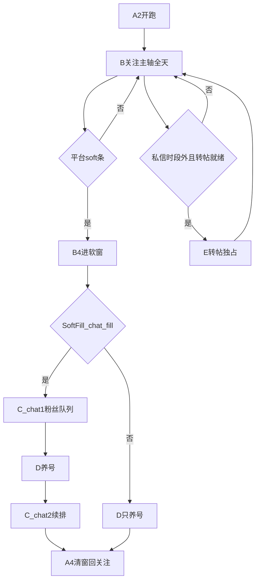

# 智能调度插件 · 技术指导（项目宪法）

> **基线：扩展 4.3.24** · 修订 2026-10-01  
> **效力：** 本文 = **必须遵守**的产品目的 + 全功能逻辑链条 + 少跳页 + 平台技术要求。  
> **改行为必须先改本文对应链 ID，再改** [`调度工作手册.md`](调度工作手册.md) 子 ID，再改代码（[`工作指导.md`](工作指导.md) 白名单）。  
> 冲突时：**本文 > 手册细则 > 审查/SOP 附录**。

---

## §0 怎么用

```text
1. 用「想改什么」找到 §4 链 ID（唯一）
2. 读该链全文 + §3 少跳页（若涉及导航）
3. 读手册对应子 ID 细则
4. 读工作指导白名单 → 一次只改一个子 ID
5. 验收用该链「终态」；工作指导 §13 记：链ID + 子板块
```

**说不清链 ID / 说不清「不破坏哪几条相邻链」→ 禁止开工。**

文档三角：

| 文档 | 角色 |
|------|------|
| **本文** | 宪法：目的、链条、少跳页、平台标准、自洽 |
| [`调度工作手册.md`](调度工作手册.md) | 分板块不变量（A1/C2…） |
| [`工作指导.md`](工作指导.md) | 改哪个文件 |

---

## §1 产品目的（把插件说清楚）

### 1.1 一句话

在 **多开 Chrome 档位**上，对 X（Twitter）账号做可持续运营：  
**关注获客 → 软风控填窗内私信转化 → 养号保活 → 夜间转帖**；由调度 **单引擎轮转**，可被 OPS/SCRM 闸住。

### 1.2 目标账号画像

| 日龄 | 允许 |
|------|------|
| Day1 | 关注 + 养号 + 私信（时段内 + SCRM 闸） |
| Day2+ | 关注 + 软窗私信（时段内）+ 养号 |
| 夜间/下班后 | S0 转帖专场（白天 priority 不含 repost） |

### 1.3 成功长什么样

- 关注能点到平台 soft 条，再进 **15–17 分**填窗，不装死。  
- 填窗内（chat_fill）：粉丝页 **封口名单 → 一人一条** 破冰/查回/AD/盾牌/催加，然后交回关注。  
- 对方拒绝 → **本地记死**，下窗不再点进。  
- 无破冰后新回复 → **不发 AD**。  
- 客服离线 / 非私信时段 → **不开私信**。  

### 1.4 明确不做

- 不点 X 平台「屏蔽」当拉黑（本地 skipped 即可）。  
- 默认不开蓝点守箱（不进 `/i/chat` 扫箱）。  
- 不把超时/死号/配额满当成软风控。  
- 不拆巨石「为模块化而模块化」。  
- 不引入 Web Firebase 登录替换 SCRM。

---

## §2 整天总链条（唯一鸟瞰）



| 段 | 启动 | 结束 / 交回 | 必须清掉的残留 |
|----|------|-------------|----------------|
| 关注主轴 | A2 priority=follow（全天） | soft 进窗或转帖独占 | 无 softRisk 假旗 |
| 软窗 | B4 `enterSoftRiskDiversion` | 名单做完 / 闹钟到 → 回 follow | `softRiskPhase=''` `softRiskUntil=0` |
| chat1/2 | A4 相位 | 队列 drain 或窗尾 | doing 不得跨人；lease 交回 |
| 养号 | A4/D / 全天 | 相位切换或预算尽 | 不抢 chat；转帖独占时停 |
| 转帖 | 非私信时段就绪 | 日配额或超时 | 私信时段硬停；白天不与 chat 并存 |

**共享总闸（任何引擎启动前）：** 自动模式 running、单引擎、A7 门禁、日龄/时段/SCRM（私信）。

细则：手册 §A / §B4 / §C2。

---

## §3 少跳页铁律（全局强制）

**原则：同页能做完 → 禁止导航；必须导航 → 最短路径 + 原路返回。**  
跳页会放大：占用、错页假活、step 武装在错误 URL、CPU。

| 场景 | 允许路径（次数尽量少） | 禁止 |
|------|------------------------|------|
| 私信开人 | `/followers` → 资料页 → 点 DM → 发 **1** 条 → **`chatGo(/followers)`** | `/i/chat` 列表；直跳会话 URL；点左上角回 Messages；同人连发多条再跳 |
| 软窗登记 | 停在本人粉丝页浅扫/首扫 | 无故经 `/home` 再进粉 |
| 关注点粉 | 博主粉页连续点击 | 超时轮转冒充 soft 乱跳 |
| 养号 | `/home` 动作 | 与私信双引擎抢导航 |
| 空壳/错会话 | **立刻**回 `/followers` 锚点 | 在 Messages 空壳武装 step2 |
| 开人前旧 DM | 先离会话回粉，再开下一人 | 在旧会话上开第二人 |

**私信成功路径跳转上限（设计预算）：** 每人每条业务 ≤ **资料 1 次 + 回粉 1 次**（会话由资料按钮进入，不另计 URL 直跳）。超出必须改 §3 并说明收益。

改导航相关代码：主看 **C2 / C9 / A2 / B3**；先改本节。

---

## §4 功能逻辑链条（全量 · 自洽核心）

每条格式固定。改行为 = 改对应链，并列出「不破坏」相邻链。

---

### L-GATE · 总闸（日龄 / 时段 / SCRM / 策略）

| 项 | 内容 |
|----|------|
| 板块 | A1、A5、H3、J |
| 输入 | 账号 day、北京时间、modules.chat、SCRM 快照 |
| 判定 | 私信时段（dating 08–18 / job 北京 10–19 硬停）；SCRM **strict** 下客服在线且快照有效；策略 allow_chat |
| 动作 | 放行或 `chat_blocked`；SoftFill 只看 day+时段+modules（**SCRM 不进 SoftFill**，只挡 start） |
| 终态 | 可开 chat / 不可开（只养号或跳过） |
| 禁止 | C 旁路 A5；过硬停仍加债 |
| 跳页 | 无 |
| 清场 | OPS「重置私信」清 `dm_records`+leads 阶段；本地空或 `reset_chat_local` 后 `current_round` 回 0 可再破冰 |
| 共享键 | chatHours、scrm gate、softFillMode |
| 手册 | A1、A5、H3 |

---

### L-LEASE · 指挥租约

| 项 | 内容 |
|----|------|
| 板块 | A2 |
| 输入 | coStart / 换令 / force 脉冲 |
| 判定 | 无 diag 冻结；单引擎空位 |
| 动作 | `round_start`（pulseId）→ 引擎 seal/exec → `round_result` → `round_complete`；进度心跳；&gt;45s 无进度 → zombie reclaim |
| 终态 | `auto_run=false` + module.running=false；或 reclaim 后可再令 |
| 禁止 | 未 exec 完 clear 密封名单；裸 auto_run 当活；远程任意 JS |
| 跳页 | 仅 page-router 必要落点 |
| 共享键 | `sg_chat_lease`、`sg_chat_last_progress_at`、pulseId |
| 手册 | A2 |

---

### L-FOLLOW · 关注主轴

| 项 | 内容 |
|----|------|
| 板块 | B2、B3、B1 |
| 输入 | pool_pop 任务、配额、间隔 |
| 判定 | 有任务且未满日限；非 softRiskActive |
| 动作 | 粉丝列表点关注；一博主点完再换；done/dead 回报号池 |
| 终态 | 配额尽 / 池空 / 触 soft 条转 L-SOFT / 超时仅模块轮转 |
| 禁止 | 超时当 soft；填窗内放锁换号 |
| 跳页 | 博主粉页内滚动点击；换博主才跳 |
| 共享键 | keepTask、日限 |
| 手册 | B1–B3、B6 |

---

### L-SOFT · 软风控填窗

| 项 | 内容 |
|----|------|
| 板块 | B4、A4 |
| 输入 | 平台 soft 蓝条文案 |
| 判定 | **唯一入口**＝平台 soft；读 SoftFillMode |
| 动作 | 窗长 15–17m；`chat_fill`→phase chat1；否则 nurture-only；不释放任务锁 |
| 终态 | 清窗：phase 空、until=0，交回 follow（`soft_risk_round_end`） |
| 禁止 | 死号/超时/配额满冒充 soft；窗内 hold 卡死（守箱关） |
| 跳页 | 进窗落到粉丝页锚点；窗内少跳（见 §3） |
| 共享键 | softRiskUntil/Phase/Mode/ChatDone、softFillMode |
| 手册 | B4、A4 |

---

### L-ROSTER · 粉丝名单封口与一人一条

| 项 | 内容 |
|----|------|
| 板块 | C2 |
| 输入 | 软窗 chat 相位、目标库债、粉丝 DOM |
| 判定 | 有台账→浅扫一屏；无→首扫触底；同窗已扫→复用+灌债禁重扫；全量封口对齐本号「关注者」数 |
| 动作 | seed 债 → harvest 新粉 → **sort kick→ad→ice** → seal → 台账 snapshot → `dm/roster` 上传 → drain；doing 占坑拒第二人 |
| 终态 | queue drained / 窗结束交回；skipped 永不可 promote（reject/blocked/they_blocked_us/no_dm） |
| 禁止 | sealed 后再「浅扫：回顶」；为查回复再浅扫；乱序插队；单语文案检测 |
| 跳页 | 登记阶段尽量 0；开人见 L-ICE/L-PROBE |
| 共享键 | `dan_ice_task_queue`、baseline（含 followerCount）、softRiskUntil |
| 手册 | C2（4.3.28） |

---

### L-ICE · 破冰

| 项 | 内容 |
|----|------|
| 板块 | C2、C5、C9 |
| 输入 | round0 / 真空会话 / 可发框 |
| 判定 | 真真空或需 ice；非 hard_closed；通过 L-GATE |
| 动作 | §3 路径进会话 → 发破冰 → UI 确认 → **本地 round/iceSentAt** → 回粉 |
| 终态 | 队列 done/deferred；本窗刚破冰者 wait_reply |
| 禁止 | setUserRound(0) 清态；确认成功不计数；直跳 /i/chat |
| 跳页 | §3 预算内 |
| 共享键 | iceSentAt、dan_iced_*、current_target |
| 手册 | C2、C5、C9 |

---

### L-PROBE · 查回复与分流（含检测）

| 项 | 内容 |
|----|------|
| 板块 | C3、C5、C4、C7 |
| 输入 | 已破冰目标、会话 DOM |
| 判定 | peer = **afterIce 正文**；无 peer→不 AD；dating 看年龄；job 看意向 |
| 动作 | 有回复→L-AD-KICK 或 L-REJECT；无→deferred |
| 终态 | 发送 / skipped / deferred |
| 禁止 | 歴史灰泡当回复；无 peer 发 AD；查回复触发浅扫 |
| 跳页 | 同 L-ICE 路径开人 |
| 共享键 | peer 文本、replySeenAt、script_pool |
| 手册 | C3、C5、C4、C7 |

---

### L-REJECT · 拒绝 / 低龄记死

| 项 | 内容 |
|----|------|
| 板块 | C5、C2 |
| 输入 | jobIntent=no 或 dating 年龄&lt;25 |
| 判定 | 已认定拒绝/低龄 |
| 动作 | 尽量发婉拒文案；**无论气泡确认成败** → markAgeRejected + reject 库 + queue skipped |
| 终态 | skipped 永久；下窗 classify 不开人 |
| 禁止 | finishTargetVisit 空返回；promote 抬回 pending |
| 跳页 | 发完回粉 |
| 共享键 | rejectSentAt、blockedAt、dan_reject_users |
| 手册 | C5、C2（4.3.20） |

---

### L-AD-KICK · 广告与两步跟进

| 项 | 内容 |
|----|------|
| 板块 | C5、C8 |
| 输入 | 有 peer 且非 L-REJECT；或 round 已 AD |
| 判定 | canSendAdNow；kickCount 0/1 |
| 动作 | 发完整 AD → 下窗盾牌 → 再下窗催加一次 → 完结 |
| 终态 | round/kick 推进至 done；满 2 步完结 |
| 禁止 | 催加≤4 旧逻辑；按小时死等；无 peer 发 AD |
| 跳页 | §3 |
| 共享键 | adSentAt、kickCount |
| 手册 | C5、C8 |

---

### L-NURTURE · 养号

| 项 | 内容 |
|----|------|
| 板块 | D1–D3、A4 |
| 输入 | priority=nurture 或软窗 nurture 相位 |
| 判定 | 预算未尽 |
| 动作 | 首页赞/评等；评论写入须读回校验 |
| 终态 | 预算尽或相位切换 |
| 禁止 | 自启抢导航；软窗该 chat 时抢跑 |
| 跳页 | 以 /home 为主 |
| 手册 | §D |

---

### L-REPOST · 转帖 S0

| 项 | 内容 |
|----|------|
| 板块 | E、A2 |
| 输入 | 非工作时段或 test24h 专场闸 |
| 判定 | 到开跑点（默认 06:00）；日配额 |
| 动作 | 转帖；间隔≥30m；已发 ID 不重复 |
| 终态 | 配额满或超时收工 |
| 禁止 | 白天 priority 插入 repost（例外见 A2） |
| 跳页 | 转帖所需页 |
| 手册 | §E |

---

### L-HEAL · 自愈与多开

| 项 | 内容 |
|----|------|
| 板块 | K1、K2 |
| 输入 | CF 挑战、白屏、Aw Snap、多开档 |
| 判定 | 撞页/壳/媒体策略 |
| 动作 | challenge-guard；purge 错峰；Aw Snap recreate；默认 media on |
| 终态 | 页可继续或档位恢复 |
| 禁止 | loading_shell 首愈乱 purge；默认禁图当「省占用」唯一解 |
| 跳页 | recreate 不可避免；业务跳页仍守 §3 |
| 手册 | §K |

---

### 链与链自洽图（共享状态）

```text
L-GATE ──允许──► L-SOFT / L-ROSTER / L-ICE …
L-SOFT ──相位──► L-ROSTER ──开人──► L-ICE / L-PROBE ──► L-AD-KICK | L-REJECT
L-LEASE ──包住──► 上述 chat 段（假活 reclaim 不烧错误 chatDone）
L-FOLLOW ◄──清窗交回── L-SOFT
```

改任一共享键（`softRiskPhase`、`dan_ice_task_queue`、`rejectSentAt`、pulseId）必须勾选上表相邻链。

---

## §5 平台技术要求（服从 §2–§4）

依据：[SW 生命周期](https://developer.chrome.com/docs/extensions/develop/concepts/service-workers/lifecycle)、[迁移 SW](https://developer.chrome.com/docs/extensions/develop/migrate/to-service-workers)、[MV3 迁移/DNR](https://developer.chrome.com/docs/extensions/develop/migrate)。

### 5.1 占用（Performance）

| 必须 | 说明 | 挂钩 |
|------|------|------|
| 封口后禁 harvest | 防 CPU 100% | L-ROSTER |
| Content 重 DOM 限频 | 主战场在页面进程 | L-PROBE、C9 |
| SW 短命、勿永活 | alarms 替长 timer | L-LEASE、background |
| 多开错峰 | 不同秒齐扫 | L-HEAL |
| 可测 | Task Manager 看档位 CPU/内存 | G |

### 5.2 鉴权（AuthZ / 最小权限）

| 必须 | 说明 | 挂钩 |
|------|------|------|
| 三层闸 | X 登录 → 插件/账号绑定 OPS → SCRM allow_chat | L-GATE |
| 密钥不进包 | token/cookieImport 服务端或本地保密存储 | H/J/F |
| 远程指令白名单 | 禁止任意 JS | L-LEASE |
| host 权限有理由 | optional 能缩则缩 | manifest |
| 吊销 | cookie 失效/gate 红 → 停私信 | L-GATE |

### 5.3 收口（Lifecycle + 工作闭环）

| 必须 | 说明 | 挂钩 |
|------|------|------|
| 软窗交回 | phase/until 清零 | L-SOFT |
| 租约交回 | auto_run + running false | L-LEASE |
| 名单 drain | sealed 后做完或窗尽 | L-ROSTER |
| 拒绝死门 | skipped 不回流 | L-REJECT |
| 随时被杀仍正确 | 态在 storage；不靠 SW 内存 | 全链 |
| pause 停表 | content 定时器/Observer 可停 | C9/A2 |

---

## §6 自洽纪律（防改坏）

1. **行为变更顺序：** 本文链 ID → 手册子 ID → 代码 → 工作指导 §13。  
2. **一次一条链的主板块**；共享键必须列出相邻链。  
3. **新跳页 / 新队列态 / 新闸门** = 先改 §3 或 §4，禁止隐形旁路。  
4. **开工模板（强制）：**

```text
【链 ID】
【目的】
【不破坏】相邻链列表
【跳页】无 / 有（对照§3）
【验收】终态 + 事件名
```

5. 数字（时段、kick=2）**只在本文+手册维护**；审查不得另起一套。  
6. 纯文档变更不 bump 扩展版；行为变更必须 bump。

---

## §7 验收（宪法是否可用）

- [ ] 只读本文能说明：插件目的、白天怎么转、私信为何少跳页、拒绝后为何不进。  
- [ ] 每个现网功能能落到 **唯一链 ID**。  
- [ ] 私信成功路径跳转预算可检查。  
- [ ] 占用/鉴权/收口均有「必须」且挂到链。  
- [ ] 新需求说不清链 ID → 被拒开工。

---

## 附录 · 链 ID 速查

| 链 ID | 一句话 |
|-------|--------|
| L-GATE | 能不能私信 |
| L-LEASE | 调度发令与假活回收 |
| L-FOLLOW | 关注主轴 |
| L-SOFT | 软窗进与清 |
| L-ROSTER | 封口一人一条 |
| L-ICE | 破冰 |
| L-PROBE | 查回复分流 |
| L-REJECT | 拒绝记死 |
| L-AD-KICK | AD+盾牌+催加 |
| L-NURTURE | 养号 |
| L-REPOST | 夜间转帖 |
| L-HEAL | 自愈多开 |

细则与文件白名单：[`调度工作手册.md`](调度工作手册.md) · [`工作指导.md`](工作指导.md)。
