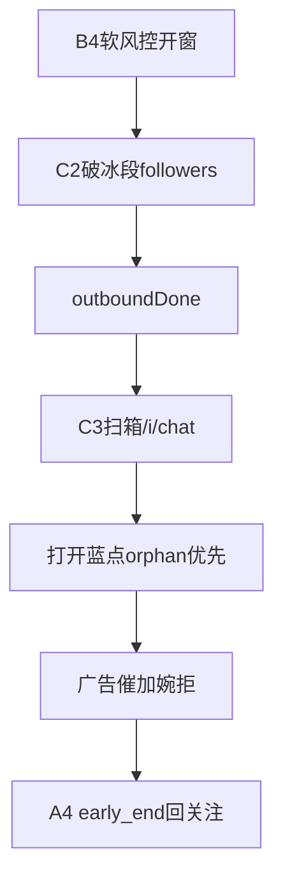

# 私信守箱全面审查（实机 @MaltzTeres75998）

> **产品状态（2026-09-05 · 4.1.0）：蓝点守箱脉冲已默认停用。**  
> 回信改走「破冰同路」：DB 跟进队列登记 → 逐条进会话检测 → AD/婉拒/催加（`kickCount`≤4）。  
> 本文保留作历史根因档案；新行为见 [`工作指导.md`](工作指导.md) §13 与计划「停用 DM 守箱」。

> 日期：2026-09-04 · 审查基线 **4.0.21** · **一次包已落地 4.0.22** · 板块 **C2/A4/C3/G6**  
> 结论先行（历史）：**不是「看不见蓝点」**，是 **软风控卡在破冰段 / 扫箱脉冲空收工 / 页面强制命令进不了隔离世界** 三条叠加。  
> 状态：**4.1.0 起默认不再依赖本审查中的扫箱路径做生产回信。**

---

## 0. 实机证据摘要

| 现象 | OPS / diag |
|------|------------|
| 看见未读 | `inbox.list_signal` unread_dom=**5**（07:01） |
| 未打开 | 同日几乎无新 `inbox_open`；历史 `saw_unread_no_open` |
| 假债 | kick≈31 / ad≈8～11；删库后 OPS `mergeTargetRoundsMap` 灌回（4.0.19 禁新建） |
| 墓碑 | done=true 后队列曾整段 skip（4.0.20 部分修） |
| 强制空跑 | 页面 `dispatchEvent(sg-chat-command)` **到不了** content 隔离世界 |
| 下午 | `soft_ice_extend` 刷屏；`soft_outbound_done` 后仍无守箱打开 |
| 强制扫箱态 | `soft_risk_scan_pulse` + chatRunning，但无 `list_signal` |

---

## 1. 设计态（应然）



铁律：可视未读必须 `opened_*` 或显式 `saw_unread_no_open`；**禁止**仅有 `list_signal` 就 `chatDone`/`early_end`。

---

## 2. 缺陷清单（按优先级）

### P0 — 必须进一次包

| ID | 缺陷 | 位置 | 后果 |
|----|------|------|------|
| **D1** | `/verified_followers` 不含 `/followers` 子串，C2 破冰主循环不进 | `content_chat` 出站门 | 停在 verified 页假活，`icePending=0` 仍 `soft_risk_outbound_ice` |
| **D2** | `soft_no_ice_pending` 用 `countPendingListTargets`（含 ad/kick） | C2 空破冰出口 | 有假 kick 时永远不转扫箱 → `soft_ice_extend` 空耗窗 |
| **D3** | `forceInboxPulse` 启动后**同步** tick，列表未就绪 | G6/C3 `forceInboxPulse` | 返回 ok 但无开人、无 list_signal |
| **D4** | 脉冲 `completeChatRound` 即 `softRiskChatDone`，即使 unread>0 且 opened=0 | C9/C3 收工 | 一趟空扫烧尽整窗，蓝点挂到下一软风控 |
| **D5** | 假 kick（`!adBubbleOk` 也算可行动）驱动 `hold_chat` 烧 5 开会话帽 | A4 + C5 债计数 | 脉冲开 kick/空 miss，蓝点排不到 |

### P1 — 同包建议一并做

| ID | 缺陷 | 说明 |
|----|------|------|
| **D6** | `listOrphanUnreadRows` 建 pid/dn 索引仍跳过 `done` | 墓碑后显示名/peer 匹配变脆 |
| **D7** | 软窗时间帽 4 分、0 开也可收工 | 列表慢渲染 → 空 early_end |
| **D8** | 页面 console 直接 `dispatchEvent` | 文档/SOP 必须写死只用 `__sg*` |

### 已修（勿回退）

- 4.0.18 orphan 先于 kick；软风控收养帽 5  
- 4.0.19 OPS `applyOpsMaxRound` 不凭空新建  
- 4.0.20 done 墓碑可 revive（队列侧勿再因 done 整段 skip）  
- 4.0.21 `__sgForceInboxPulse` 桥（方向对，**D3 未完**）

---

## 3. 一次修复包（统一改，禁止再拆成多日热修）

**范围白名单：** C2 · C3 · A4 · G6（必要时 C1 索引一行）。  
**禁止：** C6 PIN、B3 点击、拆巨石、改窗长/填窗概率。

| 步骤 | 板块 | 改什么 | 验收 |
|------|------|--------|------|
| 1 | **C2** | 出站面认 `followers` **或** `verified_followers`；软风控在 verified 则拉回 `/followers` 或同页跑破冰 | 不再 verified 假活 |
| 2 | **C2** | 空破冰出口只看 **ice 队列 + round0**，不看 ad/kick | `soft_outbound_done` reason=`soft_no_ice_pending` 且无 extend 刷屏 |
| 3 | **A4** | `early_end`：若上脉冲 `unread>0 && opened=0`（或 `saw_unread_no_open`）则**禁止**清窗，允同窗再脉冲一次 | 蓝点未试完不回关注 |
| 4 | **A4** | `hold_chat` 可行动 kick **不含**「仅缺 adBubbleOk 的脏 repair 堆」；或 hold 上限与 orphan 可见未读解耦 | 假 kick 不烧 5 开 |
| 5 | **C3** | `unread>0 && opened=0` 时禁止直接 `softRiskChatDone`；强制再 orphan 一轮或 `unread_hold` | 与 A4 对齐 |
| 6 | **C3** | orphan 索引含 done（仍跳过 reject）；seal 后 `row_miss` 回顶再找一次 | 墓碑+虚拟列表 |
| 7 | **G6** | `forceInboxPulse`：轮询至 `mailSrc && listVisible && rows>0`（≤8s）再 tick；失败 `ok:false`；+2s 二次 tick | 强制不再空 ok |

版本：**已 bump 4.0.22**，§13 已记「守箱全面修复包」。

---

## 4. 统一复验（只用桥，禁止页面 dispatchEvent）

```js
await __sgDiag();
const r = await __sgForceInboxPulse(20);
console.log(r);
const sig = await __sgDumpInboxSignals(20);
console.table(sig.samples || sig);
```

**PASS：**

1. `r.ok && r.mailSrc && r.listVisible && (r.orphanCount>0 \|\| 有 unread sample)`  
2. 数分钟内出现 `inbox_open` / `opened_*` / `ad_sent` 或 `reject_sent`（如「14です」）  
3. OPS 无连续 `soft_ice_extend`；无「仅 list_signal、无 open」的脉冲收工  

**FAIL 归因：**

| 结果 | 指向 |
|------|------|
| Force timeout | 未重载 / 未注入 |
| ok 但 !listVisible | D3 未修好或人在会话页 |
| listVisible 有 orphan 仍不开 | D5/D6 C3 |
| 仍 soft_ice_extend + verified | D1/D2 |

---

## 5. 与扩号闸门

本 FAIL（C-Inbox）未关前：**不扩号**。  
S1–S4 短测排在本包 PASS 之后。

---

**一句话：** 先修「空破冰假活 + 空扫就 chatDone + 强制 tick 抢跑」，守箱才会动；不要再只改 orphan 排序或只清债。
