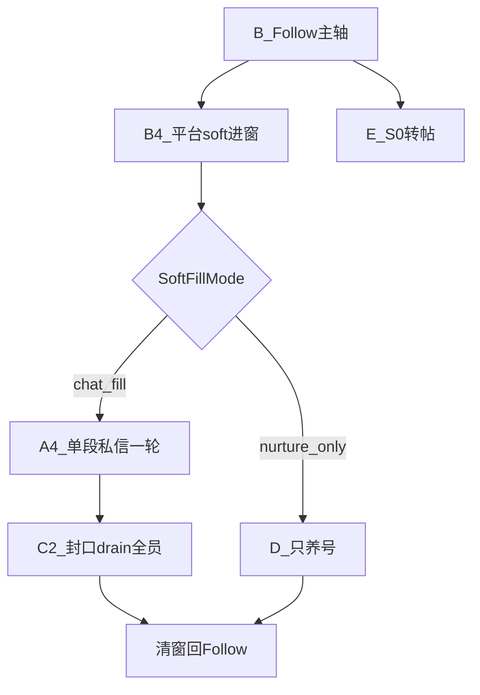

# 智能调度 · 工作手册（业务逻辑 · 分板块细则）

> **基线扩展：4.5.0** · 修订 2026-10-03  
> **先读宪法：** [`智能调度插件技术指导.md`](智能调度插件技术指导.md)（目的、全功能链 ID、少跳页、占用/鉴权/收口）。  
> **本文 =** 按子 ID 的 Why/禁止细则。改码白名单见 [`工作指导.md`](工作指导.md)。  
> **铁律：** 一次只读/改 **一个子 ID**；跨板块必须先改本文 **§X 契约表**，再分两次改代码。

---

## §0 怎么用（防牵一发动全身）

### 0.1 开工五步

```text
1. 定需求场景（例：拒绝后还进 / 软窗谁先跑 / 误发 AD）
2. 打开本文对应子 ID 全节（不要读整章铁律堆）
3. 若跨板块 → 先查/改 §X 契约表
4. 打开工作指导同 ID 白名单 → 只改列出的文件/锚点
5. 按本节「验收」勾完 → 工作指导 §13 记一笔
```

### 0.2 分板块硬规则

| # | 规则 |
|---|------|
| 1 | **不变量在手册对应子节**；工作指导不另起第二套数字 |
| 2 | **一次只改一个子 ID**（A2≠A4；C2≠C3≠C5；B4≠B3） |
| 3 | **禁止**在 A 节写发信/差集细节；**禁止**在 C 节写 coTick priority |
| 4 | 新功能放不进现有子 ID → 先在工作指导 + 本手册新增子节，再写代码 |
| 5 | 行为变更 bump `manifest.json`；纯文档不 bump |

### 0.3 文档分流

| 问什么 | 读哪 |
|--------|------|
| 业务该怎样 / 禁止什么 | **本文对应子 ID** |
| 改哪个文件 | [`工作指导.md`](工作指导.md) 同 ID |
| 接口字段 | [`API_CONTRACT.md`](API_CONTRACT.md) |
| 交付怎么测 | [`交付与检测SOP.md`](交付与检测SOP.md) |
| 历史实现审查 | 调度/私信「逻辑审查」（附录；冲突以本文为准） |

---

## §X 跨板块契约总表

> 只写接口。实现细节在各方子节。新增耦合 = 先加一行再改代码。

| 契约 ID | 从 → 到 | 约定 | 改谁 |
|---------|---------|------|------|
| A1↔C | 时段 → 私信 | dating 08–18；job **北京 10:00–19:00 硬停**（19:00 起不开私信/不加债，留到次日）；时间一律 Asia/Shanghai | 时段键 A1/`TimeUtil`；发信逻辑不改时段 |
| A1↔A5 | 日龄 → 策略 | 4.3.32 起 **取消私信天数限制，Day1 即可私信**（原 Day≥3 硬闸已移除）；日龄仅用于配额/画像展示 | A1 日龄；A5 策略对象 |
| A2↔A7 | 启停 ↔ 门禁 | 自动模式仅 A2 启停；引擎禁自启 | A7 门禁；A2 coStart |
| A3↔B | S3 让路 | 关注真活时 chat 让路（非软窗脉冲） | A3；勿改 B3 点击 |
| A4↔B4 | 相位 ↔ 进窗 | B4 写窗长/进场；A4 只排 **单段 chat 一轮→follow**；SoftFillMode 决能不能塞私信 | 窗长=B4；相位=A4 |
| A4↔C2 | 时间片 ↔ 队列 | 单段窗内按人状态混发（ice/ad/probe/kick）；封口/开人/排序只在 C2 | A4 禁止改队列序 |
| A4↔C | hold | 守箱关时禁止 `soft_risk_hold_chat` 卡死；债下窗 promote | A4 |
| A5↔H3/J | SCRM 闸 | 插件 A5 读闸；strict 默认不放行 | 服务端 H3/J；勿在 C 旁路 |
| B2↔I1 | 号池 | pop/done/dead；号池双实例 **78=主池 `:15678` / 79=兼职池 `:15679`**，领号目标由 H1 `pool_server`（全局阈值或账号 override）经 F1 下发决定；插件对**非 78 池禁回退外网 haochi1 兜底**（haochi1 仅映射 78 池，回退=跨池错领）；79 池仅内网可达 | B2/I1/H1 |
| B4↔D | 软窗养号 | SoftFill≠chat_fill 或相位 nurture → 只养号 | B4 进场；D 执行 |
| C1↔C2 | 目标库 ↔ 开人 | round/iceSentAt/adSentAt/reject* 为真相；队列镜像 | C1 字段；C2 分类开人 |
| C2↔C3 | 开人 ↔ 检测 | 查回复不靠浅扫；浅扫只登记新粉 | C2 收获；C3 afterIce |
| C3↔C5 | peer → 发送 | peer 空不得 AD；intent=no / 低龄 → C5 记死 skipped | C3 检测；C5 落库 |
| C5↔C8 | 跟进 | 盾牌+催加共 2 步；不按小时等 | C5 发送；C8 读闸 |
| C6↔C9 | PIN ↔ 步进 | 门检出立刻填码；禁止空挂 | C6；C9 步进 |
| C7↔F/H | 话术池 | `chat_script_pool=dating\|job` | F/H 键；C7 读池 |
| F↔引擎 | 阈值 | H 表 → F 映射 → 引擎读 **三处同改** | F+H+对应引擎 |
| H1↔A2/F | 关注日限计数 | **今日关注计数只按北京日期（Asia/Shanghai）跨日归零**（插件 `matrix_stats_*` 的 `date` / OPS 上海日）；**保存关注阈值不清零当日计数**（H1 保存后不再自动下发 `reset_follow_daily_limit`、不再删今日 follow 成功日志）；新 DayN 区间仍经 F1 下发，插件对「区间外旧锁」自动重抽（不清已用数）；人工清零仅走账号页「重锁今日关注配额」按钮 | H1 保存不改计数；A2 命令保留但仅手动触发 |
| E↔A2 | 转帖 | 非私信时段可独占；私信时段硬停 | E；A2 勿在私信时段插 repost |
| E4↔A2 | 转帖浮层 → 调度 | 面板「启动」经页面内 `CustomEvent('sg-page-cmd',{action:'sg_manual_repost'})` 直发，不走 chrome.runtime/SW | E4 发事件；A2 挂监听 |
| A2↔C2 | 私信重置广播（4.6.30） | `sg_reset_chat_seq` 广播监听**唯一归属 A2**（scheduler-core.js）；C 侧（content_chat.js）禁止再挂同名监听，避免双份清理+双 toast 维护分叉 | A2 挂监听+清 sessionStorage+toast；C2 只产出/消费重置结果 |
| G1↔A2 | 主控面板 → 调度 | 手动按钮（自动/停止/只关注/只私信/纯养号/只转帖）经页面内 `sg-page-cmd:{action}` 直发，不走 SW；A2 单一监听按 action 分发；启动/暂停须回传 `sg-page-cmd-result`（ok/message），面板据此闪条，超时提示刷新页面 | G1 发事件并听结果；A2 挂监听并 emit 结果 |
| E2↔G1 | 发帖标记 | 面板只调 `RepostTracker.markOwnPosted()/hasPostedOk()`；键 `sg_repost_posted_ok_<handle>` 由 E2 定义 | E2 定义键与认号；G1 仅调用，勿自读键 |
| F3↔E1/D1 | 反垃圾冷却键（4.6.30） | `sg_antispam_cooldown_until` 按号隔离；`sg_antispam_count` 按号隔离；全局共享 key 在多号场景会导致跨号连坐 | F3 键规则；E1/D1 调用不改 |
| K2↔多开 | 媒体/愈 | 默认 media on；Aw Snap recreate | K2 |
| H9↔E1/F1 | 来源号池 | OPS `repost_sources` 表统一登记来源号；H1 组装 `repost_targets` 时剔除 banned（插件零改动）；E1 抓取遇冻结/不存在页 → 上报 H2 `/api/plugin/repost-source-status` 标 banned；账号/全局配置只许池中勾选，禁止手填池外 handle | H9 建池+过滤；E1 只上报；F1 读法不变 |
| H11↔E5/F1 | 原创内容池 | OPS `content_pool_items` 表为原创发帖唯一来源；插件按号 claim 已批准且到期（scheduled_jst_at ≤ 当前日本墙钟）的一条，原子 approved→claimed，成功报 posted、可恢复失败报 retry（回 approved 待重发）、彻底失败报 failed；账号 override `repost_content_pool=1` 经 F1 透传切模式；**空池/无到期 = 跳过，5 分钟后再查，绝不硬发、不扫来源号**；内容脚本不直接连 OPS，claim/report/取图均经 background `opsFetch`/跨域 fetch | H11 建池+审核+claim 语义；E5 claim→pending 两阶段→回报；F1 键透传不改读法 |
| obs-retention↔H2 | 台账快照保留与查询索引 | `dm_roster_snapshots` 查询一律 `bot_id` 等值（写入端已小写化），**禁 `LOWER()` 包裹列废索引**（2.35GB 表全扫一次 0.7–6.3s，同步驱动直接卡死事件循环）；POST roster **仅 final chunk 写一封快照**（分片是传输细节，不产生多份快照）；`log-retention` 每 6h 调 `dm-roster-repo.purgeSnapshots()` 分层保留：①`sealed_at` 超 30 天删除（与 30 天展示窗口对齐）；②同 bot 同日只留 `MAX(id)` 一封；③`sealed_at` 7–30 天的快照 `payload` 置 `'{}'`（仅留趋势元数据列，明细很少回看）；④≤7 天保留完整 `payload.items`（历史粉丝明细回看来源）。**年龄判定用 `sealed_at`（ms 时间戳），禁用 `created_at` 日串比较**（非零填充 `'2026/10/9'` 字符串序不可靠） | H2 repo 实现保留与等值查询；retention 只调度 |

---

## §A 调度控制面

### A1 阶段与时段

**职责：** 判定 S0–S4、工作/私信时段、日龄对私信的硬闸。

**现行逻辑：**

- **关注 + 养号：** **全天可跑**（含下班后；不再因「非工作窗」进空 priority 的 S0 静默）。
- **工作时段**默认北京时间 **07:00–23:00 / 06–02**（产品窗）；用于早间渐进等，**不再**作为停关注的硬闸。
- **私信时段（一律北京时间 Asia/Shanghai）：** dating **08:00–18:00**；job **OPS 下发优先（H10 账号级下班时间），无下发兜底硬窗 10:00–19:00**（`TimeUtil.readChatHours`：job 池且 `sg_account_config.work_hours` 无覆盖时才硬编码；`inRange` 为 [start,end)，**到点硬停**新开私信/不加债/不赶债）。软风控：**下班前30分末次进**、已进窗可**延伸至下班+30**（随账号级下班点自动浮动，见 A4/B4）。
- **转帖：** **仅非私信时段**可跑；与私信零撞车。开跑后 **独占**（停关注/养号/私信）直到收工，再交回关注/养号。
- **定格：** dating **17:00** 禁止主动破冰新粉；job 定格对齐私信硬停点（无账号级下班时 19:00，随 H10 账号级下班时间浮动；窗内可破冰到停点前）。对方已来信/未读收养仍可处理（仍须在硬停前）。
- **日龄：** 4.3.32 起 **Day1 即可私信**（原 Day≥3 硬闸已移除）；日龄仅用于配额与画像展示，不再作为私信闸门。
- **新号自动上路（onboarding）：** Day1 且未就绪时，coTick 优先进入 onboarding 流程：① 有转帖来源 → 资料克隆→转帖→就绪→正常调度；② 无来源 → 最多等 90 分钟（每 2 分钟查一次），超时养号兜底。每步最多重试 3 次，失败原因存 `sg_onboarding_state_<handle>`。进行中独占调度，等来源期养号可并行。Day≥2 或已就绪自动清状态。面板显示「新号上路」阶段。
- **S1–S3** 由 `stage-detector` 产出；私信时段 priority **不含** repost（A2 strip）。

**关键键：** `sg_stage_policy`、chatHours、workHours、账号 day。

**禁止：** 在本板块改引擎发送/差集；私信时段插入 repost。

**验收：** 非私信时段无 chat start；私信时段无转帖 start；下班后仍可 follow；Day1 私信可开闸（4.3.32 起）。

**耦合：** A1↔C、A1↔A5、A1↔E。

---

### A2 主循环启停

**职责：** ~10s `coTick` 算 priority，**同一时刻只启一个引擎**；发/收指挥租约；超时与幽灵纠正。

**现行逻辑：**

- 叠层顺序：`StageDetector` → stripRepost（仅私信时段剔）→ `applyFollowFirstInS3` → **`applySoftRiskPriority`** → rush/quality → **`applyNurtureYieldPriority`** → launch（canRun/SCRM/day）。
- **养号帽让台不越私信主轴（4.6.144）：** `applyNurtureYieldPriority` 在 `priority[0] === 'chat'` 时**直接返回原序**——此时上游 `applyFollowFirstInS3` 已按 A3 判定把 chat 置顶（私信时段有债且未 yield），养号帽让台不得再把 follow 插到 chat 前抢跑私信。
- **单引擎：** 已有 `sg_module_*.running` 则本 tick 不再 start。
- **转帖独占：** 非私信时段且 `nightRepostShouldRun`（或已在跑）→ 停 follow/chat/nurture，只跑转帖；转完交回。私信时段硬停转帖。**日限已满 / 本日已完成**时必须停转帖并解除独占（不可因 `rpAlive` 僵尸占坑）。
- **工作/私信内：** **4.6.83 私信主轴**（有债先 chat；一轮后 yield 关注至 soft）；soft 填窗内从上到下做完名单再回关注（A4/C2）。
- **指挥租约（CMD）：**
  - CMD-1：只 A2 `coStart`/`coStop`/换令
  - CMD-2：`round_start` → plan/progress → `round_result` → `round_complete`
  - CMD-3：同租约先 seal 再 exec；禁止未执行完 clear；重复 start 同 pulse = keep
  - CMD-4：完成交回 `auto_run=false` + `module.running=false`
  - CMD-5：`sg_chat_last_progress_at` >45s 无刷新 = 假活 → `scheduler.chat_zombie_reclaim`；**正开人（current_target+step）或队列仍有 pending/doing 时禁止推进软窗交养号**（4.6.61，防 DM 中途被拽 `/home`）。step1/2/3/4 均须续 progress。
  - CMD-6：对齐后的本地台账=执行计划；OPS=本号权威副本（定期 GET/POST + 出箱回写）；禁止串号
  - CMD-7：`forceInboxPulse` 也必须 `round_start`
  - CMD-8/9：`pulseId` 唯一；同 pulse 只一次 `round_start`
  - CMD-10：diag 冻结拒 `coStart`；面板/`__sgDiagUnfreeze` 解冻
  - CMD-11（4.6.30）：模块 `lastActive` >**10min** 无刷新 = 引擎线程卡死 → force stop；chat 走 CMD-5 zombie reclaim；**follow/nurture 仅 stop + 遥测告警 `scheduler.module_stuck`，不进诊断冻结**（冻结只留明确异常证据场景；后台标签页 Chrome intensive throttling 下 90s 阈值会误杀正常模块）。
  - CMD-12（4.6.97）：**换号隔离** — 导航栏本号 ≠ `sg_bound_handle` 时 `reconcileSchedulerHostIdentity`：清全局 `accountFrozen`/软风控/任务锁/未分桶日计/session 引擎旗标；按号后缀桶（`matrix_stats_*`/`posted_ok_*`/`onboard_*`）保留互不串。冻结须带 `accountFrozenHandle`，`isAccountFrozenNow` 仅对本号生效。验收：旧号冻结后换新号 → 可启动，面板显示新 @handle。
- **废私信长冷却：** 仅显式 `chatNextAllowedAt`；禁止 `chatLastEndAt+55m` 与 25–35 分兜底。
- 会话帽到期停 chat（`scheduler.chat_session_cap`）。
- 远程指令白名单 claim：`start`/`pause`/`reset_profile_media`/`reset_follow_daily_limit`/`reset_chat_local`/`clear_dead_handles`。
- **关注日限计数锚点（2026-10-14 定调）：** 今日关注**只按北京日期（Asia/Shanghai）跨日归零**——插件 `matrix_stats_<handle>.date` 用上海日串比较，跨日 `follows_today=0` + 重抽 `daily_limit`；OPS 侧读数（`activity_logs` 今日 follow/success、`account_runtime_status.followed_today`）同用上海日。**保存关注阈值不清零当日计数**（契约见 §X `H1↔A2/F`）。
- **`reset_follow_daily_limit`（4.3.30 / 4.6.51+，现仅手动触发）：** 清零 `follows_today` + 重抽 `daily_limit` + 清冷却/`quota_exhausted`；`follows_reset_day` 挡同日 OPS 回灌。OPS 侧同步删今日 `activity_logs` follow/success（否则轻总控仍按旧计数拦截）。**仅由账号页「重锁今日关注配额」按钮/单号命令人工触发；2026-10-14 起保存关注阈值不再自动下发该命令**（避免一保存阈值当天关注数就归零）。

**禁止：** 在 coTick 里写 follow 点击 / chat DOM；私信时段插入 repost。

**验收：** 无双引擎抢导航；假活出 reclaim；`round_start`/`round_complete` 可断链；非私信转帖独占、私信时段无转帖。

**耦合：** A2↔A7、E↔A2、A4。

---

### A3 关注优先 / 让路

**职责：** S3 时段排序；关注真活时 defer chat（非软窗 / 非私信主轴段）。

**现行逻辑（4.6.83/84）：**

- **私信主轴：** 私信时段有债且未 `chatYieldToFollow` → **chat 置顶**（10:00 起可直接开，不等人家 soft）。**白天第一轮跑到台账队空**（不加 30–35m 时间帽）；**过私信下班点（兼职 19:00）硬停**（4.6.85；soft 延伸除外）。
- **一轮后让路：** 私信收工（`markSoftRiskChatPass2Done`）写 `chatYieldToFollow` → **follow 置顶**（养号可穿插）；直到 soft 进窗清旗再回私信。**置旗唯一来源=一轮收工**——4.6.85 白天硬停**不置旗**（4.6.145：私信窗外 chat 本就不在 priority（S1/S2），置旗只会在同日窗重开时误压 chat，造成「早上硬停 → 全天不发私信」）。
- **末次名额（4.6.84）：** 下班前 30 分后（兼职 **18:30**）当天所有**新开私信**（白天主轴 + soft）共用 `softRiskLastEntryDate` 一次；用过后再新开 → 挡。已在软窗内续跑不算新开。
- soft 窗内仍强制私信（A4）；`shouldDeferChatForFollow` 在未 yield 的私信时段不让路。

**禁止：** 改守箱差集（C3）。

**验收：** 10:00 有债先 chat 且可跑到队空；**18:50 白天场 19:00 硬停**；一轮后跟粉；soft 后再 chat；18:40 白天开过私信后同日 soft 不再带私信。

**耦合：** A3↔B、A3↔A4。

---

### A4 软风控优先级

**职责：** 软窗内排谁跑；**不决定窗长**（窗长在 B4）。

**现行逻辑：**

- SoftFillMode=`chat_fill`：窗内 **单段 chat 一轮 → 清窗回 follow**（无中间 nurture/chat2）。
- SoftFill≠chat_fill：窗内 **只 nurture → follow**（chatDone 直接 true）。
- **一轮** = 台账全员自上而下各得 **一次** 当前轮次动作（完成/拉黑→skipped 不发）；**刚破冰本窗进 done，复检下个软窗**（非同窗再开）。队空才交回关注。
- **末次进窗 + 延伸硬停（4.6.82/84）：** 私信下班前 30 分后（兼职 **18:30**）当天**所有新开私信**只许一次（白天主轴与 soft 共用 `softRiskLastEntryDate`）；其后同日再新开 → 挡 / soft 只养号。已进窗私信可跑到下班+30（兼职 **19:30**）；到点停 chat、**剩余 until 只养号**（3A），台账下窗续。冰延/加班 until 不得越过 19:30。
- 队未空不因墙钟到期砍半截：冰延/超窗续跑单次 +5m，累计封顶 **60m**（仍须在延伸硬停前；**挂起期间禁止顺延**）。
- **SCRM/临时闸挂起（4.6.79）：** SCRM/预算/冷却/策略挡 → 置 `softRiskChatSuspended`，相位切 **nurture 真养号**（不清窗、不烧 chatDone）；闸开后回 chat1 续原进度。挂起遇闹钟 → 清窗回关注（台账下窗续）。日帽/无 URL 等硬挡仍清窗。
- **OPS 台账链（4.6.81/85/86/87）：** 软窗内挂起/下班只养号仍 **POST roster**；白天自动私信在跑同样同步；**当日私信彻底结束 → 日终 POST**（次日首次开私信 **GET 回灌**续跑）；**成功后才盖**同日幂等戳（失败 60s 可重试）；日终强制上传不依赖 sync phase；闸开 GET；清窗/收工 POST；事件 `sg-soft-risk-ledger-sync`。
- **禁止** `soft_risk_hold_chat` / `early_end` 在守箱关时把债卡死在窗外；粉丝队列 chatDone 后应交回关注。
- SoftFillMode（`shared/soft-fill-mode.js`）：`chat_fill` = modules.chat 开 + 私信时段（或已进窗的 `soft_chat_extend`）；`nurture_only` / `off` = 只养号。**SCRM 不参与 SoftFillMode**（只挡 startChat/coTick）。

**关键键：** `softRiskUntil` / `softRiskPhase` / `softRiskMode` / `softRiskChatDone` / `softFillMode` / `softRiskChatSuspended` / `softRiskSuspendReason` / `softRiskLastEntryDate`。

**禁止：** 改 `enterSoftRiskDiversion` 窗长随机；改 C2 队列排序。

**验收：** 18:30 后第二次带私信进窗被拒（只养号）；18:50 进的窗可发 DM 至 19:30；19:30 后停私信只养号；SCRM 挡时相位=nurture 且养号能跑、队列保留；挂起期间 until 不涨；一轮结束 `softRiskPhase===''` 且 `softRiskUntil===0`。

**QA 清单（4.6.87，实机/面板 + OPS）：**

1. 软窗 drain 中 SCRM 关 → 引擎切 nurture ≥2 tick，面板 remainSec 不变、队列条数不变。  
2. SCRM 开 → 回 chat1 续同队列（日志「闸门恢复 → 回私信续跑」+ GET roster）。  
3. 挂起期间假死/zombie reclaim → 只停 chat，until/队列仍在。  
4. 挂起跨闹钟 → 清窗前 POST roster；下窗 GET 回灌与本地一致。  
5. 挂起 5min → OPS `/dm-roster/:handle` pending/done 与本地无长期脱节。  
6. **10:00 有债** → 先私信，可跑到队空；**18:50 白天场 19:00 硬停 + 日终 POST**（OPS 该号 `POST .../dm/roster` 200，`reason`≈`daytime_past_chat_hours`/`chat_hours_closed`）。  
7. 私信一轮后 → 关注优先；soft 后再私信。  
8. **18:40 白天开过私信** → 同日 soft 只养号（末次名额已用）。  
9. **18:40 进 soft** → 可发 DM 至 **19:30**；19:30 停私信 → **日终 POST**（OPS `reason`≈`soft_chat_end`）。  
10. **次日首次开私信** → OPS 该号 `GET .../dm/roster/:handle` 200；页面 `/dm-roster/:handle` pending 与昨日收工一致。  
11. 白天长跑私信 → OPS roster 5min 内与本地不脱节。  
12. 队空 → toast「一轮完成 → 回关注」。  
13. outbound 误入 Messages → 硬回 `/followers`。  
14. 同一人本窗破冰后不再开第二趟。  
15. **日终/日启（以后台为准）：** 看 OPS access/业务日志或 `dm_roster_snapshots` 新增行；插件「成功盖戳」仅旁证。注意心跳也会 POST，日终用 **时刻（≥19:00/19:30）+ reason** 区分。

**耦合：** A4↔B4、A4↔C2、A4↔C。

---

### A5 私信策略闸

**职责：** 产出 allowChat 策略对象（SCRM/债/赶工）。

**现行逻辑：** 读 H3 闸门结果；**4.3.32 起日龄不再拦截**（Day1 即可私信）；不替代服务端 SCRM。

**SCRM 闸门 fail-open（4.4.1）：** 闸门未就绪/拉不到时**默认放行**，避免 SCRM 服务不可用导致私信全面停摆。闸门拉到后仍按 `allow_chat` 正常拦截。

**禁止：** 改 SCRM 爬虫/cookie（J）；在 C 里旁路 A5。

**验收：** `scheduler.chat_blocked` 可解释。

**耦合：** A5↔H3/J、A1↔A5。

---

### A6 时间预算

**职责：** 小时帽；读配置。

**禁止：** 擅自改日帽阈值键名（须走 F↔引擎）。

**耦合：** F↔引擎。

---

### A7 门禁

**职责：** `scheduler-gate` — 自动模式禁引擎自启 / 未授权跳页。

**禁止：** 改引擎 command 业务细节。

**耦合：** A2↔A7。

---

### A8 诊断 whyIdle

**职责：** `computeWhyIdle` / `__sgDiag` 空闲文案与冻结说明。

**禁止：** 改面板 DOM（G1）。

**验收：** 空闲原因可读；diag 冻结可解。

---

## §B 关注引擎

### B1 配额与阶梯

**职责：** 日限、关注间隔阶梯。

**禁止：** 只改本地不改 OPS 键名（须 F↔引擎）。

---

### B2 号池领号

**职责：** `pool_pop` / `pool_done` / `pool_dead`；有未完成任务 startFollow 只恢复不重复 pop。

**号池来源切换（2026-10-15）：** 号池双实例 78=主池 `:15678` / 79=兼职池 `:15679`；插件领号目标 = chrome.storage `pool_server`（H1 `pool_server` 全局阈值 / 账号 override 经 F1 每分钟下发，约 1 分钟生效；面板「服务器地址」仅本地逃生口，OPS 有下发时以 OPS 为准）。**防跨池错领（铁律）：** 配置为非 78 池（如 79）时，内网不通**禁止**回退外网 `haochi1` 兜底（haochi1 仅映射 78 池）——宁可 `POOL_unreachable` 歇等，不得从错误号池领号；78 池默认行为不变（内网→外网自动兜底）。

**禁止：** 在本板块改 coTick。

**耦合：** B2↔I1。

---

### B3 点击关注

**职责：** 按钮识别、已关注多语言、扫描点粉。

**现行逻辑：**

1. **现网锚定（4.6.47）：** `UserCell` / `button$-follow` / `button$-unfollow`（正在关注）。
2. **4.6.50 修「该点却未点」：** X 虚拟列表回收 UserCell 时会把 `data-matrix-processed` 粘到下一行别人身上 → 扫到可关注号却直接跳过不点。改为按 **handle 会话 Set** 记账；每轮扫描先剥掉 DOM processed；点前禁止久等全局槽位。
3. **经典模式：** 点完无风控即算成功。
4. **稳节奏（4.6.101）：** 领号先 **PROFILE**（禁直跳 `/followers`）；`FOLLOW_PACE`——主页 settle **12–16s**（中途+结束双检保护号）；粉丝入口 **30s**；Tab 后 **10s**；进粉页再 settle **8s**；步骤超时 **120s**；换博主间隔 8–15s；Force 跳前仍吃全局 nav 间隔。浮条可见「稳节奏 Ns / 跳页冷却」。
5. **全局跳页间隔（4.6.102）：** `nav_min_interval_ms` 默认 **45s**；**Force 也排队**（不再瞬间硬跳）；`goRaw` 收裸跳；跳后写 `sg_nav_settle_until`（关注/私信/养号落地先等再动作）。
6. **粉丝页渲染守卫（4.6.115）：** 进粉页 URL 到但 0 `UserCell` → 渲染守卫 **10 tick × 2s = 20s**（`FOLLOW_PACE.scanLoadingGuardTicks`）；`aria-busy`/`progressbar` 加载中**不计数**，busy 宽限封顶 15 tick（30s，`scanLoadingBusyMaxTicks`）防永等；白壳**首愈只等不刷**（防硬刷抹掉在途渲染），shell#2 起才软愈重载；派发愈后清 `sg_follow_scan_settled_<cr>`，重载页重新吃 8s settle。shell 6-cap 释放语义不变。

**禁止：** 顺手改私信破冰（C2）。

---

### B4 软风控填窗

**职责：** **软风控唯一入口**；写窗长与进场模式。

**现行逻辑：**

1. 仅当点粉过程中出现平台风控条（「暂时不能关注更多用户」等）→ `enterSoftRiskDiversion`。
2. 窗长 **30–35 分钟**（可冰延/超窗续跑，累计封顶 60m，且 until 不过延伸硬停）；填窗内 **不释放任务锁**。
3. 读 SoftFillMode：`chat_fill` → 单段私信一轮（phase=chat1）；否则只养号。
4. **4.6.84 末次私信：** 下班前 30 分后（兼职 18:30）**白天主轴与 soft 共用**一次名额（`softRiskLastEntryDate`）；再用 → 只养号/挡新开。until 封顶下班+30（19:30）。
5. **禁止**把超时轮转 / 死号 / 列表卡死 / 配额满当成软风控。
6. 自动模式平台 SOFT 必须走填窗，不能只 warmup。
7. 日龄：4.3.32 起不再挡私信（Day1 即可），进窗 allowChat 只看 SoftFillMode + 末次进窗闸。

**验收：** `sg-soft-risk-entered`（durationMin 30–35）；Day1 也可 chat_fill；18:30 后第二次进窗 reason=`soft_last_entry_used`。

**耦合：** A4↔B4、B4↔D。

---

### B5 死号填窗

**职责：** 死号跳过填窗计数；**不是**软风控。

**现行逻辑：** 仅真保护号/封禁/不存在 → `pool_dead`。粉丝页「出错了」、入口未挂上 → **加长等待 + 软愈重试**，满次 `pool_fail`/`release`，**禁止**立刻 dead。进粉被踢回主页：先认保护文案/锁标；文案未命中时 **踢回≥2 次** 或 **软失败≥2 次** 亦按隐私号 `pool_dead`（防主页↔粉丝极速空转）。本地 `matrix_dead_handles` 命中只释放换号，不二次 dead。

**保护号扫描（4.6.99）：** `isProtectedProfileText` 去零宽后再匹配；`pageLooksProtected` 扫**全部** `emptyState*`（勿只取第一个）、primary/main，短语仍不中则 **body 短语兜底**（禁止 body 级锁标）。验收句：「这些帖子受到保护…若要申请访问，点击关注」→ `🔒` + `pool_dead` + 换号。

**禁止：** 写成 softRisk 入口。

---

### B6 任务锁恢复

**职责：** keepTask；休息后回原博主粉丝列表。

**禁止：** 填窗内误释放锁。

---

### B7 回关检测

**职责：** 回关上报；A2 轻量主动扫通知（默认约 **240 分钟**，一天几次够用；本地 `sg_fb_active_scan_min` 可 10–480）。

**现行逻辑：** follow / chat / **nurture** 任一在跑 → 不主动跳 `/notifications`。行程未到通知页或被拽回后，**8s** 清 `sg_fb_scan_hold`+trip（防养号空转）。

**禁止：** 改 H 效率分析页逻辑。

---

### B8 推博主

**职责：** 推送辅助。

**禁止：** 当成私信 outbound（push 条不属 C2 破冰主路径）。

---

## §C 私信引擎

### C1 目标库

**职责：** `SgTargetDb` — handle → round / iceSentAt / adSentAt / kickCount / rejectSentAt / blockedAt / done。

**现行逻辑：** 本地库为执行真相；与 OPS round **只升不降**（max）。完结：round≥3 或 reject/blocked/done。

**禁止：** 在本板块改调度 priority。

**耦合：** C1↔C2。

---

### C2 破冰 outbound / 粉丝队列

**职责：** 粉丝页登记、灌债、封口、一人一条开人、回 `/followers`。

**现行逻辑（写全）：**

1. **开人路径：** ice/ad/kick **一律**资料页 → `sendDMFromProfile` → step2 → 回 `/followers`。禁止 `openDmConversationDirect`；禁止 `chatGo` `/i/chat|/messages`（守箱关时）。
2. **登记（4.6.65 / 4.6.125）：** 首趟全量触底建台账；之后每软窗 **只回顶一屏浅扫**新粉；**有旧未破冰 backlog 时禁止再入队新人 ice**（仍 `discoverTarget` 入库，等旧债清完再加）。同 `softRiskUntil` **禁止清队重扫**（复用登记+灌债）。Force 可清台账重做全量首扫。**首扫触底封口（4.6.125）：** 触底封口由「首见 bottom 即封（4.1.36）」改为**连续 2 拍确认「触底 + 无 `role=progressbar` 加载条 + 本拍无新增 `UserCell`」**才封；计数按「本拍无新增格子」而非裸拍数；**保留** `dan_scroll_fail_count` > 20 硬上限（防无限下滚）。**缺口补登（4.6.125）：** `prepareAndSeal` 命中关注者缺口（部分格子 `cells+2<F`）时置 `dan_need_scroll_down`，下一拍进入**真正下滚补收**（每次 600px、封顶 8 拍，收满 `cells>=F`／触底／封顶即清标记后再封口），**禁止**只 return 不滚动＝假补登；补登有界，不得演成未封口反复 harvest。
3. **灌债（4.6.65）：** `seedUnfinishedFanDebtToQueue` 灌 ad/kick/deferred，**且在 baseline 已建后灌台账旧未破冰 ice**（`ledger_old_ice`，按 firstSeen 早者优先）；债 **不要求** ∩ `dan_session_scanned`。开人硬封闭仍 markPeerBlocked。
4. **分类 `classifyFanRosterAction`（4.6.79）：** reject 库 / rejectSentAt / blockedAt / done / round≥3 / kick 满 → **skipped**；eff0 → ice；eff1 → need_ad 或 **need_probe**（取消 wait_reply；**本窗刚破冰进 done，复检下窗**）；eff2 → kick。
5. **封口前定序（4.3.20 / 4.6.64）：** `sortIceQueueForDrain`：`kick` → `need_ad` → **`ice`** → `need_probe`（及其它 ad），同档按 `createdAt`。禁止 need_probe 饿死未破冰。路径含 `prepareAndSealIceQueue`、已封口每拍 drain。
6. **一轮定义（4.6.79）：** 台账全员自上而下各得 **一次** 当前动作；完成/拉黑→skipped 不发；**每人每软窗最多一次成功发送**；队空 → `finishSoftRiskFanQueueDone` → 清窗回关注（无中间养号/chat2）。
7. **封口后：** 禁止 harvest / 禁止「浅扫：回顶」；只 `iceQueueNextPending` 逐条。有 **doing** 只续此人；`startIceTask` 拒开第二人并 toast「等人 @x 完成」。
8. **跳过门闩（4.3.20）：** `job_intent_no` / `age_reject` / reject / blocked / `they_blocked_us` / `no_dm` 等 **永不可 promote** 回 pending；开人前复核 `classify` ≠ pending 则 mark 后 return。
9. **一窗一人一条：** 每人目标库 round 独立；无全队齐步「第几轮」；每窗每人最多一条成功发送。
10. **发出即本地计数：** UI 确认成功必须推进 round/iceSentAt 并队列终态；OPS `dm/record` 失败只告警，禁止连环重发。
10b. **OPS 缺轮补记（4.6.66）：** `dm/record` 遇 `round_gap`（本地已推进、OPS 缺前轮）时，用本地 `lastIceText`/`lastAdText`/`sg_dm_history` 按序补记缺轮后再报本轮；`round_duplicate` 视作已入账；`timeout` 退避重试 1 次。仍失败才黄条「后台记账失败」。
11. **查回复 ≠ 浅扫：** 已破冰/AD/kick 从库灌队开人，不为检测再浅扫。
12. **target_mismatch：** 粉丝队列有对方文本则忽略 mismatch 继续；无对方文本 → deferred。
13. **17 点定格：** 不破冰新粉（债仍可清）。
14. **台账（4.3.28 / 4.6.59 / 4.6.70 / 4.6.71）：** 每人一行必有 `queueStatus/queueKind/queueReason`（库存粉无队列也要反馈）；**快照全量**=本号 `chat_target_db` ∪ sessionSeen ∪ queue；**botKey=本号 X handle**（A/B 不混桶）。**执行计划**=对齐后的本地队列（序仍 kick→need_ad→ice→need_probe）；OPS 为本号权威副本。封口先 `POST` 再 `sealed`（失败出箱+黄条仍 seal）；`syncLedgerWithOps` 心跳 180s；`markLedgerDirty`→**5s 防抖轻量 POST**；OPS 灌入项带 `opsLockedKind`（reclassify 禁改 kind，仅本地终态可升 skipped）。诊断：`__sgFanLedgerSnapshot()`。OPS 页 `/dm-roster/:handle`。
15. **关注者对账（4.6.59/4.6.65/4.6.75/4.6.76/4.6.124/4.6.127）：** 本软窗严格两段：`sg_roster_nav_phase=profile` 停本号主页读 F → 标 ready 后 `phase=followers` 进 `/followers` **只进一次**。followers 相位下封口/空扫/离 CHAT **禁止**再回主页（列表 DOM 读 F=0 是常态，不得清标记）。**补活** `sg-chat-command start`（空 dest / `coRehydrate`）**不得**清 `nav_phase`/F-ready。换号或真启动（非空 dest）才 `clearOwnProfileFollowerReady` 重置相位。**落地加载守卫（4.6.124/4.6.127）：** 进列表后 harvest 前必须确认列表已加载完成——`UserCell===0` 或检出 `aria-busy=true`/`role=progressbar` 加载态时等待：**加载态单独计数**（不计入空列表失败窗口，封顶 15 tick≈30s），空列表计数封顶 10 tick≈20s，超窗才软愈刷新；且**同 pulse 首次落地要求连续 2 拍 `UserCell` 数一致**才 harvest（防列表未挂满即开始登记漏粉）。**白壳判定修正（4.6.127）：** `pageLooksChatFollowersShell` 会把「仍在加载」误判为白壳从而跳过等待 → 命中 `cells0_hard` 后 `forceRescanForRosterGap` 在 followers 相位下只清计数器、不导航不刷新 → 无限 defer 扫不到粉。改为**只有真实空态（0 粉丝 emptyState 含「关注者/followers/フォロワー」文案）才跳过等待**，其余 `UserCell=0` 一律等加载或软愈。
16. **逐人进 DM 核验（4.6.59/4.6.65）：** **旧 pending ice 优先清完**再收人；仅 `pending`/未知开 DM；skipped/done/blocked 不开。need_probe 复检保持 doing。step2 只认队列 kind。48h/已屏蔽/对方拒 → 台账拉黑。
17. **拉黑规则（4.6.59 / 4.6.123）：** 「已屏蔽你」→ 立刻 `they_blocked_us`+拉黑；**封禁/不存在**（`accountGone` 多语**宽松**词表：简繁中/英/日，覆盖 `suspended`/`凍結`/`冻结`/`停用`/`已被暂停`/`temporarily unavailable`/`不存在` 等，**不要求「Account suspended」紧邻**）→ **step1 资料页与 step2 DM 会话页均命中即拉黑**（`saveToDB('dan_reject_users')` + `iceQueueMark(skipped,'corpse')` + `sendLogToNAS('CORPSE')`），不再只认 step1；无 DM/硬封闭/婉拒/同行等同现网；**我方发信后 48h 无对方有效回复** → `stale_48h_no_reply`+拉黑。保护号多语言；无 DM 等 2 拍→`no_dm`。`CHAT_I18N` 简繁英日。
18. **OPS 校验超时（4.6.30 / 4.6.123）：** `opsDmCheck` 前端超时 **12s**（须 ≥ 后台 failover 总预算：内网 `LAN_TRY_MS` 2.5s + 外网 `WAN_TRY_MS` 8s = 10.5s，留余量；两层 failover 期间前端不得先到期，否则 failover 成果被白等浪费）。失败原因**细分**（禁一笔糊涂账）：前端预算耗尽 → `frontend_timeout`；SW 内外网均不可达 → `ops_unreachable`；二者均按**软失败落 `deferred`**（`queueReason=ops_frontend_timeout`/`ops_ops_unreachable`），**禁止当硬完结跳过**。`unknown` 仅保留给 SW `lastError`/无消息对象。`dm/check` 为只读校验，H2 后台允许失败 2s 后退避重试 1 次（**仅快失败**；慢失败已耗尽内外网 failover，重试赶不上前端预算不再重试）；`dm/record` 幂等（重复提交无副作用），同策略。
19. **禁空扫假封口 + OPS 回灌（4.6.67）：** `F>0 && cellsSeen===0` **禁止** `iceQueueSeal`（持续暂缓再扫，不用 gap_retry 一次放行）。封口前/软窗启动 `GET /api/plugin/dm/roster/:bot` 把 OPS pending ice/need_probe 灌入本地队列（`ledger_ops_ice`）。本地仍有未破冰债时禁止 shallow_empty 完工。OPS：空 items 假封口只记 snap 不碰 items；有 items 时未带回的旧 pending 标 stale；台账页对「snap 空 vs 库内 pending」打陈旧脱节红标。
20. **全量对齐 + 出箱（4.6.70/71）：** 分片上传（末片 `finalize_stale`+`allHandles`）；GET 时 OPS done/skipped/blocked **对齐本地非 doing**；`ledgerIncomplete`（F≫itemCount）**禁止** shallow_empty/queue_empty/all_skipped 转养号。出箱按 bot+target+round / 同 bot roster **去重**。
21. **上传 handle 链与结果遥测（4.6.116）：** roster 上传 bot 解析链 **必须** 与遥测 `getBotId()` 对齐：`getMyHandle()`（导航栏/`dan_worker_id`）→ `dan_target_username` → `matrix_my_handle` → **`matrix_extracted_handle`**（scheduler-core 换号绑定时写入，最可靠兜底）；`buildFanLedgerSnapshot.botHandle` 与 `currentLedgerBotHandle()` 共用同一链，禁止各写一套。封口上传 **结果必须遥测** `chat.ledger_sync`（`why=seal:*`，ok/itemCount/profileFollowers/cellsSeen）；无 handle 跳过也必须遥测（`why=roster_skip, reason=no_bot_handle`）——**禁止静默跳过**。

**关键键：** `dan_ice_task_queue`（sealed/items/`opsLockedKind`）、`dan_session_scanned`、台账 baseline（含 `followerCount`）、`current_target`、`dan_auto_step`、`ops_ledger_outbox`、`sg_ledger_dirty`。

**禁止：** 收件箱 DOM 识别（C3）；改 PIN（C6）；`setUserRound(0)` 清破冰态；单语文案检测。

**验收：** 封口后日志 `@a 完成 → @b 开始`；无第二人插入 doing；同软窗无第二次「浅扫：回顶」；やらない 后下窗无 startIceTask；`__sgFanLedgerSnapshot` 含 blocked；「已屏蔽你」/blocked you 立刻 skipped；主页关注者对齐或有 gap。

**耦合：** C2↔C3、C1↔C2、A4↔C2。

**反例：** 未封口反复 harvest 导致 CPU 100%；婉拒未写 skipped 导致反复 need_probe。

---

### C3 回复扫描 / 差集

**职责：** 判定「破冰后对方说了什么」；守箱列表 pick（默认关）。

**现行逻辑：**

1. **三层硬门：** 谁说的 = 正文∩话术池；几轮 = 时间戳；检测窗口 = **最后我方正文之后的对方正文**（`collectPeerTextsAfterIceTurn`）。
2. **有我方破冰**（DOM 话术或 `iceSentAt`）→ `collectPeerDmMessages` **只返回 afterIce**，禁止回落宽扫历史灰泡（修「はなそーん」误 AD）。
3. 链接壳 / 话术壳 ≠ 对方回复。
4. **默认停用蓝点守箱**；仅 `chat_inbox_watch_enabled=true` 恢复。守箱开时短扫：未读 → 强回复 → 仅无 1/2 才探测（见 [`私信短扫优先级.md`](私信短扫优先级.md)）。
5. 排障先拉 OPS `chat.session_verdict` / 队列 seal 事件（[`私信回扫读错SOP.md`](私信回扫读错SOP.md)）。
6. **空列表二次机会（4.6.32）：** 首扫判定 `no_reply` 且未读/回复皆无时，必须「上滚加载历史 → 回底 → 重扫一次」后才允许定性；禁止首扫空直接退出（慢网/虚拟列表未渲染不得误判无回复）。重扫结果上报 `chat.reply_rescan`。
7. **边界缺失上报（4.6.32）：** 正文流切分找不到我方边界（lastOwnIdx<0）但存在 peer 行时，必须上报 `chat.ice_boundary_missing` 遥测；禁止静默当无回复（DB 已破冰但 DOM 未渲染我方气泡时不得漏检）。
8. **几何+DNA 混合分类（4.6.33）：** 消息归属判定从纯文本相似度升级为「几何位置优先 + 话术池兜底」——X DM 我方气泡右对齐、对方左对齐，用叶子中心 X 坐标与容器中心比较（死区 ±3%/15px）。几何右 → own（新话术未入池也跳过），几何左 → peer（对方引用/撞车前缀不再误判 own），几何不明 → DNA 兜底。替代 innerText 行流遍历（丢失几何位置），改用 DOM 叶子遍历（`[data-testid^="message-text-"]` / `[data-testid="messageText"]`）。**下游禁再文本过滤：** `collectExtraPeerTexts` 对主路径（已混合分类）禁止再做 `isOwnScriptText/isLinkShellText` 文本过滤，仅 fallback 宽扫保留文本兜底。
9. **全轮次检测横幅（4.6.34）：** OPS 校验前、`readReplyStateAfterScroll` 起止、空列表二次扫描、round0/1/2 查回结果均须页面浮条（`#auto-dm-toast`）；`showToast` 用代次令牌，旧 timeout 不得藏掉新横幅。禁止只在进/退场有反馈。

**禁止：** 关注点击；为「查回复」要求 C2 再浅扫。

**验收：** 破冰+「やる」→ peer 含やる；破冰前灰泡+破冰 → peer 空或仅破冰后；无 afterIce → 不得当有回复。

**耦合：** C3↔C5、C2↔C3。

---

### C4 年龄分流

**职责：** 仅解析年龄数字/口语/明示未成年→低龄数值。

**现行逻辑：** 认 `24です`/`だよ`；明示「未成年」等 → 低龄。**废除**模糊词（若い等）关键词婉拒。

**禁止：** 在本文件做发送/婉拒落库（属 C5）。

**耦合：** C4 输出给 C5 dating 分支。

---

### C5 广告 / 婉拒发送

**职责：** 在已有 peer 证据后决定发 AD / 婉拒 / 盾牌 / 催加；发送确认；拒绝落库。

**现行逻辑：**

1. **无 peer → 不发 AD**（`canSendAdNow` reason `no_peer_texts`）→ deferred。
2. **dating：** 有回复无年龄 → 发 AD；明确 &lt;25 → 婉拒不发 AD；废除 need_age 追问。
3. **job：** 有回复且非明显拒绝 → 发完整话术；`parseJobIntent=no`（やらない等）→ 婉拒；年龄不挡；unknown 含蓄寒暄也发 AD（但必须有 peer）。
4. **拒绝落库优先气泡确认（4.3.20）：** job `intent=no` 或 dating 低龄婉拒，**无论** `threadSafeSendAndConfirm` 是否 ok，都必须：`markAgeRejected`（或等价 rejectSentAt/blockedAt）+ `dan_reject_users` + `iceQueueMark(skipped, job_intent_no|age_reject)` + `finishTargetVisit({queueStatus:'skipped'})`。禁止空 `finishTargetVisit()`。
5. **AD 后两步：** kickCount0=盾牌 `kick_message` → 下一软窗 kickCount1=催加 `final_kick_message` → 满 2 完结。**废除**催加≤4 与按小时等（`chat_kick_min_hours` 忽略）。
6. **发送三态：** can_send / hard_closed（永久 skipped）/ pending（仅 deferred，禁止「找不到框」永久杀）。**扫描穿透（4.6.126）：** X 已将 DM 会话面板（`dm-container` 全链）整体移入 open shadowRoot——三态的面板定位 / 硬文案提取 / composer / `Use X Number` 按钮查找与只读判定必须穿透 shadow（`__dmQueryAllDeep` / `__dmCollectTextDeep`）；`document.querySelector` / `body.innerText` 不透 shadow 会整体漏判（closed inbox 永不 hard_closed，只空转 deferred 不拉黑）。
7. hard_closed → 拉黑跳过；UI 确认成功必本地计数。
8. **写入不变量（4.6.54）：** contenteditable 有残留时 **全选后粘贴覆盖**（禁止单独 `selectAll+delete`，否则用户可见删→贴→再删）；空框只贴一次；核对走归一化/全等，禁止为失败反复粘贴。
9. **发送确认同源（4.6.34）：** 发送钮优先 `EngineUtils.humanClick`（失败再原生 click / Enter）；Lexical settle ≥1.8s；`__collectDmBodyTexts` 叶子回落须用 `classifyDmMessageOwnPeer`（与 C3 几何+DNA 一致），禁止确认路径仍纯 DNA 导致 `no_bubble` 假阴性；「发送中」横幅须覆盖确认等待（≥确认窗口）；发后停留 4–7s；`fill_failed:*` 失败提示归并到「填入话术失败」。

**禁止：** PIN 填框逻辑；自己宽扫历史灰泡当 peer。

**验收：** やらない → 本趟 skipped，下窗零点进；やる → 只发 AD；无新回复 → deferred 无 AD。

**耦合：** C3↔C5、C5↔C8。

---

### C6 DM Passcode

**职责：** 固定码 **2546**（`chat_dm_pin` 可覆盖）；门检出立刻填入。

**禁止：** 空挂「暂不识别轮次」；改守箱排序。

**耦合：** C6↔C9。

---

### C7 话术与链接

**职责：** 话术池 / DNA；`chat_script_pool=dating|job`；推广链 `{LINK}`。

**现行逻辑：** job 破冰指定性二选一（やる／やらない）；完整话术在愿意或非拒绝回复后发。链接壳回显不算 peer。

**推广链接轮播（4.4.1）：** 多链接时采用 round-robin 轮询，每次发送取下一个，均匀分配流量；列表变更后索引重置回 0。

**链接来源与过期（4.6.130）：** OPS `promo_links` 为唯一真相源；插件启动时 `loadMyLinks()` 优先从服务端拉取并覆盖本地缓存（`dan_promo_links`），服务端不可达时 fallback 到本地缓存并标记 `dan_links_source=local`。**每天换号**：本地缓存超过 24h（`LOCAL_LINK_MAX_AGE_MS`）视为过期，`getLiveLink()` 返回 null 不上报旧链接，避免发出昨天的客服号。

**话术与链接绑定（4.6.130）：** R2 广告、R3 催加文案若含 `{LINK}` 占位符则用当前推广链替换；若不含 `{LINK}` 且文案内未硬编码 `line.me` 链接，则在末尾自动追加当前推广链（催加轮必须带链接，否则热目标无入口）。

**禁止：** 先改 OPS 交友池结构再改本地键（先 H/F）。

**耦合：** C7↔F/H。

---

### C8 冷却与日轮

**职责：** 读间隔/日帽配置；配合 C5 跟进闸。

**现行逻辑：** 盾牌/催加不按小时等；长冷却已废（见 A2）。

**禁止：** 写死与 OPS 冲突的魔法数。

---

### C9 主巡航引擎

**职责：** `dan_auto_step` 步进；粉丝队列相位 outbound；回退路径。

**现行逻辑：**

- 守箱关：不得因 `/i/chat` URL 默认 phase=inbox；禁止在 Messages 武装 step2。
- 回退：**原路 `chatGo(/followers)`**；禁止点左上角落到 `/i/chat` 列表。
- **回退硬化（4.6.68 / 4.6.123）：** 粉丝队列 / outbound / followup 离会话 **禁止** `history.back` / 点会话返回（会落到 Messages 列表）；`leaveDmConversationToListOnce` 与 step4 一律硬跳本号 `/followers`。误停 Messages 无框 → `recoverFanQueueOffChatSurface` 拉回；**带会话 id（`/i/chat/\d{5,}`）的单会话页给一次性宽限（约 2 tick / 20s，宽限内只探测/唤醒输入框，不判误落、不拉回）**，避免 DM 尚未加载完就被拽走导致检测失败；**纯列表根 `/i/chat`（无 id）与 `Start Conversation` 空壳照旧立即回收**——**禁「带 id 永不回收」**（否则每单白耗 40–170s 空转）。
- **硬禁会话栏（4.6.77）：** 粉丝队列只锚定 `/followers`；资料→点 DM→单会话→硬回 `/followers`。outbound 且无 `dan_auto_step` 时若落在 Messages → `recoverFanQueueOffChatSurface('main_messages_bar_ban')` 立刻硬回。
- **只读/打不开即拉黑（4.6.68/69）：** 检出「此对话当前处于只读模式」/ 唯讀 / `hard_closed` → `finalizeUnsendablePeer`；`read_only`/`dm_button_dead`/`no_dm` **永久 skipped 不可 promote**；禁用/只读输入框不算 can_send；资料页点 DM 仍停资料 ≥2 拍 → 拉黑。
- 开人前若在旧 DM → 先离会话再开下一人。
- 误落收件箱空壳 → 立刻回 `/followers`。
- **step2 早锁（4.6.34）：** 调用 `sendOneOrDump` 前立刻 `dan_auto_step=2_waiting` + `dan_dm_inflight=1`；主循环见 inflight/`2_waiting` 不得并行重入。`finishTargetVisit` 清 inflight。
- **节奏（4.6.101）：** 主巡航间隔 5–7s；人间间隔 25–40s（`dan_next_target_at`，非 rush 也生效；rush 仍 70–120s）；资料点 DM / 离开会话前各 settle **2.5–4s**；全局跳页间隔默认 45s。

**踩坑：清理守箱时误删仍被引用的 DOM 工具函数（4.6.4）**：4.6.0 方案A 移除守箱时，把 `content_chat.js` 中 7 个收件箱 DOM 工具函数一并删了（`findInboxConversationElement`、`pickActionableInboxRows`、`captureDmPeerIdFromRow`、`extractInboxRowPreviewData`、`getInboxListScroller`、`isInboxListAtBottom`、`scrollInboxListBy`），但这些函数仍被 live 流程（如 `isActionableAdEntry`）与 `__sgChatBridge` 导出引用。运行期抛 `Uncaught ReferenceError: findInboxConversationElement is not defined`，因 content script 异常导致同页的转帖流程一并中断（表现为「转帖没成功」）。**规则：** 删除守箱代码前必须先全项目引用扫描（`rg '函数名'`）确认零调用；`inbox-watch.js` 的差集/回复检测工具函数按原方案保留；删除后回归验证方式为「备份↔当前函数清单 diff + 残留引用扫描 + `node --check` + 全量测试」。

**验收：** 全程无意外进 `/i/chat`/`/messages` 会话栏；连续两人间隔 ≥25s；step2 发送中无并行重入。

---

### C10 诊断桥

**职责：** `debugTraceReplyChain` / `__sg*` 排障；**不改变**生产发送语义。

**禁止：** 在诊断路径偷偷改 round/队列。

---

## §D 养号

### D1 引擎

**职责：** 刷首页点赞评论等动作执行；软窗 nurture 相位由 A4/B4 拉起。

**禁止：** 自启抢导航（A7）；评论失败粉红条乱计数。

### D2 预算

**职责：** 日/时预算（`nurture-tracker` / config）。

### D3 评论库

**职责：** 文案池；Lexical 写入须读回校验。

---

## §E 转帖

### E1 执行

**职责：** `repost-engine` 发帖路径。

**两阶段原创发（4.6.89 恢复；对齐宪法 L-REPOST）：**
1. **抓取（来源号主页）：** `extractTweetText` → `stripMentions`（正文零 `@`）→ 开闸下图 → `savePendingContent` → **禁止**在本页开 compose → `go(/compose/post)`（全页发帖，比首页 modal 稳）。
   - **来源号被动检测（H9 契约）：** 进来源主页后检出「账号冻结 Account suspended / 此账号不存在 This account doesn't exist」→ 上报 OPS `POST /api/plugin/repost-source-status`（handle+status=banned）→ 本来源跳过转下一位，禁止在死号上空抓。OPS 侧标 banned 后 H1 组装自动剔除，各号下轮配置同步即不再收到。
2. **发布（发帖页/首页）：** `runOnce` 优先 `loadPendingContent` → `publishPendingContent`：已在 `/compose/*` 则直接粘贴；在首页仅点侧栏开 modal（禁点会整页跳的 compose 链接）→ 正文粘贴一次 + 图注入一次 → 验证 → 发送；成功/跳过清 pending，失败保留。
3. **禁止：** 原生 Retweet/Quote；来源页就地发帖；正文残留 `@`（发送前 `mention_blocked` 放弃，禁止为清 `@` 再粘贴）。
4. **图优先（产品定稿 A，4.6.90）：** 来源有图且任务需要图 → 下载 0 张 / sessionStorage 丢图 / 注图预览失败 → **整条放弃**，禁止降级发纯文；仅来源本无图（`text_or_image` 纯文帖）才允许无图发出。运维：比特「禁 300K 以上图片」会导致本条跳过，转帖档应关闭该限制。
5. **手动只转帖：** 协调器自动关时不得把仍活着的 repost 当假活 `coStop`（4.6.94）。

**拟人化发帖路径（4.6.1 / 4.6.36 / 4.6.54 / 4.6.57，首页 publish 沿用）：**
- **正文只粘贴一次**（`ClipboardEvent('paste')`）；禁止 `selectAll+delete` 再贴；有残留仅全选后粘贴覆盖。
- **「复制」= 真写系统剪贴板（4.6.98）：** 抓取阶段只说「抓取文案/存待发」；发帖页 `insertEditorText` 写剪贴板时才说「复制到剪贴板」再「粘贴正文」。禁止抓取阶段冒充复制（防「复制两边」观感）。
- **图片只注入一次**（`fileInput.files = DataTransfer`）；预览失败 → 干净关窗回退，禁止重注。
- **验证环节（粘贴/注图之后）：** 等 Lexical settle → `verifyComposeText` + 图片预览计数；失败则放弃本条，**不重写**。
- **发送真兜底（4.6.57）：** 先 `humanClick`；约 1.2–2s 后若编辑器仍开且按钮可点 → 再原生 `click()` 一次（合成点击常被 X 忽略）。
- **成功一律记账：** 确认窗内 toast / 编辑器消失 / URL 离开 compose → `markPosted`+`bumpDaily`（含用户手点发出）；关窗前再扫一次。
- **全页 `/compose/post` 成功（4.6.95）：** 发成功后常仍停在此页，编辑器被清空、发送钮禁用——用 `compose_cleared`（点发送前字数→清空）/`compose_empty_no_btn` 记账，禁止只靠 `composeStillOpen`（路径一直算开）。
- **面板过程态：** `sg_repost_last_msg` 空串须真正清除；停机后禁止用「正文已粘贴」冒充仍在转帖。
- 命中反垃圾 → `markAntiSpamCooldown(60,120)`（按号隔离，**跨自然日仍生效**）+ 填满当日配额，当日不再转帖；识别面须同时扫 `[role="alertdialog"]/[role="alert"]` 与 toast（`[data-testid="toast"]/[role="status"]`，官方句式「该请求看上去可能是自动产生的…请稍后再试」常以 toast 呈现），统一走 `EngineUtils.looksLikeAntiSpam`，成功 toast 优先认成功。
- **踩坑：冷却只填配额不写 cooldown（4.6.110）**：旧代码命中后只填满配额、没写冷却，零点配额重置后在服务端风控未解除时立刻再撞。**规则：** 命中即写 cooldown 60–120 分钟（与 D1 评论一致）；不扫 `[role="dialog"]`（compose 正文里的「自动/垃圾」会自伤误判），只认错误专属容器与 toast。
- **纯文本 API 直发优先（4.6.111，灰度开关 `localStorage.sg_repost_api_direct=1`，默认关）：** 实测（2026-10-13 探针双路对照）X GraphQL `CreateTweet` **不强制 `x-client-transaction-id`**——无 txid 直发可穿到业务层；此前 403 空响应真因是写死的过期 queryId/features，与签名无关。**规则：** ①MAIN world 观察器（`page-diag-bridge.js`，document_start 链式 patch fetch/XHR）在 X 前端自身发帖 200 后自动播种 `sg_x_createtweet_seed_v1`（真实 qid+37 features+variables 骨架+Bearer，30 天有效）；②纯文本转帖先经 `__sg_xapi_request` RPC 直发，成功记 `api_direct`；③**带图仍走 UI**（媒体上传链路未收编）；④`need_seed/seed_invalid(403,404)/seed_expired/network/rpc_timeout/rate_limited/auth_401` → 静默回退 UI 拟人路径（UI 成功即完成重新播种，自举闭环）；⑤业务错误（重复推文等）不回退（同内容再撞），记 `api_business_<code>` 跳过；⑥`antispam`（code 326/自动化措辞）或 code 344 日限 → 与 UI 同口径：cooldown 60–120 分钟+填满当日配额。**边界：** 直发只消除客户端合成事件指纹（isTrusted/交互遥测），服务端内容重复聚类仍须靠文案/链接多样化，不能替代。

**踩坑：4.6.22 为少跳页掐断两阶段：** 来源页就地 compose 观感像转发/@。**规则：** 产品正确性优先，允许抓取→首页 1 次必要跳页；`publishPendingContent` 必须由 `runOnce` 接线，禁止再留死代码。

**踩坑：关窗卡在「是否离开」（4.6.55）：** X 退出发帖会弹离开确认；旧匹配只认 Discard/删除，**Leave/离开/破棄** 点不到 → 确认层卡住整轮长时间不工作。**规则：** `clickDiscardConfirm` 须覆盖 Leave/离开/Discard/削除/破棄；已在确认层优先点确认、勿乱 Escape；`closeCompose` 多轮直到确认消失。

**踩坑：插件点发送无效、手点可发却不记账（4.6.57）：** `humanClick` 的 `isTrusted=false` 常被 X 忽略；失败路径又 `markSkipped`。**规则：** humanClick → 仍开则 native 一次；确认窗内成功信号优先于失败归因。

**踩坑：多层重试叠成「持续复制」（4.6.36）：** 内层 paste 重试 + 外层失败重调 + 最终核对再写，一次 compose 可达约 6 次删贴。**规则：** 整次 compose 正文粘贴≤1、图片注入≤1；之后只验证不重写。

**踩坑：execCommand/连点触发 X 反垃圾提示**：发送按钮无等待连发 `.click()` 易触发反垃圾。**规则：** 先 humanClick；仅未生效时再补一次 native；正文走单次 paste。

**踩坑：拟人输入分段重叠写坏正文（4.6.2）**：`typeTextHumanLike` 非日文分支原按 `i += randDelay(2,6)` 步进却取 `slice(i, i+6)`，片段相互重叠。**规则：** 切分统一走 `EngineUtils.segmentForTyping()`；QA 见 `test/human-typing-segment.test.js`。

**踩坑：humanClick 重复触发 click（4.6.2）**：合成 `click` 后再立刻 `el.click()` 会双击。**规则：** 一次尝试只发一个 `click`；兜底须等 1.2s+ 确认仍开再补。

**踩坑：发送前二次清 @ 会把正文删光（4.6.5/4.6.36）：** 旧 `scrubEditorMentions` 会再走 `insertEditorText`。**规则：** 写入前 `stripMentions`；发送前只检测 `@`，有则 `mention_blocked` 放弃，禁止为清 @ 再粘贴。

### E2 日程

**职责（4.6.140 硬窗）：** **只在 20:00–23:59 转帖**——`20:00` 开跑（不跟随下班），`23:59` 硬收窗：过窗尾 `isInRepostWindowNow()` 返回假，`running` 也不豁免，协调器随即停转帖、把夜场交回关注/养号（旧版「过 0 点仍算窗内」已删除）。开跑后 **0–错峰 分钟**按号（bit_id/handle/installationId）哈希错峰，**错峰上限受窗尾夹紧、且余量按当日配额算**（`上限 = 窗尾 − 开跑 − [(配额−1)×间隔上限 + 20 分]`：1 条/天（间隔上限 90 分）→ 上限 **219 分**、最晚开跑 **23:39**；2 条/天 → 上限 **129 分**、最晚开跑 **22:09**，确保两条 + 最长间隔也能在 23:59 前发完，避免晚错峰漏发第 2 条）；**当日配额满即收工**（Day1–4 每天 2 条、Day≥5 每天 1 条，1/1 满即停，不再空转占坑）；成功间隔 ≥30 分钟；已发 ID 不重复。开跑点 &lt; 上班点时仅 `[开跑+jitter,上班)` 算已到点。键：`repost_start_jitter_max_min`（OPS→config-sync→tracker）。

**踩坑：转帖已发但新号就绪仍「缺发帖」（4.6.3 复发修复）**：4.4.3 让 `markPosted` 优先读 `matrix_my_handle`，但该键在转帖跳来源号主页时会被 `id_extractor` 按 URL/脚本兜底**改写成来源号**，标记就写到来源号头上；且文档所称的 `EngineUtils.getHandle` 兜底函数**根本不存在**（死代码），实际只有 `matrix_my_handle` → `matrix_stats_*` 两级。表现为「有时手动转发过却没检测到，新号一直不跑」。**规则：** 认号优先级改为「**导航栏个人资料链接** `a[data-testid="AppTabBar_Profile_Link"]`（无论当前在谁的主页都指向登录本号）> `matrix_my_handle` > `matrix_stats_*`」；写标记时对**每个候选 handle 都写**，读取方用哪个都能命中。新增 `RepostTracker.markOwnPosted()`（写标记，供面板兜底按钮调用）与 `hasPostedOk()`（任一候选命中即算已发）。面板加「标记已发帖」按钮，手动发过但插件没检测到时一键补标。

### E3 资料克隆

**职责：** Day≤2 养号前置；未完成调度让路；挂 `startNurture` 闸。

**踩坑：局部变量 `var go` 覆盖外层 `go()` 函数**：`stepScrape` / `fetchBlobWithGate` 中曾用 `var go = mediaGateOpen()` 存开闸结果，与外层跳转函数 `go(url)` 重名。JS `var` 变量提升导致函数顶部调用 `go()` 时局部变量为 `undefined` → `go is not a function`。**命名规则：** 开闸返回值用 `gateResult`，勿用 `go`。

**踩坑：`media_upload_fail` 错误码被 `blob_null` 覆盖**：`uploadProfileMedia` 原在 `resolveMediaBlob` 返回 null 时强制写 `_lastUploadErr='blob_null'`，掩盖了真实失败原因（URL 类型错误、闸门失败、fetch 失败等）。**规则：** 已有 `_lastUploadErr` 时不覆盖；下载/上传各阶段必须写细分错误码（`url_empty`、`url_type_*_reject`、`fetch_fail:*`、`fetch_orig_fail:*`、`blob_small`、`page_*`、`btn_*`）。

**踩坑：twimg 单尺寸 URL 404 导致资料克隆待补图**：`upgradeImgUrl` 将 `_normal` 统一升成 `_400x400`，但源号头像/横幅可能未生成该尺寸，直接 404。`resolveMediaBlob` 原只重试一次 `name=orig`，仍无法绕过尺寸缺失。**规则：** 下载必须构造多候选 URL（原始 URL、无参、多尺寸、去尺寸），循环尝试，任一 ≥500B 即成功；新增 `buildImgFallbacks()` 集中管理候选集。

**踩坑：手动转帖不往下找新帖**：`findLatestTweets` 原用累计 `seen` 计数判断是否有新内容，X 虚拟列表会回收顶部旧节点，导致 `seen` 数量不涨，误判到底而提前退出；且 `postsPerHandle=1` 时找到 1 条即回，看起来「没滚」。**规则：** 改按「本次可见 tweet ID 集合」变化判断新内容；手动场至少下滚 3 屏；`postsPerHandle` 可在转帖面板「帖数」调整，想一次多转几条就调大。

**踩坑：转帖已发但新号就绪仍「缺发帖」**：`markPosted` 写 `sg_repost_posted_ok_<handle>` 时调用了 `myHandle()`，该函数在转帖场景（位于来源号主页）下回退到 `location.pathname` 解析，把标记写到了**来源号**头上，面板/阶段检测读本号 key 自然查不到。**规则：** `posted_ok` 标记必须用本号 handle，优先 `matrix_my_handle`，EngineUtils 兜底，`matrix_stats_*` 最后兜底，禁止用 `location.pathname`。

### E4 浮层

**职责：** 粉色球面板；勿再装独立 X Repost Engine。

**禁止（E 总体）：** 私信时段跑转帖；与 chat 抢导航。

**耦合：** E↔A2；E4↔A2。

**启停（4.6.6）：** 「启动」= 页面内 `window.dispatchEvent(new CustomEvent('sg-page-cmd',{action:'sg_manual_repost'}))`（A2 单一监听按 action 分发到 `manualRepost()`，含停其它引擎/暂停调度编排）；「停止」= `RepostEngine.stop()` + `sg-repost-command:{command:'stop'}`。二者均不走 chrome.runtime/SW（避免 SW 休眠竞态）。

### E5 原创内容池（4.6.126）

**职责：** `repost/content-pool-client.js` + repost-engine 内容池分支。`repost_content_pool=1` 的账号放弃扫来源号，改为 claim OPS 内容池。

**闭环：**
1. runOnce 起：该号无 pending 时先 claim（带本号 handle，SW `ops_content_pool_claim` 代理）；无到期内容 → `scheduleNext(5min)`，不 stop、不导航、不扫来源号。
2. claim 到 → 经 SW 下载配图 Blob → `savePendingContent(text, blobs, '', String(item.id))`，再给 pending 补 `contentPoolId` → 跳 `/compose/post`（与 E1 完全相同的两阶段发布与拟人规则）。
3. 发布成功 → `ContentPoolClient.report(id,'posted',{external_post_id})`；发布被判定可恢复失败（media_download_fail 等）→ report 'retry'（回 approved，下轮重发）；判定不可恢复（mention_blocked/mismatch 放弃/反垃圾冷却）→ report 'failed'（人工处理，不自动重发）。
4. claim 是原子的（approved→claimed 条件更新）；同一账号只允许一个标签页跑 repost（沿用既有单实例约束）。

**禁止：**
- 内容脚本里写死任何 OPS 地址/令牌（一律走 background opsFetch，内外网 failover 复用现有通道）。
- claim 不到内容时把空文本/旧内容发出去；禁止 fallback 回来源号模式。
- 正文规则与 E1 相同：标签 ≤3、零裸词、零外链零联系 ID（H11 入库时不做语言校验，红线由内容生产侧 prompt + 人工审核双保险）。

**耦合：** H11↔E5/F1。日程窗口仍受 E2/A2 约束（内容池账号通过 repost_start_hour=11 / repost_eve_end_hour=23 的账号 override 扩窗，引擎 tick 在窗内空转查询，无需改 scheduler-core）。

---

## §F 配置同步

### F1 config-sync

拉 `/api/config/all` → localStorage。

> `repost_targets` 已由 OPS H1 在组装时剔除 banned 来源（H9 池），F1 读法不变、不做二次过滤。

> `repost_content_pool`（账号 override，'1'/'0'）：为 '1' 时 repost cfg 携带 `contentPoolMode:true`，引擎进 E5 内容池模式；读法/拉取节奏不变。

### F2 remote-settings

统一读阈值。

### F3 storage-keys

键名唯一来源。

### F4 config.js

本地默认。

**铁律：** 改阈值键 = **H + F + 引擎读** 三处同 PR。

常用键：`chat_dm_pin` · `chat_script_pool` · `chat_cooldown_*` · `chat_rounds_per_day` · `scrm_gate_*` · `follow_*` · `sg_stage_policy` · `media_load_mode`。

---

## §G 面板与观测

| 子 ID | 职责 |
|-------|------|
| G1 | 调度面板主控 — 改文案≠改状态机 |
| G2 | 中控台（悬浮球停用） |
| G3 | telemetry 上报 |
| G4 | test-monitor |
| G5 | event-catalog 中文目录 — 事件 ID 变更同步 H 告警 |
| G6 | page-diag-bridge |
| G7 | obs SOP / 验收记录 |

> 错误捕获与分板块追责（G3/G5）：`shared/logger.js` 全局错误捕获（`error`/`unhandledrejection`）不再截断（msg≤4000 / stack≤8000），meta 附带 `board/board_name/url/version/handle` 运行现场；`BOARD_RULES` 按文件名正则映射到 §A–§K 板块（未命中归 G）；错误经 `SgTelemetry.emit('system.logger_error', …)` 上报 OPS 日志库，按板块追责。

---

## §H OPS 后台

| 子 ID | 职责 |
|-------|------|
| H1 | 配置/阶段/模块 API — 阈值键 `pool_server`：**关注号池来源**（全局阈值 = 全 fleet 默认；账号 override `pool_server` = 单号覆盖，值=完整 URL，空/删除=回落全局）；config 页关注面板下拉 + 账号详情页下拉下发，插件 F1 约 1 分钟生效（读法既有，零插件改动） |
| H2 | 插件心跳、DM、telemetry |
| H3 | **私信闸门** — 默认 **strict**：无监控号/未找到/过期/离线 → 不放行私信 |
| H4 | 推广链 ↔ 客服号 |
| H5 | 监控/运行日志 / 错误中心 |
| H6 | **效率分析** — `/analytics` 页，默认 `tab=funnel`：**每日漏斗**（插件驱动，按 Asia/Shanghai 自然日 · 事件日口径，非同期群）：关注成功 → 回关 → 破冰 → 带链广告 → 进线（末级仅参考不作主指标）。数据源：关注/回关/私信轮次 = `account_daily_stats`（插件日上报）；破冰/带链/进线 = `scrm_inbound_daily.__summary__`。实现 `follow-back-analytics-repo.dailyFunnel({days})`（每行含阶段值+阶段间转化率+条宽，附区间合计）。**口径禁令：`dm_records` 自 2026-10-05 停写、`activity_logs` 的 follow 在 2026-09-30 后断档，二者不得再作破冰/带链主口径**；dm 源为 0 时今日 KPI 的破冰/带链回落 SCRM 日表当日值。进线必须取 `__summary__` 汇总行（`listInboundDaily()[0]` 会落到单个客服行，导致进线被低估） |
| H7 | 页面 njk |
| H8 | migrations |
| H9 | **转帖来源号池** — `repost_sources` 表（handle 唯一 / status: unknown·alive·banned / note / last_checked_at）；`/sources` 页增删改查+手动改状态；**H1 组装 `repost_targets` 剔除 banned**；收 E1 被动上报自动标 banned |
| H10 | **账号级上班/下班（私信窗+工作窗覆盖）** — accounts 表 `work_start/work_end`（NULL=跟随全局）；H1 `mergeAccountConfig` 按号克隆**同时覆盖 `chatHours`（私信窗：下班时间=私信停止时间，软风控末次进/延伸/定格随停点浮动）与 `workHours`（调度窗/转帖开跑）**对应侧（只填一侧=只覆盖该侧）后下发；**插件端** time-util：job 池 `readChatHours`/`chatFreezeMinutes` 改「`sg_account_config.work_hours` 有覆盖→用下发值，无覆盖→兜底 10:00–19:00/19:00 定格」；详情页双输入（空=清除回落全局）+ 列表页下班快捷改；参数约定：**undefined=保留现值、null/空串=清除** |
| H11 | **原创内容池** — `content_pool_items`（account_handle/persona/text/media_urls/scheduled_jst_at/status: pending·approved·claimed·posted·failed·rejected/external_post_id/fail_reason/source）；`/content` 页按日审核（批量批准/拒绝/删除/重试/编辑）；生产侧 `POST /api/content/ingest`（含 dataURL 配图落盘 `/data/content-media/`，GET `/content-media/:file` 白名单文件）；插件侧 `GET /api/plugin/content-pool/claim?bot_id=` 原子领单、`POST /api/plugin/content-pool/report`；时间按日本墙钟比较（store 'YYYY-MM-DDTHH:MM' JST 墙钟，不用 UTC 换算）；retry=claimed→approved；failed/rejected 不自动重发；**repost_content_pool 是普通账号 override 键，H1 mergeAccountConfig 自动下发，不新增字段/不改组装逻辑** |

> 错误中心 & 日志库（H5/H7）：新增 `/errors` 页（`routes/pages/errors.js` + `views/errors.njk` + `shell-nav.njk` 导航），按账号/板块/级别/关键字/时间筛选；数据源为专用日志库 `logDb`（`log_events`），`/runtime-logs` 已从旧 `plugin_telemetry` 切到 `logDb`（`log-repo`），板块统计走 `log-repo.boardBreakdown`。

远程指令白名单同 A2；新命令 = OPS 三处 + A2 claim + 账号页按钮。

---

## §I 号池 · §J SCRM · §K 自愈

### I1

号池服务双实例（同机不同端口/DB）：**78 主池 `:15678`**（`x-pool-test.sqlite`）· **79 兼职池 `:15679`**（`x-pool-兼职.sqlite`，docker-compose.兼职.yml）。pool_pop/done/dead/fail 语义两池一致；外网仅 haochi1 映射 78 池，79 池仅内网。

### J1 / J2

SCRM 爬虫 cookie；扩展同步。`agentIds` 必须与 OPS `promo_links` 同客服号，禁残留 `@test`。

### K1

CF ChallengeGuard。

### K2

多开错峰 purge；默认 **`media_load_mode=off`**（4.4.0 起重启禁图，纯 DNR 无 DOM 硬拦；auto 按 off）；转帖/克隆走 fetch 不受 DNR 影响；Aw Snap（含日文エラー）SW recreate；无冷启动 4min idle；S0 转帖 +0–15min 抖动。详见 [`多开网络SOP.md`](多开网络SOP.md)。

---

## §L 文档工程与新功能模板

### L1 维护规则

- 业务规则变更 → **先改本文对应子 ID**，再改代码，再工作指导 §13。
- 审查/SOP 不得另起冲突数字；文首必须指向本文。
- 模块化冻结：不主动继续拆巨石（工作指导 §11）。

### L2 新功能模板（复制到 PR / 对话开头）

```text
【子板块】（唯一主 ID，例 C5）
【契约】若跨板块：§X 新增/已有契约 ID =
【不变量】本子节哪些条款受影响 =
【禁止】不会改的子 ID =
【验收】事件/日志/现场 =
【工作指导 §13】将写：
```

### L3 提交前

- [ ] 已读手册该子 ID 全节  
- [ ] 已读工作指导同 ID 白名单  
- [ ] 未改「禁止顺手改」  
- [ ] 跨板块已先改 §X  
- [ ] 行为变更已 bump manifest  
- [ ] §13 已记  

---

## 附录 · 反例索引（按子 ID）

| 子 ID | 反例 | 正确行为 |
|-------|------|----------|
| A2 | 裸 auto_run 当活 | 看 progress 心跳；超时 reclaim |
| A4 | chat1→nurture→chat2 | 单段 chat 一轮→follow |
| A4 | soft_risk_hold_chat 卡死 | 守箱关应交回关注 |
| B4 | 超时/死号当软风控 | 仅平台 soft 条进窗 |
| C2 | 封口后再浅扫回顶 | sealed 只 drain |
| C2 | promote 抬回 reject | 永久 skipped |
| C2 | 直跳 /i/chat | 资料页进 DM |
| C3 | 歴史灰泡当破冰后回复 | 只认 afterIce |
| C5 | 婉拒 no_bubble 不写 skipped | 仍 markAgeRejected+skipped |
| C5 | 无 peer 发 AD | deferred |
| C9 | 回退进 Messages 列表 | chatGo(/followers) |

---

## 附录 · 端到端鸟瞰（只读，改逻辑仍回子节）



目标 round（每人独立）：

```text
0 破冰 → 1 查回/AD或婉拒 → 2 盾牌或催加 → 3 完结
拒绝/拉黑/hard_closed → 直接完结 skipped（不再进）
```
