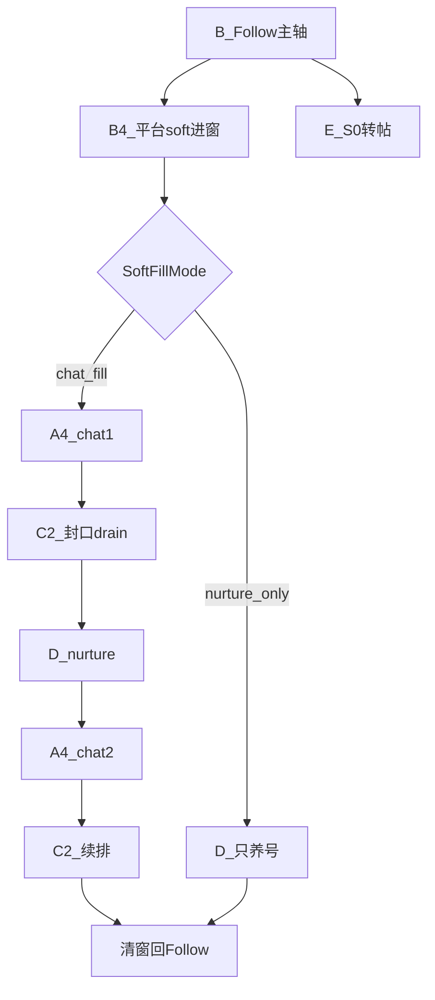

# 智能调度 · 工作手册（业务逻辑 · 分板块细则）

> **基线扩展：4.3.24** · 修订 2026-10-01  
> **先读宪法：** [`智能调度插件技术指导.md`](智能调度插件技术指导.md)（目的、全功能链 ID、少跳页、占用/鉴权/收口）。  
> **本文 =** 按子 ID 的 Why/禁止细则。改码白名单见 [`工作指导.md`](工作指导.md)。  
> **铁律：** 一次只读/改 **一个子 ID**；跨板块必须先改本文 **§X 契约表**，再分两次改代码。

---

## §0 怎么用（防牵一发动全身）

### 0.1 开工五步

```text
1. 定需求场景（例：拒绝后还进 / 软窗谁先跑 / 误发 AD）
2. 打开本文对应子 ID 全节（不要读整章铁律堆）
3. 若跨板块 → 先查/改 §X 契约表
4. 打开工作指导同 ID 白名单 → 只改列出的文件/锚点
5. 按本节「验收」勾完 → 工作指导 §13 记一笔
```

### 0.2 分板块硬规则

| # | 规则 |
|---|------|
| 1 | **不变量在手册对应子节**；工作指导不另起第二套数字 |
| 2 | **一次只改一个子 ID**（A2≠A4；C2≠C3≠C5；B4≠B3） |
| 3 | **禁止**在 A 节写发信/差集细节；**禁止**在 C 节写 coTick priority |
| 4 | 新功能放不进现有子 ID → 先在工作指导 + 本手册新增子节，再写代码 |
| 5 | 行为变更 bump `manifest.json`；纯文档不 bump |

### 0.3 文档分流

| 问什么 | 读哪 |
|--------|------|
| 业务该怎样 / 禁止什么 | **本文对应子 ID** |
| 改哪个文件 | [`工作指导.md`](工作指导.md) 同 ID |
| 接口字段 | [`API_CONTRACT.md`](API_CONTRACT.md) |
| 交付怎么测 | [`交付与检测SOP.md`](交付与检测SOP.md) |
| 历史实现审查 | 调度/私信「逻辑审查」（附录；冲突以本文为准） |

---

## §X 跨板块契约总表

> 只写接口。实现细节在各方子节。新增耦合 = 先加一行再改代码。

| 契约 ID | 从 → 到 | 约定 | 改谁 |
|---------|---------|------|------|
| A1↔C | 时段 → 私信 | dating 08–18；job 10–≥19；过硬停不开私信/不加债 | 时段键 A1/F/H；发信逻辑不改时段 |
| A1↔A5 | 日龄 → 策略 | Day≥3 才允许私信；Day1–2 全路径拒绝 | A1 日龄；A5 策略对象 |
| A2↔A7 | 启停 ↔ 门禁 | 自动模式仅 A2 启停；引擎禁自启 | A7 门禁；A2 coStart |
| A3↔B | S3 让路 | 关注真活时 chat 让路（非软窗脉冲） | A3；勿改 B3 点击 |
| A4↔B4 | 相位 ↔ 进窗 | B4 写窗长/进场；A4 只排 chat1→nurture→chat2；SoftFillMode 决能不能塞私信 | 窗长=B4；相位=A4 |
| A4↔C2 | 时间片 ↔ 队列 | chat1/chat2 **都可**按人状态混发；封口/开人/排序只在 C2 | A4 禁止改队列序 |
| A4↔C | hold | 守箱关时禁止 `soft_risk_hold_chat` 卡死；债下窗 promote | A4 |
| A5↔H3/J | SCRM 闸 | 插件 A5 读闸；strict 默认不放行 | 服务端 H3/J；勿在 C 旁路 |
| B2↔I1 | 号池 | pop/done/dead | B2/I1 |
| B4↔D | 软窗养号 | SoftFill≠chat_fill 或相位 nurture → 只养号 | B4 进场；D 执行 |
| C1↔C2 | 目标库 ↔ 开人 | round/iceSentAt/adSentAt/reject* 为真相；队列镜像 | C1 字段；C2 分类开人 |
| C2↔C3 | 开人 ↔ 检测 | 查回复不靠浅扫；浅扫只登记新粉 | C2 收获；C3 afterIce |
| C3↔C5 | peer → 发送 | peer 空不得 AD；intent=no / 低龄 → C5 记死 skipped | C3 检测；C5 落库 |
| C5↔C8 | 跟进 | 盾牌+催加共 2 步；不按小时等 | C5 发送；C8 读闸 |
| C6↔C9 | PIN ↔ 步进 | 门检出立刻填码；禁止空挂 | C6；C9 步进 |
| C7↔F/H | 话术池 | `chat_script_pool=dating\|job` | F/H 键；C7 读池 |
| F↔引擎 | 阈值 | H 表 → F 映射 → 引擎读 **三处同改** | F+H+对应引擎 |
| E↔A2 | 转帖 | 非私信时段可独占；私信时段硬停 | E；A2 勿在私信时段插 repost |
| K2↔多开 | 媒体/愈 | 默认 media on；Aw Snap recreate | K2 |

---

## §A 调度控制面

### A1 阶段与时段

**职责：** 判定 S0–S4、工作/私信时段、日龄对私信的硬闸。

**现行逻辑：**

- **关注 + 养号：** **全天可跑**（含下班后；不再因「非工作窗」进空 priority 的 S0 静默）。
- **工作时段**默认北京时间 **07:00–23:00 / 06–02**（产品窗）；用于早间渐进等，**不再**作为停关注的硬闸。
- **私信时段：** dating **08:00–18:00**；job **10:00–≥19:00**（OPS end 更早则抬到 19:00）。过硬停：**不开私信、不加债、不赶债**；软风控过点压成只养号。
- **转帖：** **仅非私信时段**可跑；与私信零撞车。开跑后 **独占**（停关注/养号/私信）直到收工，再交回关注/养号。
- **17 点定格：** 禁止主动破冰新粉；对方已来信/未读收养仍可处理（仍须在硬停前）。
- **日龄：** Day1–2 **不进私信**（养号可优先排序，但仍可关注）；**仅 Day≥3** 开私信。闸门须覆盖：S3、软风控进窗、`coStart`、`startChat` 旁路、Force/解卡、A5（禁止只靠 coStart）。
- **S1–S3** 由 `stage-detector` 产出；私信时段 priority **不含** repost（A2 strip）。

**关键键：** `sg_stage_policy`、chatHours、workHours、账号 day。

**禁止：** 在本板块改引擎发送/差集；私信时段插入 repost。

**验收：** 非私信时段无 chat start；私信时段无转帖 start；下班后仍可 follow；Day≤2 Force/只私信被拒。

**耦合：** A1↔C、A1↔A5、A1↔E。

---

### A2 主循环启停

**职责：** ~10s `coTick` 算 priority，**同一时刻只启一个引擎**；发/收指挥租约；超时与幽灵纠正。

**现行逻辑：**

- 叠层顺序：`StageDetector` → stripRepost（仅私信时段剔）→ `applyFollowFirstInS3` → **`applySoftRiskPriority`** → rush/quality → launch（canRun/SCRM/day）。
- **单引擎：** 已有 `sg_module_*.running` 则本 tick 不再 start。
- **转帖独占：** 非私信时段且 `nightRepostShouldRun`（或已在跑）→ 停 follow/chat/nurture，只跑转帖；转完交回。私信时段硬停转帖。
- **工作/私信内：** 关注轮高权利（`applyFollowFirstInS3`）；私信仅软窗填窗内从上到下做完名单再回关注（A4/C2）。
- **指挥租约（CMD）：**
  - CMD-1：只 A2 `coStart`/`coStop`/换令
  - CMD-2：`round_start` → plan/progress → `round_result` → `round_complete`
  - CMD-3：同租约先 seal 再 exec；禁止未执行完 clear；重复 start 同 pulse = keep
  - CMD-4：完成交回 `auto_run=false` + `module.running=false`
  - CMD-5：`sg_chat_last_progress_at` >45s 无刷新 = 假活 → `scheduler.chat_zombie_reclaim`
  - CMD-6：本地 roster = 执行真相；OPS = 镜像
  - CMD-7：`forceInboxPulse` 也必须 `round_start`
  - CMD-8/9：`pulseId` 唯一；同 pulse 只一次 `round_start`
  - CMD-10：diag 冻结拒 `coStart`；面板/`__sgDiagUnfreeze` 解冻
- **废私信长冷却：** 仅显式 `chatNextAllowedAt`；禁止 `chatLastEndAt+55m` 与 25–35 分兜底。
- 会话帽到期停 chat（`scheduler.chat_session_cap`）。
- 远程指令白名单 claim：`start`/`pause`/`reset_profile_media`/`reset_follow_daily_limit`/`reset_chat_local`/`clear_dead_handles`。

**禁止：** 在 coTick 里写 follow 点击 / chat DOM；私信时段插入 repost。

**验收：** 无双引擎抢导航；假活出 reclaim；`round_start`/`round_complete` 可断链；非私信转帖独占、私信时段无转帖。

**耦合：** A2↔A7、E↔A2、A4。

---

### A3 关注优先 / 让路

**职责：** S3 关注置顶；关注真活时 defer chat（非软窗脉冲段）。

**现行逻辑：** `applyFollowFirstInS3`；`shouldDeferChatForFollowCo` — 引擎未活不当真轮。

**禁止：** 改守箱差集（C3）。

**验收：** S3 有关注债时 chat 不抢导航。

**耦合：** A3↔B。

---

### A4 软风控优先级

**职责：** 软窗内排谁跑；**不决定窗长**（窗长在 B4）。

**现行逻辑：**

- Day≥3 且 SoftFillMode=`chat_fill`：窗内 **chat1 → nurture → chat2 → 清窗回 follow**。
- Day1–2 或 SoftFill≠chat_fill：窗内 **只 nurture → follow**（chatDone 直接 true）。
- chat1/chat2 是 **时间片让台**，不是「一段只能破冰、二段才检测」；两段都按每人状态混发；chat2 可 revive 本窗刚破冰待检。
- 近窗尾可 skip nurture 直进 chat2；chat 被 SCRM/预算挡 → `softRiskChatBlockedFallback`。
- **禁止** `soft_risk_hold_chat` / `early_end` 在守箱关时把债卡死在窗外；粉丝队列 chatDone 后应交回关注。
- SoftFillMode（`shared/soft-fill-mode.js`）：`chat_fill` = modules.chat 开 + Day≥3 + 私信时段；`nurture_only` / `off` = 只养号。**SCRM 不参与 SoftFillMode**（只挡 startChat/coTick）。

**关键键：** `softRiskUntil` / `softRiskPhase` / `softRiskMode` / `softRiskChatDone` / `softFillMode`。

**禁止：** 改 `enterSoftRiskDiversion` 窗长随机；改 C2 队列排序。

**验收：** `scheduler.soft_chat_pass` pass=1/2；窗结束 `softRiskPhase===''` 且 `softRiskUntil===0`；`soft_risk_round_end`。

**耦合：** A4↔B4、A4↔C2、A4↔C。

---

### A5 私信策略闸

**职责：** 产出 allowChat 策略对象（SCRM/债/赶工/日龄）。

**现行逻辑：** 读 H3 闸门结果；Day&lt;3 拒绝；不替代服务端 SCRM。

**禁止：** 改 SCRM 爬虫/cookie（J）；在 C 里旁路 A5。

**验收：** `scheduler.chat_blocked` 可解释。

**耦合：** A5↔H3/J、A1↔A5。

---

### A6 时间预算

**职责：** 小时帽；读配置。

**禁止：** 擅自改日帽阈值键名（须走 F↔引擎）。

**耦合：** F↔引擎。

---

### A7 门禁

**职责：** `scheduler-gate` — 自动模式禁引擎自启 / 未授权跳页。

**禁止：** 改引擎 command 业务细节。

**耦合：** A2↔A7。

---

### A8 诊断 whyIdle

**职责：** `computeWhyIdle` / `__sgDiag` 空闲文案与冻结说明。

**禁止：** 改面板 DOM（G1）。

**验收：** 空闲原因可读；diag 冻结可解。

---

## §B 关注引擎

### B1 配额与阶梯

**职责：** 日限、关注间隔阶梯。

**禁止：** 只改本地不改 OPS 键名（须 F↔引擎）。

---

### B2 号池领号

**职责：** `pool_pop` / `pool_done` / `pool_dead`；有未完成任务 startFollow 只恢复不重复 pop。

**禁止：** 在本板块改 coTick。

**耦合：** B2↔I1。

---

### B3 点击关注

**职责：** 按钮识别、已关注多语言、扫描点粉。

**禁止：** 顺手改私信破冰（C2）。

---

### B4 软风控填窗

**职责：** **软风控唯一入口**；写窗长与进场模式。

**现行逻辑：**

1. 仅当点粉过程中出现平台风控条（「暂时不能关注更多用户」等）→ `enterSoftRiskDiversion`。
2. 窗长 **15–17 分钟**（可冰延，有累计帽）；填窗内 **不释放任务锁**。
3. 读 SoftFillMode：`chat_fill` → phase 从 chat1；否则只养号。
4. **禁止**把超时轮转 / 死号 / 列表卡死 / 配额满当成软风控。
5. 自动模式平台 SOFT 必须走填窗，不能只 warmup。
6. 日龄：Day1–2 进窗 `allowChat=false`。

**验收：** `sg-soft-risk-entered`（durationMin 15–17）；Day≤2 mode=nurture。

**耦合：** A4↔B4、B4↔D。

---

### B5 死号填窗

**职责：** 死号跳过填窗计数；**不是**软风控。

**现行逻辑：** 仅真保护号/封禁/不存在 → `pool_dead`。粉丝页「出错了」、入口未挂上、踢回主页 → **加长等待 + 软愈重试**，满次 `pool_fail`/`release`，**禁止**立刻 dead。本地 `matrix_dead_handles` 命中只释放换号，不二次 dead。

**禁止：** 写成 softRisk 入口。

---

### B6 任务锁恢复

**职责：** keepTask；休息后回原博主粉丝列表。

**禁止：** 填窗内误释放锁。

---

### B7 回关检测

**职责：** 回关上报；A2 轻量主动扫通知（默认约 35 分钟）。

**现行逻辑：** follow / chat / **nurture** 任一在跑 → 不主动跳 `/notifications`。行程未到通知页或被拽回后，**8s** 清 `sg_fb_scan_hold`+trip（防养号空转）。

**禁止：** 改 H 效率分析页逻辑。

---

### B8 推博主

**职责：** 推送辅助。

**禁止：** 当成私信 outbound（push 条不属 C2 破冰主路径）。

---

## §C 私信引擎

### C1 目标库

**职责：** `SgTargetDb` — handle → round / iceSentAt / adSentAt / kickCount / rejectSentAt / blockedAt / done。

**现行逻辑：** 本地库为执行真相；与 OPS round **只升不降**（max）。完结：round≥3 或 reject/blocked/done。

**禁止：** 在本板块改调度 priority。

**耦合：** C1↔C2。

---

### C2 破冰 outbound / 粉丝队列

**职责：** 粉丝页登记、灌债、封口、一人一条开人、回 `/followers`。

**现行逻辑（写全）：**

1. **开人路径：** ice/ad/kick **一律**资料页 → `sendDMFromProfile` → step2 → 回 `/followers`。禁止 `openDmConversationDirect`；禁止 `chatGo` `/i/chat|/messages`（守箱关时）。
2. **登记：** 首趟全量触底建台账；之后每软窗 **只回顶一屏浅扫**即封口；同 `softRiskUntil` **禁止清队重扫**（复用登记+灌债）。Force 可清台账重做全量首扫。
3. **灌债：** `seedUnfinishedFanDebtToQueue` 只灌 ad/kick/deferred；纯新粉只靠列表 harvest；债 **不要求** ∩ `dan_session_scanned`。
4. **分类 `classifyFanRosterAction`：** reject 库 / rejectSentAt / blockedAt / done / round≥3 / kick 满 → **skipped**；eff0 → ice；eff1 → need_ad 或 wait_reply（仅本软窗刚破冰）或 need_probe；eff2 → kick。
5. **封口前定序（4.3.20）：** `sortIceQueueForDrain`：`kick` → `ad` → `ice`，同 kind 按 `createdAt`。路径含 `prepareAndSealIceQueue`、`chat1_reuse_window`、`prepareSoftRiskChat2Queue`。
6. **封口后：** 禁止 harvest / 禁止「浅扫：回顶」；只 `iceQueueNextPending` 逐条。有 **doing** 只续此人；`startIceTask` 拒开第二人并 toast「等人 @x 完成」。
7. **跳过门闩（4.3.20）：** `job_intent_no` / `age_reject` / reject / blocked / `they_blocked_us` / `no_dm` 等 **永不可 promote** 回 pending；开人前复核 `classify` ≠ pending 则 mark 后 return。
8. **一窗一人一条：** 每人目标库 round 独立；无全队齐步「第几轮」；每窗每人最多一条成功发送。
9. **发出即本地计数：** UI 确认成功必须推进 round/iceSentAt 并队列终态；OPS `dm/record` 失败只告警，禁止连环重发。
10. **查回复 ≠ 浅扫：** 已破冰/AD/kick 从库灌队开人，不为检测再浅扫。
11. **target_mismatch：** 粉丝队列有对方文本则忽略 mismatch 继续；无对方文本 → deferred。
12. **17 点定格：** 不破冰新粉（债仍可清）。
13. **台账（4.3.28）：** 每人一行 `handle/displayName/round/queueStatus/blocked/blockReason…`；真源=`chat_target_db`+`dan_ice_task_queue`；视图=`buildFanLedgerSnapshot`；开人只认 `pending`。封口同步 `POST /api/plugin/dm/roster`（失败不挡本地）。诊断：`__sgFanLedgerSnapshot()`。
14. **关注者对账（4.3.28）：** 读本号「关注者」数（多语言+followers 链接，排除 Following）；baseline 记 `followerCount`；全量封口比较 `profileFollowers↔cellsSeen↔queueTotal`；缺口同窗再滚一趟（仅一次），不自动 Force。浅扫只记 `expectedNew`，不以 F≈cellsSeen 硬对齐。
15. **屏蔽/无 DM（4.3.28）：** step1 多语言「已屏蔽你」→ 立刻 `they_blocked_us`+skipped；保护号多语言；无 DM 等 2 拍→`no_dm`。文案检测统一 `CHAT_I18N`（简中/繁中/英/日），优先 `data-testid`。

**关键键：** `dan_ice_task_queue`（sealed/items）、`dan_session_scanned`、台账 baseline（含 `followerCount`）、`current_target`、`dan_auto_step`。

**禁止：** 收件箱 DOM 识别（C3）；改 PIN（C6）；`setUserRound(0)` 清破冰态；单语文案检测。

**验收：** 封口后日志 `@a 完成 → @b 开始`；无第二人插入 doing；同软窗无第二次「浅扫：回顶」；やらない 后下窗无 startIceTask；`__sgFanLedgerSnapshot` 含 blocked；「已屏蔽你」/blocked you 立刻 skipped；主页关注者对齐或有 gap。

**耦合：** C2↔C3、C1↔C2、A4↔C2。

**反例：** 未封口反复 harvest 导致 CPU 100%；婉拒未写 skipped 导致反复 need_probe。

---

### C3 回复扫描 / 差集

**职责：** 判定「破冰后对方说了什么」；守箱列表 pick（默认关）。

**现行逻辑：**

1. **三层硬门：** 谁说的 = 正文∩话术池；几轮 = 时间戳；检测窗口 = **最后我方正文之后的对方正文**（`collectPeerTextsAfterIceTurn`）。
2. **有我方破冰**（DOM 话术或 `iceSentAt`）→ `collectPeerDmMessages` **只返回 afterIce**，禁止回落宽扫历史灰泡（修「はなそーん」误 AD）。
3. 链接壳 / 话术壳 ≠ 对方回复。
4. **默认停用蓝点守箱**；仅 `chat_inbox_watch_enabled=true` 恢复。守箱开时短扫：未读 → 强回复 → 仅无 1/2 才探测（见 [`私信短扫优先级.md`](私信短扫优先级.md)）。
5. 排障先拉 OPS `chat.session_verdict` / 队列 seal 事件（[`私信回扫读错SOP.md`](私信回扫读错SOP.md)）。

**禁止：** 关注点击；为「查回复」要求 C2 再浅扫。

**验收：** 破冰+「やる」→ peer 含やる；破冰前灰泡+破冰 → peer 空或仅破冰后；无 afterIce → 不得当有回复。

**耦合：** C3↔C5、C2↔C3。

---

### C4 年龄分流

**职责：** 仅解析年龄数字/口语/明示未成年→低龄数值。

**现行逻辑：** 认 `24です`/`だよ`；明示「未成年」等 → 低龄。**废除**模糊词（若い等）关键词婉拒。

**禁止：** 在本文件做发送/婉拒落库（属 C5）。

**耦合：** C4 输出给 C5 dating 分支。

---

### C5 广告 / 婉拒发送

**职责：** 在已有 peer 证据后决定发 AD / 婉拒 / 盾牌 / 催加；发送确认；拒绝落库。

**现行逻辑：**

1. **无 peer → 不发 AD**（`canSendAdNow` reason `no_peer_texts`）→ deferred。
2. **dating：** 有回复无年龄 → 发 AD；明确 &lt;25 → 婉拒不发 AD；废除 need_age 追问。
3. **job：** 有回复且非明显拒绝 → 发完整话术；`parseJobIntent=no`（やらない等）→ 婉拒；年龄不挡；unknown 含蓄寒暄也发 AD（但必须有 peer）。
4. **拒绝落库优先气泡确认（4.3.20）：** job `intent=no` 或 dating 低龄婉拒，**无论** `threadSafeSendAndConfirm` 是否 ok，都必须：`markAgeRejected`（或等价 rejectSentAt/blockedAt）+ `dan_reject_users` + `iceQueueMark(skipped, job_intent_no|age_reject)` + `finishTargetVisit({queueStatus:'skipped'})`。禁止空 `finishTargetVisit()`。
5. **AD 后两步：** kickCount0=盾牌 `kick_message` → 下一软窗 kickCount1=催加 `final_kick_message` → 满 2 完结。**废除**催加≤4 与按小时等（`chat_kick_min_hours` 忽略）。
6. **发送三态：** can_send / hard_closed（永久 skipped）/ pending（仅 deferred，禁止「找不到框」永久杀）。
7. hard_closed → 拉黑跳过；UI 确认成功必本地计数。

**禁止：** PIN 填框逻辑；自己宽扫历史灰泡当 peer。

**验收：** やらない → 本趟 skipped，下窗零点进；やる → 只发 AD；无新回复 → deferred 无 AD。

**耦合：** C3↔C5、C5↔C8。

---

### C6 DM Passcode

**职责：** 固定码 **2546**（`chat_dm_pin` 可覆盖）；门检出立刻填入。

**禁止：** 空挂「暂不识别轮次」；改守箱排序。

**耦合：** C6↔C9。

---

### C7 话术与链接

**职责：** 话术池 / DNA；`chat_script_pool=dating|job`；推广链 `{LINK}`。

**现行逻辑：** job 破冰指定性二选一（やる／やらない）；完整话术在愿意或非拒绝回复后发。链接壳回显不算 peer。

**禁止：** 先改 OPS 交友池结构再改本地键（先 H/F）。

**耦合：** C7↔F/H。

---

### C8 冷却与日轮

**职责：** 读间隔/日帽配置；配合 C5 跟进闸。

**现行逻辑：** 盾牌/催加不按小时等；长冷却已废（见 A2）。

**禁止：** 写死与 OPS 冲突的魔法数。

---

### C9 主巡航引擎

**职责：** `dan_auto_step` 步进；粉丝队列相位 outbound；回退路径。

**现行逻辑：**

- 守箱关：不得因 `/i/chat` URL 默认 phase=inbox；禁止在 Messages 武装 step2。
- 回退：**原路 `chatGo(/followers)`**；禁止点左上角落到 `/i/chat` 列表。
- 开人前若在旧 DM → 先离会话再开下一人。
- 误落收件箱空壳 → 立刻回 `/followers`。

**禁止：** 改完不回归 C3/C6。

**验收：** 全程无意外进 `/i/chat`（守箱关）。

---

### C10 诊断桥

**职责：** `debugTraceReplyChain` / `__sg*` 排障；**不改变**生产发送语义。

**禁止：** 在诊断路径偷偷改 round/队列。

---

## §D 养号

### D1 引擎

**职责：** 刷首页点赞评论等动作执行；软窗 nurture 相位由 A4/B4 拉起。

**禁止：** 自启抢导航（A7）；评论失败粉红条乱计数。

### D2 预算

**职责：** 日/时预算（`nurture-tracker` / config）。

### D3 评论库

**职责：** 文案池；Lexical 写入须读回校验。

---

## §E 转帖

### E1 执行

**职责：** `repost-engine` 发帖路径。

### E2 日程

**职责：** 默认 **06:00** 开跑（不跟随下班）；Day1–4 每天 2 条、Day≥5 每天 1 条；成功间隔 ≥30 分钟；已发 ID 不重复。开跑点 &lt; 上班点时仅 `[开跑,上班)` 算已到点。

### E3 资料克隆

**职责：** Day≤2 养号前置；未完成调度让路；挂 `startNurture` 闸。

### E4 浮层

**职责：** 粉色球面板；勿再装独立 X Repost Engine。

**禁止（E 总体）：** 私信时段跑转帖；与 chat 抢导航。

**耦合：** E↔A2。

---

## §F 配置同步

### F1 config-sync

拉 `/api/config/all` → localStorage。

### F2 remote-settings

统一读阈值。

### F3 storage-keys

键名唯一来源。

### F4 config.js

本地默认。

**铁律：** 改阈值键 = **H + F + 引擎读** 三处同 PR。

常用键：`chat_dm_pin` · `chat_script_pool` · `chat_cooldown_*` · `chat_rounds_per_day` · `scrm_gate_*` · `follow_*` · `sg_stage_policy` · `media_load_mode`。

---

## §G 面板与观测

| 子 ID | 职责 |
|-------|------|
| G1 | 调度面板主控 — 改文案≠改状态机 |
| G2 | 中控台（悬浮球停用） |
| G3 | telemetry 上报 |
| G4 | test-monitor |
| G5 | event-catalog 中文目录 — 事件 ID 变更同步 H 告警 |
| G6 | page-diag-bridge |
| G7 | obs SOP / 验收记录 |

---

## §H OPS 后台

| 子 ID | 职责 |
|-------|------|
| H1 | 配置/阶段/模块 API |
| H2 | 插件心跳、DM、telemetry |
| H3 | **私信闸门** — 默认 **strict**：无监控号/未找到/过期/离线 → 不放行私信 |
| H4 | 推广链 ↔ 客服号 |
| H5 | 监控/运行日志 |
| H6 | 效率分析 |
| H7 | 页面 njk |
| H8 | migrations |

远程指令白名单同 A2；新命令 = OPS 三处 + A2 claim + 账号页按钮。

---

## §I 号池 · §J SCRM · §K 自愈

### I1

`:15678` pool_pop/done/dead。

### J1 / J2

SCRM 爬虫 cookie；扩展同步。`agentIds` 必须与 OPS `promo_links` 同客服号，禁残留 `@test`。

### K1

CF ChallengeGuard。

### K2

多开错峰 purge；默认 **`media_load_mode=on`**（auto 亦 on；仅显式 off 禁重媒体）；Aw Snap（含日文エラー）SW recreate；无冷启动 4min idle；S0 转帖 +0–15min 抖动。详见 [`多开网络SOP.md`](多开网络SOP.md)。

---

## §L 文档工程与新功能模板

### L1 维护规则

- 业务规则变更 → **先改本文对应子 ID**，再改代码，再工作指导 §13。
- 审查/SOP 不得另起冲突数字；文首必须指向本文。
- 模块化冻结：不主动继续拆巨石（工作指导 §11）。

### L2 新功能模板（复制到 PR / 对话开头）

```text
【子板块】（唯一主 ID，例 C5）
【契约】若跨板块：§X 新增/已有契约 ID =
【不变量】本子节哪些条款受影响 =
【禁止】不会改的子 ID =
【验收】事件/日志/现场 =
【工作指导 §13】将写：
```

### L3 提交前

- [ ] 已读手册该子 ID 全节  
- [ ] 已读工作指导同 ID 白名单  
- [ ] 未改「禁止顺手改」  
- [ ] 跨板块已先改 §X  
- [ ] 行为变更已 bump manifest  
- [ ] §13 已记  

---

## 附录 · 反例索引（按子 ID）

| 子 ID | 反例 | 正确行为 |
|-------|------|----------|
| A2 | 裸 auto_run 当活 | 看 progress 心跳；超时 reclaim |
| A4 | chat1 只破冰、chat2 才检测 | 两段都按人状态混发 |
| A4 | soft_risk_hold_chat 卡死 | 守箱关应交回关注 |
| B4 | 超时/死号当软风控 | 仅平台 soft 条进窗 |
| C2 | 封口后再浅扫回顶 | sealed 只 drain |
| C2 | promote 抬回 reject | 永久 skipped |
| C2 | 直跳 /i/chat | 资料页进 DM |
| C3 | 歴史灰泡当破冰后回复 | 只认 afterIce |
| C5 | 婉拒 no_bubble 不写 skipped | 仍 markAgeRejected+skipped |
| C5 | 无 peer 发 AD | deferred |
| C9 | 回退进 Messages 列表 | chatGo(/followers) |

---

## 附录 · 端到端鸟瞰（只读，改逻辑仍回子节）



目标 round（每人独立）：

```text
0 破冰 → 1 查回/AD或婉拒 → 2 盾牌或催加 → 3 完结
拒绝/拉黑/hard_closed → 直接完结 skipped（不再进）
```
