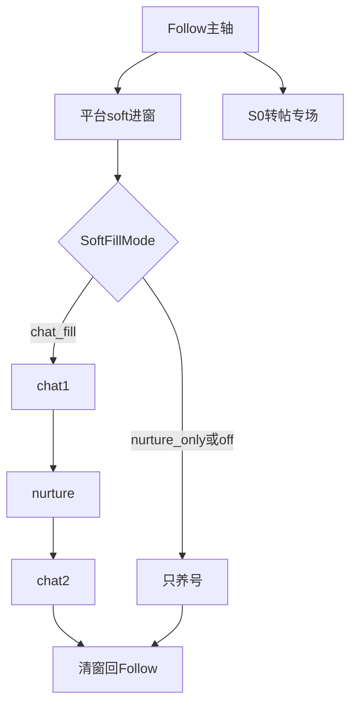

# 调度模块工作制度与逻辑审查

> **【附录】** 现行业务逻辑以 [`调度工作手册.md`](调度工作手册.md) **§A / §X / §B4** 为准（基线 **4.3.20**）。本文为历史 As-Is 实现审查；**数字/规则冲突时以手册对应子 ID 为准**（例：kick 满 2 完结，非旧文「≤4」）。  
> 相关：[工作指导.md](工作指导.md) §3 A · §4 B4 · [私信模块逻辑审查.md](私信模块逻辑审查.md) · [RUNTIME.md](RUNTIME.md)

> ~~旧基线扩展：4.2.31~~（SoftFillMode 能力闸 + 关注主轴 + 软窗五段 / nurture-only）  
> 原则：改调度前必读**手册 §A**；**一次只动 A2 / A3 / A4 之一**；A4 不改 B4 分流；阈值 OPS(H)+F+引擎三处同改。

---

## 0. 指挥租约与逻辑链条（4.0.24+ · 不可妥协）

**一句话：** A2 发租约；C3 同租约内 `scanning → sealed → executing → done`；判活看 **进度心跳** 不看裸 `auto_run`；密封名单禁清；每环 OPS 可断链定位。

### 0.1 铁律

| 编号 | 内容 |
|------|------|
| CMD-1 | 调度唯一指挥：只 A2 `coStart`/`coStop`/换令 |
| CMD-2 | 每租约必有 `round_start` → `round_plan`(守箱) → `progress*` → `round_result` → 指挥 `round_complete` |
| CMD-3 | 同租约先 seal 名单再 exec；**禁止**未执行完 clear；重复 start 同 pulse = keep |
| CMD-4 | 完成交回：`auto_run=false` + `module.running=false` |
| CMD-5 | `sg_chat_last_progress_at` 超过 45s 无刷新 = 假活 → `scheduler.chat_zombie_reclaim`（未读未解不烧 chatDone） |
| CMD-6 | 本地 roster = 执行真相；OPS = 镜像 |
| CMD-7 | 强制扫箱（`forceInboxPulse`）不经 `coStart` 时也必须发 `scheduler.round_start`（`via=forceInboxPulse`） |
| CMD-8 | 同租约 `pulseId` 唯一：`coStart` 写入 `dan_inbox_queue_pulse`；`force_new_lease` 清队列不清指挥 pulse；`beginChatLease` 优先租约 id |
| CMD-9 | 同 `pulseId` 只发一次 `scheduler.round_start`（`SgTelemetry.emitRoundStart`）；清租约时清去重键 |
| CMD-10 | 诊断冻结：阶段动作契约违背或假活 → `diag_anomaly` + 冻结拒 `coStart`；面板/ `__sgDiagUnfreeze` 解冻；正常时长帽打断不冻 |

### 0.2 守箱相位

`scanning`（登记下滑）→ `sealed`（写 plan）→ `executing`（逐条开人）→ `done`（交回）。

### 0.3 OPS 断链口诀

- 有 `scheduler.round_start` 无 `chat.round_plan` → 断在 scanning  
- 有 plan 无 `inbox_open`/`round_progress` → 断在 executing  
- 有 progress 无 `chat.round_result` → 断在交回  
- 有 result 无下一 start/换模块 → 断在指挥  
- 长期 auto 无 progress → 假活（应出 reclaim）

### 0.4 日志与后台（4.0.25）

- 插件：`round_*` / `zombie_reclaim` 目录 `upload:true`；遥测优先出队 + ~200ms flush  
- 强制脉冲：`via=forceInboxPulse` 的 `round_start`  
- OPS：`GET /api/monitor/logs/command-loop?account=&hours=6`；监控页「日志」Tab 预设「指挥闭环」  
- 假活：30 分钟内 ≥2 次 `chat_zombie_reclaim` 可 PushPlus  

---

## 1. 角色与职责（谁管什么）

| 角色 | 文件 / 锚点 | 制度职责 | 禁止越权 |
|------|-------------|----------|----------|
| A1 阶段 | `scheduler/stage-detector.js` | S0–S4、是否私信/工作时段 | 引擎发送逻辑 |
| A2 主循环 | `scheduler-core.js` `coTick` / `coStart*` | ~10s 算 priority、启停**单**引擎、超时、幽灵纠正、会话帽停 chat | follow 点击 / chat DOM |
| A3 关注优先 | `applyFollowFirstInS3` · `shouldDeferChatForFollowCo` | S3 关注置顶；关注**真活**时 chat 让路 | 守箱差集 |
| A4 软风控优先 | `applySoftRiskPriority` · `markSoftRiskChatPass*` · **`SgSoftFillMode`** | 窗内五段或只养号；`SoftFillMode` 统一 day/时段/modules.chat | 窗长随机（在 B4） |
| A5 策略闸 | `scheduler/chat-strategy.js` | allowChat 策略对象 | SCRM 服务端（H/J） |
| A6 预算 | `scheduler/time-budget.js` | 小时帽 | 日帽阈值键（F/H） |
| A7 门禁 | `shared/scheduler-gate.js` | 自动模式禁自启乱跳 | 引擎 command 细节 |
| B4 填窗入口 | `follow/soft-risk.js` `enterSoftRiskDiversion` | SOFT 写入窗字段；读 **SoftFillMode**；停 follow keepTask | C3 差集识别 |
| SoftFillMode | `shared/soft-fill-mode.js` | `off` / `nurture_only` / `chat_fill`（SCRM 不参与） | 相位推进细节（在 A4） |
| 进箱 URL | `resolveChatStartUrl` | chat 落粉丝页队列（守箱默认关） | 会话内 round 路由（C9） |
| C3 脉冲扫描 | `inbox-watch.js` + `content_chat` | 守箱开时脉冲扫/开 | 「该不该轮到 chat」（属 A） |

**一句话：** A 决定「现在跑谁」；B4 决定「何时进入软风控窗」；C 决定「进箱后怎么干活」；**SoftFillMode 决定软窗能不能塞私信**。

---

## 2. 白天工作节奏（As-Is 闭环 · 4.2.31）

```text
1. 未满配额：Follow 主轴（S1–S3；S3 关注优先）
2. 平台 soft_* 蓝条 → enterSoftRiskDiversion（窗长 15–17m，可冰延/加班有帽）
   - SoftFillMode = SgSoftFillMode.resolve()：
     · chat_fill：modules.chat 开 + Day≥3 + 私信时段 → softRiskMode=chat_nurture_chat，phase=chat1
     · nurture_only / off：只养号 → softRiskMode=nurture，phase=nurture，chatDone=true
   - SCRM 不参与 SoftFillMode（只挡 startChat / coTick 启动）
3. SoftFillMode=chat_fill 时窗内五段：
   chat1（粉丝队列混发）→ nurture → chat2 → 清窗回 Follow
   - 近窗尾可 skip nurture 直进 chat2；chat 被 SCRM/预算挡 → softRiskChatBlockedFallback
4. SoftFillMode≠chat_fill：窗内 priority=['nurture'] → 闹钟到清窗回 Follow
5. HARD / 冻结：停模块，不是「关注专用窗」
6. S0：转帖专场（白天 priority 不含 repost）
```



### SoftFillMode

| mode | 条件 | 软窗行为 |
|------|------|----------|
| `chat_fill` | `modules.chat` 开 + Day≥3 + 私信时段 | chat1→nurture→chat2 |
| `nurture_only` | Day&lt;3 或非私信时段或 sticky `softRiskMode=nurture` | 只养号 |
| `off` | `modules.chat=false` | 只养号（产品关私信） |

### coTick priority 叠层

`StageDetector` → `stripRepost` → `applyFollowFirstInS3` → **`applySoftRiskPriority`（读 SoftFillMode）** → rush → quality → launch（canRun / SCRM / day）

---

## 3. 互斥与门禁

| 规则 | 说明 |
|------|------|
| 单引擎 | 同 tick 已有 running 则不再 start |
| 填窗禁 follow | `softRiskActive` 期间禁止 start follow |
| chat 让路 | 关注真活且非软风控脉冲窗 → defer；引擎未活不当真轮 |
| 会话帽 | 打开次数或墙钟到期 → 停 chat（`scheduler.chat_session_cap`） |
| chat 附加闸 | 策略、日帽、冷却、小时预算、SCRM |
| 白天 repost | 不跑；S0 夜场专场 |

---

## 4. 进箱铁律（4.2.x · 守箱默认关）

默认**粉丝队列**开人（资料→DM→回 `/followers`），**不进** `/i/chat` 列表。

进 `/i/chat` **仅当**显式打开守箱（`chat_inbox_watch_enabled`）且相位需要。

软窗 chat 段：`SoftFillMode=chat_fill` 时 priority=`['chat']`，落粉丝页混发 ice/ad/kick；被 SCRM/预算挡走 `softRiskChatBlockedFallback`。

**禁止：** 超时/死号/配额满冒充软风控；`SoftFillMode≠chat_fill` 时启动 chat。

---

## 5. 关键旗标与遥测

| 键 / 事件 | 含义 |
|-----------|------|
| `softRiskUntil/Mode/Phase/Pass/ChatDone` | 软窗五段；Mode=`chat_nurture_chat` 或 `nurture` |
| `softFillMode` | 进窗快照：`off` / `nurture_only` / `chat_fill` |
| `SgSoftFillMode.resolve` | 能力闸（modules.chat + Day + 私信时段） |
| `scheduler.soft_chat_pass` | chat1/chat2 推进 |
| `scheduler.soft_risk_chat_blocked_fallback` | 软窗私信被挡回退 |
| `scheduler.soft_risk_round_end` | 清窗回关注 |
| `scheduler.follow_idle_recover` / `ghost_*` | 空转/假活 |
| `sg_chat_lease` / `sg_chat_last_progress_at` | 指挥租约 + 进度心跳 |
| `scheduler.round_start` / `round_complete` | 指挥发令 / 收工 |
| `chat.round_plan` / `round_progress` / `round_result` | 守箱计划 / 逐条 / 交回（守箱开时） |
| `scheduler.chat_zombie_reclaim` | 进度超时回收假活 |

---

## 6. 旧半开环 vs 闭环

| 维度 | 3.7.66 半开环 | **3.7.67 闭环** |
|------|---------------|-----------------|
| hold | 裸 replyPending 可占满窗 | 仅可行动债 + N/T |
| 窗外进箱 | 裸 waiting 可进 | 禁止；仅 confirmed/kick |
| 满配额有债 | 直接 nurture | 未触帽则 hold chat |
| 空跳 | early_end↔waiting 再进箱 | 干等不进箱 |

历史断点 L1–L5（裸 hold / 空跳 / 满配额 nurture / 双轨窗语义 / 双时钟）在 3.7.67 以进箱与 hold 规则关闭；SOFT≈55min 冷却仍只约束「再进 SOFT」，与窗外短打断并存（有意：打断短、SOFT 稀）。

---

## 7. 改调度纪律

1. 读本文 §1–§4 + 工作指导 A/B4  
2. 一次只动 A2 / A3 / A4 之一  
3. A4 不写窗长随机；B4 不改 C3  
4. 阈值三处同改；跨板块先 §13  
5. 验收 §8  

---

## 8. 回归矩阵

| 场景 | 期望 |
|------|------|
| SOFT 开窗 | 先 `/followers` 扫粉破冰，pending=0 触底后再 `/i/chat` |
| 破冰完成闸 | 触底×2 无 loader → `soft_outbound_done`；库内残留 pending 只报 `outbound_pending_residual` |
| 破冰顺延 | 距到期不足 90s 且未 outboundDone → `soft_ice_extend`（累计不超过 +30m） |
| 无未读无 kick | 扫箱完 early_end → 稳定 Follow；无 `inbox` 因干等 |
| 有 confirmed 回复 | SOFT 内 ≤5 开或 4min → early_end |
| kick 窗外 | 短打断 ≤2 开/2min → Follow |
| 满配额仍有 kick | hold chat，不直接 nurture |
| 裸 waiting | 可出现 `inbox_denied_waiting`；不进箱 |
| 幽灵假活 | 扫箱段卡粉丝页才清旗重拉 inbox |
| 进度假活 | `/i/chat` 上 auto=true 但 45s 无 progress → reclaim，不永占 hasRun |
| 密封名单 | executing 中重复 start 不得 `task_queue_cleared` 吞 pending |

---

## 9. 变更指针

| 版本 | 主题 |
|------|------|
| 3.7.47–66 | 幽灵 / 占空比 / hold 半开环 |
| **3.7.67** | **调度闭环**：可行动进箱、有界 drain、满配额有债优先 chat |
| **3.7.68** | QA：打断帽仅收箱；actionableAd 对齐 replySeenAt |
| **4.0.0** | 大版本升格：manifest 描述「关注主轴 · 私信闭环调度」；制度基线 4.0.0 |
| **4.0.1** | 破冰选人不依赖推广链 |
| **4.0.2** | 软风控填窗：破冰→扫箱→养号；`softRiskOutboundDone` |
| **4.0.3** | 破冰不固定掐时：扫完新粉再转扫箱；会话帽延后到扫箱段 |
| **4.0.4** | 破冰防漏扫：pending=0 才转扫箱；timeout 续滚；不删 UserCell；软窗顺延 |
| **4.0.24** | **指挥租约**：相位机 + 进度心跳判活 + 密封名单 + OPS round_* 断链 |

## 附录 · 已关闭的半开环断点

| ID | 原断点 | 关闭于 |
|----|--------|--------|
| L1 | 裸 replyPending hold | 3.7.67 |
| L2 | early_end 后裸 waiting 再进箱 | 3.7.67 |
| L3 | 满配额有债 → nurture | 3.7.67 |
| L4 | 脉冲后进箱语义 | 文档+hold 可行动 |
| L5 | 双时钟 | 保留 SOFT 稀 + 打断短（有意） |
